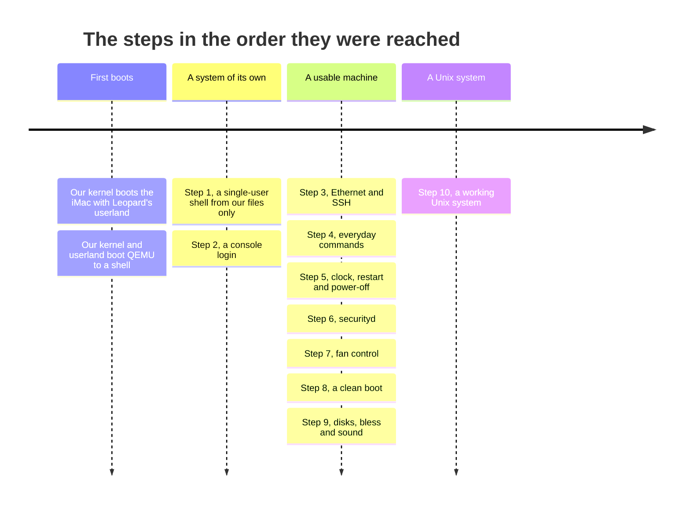

# Start here

PowerDarwin builds Darwin 9.8, the open core of Mac OS X 10.5.8 Leopard (build `9L30`), for PowerPC Macs, from the sources Apple published, and boots it. Every file on its disk image is built from source by the project or written by its scripts; nothing is copied from Apple's own installation of Leopard.

This book explains how, for a reader who knows Unix but has never worked on Darwin, Mac OS X's internals, PowerPC Macs, firmware or drivers. It explains each of those where it first matters, and again in the [glossary](reference/glossary.md).

## What has been done

The work is split into steps, each with a goal that can be checked on a running machine. Two machines check them: QEMU's `mac99`, an emulated G4 Power Mac that anyone can run, and an iMac G5 (`PowerMac12,1`), a real Mac used as the reference.

Steps 1 to 10 are reached; Step 9 lacks FireWire and the microphone, and its CDs were tested in QEMU only. The image boots to a login prompt, brings up Ethernet and takes SSH logins, runs everyday commands, keeps the time, restarts and switches off, runs securityd, drives the iMac's fans as quietly as Leopard does, and boots with nothing in its log but what Apple's own files or the missing closed parts cause. It also mounts its disks and USB keys as they appear, makes a partition the startup disk with bless, and plays sound. It compiles and links C and C++ programs with the release's own compilers, built from source, runs Perl, Python and Ruby, and shares a folder with another Mac through Samba. Step 11 (booting from a USB key) is defined.

## What makes it different

Apple's last bootable Darwin was 8.0.1, in 2005; after that, Apple published sources only. The earlier Darwin 9 builds we know of either target Intel Macs or stop before a bootable system ([the history](background/history.md)). This project:

- builds every file on the image from Apple's published sources, at the exact versions of Mac OS X 10.5.8;
- changes those sources as little as possible, and lists every change with its reason;
- writes open drivers where Apple's are closed and the system cannot do without them, such as [OpenSMU](synthesis/opensmu.md) for the iMac G5's system management unit;
- keeps the scripts that repeat the build.

## How the book is organised

- **Background**: what Darwin is, its history, the hardware and boot ideas the rest of the book uses, PowerPC Macs and QEMU, and the boot chain from power-on to `login:`.
- **Method**: where the sources come from, how darwinbuild builds them, the project's rules, how the disk image is made, and how it is tested.
- **The steps**: one chapter per step, two for Steps 1 and 3, each with its goal, what was built, what broke, how it was fixed, and how the step was proved.
- **Synthesis**: the kinds of change the project had to make, OpenSMU in full, and what stays closed.
- **Reference**: the glossary and indexes of deviations, projects and commits.

## Three ways to read it

- To understand what was done: Background, then the steps in order.
- To rebuild the image: Method, then the step chapters for the projects each one adds.
- To build another Darwin, or for another Mac: Synthesis, then the step chapters it points to.

## Conventions

- "Our" before a name means built by this project from Apple's source: "our kernel" is xnu built here, "Apple's kernel" the one Leopard ships. "Ours" as a label, in tables and diagrams, means code the project wrote itself, such as OpenSMU.
- A deviation is any change from Apple's sources or build. Each has an ID, such as [D81](https://github.com/nyg/PowerDarwin/blob/master/DEVIATIONS.md#d81), and a row in [DEVIATIONS.md](https://github.com/nyg/PowerDarwin/blob/master/DEVIATIONS.md).
- Commands, files and log lines are in `code`, and log lines are quoted exactly.
- Each chapter starts with what you will learn and ends with where to look in the repo.

PowerDarwin is an independent project, not affiliated with, endorsed or sponsored by Apple Inc. Apple, Mac, Mac OS, iMac and Power Mac are trademarks of Apple Inc., and PowerPC is a trademark of IBM; the other names belong to their owners.
