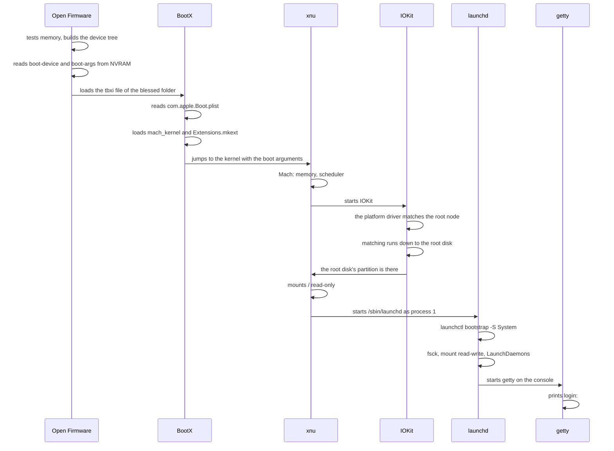

# From power-on to login: the boot chain

## What you will learn

- What Open Firmware does at power-on: its Forth prompt, its NVRAM variables such as `boot-device` and `boot-args`, and the device paths it boots from, such as `sata/k2-sata@0/@0:4,\\:tbxi`.
- How the disk is laid out: the Apple Partition Map, the HFS+ volume, and the blessed folder in which Open Firmware finds BootX by its file type, `tbxi`.
- What BootX loads, and how xnu starts, matches its drivers and finds its root disk, or waits for it ("Still waiting for root device").
- Which kexts go into the driver cache, and why `OSBundleRequired` and `Safe Boot` decide it.
- How launchd starts a single-user shell or the multi-user system, and how getty and login lead to the `login:` prompt and a shell.

## The whole chain

Booting a PowerPC Mac with Darwin 9 is a relay, each stage loading or starting the next and then handing over; IOKit, part of the kernel, is drawn on its own:



The same chain runs on the iMac G5 (`PowerMac12,1`) and in QEMU's `mac99`. Only the first link differs: the iMac runs Apple's Open Firmware, QEMU runs OpenBIOS. [Hardware and boot basics](hardware-basics.md) explains the general ideas: the reset vector, firmware, boot loaders and the kernel's first steps. This chapter follows Darwin 9's own chain.

## Open Firmware

### The firmware of PowerPC Macs

Open Firmware is a firmware standard, IEEE 1275-1994, which Apple's PCI-based Power Macs and every later PowerPC Mac run ([TN1061](https://developer.apple.com/legacy/library/technotes/tn/tn1061.html)). At power-on it tests the memory, walks the buses, builds the device tree, and then boots: it reads its settings from NVRAM, loads the boot loader named there and starts it.

Its language is Forth, a small stack-based language: words separated by spaces, numbers pushed on a stack, and words that take their arguments from it. Device drivers in the expansion cards' ROMs are Forth too, compiled to FCode, so that one card works in any Open Firmware machine.

### Its prompt

Holding Command-Option-O-F at power-on stops Open Firmware before it boots, at its prompt ([TN2001](https://developer.apple.com/legacy/mac/library/technotes/tn/tn2001.html)). The prompt is `0 >`: the number is the depth of Forth's stack, and Open Firmware writes `ok` after each line it has run. In TN1061's first example, `5 7 + .s` pushes 5 and 7, adds them, and shows the stack, `12`, after which the prompt reads `1 >`: one number is left on the stack. A few words do most of the work:

| Word | Does |
|---|---|
| `printenv` | lists the NVRAM variables, each with its value and its default |
| `setenv boot-args -v -s` | sets a variable; it is kept in NVRAM across restarts |
| `devalias` | lists the short names for device paths, such as `hd` and `sata` |
| `dev /` then `ls` | selects a node of the device tree and lists the nodes below it |
| `.properties` | prints the selected node's properties |
| `boot` | boots from `boot-device`, or from the device path given after it |
| `reset-all` | restarts the machine |

Apple's [TN1061](https://developer.apple.com/legacy/library/technotes/tn/tn1061.html) introduces the prompt, Forth and the device tree at greater length.

Open Firmware's prompt is the most direct way to start a system it would not start by itself. The first boot of the image on the iMac was made from it, with two lines:

```text
setenv boot-args -v -s
boot sata/k2-sata@0/@0:4,\\:tbxi
```

### NVRAM variables

Open Firmware keeps its settings in NVRAM, in its own partition beside the classic Mac OS's PRAM. Under Darwin, `nvram -p` prints them. The ones that matter for booting:

| Variable | Holds |
|---|---|
| `boot-device` | where to boot from, as a device path; `bless` sets it |
| `boot-args` | the kernel's arguments, which BootX passes on |
| `auto-boot?` | `true` to boot at power-on, `false` to stop at the prompt |
| `boot-command` | the Forth to run when it boots: `mac-boot` on the iMac |

`boot-args` is where the image's boot tests put `-v` and `-s` (see [Boot arguments](#boot-arguments) below).

### Device paths

A device path names one device by its place in the device tree, as a file path names a file, and Open Firmware can add a partition and a file after it. The path that booted the iMac, piece by piece:

| Part | Means |
|---|---|
| `sata` | a device alias, Open Firmware's short name for the K2's SATA controller, the `k2-sata-root` node; `devalias` lists the aliases |
| `/k2-sata@0` | the controller's first port |
| `/@0` | the disk on that port |
| `:4` | partition 4 of the disk |
| `,\\` | on that partition's HFS+ volume, the blessed folder |
| `:tbxi` | the file in it whose HFS file type is `tbxi` |

So the path says: in the blessed folder of partition 4 of the SATA disk, the file of type `tbxi`, which is BootX. [TN2001](https://developer.apple.com/legacy/mac/library/technotes/tn/tn2001.html) shows a Mac's default `boot-device`, `hd:,\\:tbxi`: the same, on the disk aliased `hd`, with no partition number. bless, which makes a volume the startup disk, writes a path of that form into `boot-device`: in bless 63.2's `libbless/OpenFirmware/BLGetOpenFirmwareBootDevice.c`, the device's path, then `,\\:`, then `tbxi`.

### The Startup Manager

Holding Option at power-on opens the Startup Manager instead ([Mac startup key combinations](https://support.apple.com/en-us/102603)): a screen that shows the volumes the Mac can boot from, as icons to click. Choosing one boots it this once and leaves `boot-device` as it was: in Step 5, after a boot of the image chosen there, `reboot` brought the iMac back to Leopard, its usual system ([Step 5](../steps/step-5-clock-and-power.md)).

From the sixth boot test on, the image was started this way on the iMac, with `boot-args` still `-v` from the earlier tests. In Step 9, our own `bless` made the image's partition the startup disk, and then Leopard's again, and the iMac restarted into each without the Startup Manager ([Step 9](../steps/step-9-disks-and-devices.md)).

### QEMU's path: OpenBIOS

QEMU's `mac99` runs OpenBIOS, an open-source Open Firmware. [scripts/boot-qemu](https://github.com/nyg/PowerDarwin/blob/master/scripts/boot-qemu) sets the boot arguments with QEMU's `-prom-env "boot-args=$boot_args"`, which sets the variable in OpenBIOS's environment before it starts, with `-v -s` as the default, and chooses the disk with `-boot c`. OpenBIOS then tries, in turn, the devices of its `boot-device`, which its [`arch/ppc/qemu/init.c`](https://github.com/openbios/openbios/blob/master/arch/ppc/qemu/init.c) builds as `hd:,\\:tbxi hd:,\ppc\bootinfo.txt hd:,%BOOT`: the first is the same blessed-folder path as a Mac's. From there on, the chain is the same as on the iMac: OpenBIOS loads our BootX, which loads our kernel and driver cache.

## The disk

### The Apple Partition Map

PowerPC Macs divide a disk with the Apple Partition Map. Block 0 of the disk holds a short header, with the signature `ER` and a table of driver descriptors; the map itself fills blocks 1 and on, one block per partition, the map's own entry usually first. IOStorageFamily 92.9's `IOApplePartitionScheme.h`, the header of the kernel's driver for the map, describes both. Each entry gives the partition's first block, its length, its name and its type: `Apple_partition_map` for the map, `Apple_HFS` for an HFS+ volume, `Apple_Free` for free space. Open Firmware reads the map to find a partition by number, which is what `:4` asks for.

[scripts/make-test-image](https://github.com/nyg/PowerDarwin/blob/master/scripts/make-test-image) makes the test image with `hdiutil create -size 1g -layout SPUD -fs HFS+J -volname Darwin9`: a 1 GB disk with an Apple Partition Map and one HFS+ partition, journaled, named Darwin9. In QEMU the image is the whole disk, so the volume is partition 2, `disk0s2`. On the iMac, `asr` restores the same volume onto partition 4 of the internal disk, `disk0s4`, a partition named `Darwin9` ([How testing is done](../method/testing.md)).


### HFS+ and the blessed folder

HFS+ is the file system of Mac OS X. Besides names and data, each file has a four-character file type and creator, kept by the file system, and the volume's header has a block of Finder information, eight 32-bit words, for the Finder and the firmware.

The first of those words is the ID of the blessed folder: the folder that holds the volume's boot loader. In bless 63.2, `libbless/HFS/BLBlessDir.c` writes it as `finderinfo[0]`. On Mac OS X, the blessed folder is `/System/Library/CoreServices`, and the boot loader in it is BootX, of type `tbxi` and creator `chrp`. That is what `,\\:tbxi` asks Open Firmware to find: no file name at all, only a folder by its ID and a file by its type.

`make-test-image` blesses the image with one command:

```sh
bless --folder $mount/System/Library/CoreServices --bootinfo $mount/usr/standalone/ppc/bootx.bootinfo
```

which copies our BootX into the folder as `BootX`, sets its type and creator, and writes the folder's ID into the volume header. The eighth boot test in QEMU checked the result: `BootX`, type `tbxi`, creator `chrp`.

### What Open Firmware loads

The file Open Firmware loads is not a plain program. BootX's build makes `bootx.bootinfo`: a short text header in front of the program itself, an XCOFF file, the format Open Firmware runs. The header, from BootX 81's `bootx.tproj/bootinfo.hdr`, names the platforms it runs on, an icon, and a Forth script:

```text
<CHRP-BOOT>
<COMPATIBLE>
MacRISC MacRISC3 MacRISC4
</COMPATIBLE>
...
<BOOT-SCRIPT>
...
load-base swap move
init-program go
</BOOT-SCRIPT>
</CHRP-BOOT>
```

Open Firmware loads the whole file into memory and runs the script, which finds the end of the header, moves the XCOFF program that follows it to the load address, prepares it (`init-program`) and starts it (`go`). From then on, BootX runs.

## BootX

BootX is the boot loader of Mac OS X and Darwin on PowerPC Macs. Ours is built from Apple's BootX 81, and is the same size as Leopard's, with an identical header. Its `main.c` does, in order:

1. Read the keys held down: Shift asks for a safe boot, Command-S for single-user, Command-V for a verbose boot.
2. Find the boot device: the `bootpath` that Open Firmware put in the device tree's `/chosen` node, or else `boot-device`.
3. Read `com.apple.Boot.plist`, first from `/Library/Preferences/SystemConfiguration`, then from the blessed folder. `make-test-image` writes one that names the kernel, `mach_kernel`, with empty `Kernel Flags`.
4. Load the kernel. BootX tries a prelinked kernel cache first, in `/System/Library/Caches/com.apple.kernelcaches`, if its date fits; the image has none, so BootX loads `/mach_kernel`, a fat binary, and takes its `ppc` slice.
5. Load the drivers: the driver cache, `/System/Library/Extensions.mkext`, if its date is exactly one second later than that of the `Extensions` folder; otherwise each kext from the folder, one at a time, which is far slower. `kextcache` sets the mkext's date in that way when it makes it: in kext_tools 117.4's `kextcache_main.c`, the folder's date plus one second.
6. Find the root volume's UUID and write it into `/chosen` as `boot-uuid`, for the kernel.
7. Build the kernel's command line: the keys held, then `boot-args`. Shift adds `-x`, Command-S `-s`, Command-V `-v`.
8. Copy the device tree into one flat block, fill in the boot arguments (the command line, the memory banks, the screen, the device tree's address), turn the MMU's translation off, and jump to the kernel's first instruction.

BootX is gone once the kernel runs. If the kernel never prints anything, the fault is in BootX or before; once it prints, the kernel has started.

## xnu's start-up

### Mach, then IOKit

xnu starts as Mach: it builds its memory manager from the memory banks, turns the MMU on with its own page tables, and starts the scheduler. Its first line in a verbose boot is its version. Leopard's kernel on the iMac prints:

```text
Darwin Kernel Version 9.8.0: Wed Jul 15 16:57:01 PDT 2009; root:xnu-1228.15.4~1/RELEASE_PPC
```

Ours prints `Darwin Kernel Version 9.8.0: Thu Nov 19 03:13:42 PST 2026; root:xnu-1228.15.4.obj/RELEASE_PPC`, with the date and place of its own build.

Then it starts IOKit. IOKit makes a registry entry for each node of the device tree, then links in the kexts that BootX loaded and matches them. The first match is the platform driver against the root node: AppleMacRISC4PE on the iMac, AppleMacRISC2PE in QEMU ([PowerPC Macs](powerpc-macs.md)). The platform driver creates nubs for the nodes below the root, the bridges' drivers match those, and matching runs down the tree, bus by bus, until the disk controllers have found their disks and the storage drivers their partitions ([Hardware and boot basics](hardware-basics.md) shows the stack for the iMac's root disk).

At this time, too, ApplePlatformExpert asks for the clock and waits up to 30 seconds for a clock driver; without one, as in QEMU, and on the iMac before OpenSMU, the kernel logs `RTC did not show up` and starts at 1970 ([Step 5](../steps/step-5-clock-and-power.md)).

### The root device

Meanwhile the BSD layer of xnu starts, and needs a root file system. It does not know a disk by name. In xnu 1228.15.4's `iokit/bsddev/IOKitBSDInit.cpp`, the kernel reads `boot-uuid` from `/chosen`, publishes it, logs `rooting via boot-uuid from /chosen:` with the UUID, and asks IOKit for the partition whose volume has that UUID:

```text
Waiting on <dict ID="0"><key>IOProviderClass</key><string ID="1">IOResources</string><key>IOResourceMatch</key><string ID="2">boot-uuid-media</string></dict>
```

When matching finds it, the kernel logs the partition's whole path in the registry, `Got boot device = IOService:/MacRISC4PE/ht@0,f2000000/AppleMacRiscHT/...`, then `BSD root: disk0s4`, mounts it read-only and starts process 1.

If no driver ever publishes the partition, because a driver of its stack is missing, the kernel waits 60 seconds (`ROOTDEVICETIMEOUT`), logs `Still waiting for root device`, shows the kernel's `noroot` icon on a graphical boot, and goes on waiting. The image met it in the fourth boot test in QEMU, when the plug-ins of Apple's IOATAFamily were missing. In QEMU and on the iMac, the stack needs Panther's IOATABlockStorage ([D40](https://github.com/nyg/PowerDarwin/blob/master/DEVIATIONS.md#d40)), whose loading prints a notice of its own before the root is found: `Extension "com.apple.iokit.IOATABlockStorage" has no explicit kernel dependency; using version 6.0.`.

## Kexts and the driver cache

### Which kexts BootX loads

A kext is a bundle, a folder such as `AppleK2SATA.kext`, with the driver's code and an `Info.plist`. Most kexts are not needed to boot: kextd, a daemon, loads them later, when a device appears that one of them matches. BootX loads only the kexts that the kernel needs before it has a root file system. Each kext says whether it is one of them with its `OSBundleRequired` key:

| `OSBundleRequired` | The kext is needed | In the driver cache made with `-l` |
|---|---|---|
| `Root` | to reach any root disk, local or network | yes |
| `Local-Root` | to reach a local root disk | yes |
| `Network-Root` | to boot from the network | no |
| `Console` | for the console's keyboard and screen | yes |
| `Safe Boot` | only in a safe boot, and then by kextd | no |
| none | not at boot | no |

In kext_tools 117.4's `kextcache_main.c`, `-l` takes `Root`, `Console` and `Local-Root` kexts. In BootX's `drivers.c`, a kext loaded from the folder must have `OSBundleRequired` and must not be `Safe Boot`. OpenSMU, for example, is `Root`, so it is in the cache and starts before the kernel first asks for the time ([Step 5](../steps/step-5-clock-and-power.md)). IOGraphics' kexts are `Safe Boot`, so they stay out, as they do in Leopard's own driver cache, and a single-user shell keeps the firmware's framebuffer.

### The mkext

The driver cache is one file, `/System/Library/Extensions.mkext`, which holds the `Info.plist` and the code of every kext chosen, compressed. BootX reads one file instead of one per kext. `make-test-image` makes it with our kextcache:

```sh
kextcache -a ppc -l -m $mount/System/Library/Extensions.mkext $mount/System/Library/Extensions
```

for the `ppc` architecture only (`-a ppc`), with the local-root kexts (`-l`), into an mkext (`-m`). Since the third boot test in QEMU, the cache has been made by our own kextcache. [Making the image](../method/making-the-image.md) describes the rest of what the script writes.

### Safe boot

A safe boot, with Shift held or `-x` in `boot-args`, is the fallback when a kext breaks the boot. BootX then ignores the mkext and the kernel cache and loads from the folder, so a broken cache is bypassed, and launchctl checks the root volume with `fsck -fy` instead of `fsck -p`.

## launchd

### Process 1

The first program the kernel starts is `/sbin/launchd`, Darwin's process 1 since Mac OS X 10.4, which takes the place of `init`, `inetd` and the start-up scripts of other Unix systems. If the command line holds `-s`, the kernel passes it on: in xnu's `bsd/kern/kern_exec.c`, `load_init_program` gives launchd the argument `-s` when the boot is single-user.

launchd does not start the system itself. In launchd 258.25's `launchd_core_logic.c`, it runs `/bin/launchctl bootstrap -S System`, with `-s` added for a single-user boot, and launchctl does the work.

### Single-user

With `-s`, launchctl opens the console and starts a shell at once, before anything else, on a root volume that is still read-only. It prints, in launchd 258.25's `launchctl.c`:

```text
Singleuser boot -- fsck not done
Root device is mounted read-only

If you want to make modifications to files:
	/sbin/fsck -fy
	/sbin/mount -uw /

If you wish to boot the system:
	exit
```

and runs `/bin/sh`. This is Step 1's goal: a root shell, `-v -s`, from files that are all built by the project ([Step 1, part 1](../steps/step-1-kernel-and-userland.md)). When the shell exits without an error, launchctl goes on to the multi-user start-up below.

### Multi-user

Without `-s`, or after the single-user shell exits, launchctl brings the system up. In the order of its `system_specific_bootstrap`:

1. Set the host name to `localhost`, bring up the loopback interfaces, and apply `/etc/sysctl.conf`.
2. Check the root volume with `fsck -p` (or `fsck -fy` in a safe boot) and mount it read-write with `mount -uw /`.
3. Mount the other file systems in `/etc/fstab`, if it exists, and empty `/var/run` and `/tmp`.
4. Run `/etc/security/rc.audit`, which reads `/etc/rc.common`. Apple's launchd installs `rc.common` and `/etc/hostconfig` only with SystemStarter, which needs Apple's closed CoreFoundation, so `make-test-image` copies both from launchd's source ([D21](https://github.com/nyg/PowerDarwin/blob/master/DEVIATIONS.md#d21)).
5. Start BootCache, which reads ahead the blocks that the last boot read.
6. Load the jobs of `/System/Library/LaunchDaemons` and `/Library/LaunchDaemons` into launchd.

Each job is a property list that says what to run and when: at load, kept alive, or on demand, when a client connects to the job's socket or Mach service. launchd starts them as their property lists say, in parallel. The first multi-user boot test in QEMU describes the same steps: `launchctl bootstrap -S System`, which checks the root volume, mounts it read-write and loads the LaunchDaemons.

## getty and login

On Leopard, the console's login is loginwindow, the graphical login, which is closed. The image has a text console instead. `make-test-image` installs system_cmds' `com.apple.getty.plist`, which Apple installs only on embedded systems, into `/System/Library/LaunchDaemons`, and launchd starts getty from it.

getty opens the console, prints its banner, `Darwin/BSD (localhost) (console)`, and the prompt, `login:`, and waits.

When a user name is typed, getty runs `login`, which checks the password through PAM, the pluggable authentication modules: `pam_unix` compares it with the account's hash, read from `/etc/master.passwd` in Step 2 and, once DirectoryService runs, from its local directory. The image has no `passwd` command, since it needs closed code ([D44](https://github.com/nyg/PowerDarwin/blob/master/DEVIATIONS.md#d44)), so `make-test-image` writes the hash of a test password, kept outside the repo, into root's entry in both. In Step 2, before securityd existed, [D45](https://github.com/nyg/PowerDarwin/blob/master/DEVIATIONS.md#d45) made `pam_launchd` optional, and root's shell stayed in launchd's System session. Since Step 6, login moves into a security session of its own through `pam_launchd`, which needs securityd, and then starts root's shell. Logging in on the console is Step 2's goal ([Step 2](../steps/step-2-console-login.md)).

## The daemons that follow

While getty waits, launchd starts the rest of the system's daemons from their jobs. The ones the later steps bring in:

| Daemon | Does | Step |
|---|---|---|
| kextd | loads the kexts that are not in the driver cache, as devices appear | [Step 2](../steps/step-2-console-login.md) |
| notifyd | carries notifications between processes | [Step 3](../steps/step-3-security-and-daemons.md) |
| configd | keeps the network configuration: names `en0`, runs DHCP | [Step 3](../steps/step-3-security-and-daemons.md) |
| diskarbitrationd | mounts disks as they appear | [Step 3](../steps/step-3-security-and-daemons.md), [Step 9](../steps/step-9-disks-and-devices.md) |
| DirectoryService | holds the user accounts | [Step 3](../steps/step-3-network-and-ssh.md) |
| sshd | started by launchd when a client connects to port 22 | [Step 3](../steps/step-3-network-and-ssh.md) |
| syslogd, ntpd | the system log and the clock | [Step 4](../steps/step-4-everyday-commands.md) |
| securityd | security sessions and keychains | [Step 6](../steps/step-6-securityd.md) |

[Step 8](../steps/step-8-clean-boot.md) follows these daemons in a full boot, and explains the 60 seconds configd waited before naming `en0` until OpenSMU published `IOPMU`.

## Boot arguments

The boot tests use two arguments, set in `boot-args` from Open Firmware's prompt on the iMac and through `-prom-env` in QEMU:

| Argument | Effect | Used in |
|---|---|---|
| `-v` | verbose boot: the kernel's and launchd's messages on the screen as they come | every boot test |
| `-s` | single-user: launchctl starts a root shell before the multi-user start-up | Step 1, and QEMU's default in `boot-qemu` |

BootX also adds `-x`, a safe boot, when Shift is held, and the kernel reads others, which the project has not needed.

## Where to look

- [scripts/make-test-image](https://github.com/nyg/PowerDarwin/blob/master/scripts/make-test-image): the partition map and volume (`hdiutil create -layout SPUD`), `com.apple.Boot.plist`, `kextcache`, `bless --folder --bootinfo`, the getty job, `rc.common` and `hostconfig`.
- [scripts/boot-qemu](https://github.com/nyg/PowerDarwin/blob/master/scripts/boot-qemu): `-prom-env boot-args`, `-boot c`.
- [D21](https://github.com/nyg/PowerDarwin/blob/master/DEVIATIONS.md#d21), [D40](https://github.com/nyg/PowerDarwin/blob/master/DEVIATIONS.md#d40), [D44](https://github.com/nyg/PowerDarwin/blob/master/DEVIATIONS.md#d44), [D45](https://github.com/nyg/PowerDarwin/blob/master/DEVIATIONS.md#d45).
- [reference/imacg5/boot-kernel-log.txt](https://github.com/nyg/PowerDarwin/blob/master/reference/imacg5/boot-kernel-log.txt): Leopard's kernel log on the iMac, from its version line to `BSD root`.
- In BootX 81: `bootx.tproj/bootinfo.hdr` (the header and its Forth), `bootx.tproj/sl.subproj/main.c` (`Main`, `GetBootPaths`, `ReadBootPlist`, `SetUpBootArgs`, `CallKernel`), `bootx.tproj/sl.subproj/drivers.c` (the mkext and `OSBundleRequired`).
- In bless 63.2: `libbless/HFS/BLBlessDir.c` and `libbless/OpenFirmware/BLGetOpenFirmwareBootDevice.c`.
- In xnu 1228.15.4: `iokit/bsddev/IOKitBSDInit.cpp` (`boot-uuid`, `Still waiting for root device`), `bsd/kern/kern_exec.c` (`load_init_program`).
- In kext_tools 117.4: `kextcache_main.c` (`-l` and `OSBundleRequired`).
- In launchd 258.25: `launchd/src/launchd_core_logic.c` (`launchctl bootstrap -S System`) and `launchd/src/launchctl.c` (`do_single_user_mode2`, `system_specific_bootstrap`, `do_potential_fsck`).
- Apple's technotes [TN2001](https://developer.apple.com/legacy/mac/library/technotes/tn/tn2001.html) and [TN1061](https://developer.apple.com/legacy/library/technotes/tn/tn1061.html), on Open Firmware's prompt.
- OpenBIOS's [`arch/ppc/qemu/init.c`](https://github.com/openbios/openbios/blob/master/arch/ppc/qemu/init.c), for QEMU's `boot-device`.
