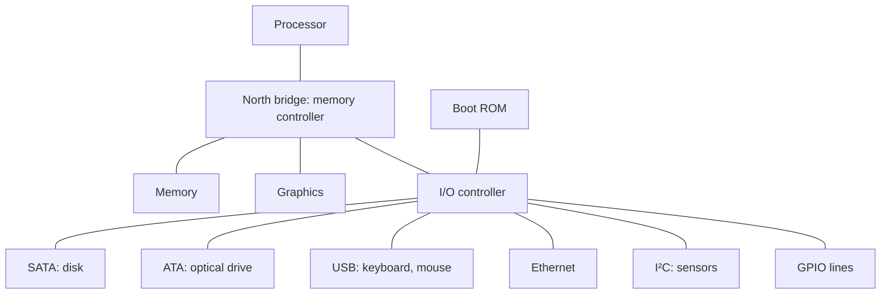
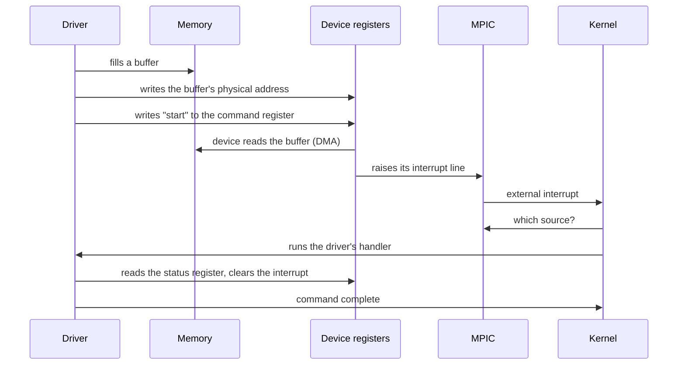
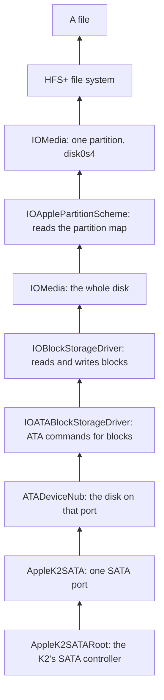
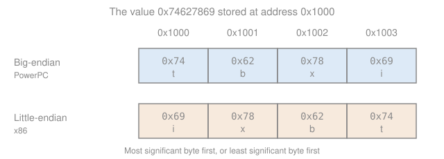
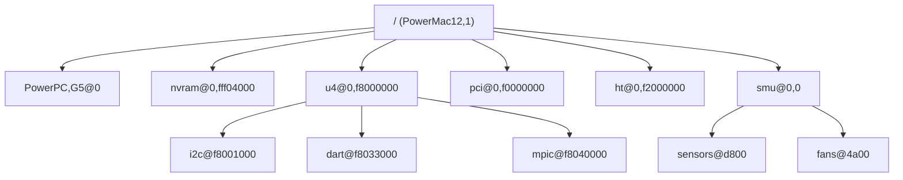

# Hardware and boot basics

## What you will learn

- What a computer is made of, seen from the software that runs it: a processor, memory, bridges, buses and devices.
- What happens between power-on and a running kernel: the reset vector, the firmware, the boot loader and the kernel's first steps.
- How memory works for a kernel: physical and virtual addresses, the MMU, and the split between kernel and user mode.
- How a driver talks to a device: registers mapped into memory, interrupts, polling, DMA, cache flushes and the IOMMU.
- What a driver is, how a kernel picks one for a device, how drivers stack from a disk controller to a file, why byte order matters, and what the firmware's device tree tells the kernel.

This chapter is the one the rest of the book leans on for low-level ideas. Each section ends with the chapters where Darwin uses the idea.

## The parts of a computer

A program sees a computer as a processor running instructions on memory. The processor is the chip that runs them; memory is the large array of bytes that holds the instructions and their data while the machine runs. Everything else, a disk, a keyboard, a network port, a fan, is a device: hardware that the processor does not run instructions on, but talks to.

The processor does not reach the devices directly. Between them sit chips that carry the traffic, and wires that join them, called buses. A bus is a shared path with its own rules for who may speak and how an address and its data are sent. A bridge is a chip that joins two buses and passes traffic from one to the other.

Most computers of the PowerPC Macs' time share one plan:



- The north bridge joins the processor to memory, and to the fastest devices, such as the graphics chip. On the iMac G5 (`PowerMac12,1`) it is a chip named U4.
- The I/O controller, sometimes called the south bridge, holds the controllers of the slower devices: disks, USB, the network, sound. On the iMac it is a chip named K2.
- The boot ROM is a small memory chip that keeps its content with the power off and holds the firmware, the first program the machine runs.

Each controller is itself a small device that the processor talks to: a SATA controller, for example, talks to the disk on the processor's behalf. The processor never sees the disk, only the controller.

[PowerPC Macs](powerpc-macs.md) draws this plan for the two machines the project runs on, QEMU's `mac99` and the iMac G5.

## From power-on to a kernel

### The reset vector

When the power comes on, or the machine is reset, the processor knows nothing: memory holds random bits, and no device has been set up. It does the only thing it can, which is to start running instructions at one fixed address, written into the processor's design. That address is the reset vector, and the board is wired so that it falls in the boot ROM. The first instruction a computer runs is therefore always the firmware's.

### The firmware's job

Firmware is the program stored on the machine itself. On PowerPC Macs it is Open Firmware, and in QEMU it is OpenBIOS, an open-source Open Firmware. Whatever its name, firmware has four jobs at power-on:

1. Set up the hardware that it needs first: the processor's caches, the memory controller, a clock.
2. Test and size the memory, so that it knows how much there is and where.
3. Find the devices: walk the buses, ask each device what it is, and give each one the addresses it will answer on.
4. Find a boot loader on a disk, a CD or the network, load it into memory and start it.

Along the way, Open Firmware writes down everything it found in the device tree, described at the end of this chapter, and keeps a few settings in NVRAM, memory that keeps its content with the power off: which disk to start from (`boot-device`), and the arguments to pass to the kernel (`boot-args`). Open Firmware also offers a prompt at which a person can type commands, and a menu of the disks it can start from, the Startup Manager. [The boot chain](boot-chain.md) shows both.

### The boot loader's job

A kernel is too large and too particular for the firmware to load by itself: it is a file on a file system, in a format the firmware does not read, and it needs drivers and settings loaded with it. So the firmware loads a small program first, the boot loader, which knows those things.

A boot loader's job is narrow: find the kernel's file, load it into memory, load whatever the kernel needs to reach its root disk, describe the machine to the kernel, and jump to the kernel's first instruction. It then disappears; nothing of it stays once the kernel runs.

On PowerPC Macs, Darwin's boot loader is BootX. Open Firmware finds it on an HFS+ volume by its file type, `tbxi`, loads it and starts it. BootX loads the kernel, `mach_kernel`, and the driver cache, `Extensions.mkext`, which holds the drivers needed to reach the root disk. It then hands the kernel a structure of boot arguments: the command line from `boot-args`, the banks of memory, the screen, and a copy of the device tree.

### The kernel's first steps

The kernel starts with the machine much as the boot loader left it. Its first steps, before it can run any program, are:

1. Take over the processor: install its own handlers for interrupts and errors, and turn on the MMU with its own page tables (both explained below).
2. Set up its memory manager from the memory banks the boot loader listed.
3. Start the scheduler, so that it can run threads.
4. Start its drivers, which find the devices from the device tree and the buses, the root disk among them.
5. Mount the root file system from that disk.
6. Start the first program, process 1, which starts every other.

On Darwin, process 1 is launchd. [The boot chain](boot-chain.md) follows each of these steps on the iMac and in QEMU, from Open Firmware to the `login:` prompt.

## Memory

### Physical and virtual addresses

Each byte of memory has a physical address: its number among all the bytes the memory controller holds, starting from 0. Devices see memory by these addresses.

Programs do not. Each program runs in its own address space, a range of virtual addresses that the kernel maps, page by page, onto physical memory. A page is a block of 4 KB on PowerPC. Two programs can both use the virtual address `0x1000`, and each reaches a different physical page; a program cannot even name a page the kernel has not mapped for it. The kernel itself also runs at virtual addresses.

### The MMU

The translation is done by the processor, not by software: its MMU, the memory management unit, turns each virtual address into a physical one as the instruction runs. The kernel writes the translations into page tables in memory, which the MMU reads; PowerPC's MMU looks them up in a hashed page table. The MMU caches recent translations, so the lookup costs nothing in the common case.

When a program uses an address that has no translation, the MMU stops the instruction and calls the kernel, which either maps the page (it was swapped out, or not yet touched) or ends the program with a fault, `Segmentation fault` or `Bus error`.

Firmware and boot loaders usually run with the MMU off, at physical addresses. BootX turns translation off just before it jumps to the kernel, and the kernel turns it on again with its own tables.

### Kernel and user mode

The processor runs in one of two modes. In kernel mode (PowerPC calls it supervisor state) every instruction is allowed, and so is every page of memory. In user mode (problem state, in PowerPC's terms) the instructions that change the MMU, reach devices or turn interrupts off are refused, and so are the kernel's pages.

Programs run in user mode. To open a file or send a packet, a program makes a system call: a special instruction that switches the processor to kernel mode and jumps into the kernel at a fixed place. The kernel does the work, then returns to the program in user mode. This is the boundary between the kernel and its userland: everything below it is the kernel and its drivers, everything above it programs and libraries.

Drivers, on Darwin, run in kernel mode, inside the kernel's address space. A mistake in a driver is therefore a mistake in the kernel, and usually a kernel panic.

Where Darwin uses this: [What Darwin is](what-darwin-is.md) for xnu's split into Mach and BSD; [Step 1, part 1](../steps/step-1-kernel-and-userland.md) for the kernel and libSystem, the library through which every program makes its system calls.

## How software talks to hardware

### Registers mapped into memory

A device is driven through its registers: small slots, usually 32 bits wide, each with a meaning fixed by the chip's design. One register might hold a command, another the address of a buffer, a third a status that says whether the last command has finished. Writing a register tells the device to do something; reading one asks what it has done.

On PowerPC, as on most modern machines, the registers are mapped into the physical address space. The firmware gives each device a range of physical addresses, and the bridges send any load or store at those addresses to the device instead of to memory. To the processor, writing a register looks exactly like writing memory: an ordinary store instruction at a particular address.

On the iMac G5, the device tree shows where each block lives. Its node `u4@0,f8000000` says that the U4's registers start at physical address `0xf8000000`; within that range, the interrupt controller is at `mpic@f8040000`, the IOMMU at `dart@f8033000` and one I²C controller at `i2c@f8001000`. A driver asks the kernel to map such a range into its virtual address space, then reads and writes the registers through that mapping.

Two things make register access different from memory. Reads and writes have effects, so they must happen exactly as many times as the code says, in the order it says; and the processor must not keep them in its cache. The kernel maps device ranges as cache-inhibited, and drivers use special instructions or IOKit's helpers to keep the order of their accesses.

### Interrupts

A device works at its own pace: a disk takes milliseconds to read a block, a network port receives a packet whenever one arrives. The driver could keep reading a status register until something changes, but that wastes the processor. Instead, the device raises an interrupt: it sets a signal on a wire that makes the processor stop what it is doing, save its state, and run the kernel's interrupt handler.

A PowerPC processor has one input for external interrupts, and a Mac has dozens of devices. Between them sits the interrupt controller: a chip that takes one wire from each device, remembers which have raised an interrupt, and signals the processor. The kernel's handler asks the controller which source fired, runs the handler of the driver that owns that source, then tells the controller the interrupt has been handled. The controller of PowerPC Macs is the MPIC, the multiprocessor interrupt controller, an implementation of the OpenPIC design; the device tree calls it `chrp,open-pic`, and the driver AppleMPIC drives it. The iMac has two, one in the U4 and one in the K2, and QEMU's `mac99` has one.

Here is one command and its interrupt, as a driver sees them:



In IOKit, Darwin's driver framework, the kernel's handler does almost nothing itself: it wakes a thread of the driver, its work loop, which runs the driver's handler with the driver's lock held. Most of a driver's work happens on that thread.

### Polling

Not every device has an interrupt, and not every wait is worth one. Polling is the other way: the driver reads a status again and again until it changes, usually with a short pause between reads. It is simple and costs the processor time, so drivers poll only for short waits or where no interrupt exists.

OpenSMU, the project's driver for the iMac's system management unit, polls: after it rings the SMU's doorbell, it asks every 100 microseconds whether the reply is there, for at most 2 seconds ([Step 5](../steps/step-5-clock-and-power.md)).

### DMA

A disk block is 512 bytes or more, a network packet up to 1,500. If the processor copied each byte through a register, it would do little else. Instead, the device copies the data to or from memory by itself: DMA, direct memory access. The driver puts the buffer's physical address and length in the device's registers and starts the command; the device then reads or writes memory directly, while the processor runs something else, and raises an interrupt when it has finished.

Two consequences follow:

- The device needs a physical address, not a virtual one, since it does not go through the processor's MMU. A driver must ask the kernel for the physical address of each page of its buffer, and make sure the pages stay where they are, wired, until the device is done.
- A device that takes a 32-bit address can only reach the first 4 GB of physical memory. A driver whose buffer lies above that line must move it, or have an IOMMU translate (below).

### Caches, and why they must be flushed

The processor does not read and write memory directly either. It keeps copies of recently used memory in its caches, small fast memories on the processor chip, and works on those copies; a write may stay in the cache for a long time before it reaches memory.

On some machines, the bridges watch the processor's caches during DMA and keep the two in step. On others, or for some devices, they do not: the device sees memory only. Then a driver that writes a command into a buffer and starts a device must first flush the cache, that is, write the cached copy of the buffer back to memory; otherwise the device reads what was there before. When the device has written its answer into memory, the driver must flush again, so that the processor drops its stale copy and reads what the device wrote.

The project met this in OpenSMU ([D81](https://github.com/nyg/PowerDarwin/blob/master/DEVIATIONS.md#d81)). The SMU reads its commands from a page of memory by DMA, and writes its reply over the command. So `OpenSMU::sendCommand`:

1. writes the command, its length and its data into the page;
2. flushes the page from the processor's cache, so the SMU reads the new command;
3. hands the SMU the page's physical address, and checks that the address fits in 32 bits, since the SMU takes a 32-bit address;
4. rings the doorbell and polls for the reply;
5. flushes the page again, so the processor reads the SMU's reply and not its own old copy;
6. checks that the reply's first byte is the command with every bit inverted.

That is DMA, a physical address, the 4 GB line, cache flushes and polling in one short function. [Step 5](../steps/step-5-clock-and-power.md) tells the story in full, and [OpenSMU](../synthesis/opensmu.md) describes the protocol.

### The IOMMU

An IOMMU does for devices what the MMU does for the processor: it translates the addresses a device uses into physical addresses, page by page, from tables the kernel writes. With one, a device that takes 32-bit addresses can reach a buffer anywhere in memory, a scattered buffer can look contiguous to the device, and a device can reach only the pages the kernel mapped for it.

The iMac's U4 holds one, the DART. Its driver, AppleDART, part of the AppleMacRiscPCI project, logs `DART enabled` when it turns it on at boot; the first boot test on the iMac shows that line from our build of it. In IOKit's terms the DART is a mapper, through which drivers get the addresses they hand their devices. QEMU's `mac99` has none.

Where Darwin uses this: [Step 5](../steps/step-5-clock-and-power.md) and [OpenSMU](../synthesis/opensmu.md) for DMA, flushes and polling; [Step 1, part 2](../steps/step-1-drivers-and-bootx.md) for D39, the register offsets of the U4 that AppleMacRISC4PE uses and Apple's published headers lack.

## Buses

### PCI

PCI is the main bus of PowerPC Macs and of most computers since the mid-1990s. Every PCI device has a configuration space, a small set of standard registers that say what it is: a vendor number, a device number and a class (disk controller, network, display, bridge). The firmware, and later the kernel, walk the bus at boot, read each device's configuration space, and give the device the ranges of physical addresses its registers will answer on. Nothing on PCI is found by guessing.

The device tree names a PCI device by these numbers when it has nothing better. The iMac's graphics chip appears as `pci1002,5b62`, vendor `0x1002` (ATI) and device `0x5b62`, and its PCI-to-PCI bridges as `pci106b,53` and `pci106b,54`, vendor `0x106b` (Apple). A driver can ask to match on these numbers.

PCI Express, a later and faster form of PCI, keeps the same configuration space with a different wire. On the iMac, the graphics chip sits on PCI Express from the U4.

### HyperTransport

HyperTransport is a fast point-to-point link between chips, which software sees as PCI: the devices behind it have PCI configuration spaces, and bridges pass traffic to them. On the iMac, the U4 reaches the K2 through HyperTransport (`ht@0,f2000000` in the device tree, driven by AppleMacRiscHT), and the K2's own controllers sit behind PCI bridges on it. QEMU's `mac99`, modelled on an older G4 Mac, has plain PCI instead.

### I²C

I²C is a slow bus of two wires, a clock and a data line, which joins small chips to a controller: temperature sensors, the chip that sets the clock speed, an audio codec. Each chip on the bus has an address of 7 bits, and the controller reads or writes a few bytes at a time to the chip at an address. It is far too slow for data, and just right for a sensor read every few seconds.

On the iMac, the U4 has an I²C controller with four sensors on one of its buses: two LM75s and two MAX6690s, which measure the disk, the optical drive, the graphics chip and the north bridge. They appear as `temp-monitor@90`, `@92`, `@98` and `@9c`, where the number is each chip's address on the bus, written in its 8-bit form. OpenSMU reads them to drive the fans ([Step 7](../steps/step-7-fans.md)).

### USB

USB connects external devices through a host controller, which the kernel drives, and which talks to the devices on the processor's behalf. Each generation has its own kind of controller: OHCI for USB 1.1, at up to 12 Mbit/s, and EHCI for USB 2.0, at up to 480 Mbit/s. The iMac has both, and QEMU's `mac99` has an OHCI controller with a USB keyboard and mouse on it.

### SATA and ATA

ATA, also called IDE, is the older disk interface: a parallel cable with up to two devices on it. SATA is its serial successor, one disk per cable, with the same command set. The iMac's internal disk is on the K2's SATA controller, and its optical drive on the K2's ATA controller. QEMU's `mac99` has two ATA controllers, with the disk on the first and the CD drive on the second.

### GPIO

GPIO, general-purpose input and output, is the simplest connection there is: one wire that a driver can set high or low, or read. Chips use GPIO lines for anything that needs one bit: a reset, a mute, whether headphones are plugged in. The iMac's K2 has a dozen in use, each named in the device tree: `smu-doorbell`, by which OpenSMU rings the SMU, `lineout-detect`, `amp-mute`, `hw-reset`.

Where Darwin uses this: [PowerPC Macs](powerpc-macs.md) for the buses of each machine; [Step 1, part 2](../steps/step-1-drivers-and-bootx.md) for the PCI, HyperTransport, SATA and ATA drivers; [Step 7](../steps/step-7-fans.md) for I²C; [Step 9](../steps/step-9-disks-and-devices.md) for USB disks.

## Drivers

### What a driver is

A driver is the code that knows one kind of device: which registers it has, what each one means, which commands it takes, how it signals that it has finished. It turns the kernel's general requests ("read these blocks", "send this packet") into the device's own steps, and the device's results back into the kernel's terms.

Drivers are what makes the same kernel run on different machines. xnu does not know how the iMac's SATA controller works; AppleK2SATA does. Change the machine, and the kernel stays while the drivers change.

On Darwin, drivers are kexts, kernel extensions: bundles, folders with a fixed layout, that hold the driver's compiled code and an `Info.plist`, a property list that says what the driver is, what it needs and what hardware it drives. The kernel loads them at boot and later, as devices appear. Darwin's drivers are written in IOKit, a framework in a subset of C++ in which each driver is an object ([What Darwin is](what-darwin-is.md)).

### Matching

At boot, the kernel knows which devices exist, from the device tree and from walking the buses, but not which driver goes with which. It finds out by matching.

In IOKit, each device the kernel finds is represented by an object called a nub: a node of the device tree, a PCI device, a disk on a SATA port. Each driver's `Info.plist` holds one or more personalities, each a short description of the nubs the driver can drive: the class of nub it attaches to (`IOProviderClass`), and something to compare, such as the device's name in the device tree (`IONameMatch`) or its PCI numbers (`IOPCIMatch`). When a nub appears, IOKit compares it with every personality, lets each candidate driver look at the device itself (its probe), and starts the one with the best score (`IOProbeScore`).

The first match on any Mac is the platform driver, the driver of the machine itself, which matches the root of the device tree. The iMac's root node has the compatible names `PowerMac12,1`, `MacRISC4` and `Power Macintosh`. In Apple's AppleMacRISC4PE 204.0.9, the personality of the G5 platform driver is, in short:

```xml
<key>IONameMatch</key>
<string>MacRISC4</string>
<key>IOProbeScore</key>
<integer>10000</integer>
<key>IOProviderClass</key>
<string>IOPlatformExpertDevice</string>
```

AppleMacRISC2PE 187.0.5, the platform driver of G4 Macs, asks for `MacRISC2` and `MacRISC3` with a score of 5000. On the iMac only the first matches; in QEMU, whose root node says `MacRISC2`, only the second. [PowerPC Macs](powerpc-macs.md) explains these names.

### Driver stacks

Drivers rarely work alone. A disk controller's driver knows how to send commands to a disk; it does not know about partitions or file systems. Each layer does one job and offers the next layer up a simpler view, so that the drivers form a stack, each one the provider of the one above.

The root disk of the image on the iMac is reached through this stack:



Below the SATA controller, three more layers reach it: the platform driver, AppleMacRISC4PE, then the HyperTransport bridge, AppleMacRiscHT, then a PCI-to-PCI bridge, IOPCI2PCIBridge. When Leopard boots, its kernel logs the whole path, from the platform driver to the partition, in one line that starts `Got boot device = IOService:/MacRISC4PE/ht@0,f2000000/AppleMacRiscHT/pci@3/IOPCI2PCIBridge/k2-sata-root@C/AppleK2SATARoot/k2-sata@0/AppleK2SATA/ATADeviceNub@0/`. Each name in it is a nub or a driver, alternately.

The layers are separate kexts, and on the image they come from separate projects: IOATAFamily, IOStorageFamily and the rest. That is why a missing piece anywhere stops the whole boot. In the fourth boot test in QEMU, the image lacked the plug-ins that Apple's `IOATAFamily.kext` carries, IOATABlockStorage among them, and the kernel stopped at `Still waiting for root device`. On the iMac, the layer that turns ATA commands into blocks is Panther's IOATABlockStorageDriver, since Leopard's was never published ([D40](https://github.com/nyg/PowerDarwin/blob/master/DEVIATIONS.md#d40)).

Where Darwin uses this: [The boot chain](boot-chain.md) for how matching finds the root disk at boot; [Step 1, part 2](../steps/step-1-drivers-and-bootx.md) for the drivers of this stack, built one by one.

## Byte order and word size

### Byte order

A 32-bit number takes four bytes of memory, and a processor must decide which byte goes first. A big-endian processor puts the most significant byte at the lowest address; a little-endian one puts the least significant byte there. PowerPC Macs run big-endian. Intel's x86 processors are little-endian.



The value `0x74627869` in the picture is the four characters `t`, `b`, `x`, `i`: BootX's file type. Classic Mac OS and Mac OS X store such four-character codes as 32-bit numbers. Written by a big-endian processor, the bytes in memory read `tbxi`; written by a little-endian one, they read `ixbt`.

Byte order matters wherever bytes cross between two machines or two parts of one:

- Files and network packets have a byte order of their own, fixed by their format. A program that writes a 32-bit number to a file on PowerPC and reads it on x86 gets a different number unless the format says which order it uses. Network protocols use big-endian, so PowerPC needs no swapping there.
- Devices have one too. PCI is little-endian, so a PowerPC driver swaps the bytes of most PCI registers it reads or writes; IOKit's headers have helpers for it, such as `OSSwapLittleToHostInt32`.
- Code compiled for one processor holds its constants in that processor's order. A Mach-O file, Darwin's format for programs and libraries, says in its header which processor it is for.

### Word size

A 32-bit processor works on 32-bit numbers and addresses, so a program can reach 4 GB of virtual memory. A 64-bit processor works on 64-bit ones. The G4 is a 32-bit processor; the G5, IBM's PowerPC 970 family, is a 64-bit processor that also runs 32-bit code.

Leopard's kernel on PowerPC is a 32-bit program even on a G5, and so is ours: its version string ends in `RELEASE_PPC`. Programs can be 64-bit on a G5, and libSystem, Darwin's C library, is built for both. A Mach-O file can hold several builds of the same program for different processors, one slice each, in one fat binary; the image's `libSystem.B.dylib` has four slices, `ppc7400 ppc64 i386 x86_64`, and its `mach_kernel` two, `i386 ppc`. [PowerPC Macs](powerpc-macs.md) explains the PowerPC slices.

Where Darwin uses this: [PowerPC Macs](powerpc-macs.md) for the slices; [darwinbuild](../method/darwinbuild.md) for `RC_ARCHS` and how fat binaries are built; [Step 5](../steps/step-5-clock-and-power.md) for a 32-bit `long` that overflowed in 1972.

## The device tree

### What the firmware tells the kernel

While Open Firmware walks the machine at power-on, it builds the device tree, a description of every piece of hardware it found, and hands it to the operating system. The kernel then needs to probe only the buses that describe themselves, such as PCI; everything else it learns from the tree.

The device tree is a tree of nodes, one per device or bus, with each device under the bus it sits on. Each node has properties, named values. A few properties have the same meaning everywhere:

| Property | Holds | Example on the iMac |
|---|---|---|
| `name` | the node's name | `mac-io`, the K2 |
| `compatible` | names a driver may match, most specific first | `PowerMac12,1`, `MacRISC4`, `Power Macintosh` on the root |
| `model` | the chip's model | `AAPL,U4` on the north bridge |
| `reg` | the node's registers: addresses and lengths | the U4 at `0xf8000000` |
| `interrupts` | which interrupt controller inputs it uses | |

A node's full name is its `name`, an `@` and its unit address, the place where it sits on its parent: `u4@0,f8000000` is the node named `u4` at the address `0,f8000000`, here a 64-bit physical address written as two 32-bit halves. A path from the root, like a file's path, names one device: `/u4@0,f8000000/mpic@f8040000`. Open Firmware also gives each node a number, its phandle, by which other nodes and drivers refer to it.

The top of the iMac's tree, with a few of the nodes below:



[PowerPC Macs](powerpc-macs.md) shows more of it, down to the disk and the K2's controllers.

The tree describes more than devices. The `smu` node, for example, names the platform functions by which another driver reaches the SMU: `platform-doorbell-buff`, `platform-doorbell-req` and `platform-doorbell-ack`, each performed by the driver of another chip ([Step 5](../steps/step-5-clock-and-power.md)). The `/chosen` node holds what the boot loader chose, such as the boot path, and the `/options` node the NVRAM settings such as `boot-args`.

### From the device tree to IOKit

BootX copies the device tree into memory as one flat block and passes its address to the kernel in the boot arguments. IOKit then turns each node into an object in its registry, the IORegistry, where the node's properties become the object's properties. Those objects are the first nubs: the platform driver matches the root, then creates nubs for the nodes below it, and matching runs down the tree.

On a running system, `ioreg -p IODeviceTree` prints the tree as IOKit received it, and `ioreg -l` the whole registry, drivers included. The excerpt above is from the iMac under Leopard; QEMU's tree, built by OpenBIOS, is far smaller.

Where Darwin uses this: [PowerPC Macs](powerpc-macs.md) for the trees of the two machines; [The boot chain](boot-chain.md) for Open Firmware's prompt, NVRAM and the device paths it boots from; [Step 5](../steps/step-5-clock-and-power.md) for platform functions and phandles.

## Where each idea is used

| Idea | Where Darwin uses it |
|---|---|
| reset vector, firmware, boot loader | [the boot chain](boot-chain.md) |
| MMU, kernel and user mode | [What Darwin is](what-darwin-is.md), [Step 1, part 1](../steps/step-1-kernel-and-userland.md) |
| registers, interrupts | [PowerPC Macs](powerpc-macs.md), [Step 1, part 2](../steps/step-1-drivers-and-bootx.md) |
| polling, DMA, cache flushes | [Step 5](../steps/step-5-clock-and-power.md), [OpenSMU](../synthesis/opensmu.md) |
| IOMMU | [PowerPC Macs](powerpc-macs.md) |
| PCI, HyperTransport, SATA, ATA | [Step 1, part 2](../steps/step-1-drivers-and-bootx.md) |
| I²C, GPIO | [Step 5](../steps/step-5-clock-and-power.md), [Step 7](../steps/step-7-fans.md) |
| USB | [Step 1, part 2](../steps/step-1-drivers-and-bootx.md), [Step 9](../steps/step-9-disks-and-devices.md) |
| drivers, matching, stacks | [the boot chain](boot-chain.md), [Step 1, part 2](../steps/step-1-drivers-and-bootx.md) |
| byte order, word size, fat binaries | [PowerPC Macs](powerpc-macs.md), [darwinbuild](../method/darwinbuild.md) |
| device tree | [PowerPC Macs](powerpc-macs.md), [the boot chain](boot-chain.md) |

## Where to look

- [reference/imacg5/kextstat.txt](https://github.com/nyg/PowerDarwin/blob/master/reference/imacg5/kextstat.txt), Leopard's list of the drivers an iMac G5 loads.
- [reference/imacg5/boot-kernel-log.txt](https://github.com/nyg/PowerDarwin/blob/master/reference/imacg5/boot-kernel-log.txt), Leopard's kernel log on the iMac, with the boot device's path.
- [reference/qemu-userland-test/kextstat.txt](https://github.com/nyg/PowerDarwin/blob/master/reference/qemu-userland-test/kextstat.txt), the drivers QEMU's `mac99` loads.
- [D81](https://github.com/nyg/PowerDarwin/blob/master/DEVIATIONS.md#d81) and [replacements/OpenSMU/OpenSMU.cpp](https://github.com/nyg/PowerDarwin/blob/master/replacements/OpenSMU/OpenSMU.cpp), the worked example of DMA, cache flushes and polling.
- [D40](https://github.com/nyg/PowerDarwin/blob/master/DEVIATIONS.md#d40), Panther's IOATABlockStorage in the root-disk stack.
- In AppleMacRISC4PE 204.0.9 and AppleMacRISC2PE 187.0.5: the personalities in each project's `project.pbxproj`.
- In BootX 81: `bootx.tproj/sl.subproj/main.c`, where `SetUpBootArgs` fills the boot arguments and `CallKernel` turns translation off and jumps to the kernel.
- In xnu 1228.15.4: `pexpert/pexpert/ppc/boot.h`, the boot arguments a PowerPC kernel receives.
