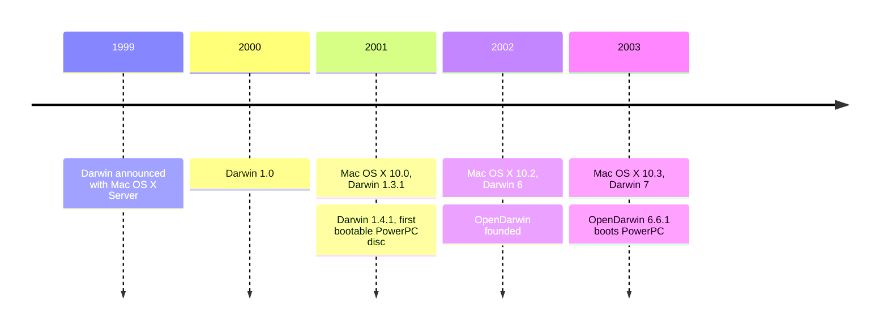
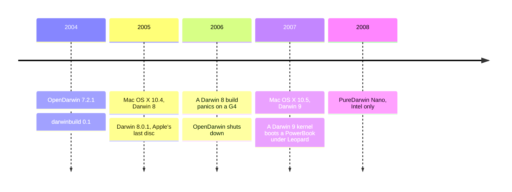
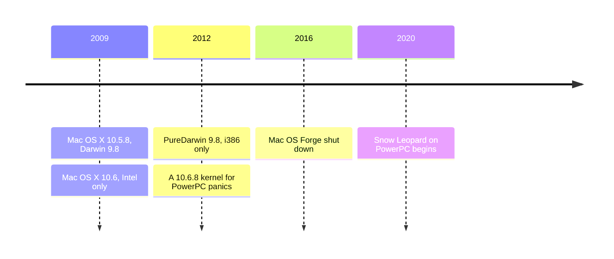
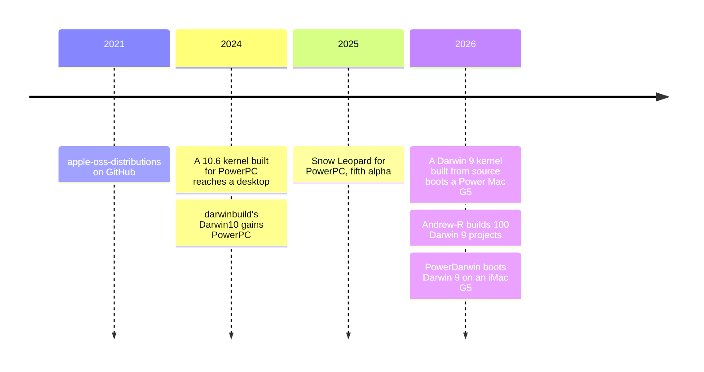

# Darwin's history, earlier attempts, and what this project adds

## What you will learn

- How Darwin's releases follow Mac OS X's, from 1999 to Snow Leopard, and which Darwin goes with which Mac OS X.
- That Apple's last bootable Darwin disc was 8.0.1, in 2005, and that Darwin 9 and later came as sources only.
- What others built from those sources before: OpenDarwin, PureDarwin, and the attempts to build Darwin for PowerPC, which booted a kernel at most, or targeted Intel.
- How PowerPC left Mac OS X with Snow Leopard, and the efforts since to bring it back.
- What this project adds to that record, and why a documented Darwin 9 for PowerPC matters now.

Every date and claim in this chapter was checked against a primary source: Apple's press releases, release notes and mailing-list archives, the projects' own pages and repositories, and the forum threads themselves. Dead pages are cited through the Wayback Machine. Where the record is a second-hand report or a forum post, the chapter says so.

## Darwin's releases

### The beginning

Apple announced Darwin on 16 March 1999, the day Mac OS X Server shipped: it was the open-source release of that system's foundation ([Apple, 16 March 1999](http://web.archive.org/web/19991012053536/http://apple.com:80/pr/library/1999/mar/16opensource.html)). The first installable binaries, releases 0.2 in May 1999 and 0.3 in August, were installed from Mac OS on a Power Macintosh, not booted from a disc of their own ([Apple's Public Source news](http://web.archive.org/web/19991007040521/http://www.publicsource.apple.com:80/news.html)). No Apple page found calls the first source release "Darwin 0.1"; that name is a later one. Darwin 1.0 followed on 5 April 2000, built for PowerPC and Intel ([Apple, 5 April 2000](https://www.apple.com/newsroom/2000/04/05Apple-Releases-Darwin-1-0-Open-Source/)).

### Each Mac OS X and its Darwin

From Mac OS X 10.0 on, each Mac OS X release has its Darwin, and Apple's index of Darwin sources lists them side by side ([Mac OS X (Darwin) Releases, 2009](http://web.archive.org/web/20090109224136/http://www.opensource.apple.com:80/darwinsource/)):

| Mac OS X | Released | Darwin | Apple's installer disc |
|---|---|---|---|
| 10.0 | 24 March 2001 | 1.3.1 | 1.3.1, 12 April 2001: on PowerPC, installed from Mac OS |
| 10.1 | 29 September 2001 | 1.4.1; 10.1.1 to 10.1.5 are 5.1 to 5.5 | 1.4.1, 1 October 2001: the first bootable PowerPC image |
| 10.2 | 24 August 2002 | 6.0 | 6.0.2, 23 September 2002 |
| 10.3 | 24 October 2003 | 7.0 | 7.0.1, 14 November 2003, one disc for PowerPC and Intel |
| 10.4 | 29 April 2005 | 8.0 | 8.0.1, 29 April 2005: the last |
| 10.5 | 26 October 2007 | 9.0 | none; 10.5.8, 5 August 2009, is 9.8 |
| 10.6 | 28 August 2009 | 10.0 | none; Intel only |

The release dates are Apple's: for [10.0](https://www.apple.com/newsroom/2001/01/09Apples-Mac-OS-X-to-Ship-on-March-24/), [10.1](https://www.apple.com/newsroom/2001/09/25First-Major-Upgrade-to-Mac-OS-X-Hits-Stores-This-Weekend/), [10.5](https://www.apple.com/newsroom/2007/10/16Apple-to-Ship-Mac-OS-X-Leopard-on-October-26/) and [10.6](https://www.apple.com/newsroom/2009/08/24Apple-to-Ship-Mac-OS-X-Snow-Leopard-on-August-28/) from its press releases, for 10.2, 10.3 and 10.4 from its press releases of 17 July 2002, 8 October 2003 and 12 April 2005, and for 10.5.8 from its security advisory of [5 August 2009](http://web.archive.org/web/20241106013924/http://lists.apple.com/archives/security-announce/2009/Aug/msg00001.html). The discs' dates and what each one does are in their release notes, for [1.3.1](http://web.archive.org/web/20010805155537/http://www.opensource.apple.com:80/projects/darwin/1.3/release.html), [1.4.1](https://opensource.apple.com/static/iso/release-notes-1.4.1.txt), [6.0.2](https://opensource.apple.com/static/iso/release-notes-6.0.2.txt), [7.0.1](https://opensource.apple.com/static/iso/release-notes-7.0.1.txt) and [8.0.1](https://opensource.apple.com/static/iso/release-notes-8.0.1.txt). Darwin's version is also the kernel's: xnu's `config/MasterVersion` reads `9.8.0` in xnu 1228.15.4, the kernel of 10.5.8, which is what `uname -r` prints.

### The last disc, then sources only

Darwin 8.0.1 came out with Tiger, on 29 April 2005, as two images, `darwinppc-801.cdr.gz` for PowerPC and `darwinx86-801.iso.gz` for Intel; its release notes say it installs and boots on every PowerPC Mac that Mac OS X 10.4 supports ([announcement](http://web.archive.org/web/20140115094839/http://lists.apple.com/archives/darwin-dev/2005/Apr/msg00103.html), [release notes](https://opensource.apple.com/static/iso/release-notes-8.0.1.txt)). It was the last. Apple's folder of disc images, as captured in September 2009, holds only 1.4.1, 6.0.2, 7.0.1 and 8.0.1 ([Wayback, 2009](http://web.archive.org/web/20090903180055/http://opensource.apple.com:80/static/iso/)), and in Apple's index every release after 10.4 is listed as source only. Apple confirmed this the day after Darwin 9.0's sources came out: asked on Apple's darwinos-users list why no binary release came with them, as one had with 8.0, Jordan Hubbard of Apple replied that Apple had made none for years, that binary releases were no longer supported, and that anyone making one was on their own ([darwinos-users, 31 October 2007](http://web.archive.org/web/20160419003041/http://lists.apple.com/archives/Darwinos-users/2007/Oct/msg00006.html)).

From Darwin 8.1 on, then, Apple published each release as a set of source projects and nothing more. Building and booting a Darwin became the work of whoever wanted one.

### Darwin 9

Apple announced the sources of Darwin 9.0 on 30 October 2007, four days after Leopard shipped, for both PowerPC and Intel Macs ([darwin-dev, 30 October 2007](http://web.archive.org/web/20220128122130/http://lists.apple.com/archives/darwin-dev/2007/Oct/msg00038.html)). Not every project was there yet: a week later a user listed 16 still missing, among them CF, the open CoreFoundation, objc4, the Objective-C runtime, and dtrace. In his reply, Apple's Kevin Van Vechten said that Leopard's first build list, `9A581`, had been added to darwinbuild, and that Roots were being built and uploaded for it ([darwin-dev, 6 November 2007](http://web.archive.org/web/2014/http://lists.apple.com/archives/darwin-dev/2007/Nov/msg00047.html)). Roots of that kind, darwinbuild's prebuilt projects, are what this project still bootstraps from, through the Wayback Machine ([Leopard 9L30](../method/sources-and-roots.md)). Some never came at Leopard's versions: IOATABlockStorage 200.1.8 and IOSCSIArchitectureModelFamily 200.3.6, through which Leopard reaches its disks and CDs, were never published, and this project builds Tiger's in their place ([D40](https://github.com/nyg/PowerDarwin/blob/master/DEVIATIONS.md#d40), [D85](https://github.com/nyg/PowerDarwin/blob/master/DEVIATIONS.md#d85)). The sources of Mac OS X 10.5.8 went up on 10 August 2009 ([darwin-dev, 10 August 2009](http://web.archive.org/web/20140115111725/http://lists.apple.com/archives/darwin-dev/2009/Aug/msg00010.html)), and Apple confirmed two days later that they were Darwin 9.8 ([darwin-dev, 12 August 2009](http://web.archive.org/web/20140115111729/http://lists.apple.com/archives/darwin-dev/2009/Aug/msg00035.html)). That release, build `9L30`, is the one this project builds ([Leopard 9L30](../method/sources-and-roots.md)).

### Snow Leopard and the end of PowerPC

Snow Leopard, Mac OS X 10.6, shipped on 28 August 2009 for Intel Macs only ([Apple's specifications, 2009](http://web.archive.org/web/20090831083420/http://www.apple.com:80/macosx/specs.html)). Leopard is therefore the last Mac OS X for PowerPC, and Darwin 9 the last Darwin that Apple shipped for PowerPC Macs and published as sources for both PowerPC and Intel.

The kernel's source did not drop PowerPC at once. xnu 1456 and 1504, the kernels of 10.6, still have the `osfmk/ppc` folder and list `PPC` among their build configurations; both go only in xnu 1699, the kernel of 10.7 (compared in [apple-oss-distributions/xnu](https://github.com/apple-oss-distributions/xnu)). That is why later efforts could build Darwin 10 kernels for PowerPC at all.

## Others' Darwins

### OpenDarwin

OpenDarwin was founded in April 2002 by the Internet Software Consortium and Apple, as a community home for Darwin's development ([opendarwin.org, May 2002](http://web.archive.org/web/20020526234739/http://www.opendarwin.org:80/)). It released its own bootable Darwins for PowerPC and Intel: OpenDarwin 6.6.1 on 26 May 2003, the first built entirely from its own repository, except for Apple's binary PowerPC drivers ([release notes](http://web.archive.org/web/20030604205608/http://opendarwin.org:80/downloads/6.6.1/release.html)), then 6.6.2, and 7.2.1, based on Darwin 7.2, on 16 July 2004 ([release notes](http://web.archive.org/web/2004/http://www.opendarwin.org:80/downloads/7.2.1/release.html)). It made no release of Darwin 8 or 9 of its own. Its core team announced on 25 July 2006 that it was shutting down ([opendarwin.org, August 2006](http://web.archive.org/web/20060804104416/http://www.opendarwin.org/)).

darwinbuild, the tool this project builds with, began there: Kevin Van Vechten released its first version on 30 June 2004 ([its `CHANGES` file](https://github.com/macosforge/darwinbuild)), and it later moved to Apple's Mac OS Forge ([darwinbuild](../method/darwinbuild.md)).

### PureDarwin

PureDarwin is a community project to make a usable system from Darwin's sources. In September 2008 it released PureDarwin Nano, a Darwin 9.2 made from the prebuilt components that Apple served through darwinbuild, not compiled from source, and it ran in VMware or from USB on Intel machines ([puredarwin.org, September 2008](http://web.archive.org/web/20080916200222/http://www.puredarwin.org:80/); [Nano's page](http://web.archive.org/web/20081009195737/http://www.puredarwin.org:80/developers/puredarwin-nano)). A developer preview, Xmas, followed in December 2008 as a VMware virtual machine ([PureDarwin's archive](https://github.com/PureDarwin/puredarwin.github.io/blob/HEAD/src/archive/users/Xmas.md)).

In 2012, a contributor known as rafirafi rewrote the binary parts of Darwin 9 that remained, among them a new platform expert, and released a PureDarwin 1.3 beta of Darwin 9.8, `9L30`, the same build as this project's. His release notes, dated 25 September 2012, say it is for i386 only, and it runs in `qemu-system-i386`; the announcement adds that no one else had yet rebuilt it from source ([PureDarwin's news](https://github.com/PureDarwin/puredarwin.github.io/blob/HEAD/src/archive/news/New%20PureDarwin%201.3%20beta%20release.md)). PureDarwin has gone on to later Darwins, and its latest release, 20.5, is dated 17 October 2026 ([PureDarwin's releases](https://github.com/PureDarwin/PureDarwin/releases)). No PureDarwin release for PowerPC was found.

## Earlier attempts on PowerPC

Before this project, several people tried to build Darwin for PowerPC from Apple's sources. None of those found reached a booted system of Darwin 8 or 9:

- In February 2006, a darwinbuild user reported that a Darwin 8 kernel built for PowerPC would not boot ([darwinbuild-dev, 2 February 2006](http://web.archive.org/web/20240915005218/http://lists.macosforge.org/pipermail/darwinbuild-dev/2006-February/000259.html)).
- On 7 March 2006, Graham Lee described a G4 Power Mac's file system built entirely from Darwin 8's open-source components; BootX loaded his kernel, which panicked at once. No later message reports a fix ([darwin-dev, 7 March 2006](http://web.archive.org/web/20140115100001/http://lists.apple.com/archives/darwin-dev/2006/Mar/msg00065.html)).
- On 2 November 2006, Craig Harman posted a HOWTO for building Darwin 8.7 (Mac OS X 10.4.7) for PowerPC with darwinbuild on a G5. It builds packages, with xnu as its example, and does not boot a system ([darwin-dev, 2 November 2006](http://web.archive.org/web/20161003130558/http://lists.apple.com/archives/darwin-dev/2006/Nov/msg00000.html)).
- In December 2007, Rand Childs built Darwin 9.0's kernel for PowerPC and booted it on a PowerBook G4, with Leopard's own userland; on a G5 it hung ([darwin-kernel, 8 December 2007](http://web.archive.org/web/2014/http://lists.apple.com/archives/darwin-kernel/2007/Dec/msg00038.html)). A kernel built from source had booted a PowerPC Mac; a system had not.
- In September 2008, a user built Darwin 9 projects on a PowerBook G4 for an Intel PC and could not make a bootable CD; he was pointed to PureDarwin ([darwinbuild-dev, 11 September 2008](http://web.archive.org/web/20240914194851/http://lists.macosforge.org/pipermail/darwinbuild-dev/2008-September/000483.html)).
- In November 2009, Apple's darwinbuild maintainer, William Siegrist, wrote of the tool itself, not of an attempt: darwinbuild's Darwin 8 and Darwin 9 branches were still built with a PowerPC slice by default, while a PowerPC build of its Darwin 10 version was untested ([darwinbuild-dev, 3 November 2009](http://web.archive.org/web/20240915005325/http://lists.macosforge.org/pipermail/darwinbuild-dev/2009-November/000610.html)).
- In September 2023, oldskooltech wrote on MacRumors of building Darwin 9.8 without darwinbuild: every part but `relpath`, a tool of bootstrap_cmds without which xnu did not yet compile. The thread reports no kernel and no boot ([Darwin 9, 5 September 2023](https://forums.macrumors.com/threads/darwin-9.2400556/)).

## After Darwin 9: bringing PowerPC back

Since Snow Leopard, the PowerPC community has tried to run Darwin 10 on PowerPC Macs:

- In November 2012, Vincent Habchi built xnu 1504.15.3, Mac OS X 10.6.8's kernel, for PowerPC; it panicked at boot, finding no driver to match ([darwin-kernel, November 2012](http://web.archive.org/web/20140115092119/http://lists.apple.com/archives/darwin-kernel/2012/Nov/msg00008.html)).
- From April 2020, a group on MacRumors worked on Snow Leopard for PowerPC, starting from Apple's 2008 developer seeds of 10.6, `10A096` and `10A190`, which still ran on PowerPC. A modified seed booted an eMac and the last 15-inch PowerBook G4, while some G5s stopped after launchd started ([the development thread](https://forums.macrumors.com/threads/10-6-snow-leopard-powerpc-development.2439769/); [Low End Mac, 28 November 2024](https://lowendmac.com/2024/mac-os-x-snow-leopard-10-6-10-6-8-for-powerpc/)). In May 2024 one of its developers built the kernel of 10.6's release build, `10A432` (xnu 1456.1.26), for PowerPC from Apple's source, and it reached a desktop. Its 10.6.8 images, the fifth alpha of which came out on 30 January 2025, run Apple's own 10.6.8 kernel binary, patched, and not one built from source, according to the same developer ([post of 6 December 2024](http://web.archive.org/web/20251003052823/https://forums.macrumors.com/threads/10-6-snow-leopard-powerpc-development.2439769/page-4)). Low End Mac's article says the opposite, that the 10.6.8 kernel was compiled from source. They have run on eMacs, Power Mac G4s, PowerBook G4s and the first Power Mac G5s. Many of their userland projects were rebuilt, through darwinbuild and by hand, but the system remains a patched install of Apple's binaries, and the project's own summary still lists support for every G4 and G5 as outstanding. The kernel version `xnu-1504.9.37` sometimes attached to this work is 10.6.7's, not 10.6.8's ([Apple's 10.6.7 release](http://web.archive.org/web/2011/http://www.opensource.apple.com/release/mac-os-x-1067/)).
- On 19 December 2024, Sergey Fedorov's macos-powerpc organisation forked darwinbuild, added PowerPC to its Darwin 10 branch and to the build list of `10A432`, and replaced the dead build-list address with its own ([macos-powerpc/darwinbuild, Darwin10](https://github.com/macos-powerpc/darwinbuild/commits/Darwin10)).
- Since September 2026, a GitHub repository, [Christopher-Charman/apple.powerpc.darwin10](https://github.com/Christopher-Charman/apple.powerpc.darwin10), gathers a source tree for Darwin 10 on PowerPC. Its README calls it a development baseline, "not a completed PowerPC port".
- On 27 September 2026, Andrew-R wrote that he had tried darwinbuild on the fifth alpha of that 10.6.8 and given up, as its Xcode leans too far towards Intel hosts ([Reviving Darwin Build?](https://forums.macrumors.com/threads/reviving-darwin-build.2490592/)).

## Darwin 9 on PowerPC in 2026

On 5 June 2026, srp wrote on MacRumors that an xnu built from source had booted a Power Mac G5 the day before, under Leopard's userland, once the G5's platform and power-management code, which Apple did not publish, had been rebuilt ([post of 5 June 2026](https://forums.macrumors.com/threads/sorbet-leopard-your-power-mac-unleashed.2300924/post-34615771)). On 21 July srp added that this code came from decompiling the platform kexts of the PCI-X Power Mac G5s, that the Quad and the PCI Express G5s were not yet covered, and that the kernel is the `g5-platform` branch of [doctashay/xnu](https://github.com/doctashay/xnu), a Darwin 9.8 xnu ([Darwin 9, post 16](https://forums.macrumors.com/threads/darwin-9.2400556/post-34691360)). It is a kernel on Apple's userland, as in 2007, this time on a G5.

In July 2026, Andrew-R took up Darwin 9 for PowerPC again. Between 20 and 22 July he reported, in a MacRumors thread, building with darwinbuild's `Darwin9` branch on a PowerPC Mac running Leopard, patched to take its build lists, Roots and sources from `macos-powerpc.org/darwinbuild/`; the Roots themselves he downloaded from the Wayback Machine's copy of `src.macosforge.org` ([Building with darwinbuild for Darwin9/ppc in 2026](https://forums.macrumors.com/threads/building-with-darwinbuild-for-darwin9-ppc-in-2026-wip.2485638/)). His list of compiled projects, last edited on 23 July, names 100, among them xnu 1228.15.4, BootX, CF and bash. No post in the thread assembles them into a system or boots one. His patch to darwinbuild is described in [reference/andrew-r/](https://github.com/nyg/PowerDarwin/blob/master/reference/andrew-r/README.md); this project does without it ([darwinbuild](../method/darwinbuild.md)).

In the same "Reviving Darwin Build?" thread of 27 September 2026, alex_free wrote that he would like to host a full mirror of Apple's open-source releases, and Sergey Fedorov (barracuda156) argued that darwinbuild is worth its trouble only for building whole system images.

## What "built from source" has meant

The attempts above use the same words for different things, so it helps to separate them:

- **A kernel built from source, on an Apple userland.** The kernel is compiled from xnu; everything else, the drivers, libraries and programs, is Apple's binary install. Rand Childs's Darwin 9 kernel in 2007, the Snow Leopard group's `10A432` kernel in 2024 and srp's Darwin 9 kernel on a G5 in 2026 are of this kind.
- **A system assembled from prebuilt parts.** Every file comes from Apple's open projects, but as the binaries Apple or darwinbuild had built, not compiled by the project. PureDarwin Nano is of this kind.
- **A system built from source, with some binary drivers.** Kernel and userland are compiled, but the drivers Apple did not publish are copied in. OpenDarwin 6.6.1 is of this kind, for Darwin 6.
- **A system built from source, with nothing of Apple's binaries.** Every file is compiled by the project or written by its scripts, and where a closed part is needed, the project writes its own. rafirafi's PureDarwin 9.8 aimed at this on Intel, and this project does it on PowerPC.

The difference matters for what a build can prove. A kernel on an Apple userland proves that the kernel compiles and runs; it says nothing of the hundreds of other projects. A system from prebuilt parts proves that the parts fit together, but not that they can still be made. Only the last kind shows that Apple's published sources, as they stand, are enough to make the system, and where they are not.

## The timeline

From Darwin's first release to Darwin 7:

Darwin 8 and 9, Apple's last disc, and the first attempts on PowerPC:

From Darwin 9.8 and Snow Leopard to the first efforts to bring PowerPC back:

The last five years:

## What this project adds

PowerDarwin first wrote its goal and rules (commit `55f21a1`). It then booted its own kernel and userland to a single-user shell in QEMU (`7ce1a8f`), booted an iMac G5 (`PowerMac12,1`) from an image whose every file came from its builds (`aab604e`), and reached Step 8, a clean multi-user boot with SSH, the clock, power-off and fan control (`fd34289`). Against the record above, it adds these:

- **A Darwin 9 for PowerPC, built from source, that boots real hardware.** The image boots the iMac and QEMU's `mac99` to a console login and SSH. As far as the search behind [RESOURCES.md](https://github.com/nyg/PowerDarwin/blob/master/RESOURCES.md) and this chapter found, it is the first Darwin 9 system for PowerPC, kernel and userland, built from Apple's sources that boots real hardware. It is not the first Darwin 9 kernel built from source to boot a PowerPC Mac: that was done in December 2007 on a PowerBook G4 and in June 2026 on a Power Mac G5, both under Leopard's userland. Nor is it the first bootable PowerPC Darwin built from source: OpenDarwin did that for Darwin 6 and 7, with Apple's binary drivers.
- **Every file on the image from source.** Each boot test checks the image by MD5 against the project's own builds. In the Step 9 test in QEMU, all of its 12,301 files came from them except the twelve that `make-test-image` writes or edits. No Apple binary is on it: not BootX, not a driver, not a library.
- **Every change recorded, with its reason.** Each of the 115 deviations so far has a row in [DEVIATIONS.md](https://github.com/nyg/PowerDarwin/blob/master/DEVIATIONS.md) with the change, the error it fixes, its kind, and the later Apple release with the same fix, if any.
- **Open replacements for closed drivers.** OpenSMU keeps the clock, restarts, powers off and drives the fans of the iMac's SMU, in place of Apple's closed AppleSMU and platform plug-ins ([D81](https://github.com/nyg/PowerDarwin/blob/master/DEVIATIONS.md#d81)); OpenOnyx drives its audio codec ([D94](https://github.com/nyg/PowerDarwin/blob/master/DEVIATIONS.md#d94)).
- **Scripts that repeat the build.** [scripts/](https://github.com/nyg/PowerDarwin/blob/master/scripts/) fetches the sources and Roots and checks their hashes, stages them on a PowerPC build machine, puts every build-environment workaround in place, makes the image and boots it in QEMU ([Method](../method/sources-and-roots.md)).
- **A map of what stays closed.** [The hardware pages](https://github.com/nyg/PowerDarwin/blob/master/hardware/README.md) and the `closed-*` rows of DEVIATIONS.md say which closed piece each feature needs, and [What stays closed](../synthesis/what-stays-closed.md) gathers them.

## Why it matters

Darwin 9 is the last Darwin that Apple shipped for PowerPC Macs. Everything later on PowerPC is the community's work, and so far it rests on Apple's binaries: the Snow Leopard images run a patched Apple kernel on an Apple userland.

The places that served Darwin's sources and binaries are going or gone. Apple's old release pages at `opensource.apple.com/release/` now survive only on the Wayback Machine. darwinbuild's prebuilt Roots were served from `src.macosforge.org/Roots/` ([darwinbuild-dev, July 2010](http://web.archive.org/web/20240915005301/http://lists.macosforge.org/pipermail/darwinbuild-dev/2010-July/000641.html)); the Wayback Machine's last good copy of that folder is from 2 October 2015, and Mac OS Forge itself shut down in November 2016 ([macports-dev, 27 November 2016](https://lists.macports.org/pipermail/macports-dev/2016-November/034704.html)). Apple served the Roots again at `opensource.apple.com/darwinbuild/Roots/`, which the Wayback Machine captured on [8 April 2018](https://web.archive.org/web/20180408161609/https://opensource.apple.com/darwinbuild/Roots/) with the folders of `9A581` to `9L30`; that address now answers 404. Apple moved its sources to GitHub, one repository per project and one tag per version, in an organisation created on 4 October 2021, [apple-oss-distributions](https://github.com/apple-oss-distributions); 372 of the 386 projects of `9L30` have their exact tag there, and the rest come from the Wayback Machine ([Leopard 9L30](../method/sources-and-roots.md)).

A Darwin 9 that boots, with every input hashed, every change explained and every script kept, is a base that does not depend on those sites staying up. It is also a starting point for what comes next: Darwin 10 on PowerPC built from source, other PowerPC Macs, and open drivers for the closed ones that remain ([What's next](../steps/whats-next.md)).

## Where to look

- [RESOURCES.md](https://github.com/nyg/PowerDarwin/blob/master/RESOURCES.md): the earlier work, tools and sources found when the project began.
- [reference/andrew-r/README.md](https://github.com/nyg/PowerDarwin/blob/master/reference/andrew-r/README.md): Andrew-R's darwinbuild patch.
- [README.md](https://github.com/nyg/PowerDarwin/blob/master/README.md), "Status": what the project has reached.
- Commits `55f21a1`, `7ce1a8f`, `aab604e` and `fd34289`.
- Apple's sources: [apple-oss-distributions](https://github.com/apple-oss-distributions), and xnu's `config/MasterVersion` and `makedefs/MakeInc.def` at xnu 1228.15.4, 1456.1.26, 1504.15.3 and 1699.
- Apple's announcements and release notes, and the mailing-list messages and forum threads cited above, each linked where it is used.
