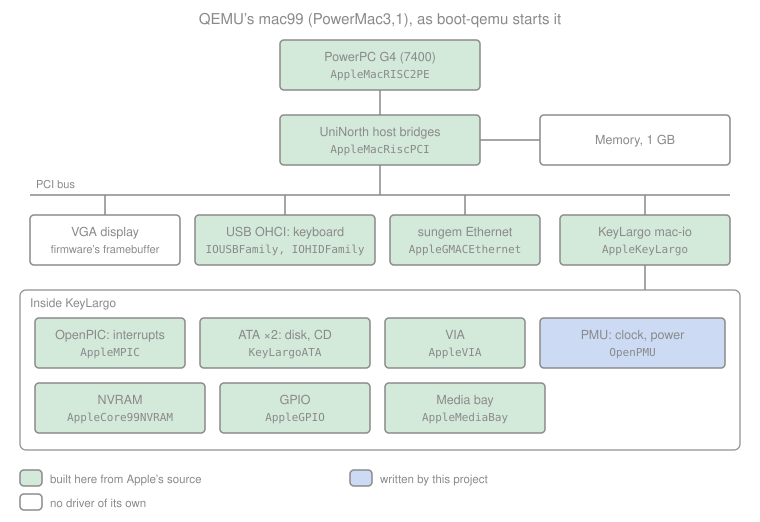
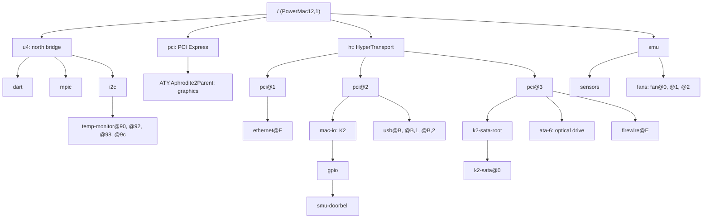

# PowerPC Macs and QEMU's mac99

## What you will learn

- Which PowerPC Macs Leopard runs on, and how Apple names a model (`PowerMac12,1`) and a platform (MacRISC2, MacRISC4).
- The two kinds of power controller, the PMU and the SMU, which keep the clock, restart and switch off the Mac, and why the one a Mac has decides which closed driver it needs.
- Why each family of Macs has its own platform driver, and what the `ppc`, `ppc7400` and `ppc64` slices of a fat binary are.
- What QEMU's `mac99` is, and what it can and cannot test.
- The iMac G5 (`PowerMac12,1`) as the worked example of real hardware: its processor, north bridge, I/O controller and system management unit, which driver runs each, and which of those drivers are open, closed or the project's own.

## The Macs that Leopard runs on

### G4 and G5

The PowerPC Macs that Mac OS X runs on have one of three processors: the G3, the G4 or the G5. Leopard, Mac OS X 10.5, needs an Intel processor, a G5, or a G4 of 867 MHz or more, according to [its technical specifications](https://support.apple.com/en-us/112593). It is the last Mac OS X for PowerPC: Snow Leopard, 10.6, runs on Intel Macs only ([the history](history.md)). So Darwin 9, Leopard's open core, is the last Darwin that Apple shipped for PowerPC Macs.

The G4 is a 32-bit processor of the PowerPC 7400 family, first made by Motorola. The G5 is IBM's PowerPC 970 family, a 64-bit processor that also runs 32-bit code. Darwin 9's kernel is a 32-bit program on both ([Hardware and boot basics](hardware-basics.md)).

### Model identifiers

Every Mac carries a model identifier in its device tree: a family name and two numbers, such as `PowerMac12,1`, `PowerBook5,1` or `RackMac3,1`, the Xserve G5. These are Apple's internal names, not the names it sold the Macs under: the iMac G5 with a built-in camera is `PowerMac12,1`, and the first iMac G5 `PowerMac8,1`. A running Darwin reports it with `sysctl hw.model`.

### Platform names

The root of a Mac's device tree also lists, in its `compatible` property, the platform the board belongs to: a family of boards built from the same chips. The iMac G5's root says `PowerMac12,1`, `MacRISC4` and `Power Macintosh`; QEMU's `mac99` says `PowerMac3,1`, `MacRISC`, `MacRISC2` and `Power Macintosh`. MacRISC2 and MacRISC3 are the platforms of G3 and G4 Macs built around Apple's UniNorth north bridge and KeyLargo I/O controller; MacRISC4 is the G5 platform, built around the U3 or U4 north bridge and the K2 I/O controller.

## Power controllers: the PMU and the SMU

### What they do

Every Mac that Leopard runs on has a small processor of its own on the logic board, apart from the G4 or G5, with its own firmware. It stays powered while the Mac is switched off, and it does the jobs that the main processor cannot do for itself:

- keep the real-time clock, which counts while the Mac is off;
- switch the power on when the power button is pressed, and off or off and on again when the kernel asks;
- on many models, read temperature sensors and drive the fans.

There are two kinds. G4 Macs and the first G5s have a PMU, a power management unit; the later G5s have an SMU, a system management unit, its successor. [Step 5](../steps/step-5-clock-and-power.md) explains how the kernel uses either to read the clock and switch off.

### Which Mac has which

Apple's AppleMacRISC4PE 204.0.9, the platform driver of the G5 Macs, names every G5 model in its `IOPlatformPluginTable`, with the closed platform plug-in that Leopard runs on each. Linux's [`drivers/macintosh/Kconfig`](https://github.com/torvalds/linux/blob/master/drivers/macintosh/Kconfig) says, in its options for each model's thermal driver, which of them has a PMU and which an SMU. Together:

| Model identifiers | Mac | Power controller | Platform driver | Leopard's platform plug-in |
|---|---|---|---|---|
| platform `MacRISC2` or `MacRISC3` | G4 desktops and portables | PMU | AppleMacRISC2PE | none; some portables use monitors inside AppleMacRISC2PE |
| `PowerMac7,2`, `PowerMac7,3` | Power Mac G5, "AGP" variants | PMU | AppleMacRISC4PE | `PowerMac7_2_PlatformPlugin` |
| `RackMac3,1` | Xserve G5 | PMU | AppleMacRISC4PE | `RackMac3_1_PlatformPlugin` |
| `PowerMac8,1`, `PowerMac8,2` | iMac G5 | SMU | AppleMacRISC4PE | `SMU_Neo2_PlatformPlugin` |
| `PowerMac9,1` | single-processor Power Mac G5 with an SMU | SMU | AppleMacRISC4PE | `SMU_Neo2_PlatformPlugin` |
| `PowerMac11,2` | dual-core Power Mac G5 (PowerPC 970MP) | SMU | AppleMacRISC4PE | `PowerMac11_2_PlatformPlugin` |
| `PowerMac12,1` | iMac G5 (iSight) | SMU | AppleMacRISC4PE | `SMU_Neo2_PlatformPlugin`, with `PowerMac12_1_PlatformPlugin` on top |

The Mac names in the G5 rows are Linux's, from its Kconfig and the table of models in [`arch/powerpc/platforms/powermac/feature.c`](https://github.com/torvalds/linux/blob/master/arch/powerpc/platforms/powermac/feature.c). Its Kconfig names the older chip, the Cuda, only on Macs that Leopard does not support (the first iMacs, the blue and white G3, the "Yikes" G4), so every Mac Leopard runs on has a PMU or an SMU. AppleMacRISC4PE's source handles both: its `MacRISC4PE.cpp` has a branch for a device-tree node named `smu` and another for one named `pmu`.

### Why the controller decides the closed driver

Leopard drives the PMU with ApplePMU and the SMU with AppleSMU, and Apple published the source of neither. Both are closed. The project's rule 6 keeps every Apple binary off the image, so a Darwin 9 built from source has no driver for either chip. On every PowerPC Mac, that means no clock at boot, and a kernel that cannot restart or switch the machine off: `RTC did not show up` and `MACH Reboot`, as [Step 5](../steps/step-5-clock-and-power.md) shows.

Which chip a Mac has therefore decides what the project must write. For the iMac G5's SMU, the project wrote OpenSMU ([D81](https://github.com/nyg/PowerDarwin/blob/master/DEVIATIONS.md#d81)), which keeps the clock, restarts, powers off and drives the fans. QEMU's `mac99` has a PMU, for which no open driver exists yet; [What's next](../steps/whats-next.md) lists one.

The fans are a second closed piece on the G5s. Leopard's platform plug-ins, the drivers in the table's last column, run the fans from the sensors; all of them are closed. Tiger's AppleMacRISC4PE 186.3.1 publishes the iMac's plug-in and thermal profile, from which OpenSMU takes its values ([OpenSMU](../synthesis/opensmu.md)). Without a plug-in, the iMac's SMU runs its fans on its own, loudly, until OpenSMU's fan loop takes over ([Step 7](../steps/step-7-fans.md)).

## Platform drivers

### Why each family has its own

xnu does not know how a given Mac's interrupts are wired, which bridge is where, how many processors it has, or how it sleeps. It leaves all of that to the platform expert: a part of the kernel, `ApplePlatformExpert`, plus a platform driver that matches the root of the device tree and knows one family of boards ([Hardware and boot basics](hardware-basics.md) shows the match). Apple's README for the platform plug-ins, in AppleMacRISC4PE 204.0.9's `IOPlatformPlugins/PlatformPlugin-README`, puts the split in one line: "AppleMacRISC2PE for G3/G4/UniNorth/KeyLargo-based systems, AppleMacRISC4PE for G5/U3/K2-based systems". The plug-ins then add what belongs to a single model, such as its fans.

Each platform driver also starts the drivers of its processors (`MacRISC2CPU`, `MacRISC4CPU`), and of its north bridge: AppleMacRISC4PE's `AppleU3` drives the U3 and U4. That is where the project met D39: the U4's register offsets that AppleMacRISC4PE uses are in none of Apple's published headers, so a patch defines them ([D39](https://github.com/nyg/PowerDarwin/blob/master/DEVIATIONS.md#d39), told in [Step 1, part 2](../steps/step-1-drivers-and-bootx.md)).

### Both on the image

Both platform drivers are open, and the image carries both: AppleMacRISC2PE, which runs in QEMU, and AppleMacRISC4PE, which runs on the iMac. Each finds nothing to match on the other machine: the tenth boot test in QEMU added AppleMacRISC4PE and noted that `mac99` "is a MacRISC2 machine, so the kext has nothing to match there".

## The slices of a fat binary

A Mach-O file can hold several builds of the same program, one slice per processor, in one fat binary; the kernel or dyld picks the slice that suits the processor it runs on. Darwin 9's PowerPC slices are three:

| Slice | Built for | Runs on | On the image, for example |
|---|---|---|---|
| `ppc` | any 32-bit PowerPC | G3, G4, G5 | `mach_kernel` |
| `ppc7400` | the G4's PowerPC 7400 and later | G4, G5 | `/bin/sh`, `libSystem.B.dylib`, `dyld` |
| `ppc64` | 64-bit PowerPC | G5 | `libSystem.B.dylib`, `dyld` |

The examples come from the builds of 19 November 2026: our `mach_kernel` is `i386 ppc`, `/bin/sh` is `ppc7400 i386`, and `libSystem.B.dylib` and `/usr/lib/dyld` are `ppc7400 ppc64 i386 x86_64`. The `i386` and `x86_64` slices are for Intel Macs, which Leopard also supports. The image needs only the PowerPC ones, but darwinbuild sets the build's architectures to `ppc i386`, as Apple's build lists do, and some projects add their 64-bit slices themselves. On the iMac under Leopard, `sysctl hw.cpusubtype` prints 100, Mach-O's number for the PowerPC 970: a G5 runs `ppc7400` and `ppc` code, and 64-bit `ppc64` code. [darwinbuild](../method/darwinbuild.md) shows how the build chooses the slices.

## QEMU's mac99

### What it is

QEMU is an open-source emulator: a program that imitates a whole computer, processor and devices, so that another operating system can boot inside it. Its `qemu-system-ppc` imitates PowerPC machines, and its `mac99` machine imitates a G4 Power Mac of the MacRISC2 platform. [scripts/boot-qemu](https://github.com/nyg/PowerDarwin/blob/master/scripts/boot-qemu) starts it as `-M mac99,via=pmu -m 1024`, with the test image as its disk.

QEMU's `mac99` runs OpenBIOS, an open-source Open Firmware, which builds its device tree and gives the root the model `PowerMac3,1`. Its machine, in QEMU's [`hw/ppc/mac_newworld.c`](https://github.com/qemu/qemu/blob/master/hw/ppc/mac_newworld.c), has:

- a PowerPC 7400, the G4, as its default processor in `qemu-system-ppc`;
- UniNorth's host bridges to memory and PCI;
- a KeyLargo I/O controller with an OpenPIC interrupt controller, two ATA controllers (the disk on the first, the CD on the second), NVRAM, GPIO and a VIA, the interface chip through which the kernel talks to the PMU or, on older Macs, the Cuda;
- with `via=pmu`, a PMU instead of QEMU's default Cuda;
- an OHCI USB controller, and with `via=pmu` a USB keyboard and mouse on it, since there is then no ADB, the older Macs' keyboard bus;
- a PCI VGA display, which BootX and the kernel see through the framebuffer that OpenBIOS set up;
- with `boot-qemu`'s `-nic user,model=sungem`, a `sungem` Ethernet card, QEMU's model of the GMAC chip that Apple's Macs of this time have.

### What it can and cannot test

QEMU runs on any current computer, can be reset at will, and can be typed into and photographed through its monitor ([How testing is done](../method/testing.md)). The kernel, the userland, launchd's startup, the console login and the network stack of Steps 1 to 4 were proved there first, through QEMU's ATA disk, its USB keyboard and its `sungem` card, which our AppleGMACEthernet drives. So were Step 9's CDs and USB disks, plugged in while QEMU runs, the USB disks on an EHCI controller added for the test, since QEMU's OHCI model stops about 90 seconds after boot ([Step 9](../steps/step-9-disks-and-devices.md)).

It cannot test what it does not imitate, and that is most of what makes a G5 Mac a G5 Mac:

- It has a PMU, not an SMU, so OpenSMU has nothing to start on: the clock, restart, power-off and fans of Steps 5 and 7 were proved on the iMac only.
- It has no ApplePMU either, and none can be on the image, so in QEMU the clock starts at 1 January 1970, `reboot` stops at `MACH Reboot`, and configd waits 60 seconds at boot, since AppleMacRISC2PE's processor driver waits for ApplePMU ([Step 8](../steps/step-8-clean-boot.md)).
- It has no U4, DART, HyperTransport, K2 or SATA, so AppleMacRISC4PE, AppleMacRiscHT, AppleK2SATARoot and AppleK2SATA load only on the iMac.
- It has no I²C sensors, fans or audio codec.
- Its processor is a G4, so `qemu-system-ppc` never runs 64-bit code.

That is why every step is proved on real hardware as well, here on an iMac G5.

## The iMac G5

### Its blocks

The iMac G5 (`PowerMac12,1`) is the worked example of real hardware in this book: one model, with one board, which Leopard supports. Its device tree and Leopard's list of drivers on it show these blocks:

- The processor is a PowerPC 970FX, a G5: the device tree's `cpu-version` property starts with `0x003c`, the number Linux's [processor table](https://github.com/torvalds/linux/blob/master/arch/powerpc/kernel/cpu_specs_book3s_64.h) gives the 970FX. It is a 64-bit processor running Darwin 9's 32-bit kernel.
- The U4 north bridge (`u4@0,f8000000`, model `AAPL,U4`) holds the memory controller, the DART, an MPIC interrupt controller, an I²C controller with four temperature sensors on it, a PCI Express bridge to the graphics chip, and the HyperTransport link to the K2 (`ht@0,f2000000`).
- The K2 I/O controller (model `AAPL,K2-Keylargo`) sits behind HyperTransport and appears to software as several PCI devices on three PCI-to-PCI bridges: `mac-io`, which holds a second MPIC, the GPIO lines, an I²C controller and the I²S audio bus, and beside it the SATA controller of the internal disk (`k2-sata-root`), the ATA controller for the optical drive (`ata-6`, compatible `shasta-ata`, the name AppleKauaiATA logs), GMAC Ethernet and FireWire. On the same PCI buses sit a NEC USB controller (two OHCI and one EHCI, `pci1033,35` and `pci1033,e0`) and the AirPort card, a Broadcom chip (`pci14e4,4318`). Bluetooth is a USB device.
- The SMU (`smu@0,0`) keeps the clock, switches the power, reads the processor's temperature and runs the three fans. Other drivers reach it through the K2: AppleK2 hands it the address of its command buffer and AppleGPIO rings its doorbell, the GPIO line `smu-doorbell` ([Step 5](../steps/step-5-clock-and-power.md)).
- The graphics chip is ATI's RV370 (its `model` property) on PCI Express, in a node named `ATY,Aphrodite2Parent` whose `compatible` names it by its PCI numbers.
- The boot ROM and NVRAM are one flash chip, `nvram@0,fff04000`.

### Its device tree

An excerpt, from the root down to the blocks this book talks about:

### Which driver runs each block

The same, as a table, with the project each driver comes from:

| Block | Driver on the image | Project | Kind |
|---|---|---|---|
| PowerPC 970FX, U4 | `AppleMacRISC4PE` (`MacRISC4CPU`, `AppleU3`) | AppleMacRISC4PE 204.0.9 | open, with D39 |
| DART | `AppleDART` | AppleMacRiscPCI 3.4 | open |
| MPICs | `AppleMPIC` | AppleMPIC 1.5.3 | open |
| HyperTransport, PCI Express | `AppleMacRiscHT`, `AppleMacRiscPCIE`, `IOPCI2PCIBridge` | AppleMacRiscPCI 3.4, IOPCIFamily 110 | open |
| K2 | `AppleK2`, `AppleK2Driver`, `IOKeyLargo` | AppleKeyLargo 172.3.1 | open |
| SATA and the disk | `AppleK2SATARoot`, `AppleK2SATA`, `IOATAFamily`, `IOATABlockStorageDriver` | AppleK2SATARoot, AppleK2SATA, IOATAFamily, IOATABlockStorage 130.3.1 | open, Panther's IOATABlockStorage ([D40](https://github.com/nyg/PowerDarwin/blob/master/DEVIATIONS.md#d40)) |
| ATA and the optical drive | `AppleKauaiATA`, `IOATAPIProtocolTransport`, `IOSCSIArchitectureModelFamily` | AppleKauaiATA, IOATAPIProtocolTransport, IOSCSIArchitectureModelFamily 139.0.2 | open, Panther's SCSI family ([D85](https://github.com/nyg/PowerDarwin/blob/master/DEVIATIONS.md#d85)) |
| GMAC Ethernet | `AppleGMACEthernet` | AppleGMACEthernet, IONetworkingFamily | open |
| USB | `AppleUSBOHCI`, `AppleUSBEHCI` | IOUSBFamily 349.4.3 | open |
| GPIO | `AppleGPIO`, `MacIOGPIO` | AppleGPIO | open |
| I²C | `IOI2CControllerPPC` | IOI2CFamily 111.0.2 | open |
| NVRAM | `AppleFlashNVRAM` | AppleFlashNVRAM | open |
| Audio | `AppleOnboardAudio`, with OpenOnyx for the codec | AppleOnboardAudio 258.3.1, OpenOnyx | open and ours ([D94](https://github.com/nyg/PowerDarwin/blob/master/DEVIATIONS.md#d94)) |
| SMU, clock, power, fans | `OpenSMU` | OpenSMU | ours ([D81](https://github.com/nyg/PowerDarwin/blob/master/DEVIATIONS.md#d81)), in place of the closed AppleSMU and platform plug-ins |
| FireWire | none | Apple's `AppleFWOHCI` is closed | closed |
| Graphics acceleration | none | Apple's `ATIRadeon9700` is closed | closed |
| AirPort, Bluetooth | none | Apple's `AppleAirPortBrcm4311`, `IO80211Family`, `IOBluetoothFamily` are closed | closed |

A single-user shell needs the rows from the processor down to SATA, and USB for the keyboard; [Step 1, part 2](../steps/step-1-drivers-and-bootx.md) tells how they were built and how the share of ours grew until every file on the image came from the project's builds. The screen of a single-user shell is the firmware's framebuffer, which the kernel keeps without a graphics driver: Leopard's own driver cache leaves IOGraphics out.

## What each machine proves

| Area | QEMU's `mac99` | iMac G5 |
|---|---|---|
| Kernel, userland, launchd, login | yes | yes |
| Platform driver | AppleMacRISC2PE | AppleMacRISC4PE |
| Root disk | ATA, KeyLargoATA | SATA, AppleK2SATA |
| Ethernet | `sungem`, QEMU's model of GMAC | GMAC |
| Clock, restart, power-off | no: ApplePMU is closed | yes, through OpenSMU |
| Fans and sensors | none to drive | yes, through OpenSMU |
| IOMMU, HyperTransport, 64-bit processor | none | yes |

## Where to look

- [reference/imacg5/kextstat.txt](https://github.com/nyg/PowerDarwin/blob/master/reference/imacg5/kextstat.txt), [loaded-kexts.tsv](https://github.com/nyg/PowerDarwin/blob/master/reference/imacg5/loaded-kexts.tsv), [extensions.txt](https://github.com/nyg/PowerDarwin/blob/master/reference/imacg5/extensions.txt) and [boot-kernel-log.txt](https://github.com/nyg/PowerDarwin/blob/master/reference/imacg5/boot-kernel-log.txt): Leopard on the iMac.
- [reference/qemu-userland-test/kextstat.txt](https://github.com/nyg/PowerDarwin/blob/master/reference/qemu-userland-test/kextstat.txt): the drivers QEMU's `mac99` loads.
- [scripts/boot-qemu](https://github.com/nyg/PowerDarwin/blob/master/scripts/boot-qemu): how QEMU is started.
- [D39](https://github.com/nyg/PowerDarwin/blob/master/DEVIATIONS.md#d39), [D40](https://github.com/nyg/PowerDarwin/blob/master/DEVIATIONS.md#d40), [D81](https://github.com/nyg/PowerDarwin/blob/master/DEVIATIONS.md#d81), [D85](https://github.com/nyg/PowerDarwin/blob/master/DEVIATIONS.md#d85), [D94](https://github.com/nyg/PowerDarwin/blob/master/DEVIATIONS.md#d94).
- In AppleMacRISC4PE 204.0.9: the `IOPlatformPluginTable` in `AppleMacRISC4PE.xcodeproj/project.pbxproj`, `MacRISC4PE.cpp` (its `smu` and `pmu` branches) and `IOPlatformPlugins/PlatformPlugin-README`. In AppleMacRISC2PE 187.0.5: its personality, in `AppleMacRISC2PE.xcodeproj/project.pbxproj`.
- In AppleMacRiscPCI 3.4: `AppleDART.cpp`.
- QEMU's [`hw/ppc/mac_newworld.c`](https://github.com/qemu/qemu/blob/master/hw/ppc/mac_newworld.c) and OpenBIOS's [`arch/ppc/qemu/init.c`](https://github.com/openbios/openbios/blob/master/arch/ppc/qemu/init.c), for the `mac99` machine and its device tree.
- Linux's [`drivers/macintosh/Kconfig`](https://github.com/torvalds/linux/blob/master/drivers/macintosh/Kconfig), for which Mac has a PMU and which an SMU.
- Linux's [`arch/powerpc/platforms/powermac/feature.c`](https://github.com/torvalds/linux/blob/master/arch/powerpc/platforms/powermac/feature.c), for the names of the models.
- Apple's [Mac OS X 10.5 technical specifications](https://support.apple.com/en-us/112593).
