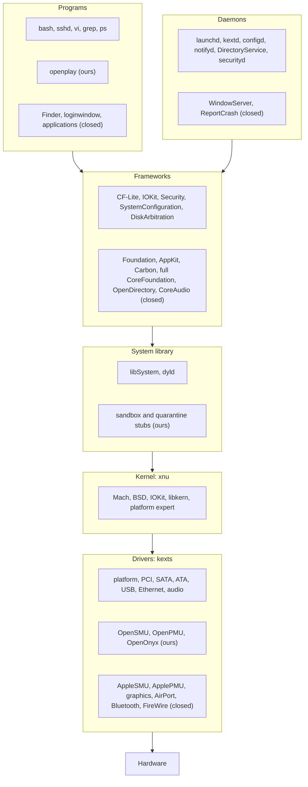

# What Darwin is

## What you will learn

- That Darwin is the open core of Mac OS X: a kernel, xnu, and a Unix userland on one system library, `libSystem`.
- What each part of xnu does: Mach for tasks, threads, memory and messages; a BSD layer for processes, files and sockets; IOKit, the C++ framework in which drivers are written.
- What sits above the kernel: libSystem, dyld, launchd, the daemons and the open frameworks, such as CF-Lite and Security.
- What Apple kept closed in Leopard, from the graphical system to many drivers, and what that leaves out of a Darwin built from source.
- What the project adds where a closed piece cannot be done without, and how this book names the three kinds of code: open, closed and ours.

## The open core of Mac OS X

Mac OS X is a Unix system with Apple's graphical system and applications on top. The part below the graphical system, the kernel and the Unix programs and libraries around it, Apple publishes as source code, and calls it Darwin. Apple's [Kernel Programming Guide](https://developer.apple.com/library/archive/documentation/Darwin/Conceptual/KernelProgramming/Architecture/Architecture.html) gives that name to the kernel and the other core parts of the system together. Each Mac OS X release has its Darwin: Leopard, Mac OS X 10.5, has Darwin 9, and Leopard 10.5.8, build `9L30`, has Darwin 9.8, which is what `uname -r` reports as `9.8.0`.

Darwin is not a separate operating system that Apple builds and ships. It is a set of source projects, 386 in Leopard 10.5.8's build list, one for the kernel, one for the C library, one for each group of commands, one for each driver family, each with its own version, which Apple publishes for each Mac OS X release ([Leopard 9L30](../method/sources-and-roots.md)). Most are under Apple's own licence, the APSL 2.0; the rest keep the licences of their origins, BSD or GPL. Apple builds the same projects, with its closed ones, into Mac OS X. Built alone, the open projects make a Unix system that boots and runs from a text console. That system is what PowerDarwin builds, for PowerPC Macs, and this book calls it Darwin 9.

The rest of this chapter goes up through the layers, from the kernel to the programs, and then says what is missing from each.

Each box holds three kinds of code. Unmarked names are open: built by the project from Apple's published source. Names marked "closed" are Apple's binaries only, with no published source, and are not on the image. Names marked "ours" are written by the project in place of a closed piece.

## The kernel: xnu

Darwin's kernel is xnu. Its source, xnu 1228.15.4 for Darwin 9.8, has a folder for each of its parts: `osfmk` for Mach, `bsd` for the BSD layer, `iokit` for IOKit, `libkern` for the C++ runtime and the kernel's own library, `pexpert` for the platform expert, and `security` for the MAC (mandatory access control) framework, the hooks on which security policies such as the sandbox attach. They are one program, `mach_kernel`, running in kernel mode, the processor's mode in which every instruction and every page of memory is allowed, and in one address space, a single map of virtual addresses onto memory ([Hardware and boot basics](hardware-basics.md#memory) explains both).

### Mach

Mach was designed as a microkernel: a kernel that does only the few things nothing else can, and leaves file systems, networking and drivers to programs. In xnu it provides the kernel's foundations, based on Mach 3.0 and extended by Apple, but it is linked with the other parts into one kernel address space, so that they call each other directly instead of sending messages ([Mach overview](https://developer.apple.com/library/archive/documentation/Darwin/Conceptual/KernelProgramming/Mach/Mach.html)).

Mach's objects are few:

- A task is an address space and the resources that belong to it: memory mappings and ports. It is the part of a Unix process that holds things, but it runs nothing by itself.
- A thread is the thing that runs: a set of registers and a stack, scheduled on a processor. Every thread belongs to a task.
- Virtual memory: Mach maps pages into each task's address space, from memory, from files, or shared with other tasks, and pages them in and out.
- A port is a message queue in the kernel. A task holds rights to ports, to send to them or to receive from them, and tasks talk to each other, and to the kernel, by sending messages to ports.

Messages are how much of Darwin's userland talks. A program asks launchd for a service by a name, receives a send right to the port of the daemon that offers it, and sends it requests; notifyd, configd, securityd and DirectoryService are all reached this way. The functions that pack and unpack such messages are not written by hand: MIG, the Mach Interface Generator, makes them from interface files ending in `.defs`, much as `rpcgen` does for Sun RPC.

### The BSD layer

On top of Mach, xnu has a BSD layer, which gives programs a Unix: processes, users, files, signals, pipes, sockets, and the POSIX system calls. It comes mostly from FreeBSD ([BSD overview](https://developer.apple.com/library/archive/documentation/Darwin/Conceptual/KernelProgramming/BSD/BSD.html)). A process is a Mach task with one or more threads, plus what Unix adds: a process ID, a parent, user and group IDs, open files, a working directory.

The BSD layer holds the virtual file system, with HFS+, Mac OS X's file system, and the other file systems the kernel can mount, and the network stack, with its TCP/IP, routing and sockets. A system call such as `open` or `read` enters the BSD layer; one such as `mach_msg` enters Mach. A Darwin program uses both, usually without knowing it, through libSystem.

### IOKit

IOKit is xnu's framework for drivers. It is object-oriented and written in a restricted subset of C++, without exceptions, multiple inheritance, templates or C++'s runtime type information, for which libkern has its own ([IOKit Fundamentals](https://developer.apple.com/library/archive/documentation/DeviceDrivers/Conceptual/IOKitFundamentals/Features/Features.html)). Every driver is a C++ object, an instance of a class that derives from one of IOKit's families, such as `IOATAController` for ATA controllers or `IOEthernetController` for Ethernet.

IOKit keeps every device and every driver in the IORegistry, a tree of objects. The registry starts from the device tree, the description of the hardware that Open Firmware, the firmware of PowerPC Macs, hands the kernel ([Hardware and boot basics](hardware-basics.md#the-device-tree), [the boot chain](boot-chain.md#open-firmware)). A device appears in it as a nub, the object that stands for the device and to which a driver attaches. Drivers are matched to nubs by the personalities in their `Info.plist`, short descriptions of the devices each driver can drive, and stack on each other, from the controller to the file system ([Hardware and boot basics](hardware-basics.md#matching) shows matching and a driver stack). `ioreg` prints the registry on a running system.

Drivers come in kexts, kernel extensions: bundles that hold the driver's code and its `Info.plist`, in `/System/Library/Extensions`. Those needed to reach the root disk are loaded at boot from the driver cache, one file that holds them all, which the boot loader reads with the kernel; the others are loaded later, by kextd, as devices appear ([the boot chain](boot-chain.md#kexts-and-the-driver-cache)).

### The platform expert

The platform expert is the small part of xnu, with a platform driver for each family of Macs, that knows how a given model is built: how its interrupts are wired, how it reads its clock, how it restarts and switches off. [PowerPC Macs](powerpc-macs.md) describes the platform drivers. On an iMac G5 (`PowerMac12,1`), the project's reference machine, the clock and the power go through the SMU, its power controller ([PowerPC Macs](powerpc-macs.md#power-controllers-the-pmu-and-the-smu)), and [Step 5](../steps/step-5-clock-and-power.md) shows the hooks that the SMU's driver fills in.

## Above the kernel

### libSystem and dyld

Every Darwin program links one system library, `/usr/lib/libSystem.B.dylib`: the C library, the maths library, the system calls, threads, name lookup and more, in one file. It is made of more than a dozen projects, linked together by the Libsystem project: Libc, Libm, Libinfo (users, groups, host names), Libsyscall (the system-call stubs, from xnu), libdyld, libnotify, copyfile, CommonCrypto, and others ([Step 1, part 1](../steps/step-1-kernel-and-userland.md)).

dyld, `/usr/lib/dyld`, is the dynamic linker: the kernel starts it with each program, and it loads the program's libraries, libSystem first, and binds their symbols before `main` runs. On Leopard it also keeps a shared cache of the most used libraries, made by `update_dyld_shared_cache` ([Step 4](../steps/step-4-everyday-commands.md)).

### launchd and the daemons

launchd is process 1. It starts the system, then starts and watches every daemon from its job files in `/System/Library/LaunchDaemons`, at boot or on demand, when a client connects to the daemon's socket or Mach port; it takes the place of `init`, `inetd` and the start-up scripts of other Unix systems ([the boot chain](boot-chain.md)). The daemons the image runs include kextd, which loads kexts; configd, which keeps the network configuration; notifyd; diskarbitrationd, which mounts disks; DirectoryService, which holds the user accounts; securityd, which keeps security sessions and keychains; syslogd, ntpd and sshd.

### Commands

The commands come in projects grouped by kind, most of them from the BSDs, some from GNU: `file_cmds` (`ls`, `cp`, `chmod`), `shell_cmds` (`echo`, `find`, `xargs`), `system_cmds` (`login`, `getty`, `reboot`), `text_cmds`, `adv_cmds` (`ps`), `network_cmds`, `diskdev_cmds` (`mount`, `fsck_hfs`); and one project each for bash, grep, less, Vim, OpenSSH, ntp and the others.

### The open frameworks

Mac OS X's libraries are frameworks: bundles in `/System/Library/Frameworks` that hold a library with its headers and resources. Some are open:

- CoreFoundation, Apple's C library of strings, arrays, dictionaries, property lists and run loops, which much of the userland uses. Darwin gets the open part of it, CF-Lite, from the CF project; Leopard's own CoreFoundation has more, and is closed.
- IOKit.framework, from the IOKitUser project, through which programs reach the IORegistry and drivers.
- Security, the framework of keychains, certificates and authorisation, built from 32 projects of its own ([Step 3, part 1](../steps/step-3-security-and-daemons.md)).
- SystemConfiguration, configd's library; DiskArbitration; DirectoryService's framework; Kerberos; OpenSSL; and others.

## What Apple kept closed

Apple publishes only part of Mac OS X. What it keeps closed, it ships as binaries only, and those are not on the image: the project's rule 5 lets the image hold only what is built from open source or written by the project's scripts. Three groups matter here.

### The graphical system and its frameworks

None of Mac OS X's graphical system is in Darwin: not WindowServer, which draws the screen; not Quartz, its drawing engine; not Aqua, its look; not Cocoa (Foundation and AppKit), Carbon, or the applications built on them, from the Finder to loginwindow, the graphical login. Nor are CoreAudio, through which Leopard plays sound, or OpenDirectory, the framework through which Leopard changes accounts. The full CoreFoundation, too, is closed: CF-Lite lacks, for example, `CFNotificationCenter`, which sends notifications between processes.

So the image has no graphical login, and its console login is getty's `login:` prompt instead of loginwindow ([Step 2](../steps/step-2-console-login.md)). It plays sound through its own small command, `openplay`, since CoreAudio and Leopard's `afplay` are closed ([D95](https://github.com/nyg/PowerDarwin/blob/master/DEVIATIONS.md#d95)).

### Pieces of open projects

Some open projects call into closed code: a framework that is not published, a tool that is, but on top of Foundation. Where they do, the project turns the feature off or works around it, and records it. DEVIATIONS.md has 26 such rows, of the kind `closed-dependency`: a feature turned off because it needs closed Apple code. A few examples:

- Libc's dtrace probes need dtrace's tools, which need Foundation and the closed Symbolication framework ([D12](https://github.com/nyg/PowerDarwin/blob/master/DEVIATIONS.md#d12)).
- launchd's SystemStarter, which runs the old start-up items, posts notifications through `CFNotificationCenter`, so it is not built ([D21](https://github.com/nyg/PowerDarwin/blob/master/DEVIATIONS.md#d21)).
- `passwd` and `chpass` change accounts through OpenDirectory, so they are not built either ([D44](https://github.com/nyg/PowerDarwin/blob/master/DEVIATIONS.md#d44)).
- IOKitUser was published with 24 empty files where the closed HID event system would be ([D22](https://github.com/nyg/PowerDarwin/blob/master/DEVIATIONS.md#d22)).

### Drivers

Many drivers are closed, and several of them are ones a PowerPC Mac needs:

- ApplePMU and AppleSMU, the drivers of the power controllers, which keep the clock, restart and power off every PowerPC Mac ([PowerPC Macs](powerpc-macs.md));
- Leopard's platform plug-ins that run the G5s' fans; Tiger's, in AppleMacRISC4PE 186.3.1, are published, and give OpenSMU its sensors, targets and rubber band, the rule that keeps the CPU fan no more than 500 rpm slower than the optical drive's fan ([OpenSMU](../synthesis/opensmu.md));
- the graphics drivers' acceleration (`ATIRadeon9700` on the iMac), AirPort, Bluetooth, and the FireWire controller driver, `AppleFWOHCI`;
- the sandbox and firewall policies, and the disk-image driver.

Two open driver projects are missing from Apple's publications at the versions Leopard ships: IOATABlockStorage 200.1.8, through which the iMac's disk is reached, and IOSCSIArchitectureModelFamily 200.3.6, which CDs and USB disks need ([README.md](https://github.com/nyg/PowerDarwin/blob/master/README.md), rule 1). [What stays closed](../synthesis/what-stays-closed.md) lists every closed piece the project met, with what its absence costs.

## What the project adds

Where a system without a closed piece would not work, the project writes its own, or builds an older open version in its place. DEVIATIONS.md files these, with smaller stand-ins such as header copies, under the kind `closed-replacement`. The book calls the new code "ours"; Panther's drivers stay Apple's open code:

- OpenSMU, a new kext in place of AppleSMU, which keeps the clock, restarts, powers off and drives the fans of the iMac ([D81](https://github.com/nyg/PowerDarwin/blob/master/DEVIATIONS.md#d81), [OpenSMU](../synthesis/opensmu.md));
- OpenOnyx, in place of the codec plug-in that Apple published only as a stub ([D94](https://github.com/nyg/PowerDarwin/blob/master/DEVIATIONS.md#d94));
- stubs for Leopard's closed sandbox and quarantine libraries, so that libSystem exports the same symbols as Apple's ([D13](https://github.com/nyg/PowerDarwin/blob/master/DEVIATIONS.md#d13), [D15](https://github.com/nyg/PowerDarwin/blob/master/DEVIATIONS.md#d15));
- `openplay`, a small command that plays sound without CoreAudio ([D95](https://github.com/nyg/PowerDarwin/blob/master/DEVIATIONS.md#d95));
- Panther's IOATABlockStorage 130.3.1 and IOSCSIArchitectureModelFamily 139.0.2, Apple's last published versions, built in place of Leopard's unpublished ones ([D40](https://github.com/nyg/PowerDarwin/blob/master/DEVIATIONS.md#d40), [D85](https://github.com/nyg/PowerDarwin/blob/master/DEVIATIONS.md#d85)).

Everything else on the image is Apple's open source, at Leopard 10.5.8's versions, built by the project. [Darwin's history](history.md) says how this compares with what was done before, and [The rules](../method/rules.md) why the project is so strict about which code reaches the image.

## How the book names things

- "Darwin 9" is the system the project builds; `Darwin9` is only the name of the partition it is tested on.
- "Leopard" is Mac OS X 10.5.8, the system whose open parts are built here and whose binaries the results are compared with.
- "Open" means built here from Apple's published source; "closed" means Apple's binary only; "ours" means written by the project.
- "Our kernel" is xnu as built here; "Apple's kernel" is the one Leopard ships.

## Where to look

- [README.md](https://github.com/nyg/PowerDarwin/blob/master/README.md): the goal, the rules, the steps and the status.
- [hardware/powermac12-1.md](https://github.com/nyg/PowerDarwin/blob/master/hardware/powermac12-1.md): the drivers an iMac G5 loads, open and closed.
- [DEVIATIONS.md](https://github.com/nyg/PowerDarwin/blob/master/DEVIATIONS.md): the `closed-dependency` and `closed-replacement` rows, among them [D12](https://github.com/nyg/PowerDarwin/blob/master/DEVIATIONS.md#d12), [D13](https://github.com/nyg/PowerDarwin/blob/master/DEVIATIONS.md#d13), [D15](https://github.com/nyg/PowerDarwin/blob/master/DEVIATIONS.md#d15), [D21](https://github.com/nyg/PowerDarwin/blob/master/DEVIATIONS.md#d21), [D22](https://github.com/nyg/PowerDarwin/blob/master/DEVIATIONS.md#d22), [D40](https://github.com/nyg/PowerDarwin/blob/master/DEVIATIONS.md#d40), [D44](https://github.com/nyg/PowerDarwin/blob/master/DEVIATIONS.md#d44), [D81](https://github.com/nyg/PowerDarwin/blob/master/DEVIATIONS.md#d81), [D85](https://github.com/nyg/PowerDarwin/blob/master/DEVIATIONS.md#d85), [D94](https://github.com/nyg/PowerDarwin/blob/master/DEVIATIONS.md#d94), [D95](https://github.com/nyg/PowerDarwin/blob/master/DEVIATIONS.md#d95).
- [manifest/9L30.tsv](https://github.com/nyg/PowerDarwin/blob/master/manifest/9L30.tsv): every project of Darwin 9.8 with its version and where its source comes from.
- [replacements/](https://github.com/nyg/PowerDarwin/blob/master/replacements/): the project's own code in place of closed pieces.
- In xnu 1228.15.4: the top-level folders `osfmk`, `bsd`, `iokit`, `libkern`, `pexpert` and `security`.
- Apple's [Kernel Programming Guide](https://developer.apple.com/library/archive/documentation/Darwin/Conceptual/KernelProgramming/Architecture/Architecture.html), its [Mach](https://developer.apple.com/library/archive/documentation/Darwin/Conceptual/KernelProgramming/Mach/Mach.html) and [BSD](https://developer.apple.com/library/archive/documentation/Darwin/Conceptual/KernelProgramming/BSD/BSD.html) overviews, and [IOKit Fundamentals](https://developer.apple.com/library/archive/documentation/DeviceDrivers/Conceptual/IOKitFundamentals/Features/Features.html).
