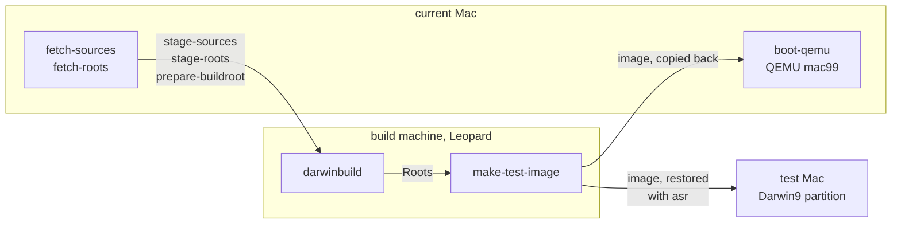
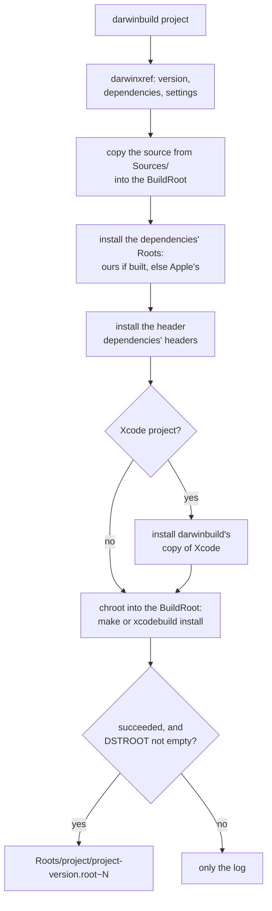
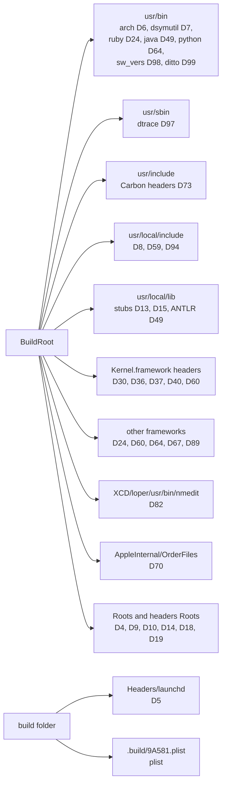

# darwinbuild and the build machine

## What you will learn

- What darwinbuild does to build one project: from the build list, through a BuildRoot filled with the Roots the project depends on, to a new Root of its own.
- How darwinxref's database knows each project's version, dependencies and build settings, and how the options `-headers` and `-target` and another version change a build.
- Why the build machine is a PowerPC Mac running Leopard and Xcode 3.1.4, and what darwinbuild does to its copy of Xcode.
- How the project's scripts stage sources and Roots on the build machine, and how `prepare-buildroot` turns every change to the build environment into a step that can be checked and repeated.

## Three machines

The work is split between two Macs and tested on a third. A current Mac holds the repository, downloads the sources and Roots ([the previous chapter](sources-and-roots.md)), and runs QEMU. The build machine is a PowerPC Mac running Leopard 10.5.8 with Xcode 3.1.4 and darwinbuild, which builds every project in a build folder, `~/9L30`, and makes the test image in `/private/var/tmp`. The project's own runs Sorbet Leopard, a community update of Leopard 10.5.8 whose kernel and drivers carry the versions of 10.5.8's build list. The scripts that link the two run on the current Mac and reach the build machine over SSH; each takes the build machine's SSH host name as its first argument. So the current Mac needs an SSH login on the build machine, and, since `prepare-buildroot` runs `sudo` there over SSH without a terminal, `sudo` on the build machine must not ask for a password.

The image is tested in QEMU on the current Mac, and on a real PowerPC Mac, the test Mac, which keeps Leopard on one partition of its disk and starts the image from another. The project's test Mac is an iMac G5 (`PowerMac12,1`), the reference machine on which every step is proved ([How testing is done](testing.md)). Any PowerPC Mac with Leopard 10.5.8 and Xcode 3.1.4 can be the build machine.



### Why a PowerPC Mac with Leopard

darwinbuild runs only on Mac OS X. Many projects are Xcode projects, built with `xcodebuild`, which is closed, and darwinbuild takes it from the Xcode installed on the host.

The build environment shares the host's kernel and daemons. The notes at the top of darwinbuild's `darwinbuild.in` warn that "items in the changed root still need to be compatible with the system daemons that are running". The host must therefore run the release being built: Leopard.

The programs a build makes run on the build machine as soon as they are installed into the build environment, since later builds use them: our `/bin/sh` runs the build scripts of the projects built after bash, and Apple's `tar` runs on our libSystem. So the build machine must run PowerPC binaries natively.

Rule 4 asks for the release's own toolchain: `gcc` 5465, `gcc_42` 5531, `cctools` 667.3 and `ld64` 77.1, the compilers, assembler and linkers of 10.5.8. They are projects of the build list like any other, and darwinbuild installs them into each build environment from their Roots: Apple's until Step 10, ours since, after a check that ours and Apple's give the same output for the same input ([Step 10](../steps/step-10-working-unix.md)). Xcode 3.1.4 is the last Xcode for Leopard, not the one Apple built 9L30 with ([D23](https://github.com/nyg/PowerDarwin/blob/master/DEVIATIONS.md#d23) shows one difference); the build uses only its `xcodebuild` and closed helpers, which darwinbuild points at the toolchain's own compilers (below).

The build machine does not download. Leopard's TLS is too old for GitHub and archive.org, so the current Mac fetches and checks everything, and copies it across.

## What darwinbuild does

darwinbuild is a set of shell scripts and a small database tool, written by Apple and kept on GitHub as [macosforge/darwinbuild](https://github.com/macosforge/darwinbuild), now archived. The project uses its `Darwin9` branch at commit `4848b7f`, unchanged. It builds one project at a time, as root: `sudo /usr/local/bin/darwinbuild <project>`, with the full path because Leopard's `sudo` leaves `/usr/local/bin` out of its search path. Every build is run in `~/9L30`, since darwinbuild takes its working directory as the build folder.

### The build folder

`darwinbuild -init 9L30`, run once in `~/9L30`, which then holds only `.build/` and the nine build lists copied into it, makes the build folder:

| Path | Holds |
|---|---|
| `.build/` | the build lists and darwinxref's database, `xref.db` |
| `Sources/` | the sources, as tarballs or unpacked folders |
| `Roots/` | the Roots darwinbuild makes, and `Roots/.DownloadCache/`, the downloaded ones |
| `Headers/` | the headers Roots darwinbuild makes |
| `Symbols/` | each build's unstripped binaries |
| `Logs/` | one log per build |
| `BuildRoot` | a link to the mounted build environment |

The build environment, the BuildRoot, is a sparse disk image, `.build/buildroot.sparsebundle`: an HFSX volume, the variant of HFS+ that tells upper-case from lower-case names, that may grow to 1 TB but takes only the room its files use. darwinbuild mounts it as `/Volumes/BuildRoot_9L30_` followed by the date and time it was made.

`-init` then loads the build list `9L30` into the database, reads its `inherits`, loads `9J61`, and so on down to `9A581`. It would download each list from `svn.macosforge.org` if the file were not already in `.build/`; since that host is gone, the lists are copied there first ([D2](https://github.com/nyg/PowerDarwin/blob/master/DEVIATIONS.md#d2)), and darwinbuild finds them.

### darwinxref

darwinxref is darwinbuild's database tool, a C program over an SQLite file. Once the build lists are loaded, it answers every question darwinbuild asks about a project: `darwinxref version xnu` prints `xnu-1228.15.4`, `darwinxref dependencies -build xnu` the projects xnu needs to build, `darwinxref environment xnu` the settings to build it with. It also records which files each Root installed. When a build list changes, `darwinxref loadIndex` reloads it.

`darwinxref environment` also builds the compiler flags: `RC_CFLAGS` is `RC_NONARCH_CFLAGS` followed by one `-arch` for each processor of `RC_ARCHS`, and darwinxref rebuilds it so even when a build list sets `RC_CFLAGS` itself. Apple's build put the flags in the other order, which a diff in Ruby's build expects ([D105](https://github.com/nyg/PowerDarwin/blob/master/DEVIATIONS.md#d105)).

A project's entry in a build list names its dependencies by kind. This is part of xnu's, from `9A581.plist`:

```text
xnu = {
	dependencies = {
		build = (
			adv_cmds,
			awk,
			bash,
			bootstrap_cmds,
			cctools,
			...
		);
		...
	};
	version = 1228;
};
```

`build` names the tools the build runs: the shell, `make`, the compilers. `header` names the projects whose headers it includes. `lib` and `staticlib` name the dynamic and static libraries it links. `run` names what it needs at run time. darwinbuild installs the full Root of every `build`, `run`, `lib` and `staticlib` dependency, and of the `lib` and `run` dependencies of those in turn, and only the headers Root of a `header` dependency.

Apple's lists are not always complete, and a missing dependency is one of the commonest failures of a first build. darwinbuild then builds without the missing project's files, or with Apple's older copy left in the BuildRoot by an earlier build, and the compiler stops on a header that is not there, such as `IOKit/storage/IOBDMedia.h` ([D18](https://github.com/nyg/PowerDarwin/blob/master/DEVIATIONS.md#d18)). The fix is either to put the files into the BuildRoot or to add the dependency to `9A581.plist`; [The rules](rules.md) says which comes first.

### One build, step by step

`darwinbuild <project>` then takes these steps:

1. It asks darwinxref for the project's version, the project whose source an alias uses, and the target and configuration the build list names, if any.
2. It looks in `Sources/` for the source, an unpacked folder `<project>-<version>` or a tarball, and copies it into the BuildRoot, under `SourceCache/<project>/`. It would download the tarball from the build list's source sites if it were not there.
3. It picks the build tool: `xcodebuild` if the source has an Xcode or Project Builder project, `make` otherwise.
4. It installs Roots into the BuildRoot: the `files` project, which lays out the folders of a Mac OS X volume, `bash` and what bash needs, and then every dependency, followed by the headers of the `header` dependencies. For an Xcode project it also installs its copy of the host's Xcode (below).
5. It writes a build script, `build-<project>-<version>~N.sh`, which clears every environment variable, sets `PATH` and the build list's settings, and runs `make install` or `xcodebuild install` with four folders: `SRCROOT`, the source; `OBJROOT`, the object files; `SYMROOT`, the unstripped products; and `DSTROOT`, an empty folder the project installs into.
6. It mounts `devfs` inside the BuildRoot, so that `/dev/null` and the terminals exist there, and runs the script with `chroot`, so that the build sees the BuildRoot as `/`. Everything the build prints goes to `Logs/<project>/<project>-<version>.log~N`.
7. If the build succeeds and `DSTROOT` is not empty, it registers the installed files with darwinxref and copies `DSTROOT` to `Roots/<project>/<project>-<version>.root~N` and `SYMROOT` to `Symbols/`.



### Ours before Apple's

When darwinbuild installs a dependency, it first looks in `Roots/<project>/` for a Root it has built itself of the version the list names. It takes the one with the highest number, unless the same one is already installed. Only when there is none does it unpack Apple's Root from `Roots/.DownloadCache/`, where [scripts/stage-roots](https://github.com/nyg/PowerDarwin/blob/master/scripts/stage-roots) put it, or download it from the build list's `binary_sites`, the dead `src.macosforge.org`. If no build in the inheritance chain has the Root, it stops with `ERROR: could not find root`, which [D3](https://github.com/nyg/PowerDarwin/blob/master/DEVIATIONS.md#d3) avoids by staging an older Root.

So the build environment turns from Apple's into ours project by project. Once our libSystem is built, every later build links against it and runs on it. This is also how our files are tested before any image exists: a bug in our `/bin/sh` first showed as ncurses failing to build ([D20](https://github.com/nyg/PowerDarwin/blob/master/DEVIATIONS.md#d20)).

### The `~N` numbers

`N` counts the attempts at one project and version: it is one more than the highest number already in `Logs/`, `Symbols/`, `Headers/` or `Roots/` for that project and version. A failed build leaves a log and no Root, so the Roots of one project may be numbered `root~1`, `root~3`, `root~6`. The book names Roots this way when it matters which build was tested, such as CF `root~5` and `root~6` in the Step 3 tests or OpenSMU `root~7` in Step 8. The project's scripts always take the latest, with the same shell function:

```sh
latest() { ls -d $roots/$1/$1-*~* | sort -t~ -k2 -n | tail -1; }
```

### Options

- `-headers` runs the project's `installhdrs` step instead of `install`, and keeps the result in `Headers/<project>/` as `<project>-<version>.hdrs~N`. Projects whose headers are needed before they can be built, or before their dependants can, are built this way first: launchd's libraries ([D5](https://github.com/nyg/PowerDarwin/blob/master/DEVIATIONS.md#d5)), IOHIDFamily and IOUSBFamily, Security's 32 parts ([D48](https://github.com/nyg/PowerDarwin/blob/master/DEVIATIONS.md#d48)).
- `-target=<name>` builds one target of the Makefile or Xcode project instead of the default one. It builds a part of a project whose other parts need something closed: launchd without SystemStarter ([D21](https://github.com/nyg/PowerDarwin/blob/master/DEVIATIONS.md#d21)), mDNSResponder's library without its daemon ([D11](https://github.com/nyg/PowerDarwin/blob/master/DEVIATIONS.md#d11)), Tcl without Tk ([D71](https://github.com/nyg/PowerDarwin/blob/master/DEVIATIONS.md#d71)).
- A version after the project's name builds that version instead of the list's. `darwinbuild IOATABlockStorage 130.3.1` builds Panther's driver in place of Leopard's unpublished one ([D40](https://github.com/nyg/PowerDarwin/blob/master/DEVIATIONS.md#d40)).
- A build list entry may also name a `configuration`, which darwinbuild passes to `xcodebuild -configuration`; [D51](https://github.com/nyg/PowerDarwin/blob/master/DEVIATIONS.md#d51) builds Security in Apple's own `Darwin` configuration this way.

## Fat binaries

`9A581.plist` sets `RC_ARCHS = "ppc i386"` for every build, so most projects build each program twice, for PowerPC and for Intel, and join the two into one fat binary: a Mach-O file with one slice per processor, which `lipo -info` lists. Leopard's own binaries are built so, and our builds keep it, since our files are compared with Apple's of the same architectures. Some projects build more: libSystem, CoreFoundation and Security come out for `ppc7400 ppc64 i386 x86_64`, 32- and 64-bit on each processor (`ppc7400` is the G4's 32-bit PowerPC), as Apple's do. Where a project links one that is four-way, its entry in `9A581.plist` can set `RC_ARCHS` to all four ([D74](https://github.com/nyg/PowerDarwin/blob/master/DEVIATIONS.md#d74)), as for SystemStubs, whose `libSystemStubs.a` gcc links into every program ([D110](https://github.com/nyg/PowerDarwin/blob/master/DEVIATIONS.md#d110)). It can also set fewer: gcc and gcc_42 are built for `ppc` alone, so that the compilers are PowerPC only, without the Intel cross compilers that `ppc i386` adds ([D100](https://github.com/nyg/PowerDarwin/blob/master/DEVIATIONS.md#d100)). A PowerPC Mac uses only its own slice of each file.

## darwinbuild's copy of Xcode

The BuildRoot's `/System/Library/Frameworks` holds the frameworks being built: our CoreFoundation, our IOKit. Xcode itself needs Apple's closed frameworks, at the versions installed on the host. Both cannot be at the same path, so darwinbuild's `installXcode31` copies Xcode to a place of its own.

It finds every file that `xcodebuild` loads, by following `otool -L` from library to library, packs them with `cpio`, and passes the stream through `sed` before it unpacks it into the BuildRoot. The `sed` rewrites, among others, three paths wherever they appear, in file names and inside the binaries: `/System` becomes `/XCD/SY`, `/Developer` becomes `/XCD/loper`, and `/usr/lib` becomes `/XCD/lib`. Each new path has exactly as many letters as the old one, so that a path inside a compiled program keeps its length and the program still runs. That is the origin of the odd names: Xcode's private frameworks are in `/XCD/SY/Library/Frameworks`, and its tools in `/XCD/loper/usr/bin`. darwinbuild then links the compilers and tools there, `gcc`, `mig`, `strip` and the others, to `/usr/bin` of the BuildRoot, where the Roots of the release's toolchain installed them, and sets `DEVELOPER_DIR=/XCD/loper`.

The copy leads to four deviations: two from settings Xcode derives from the rewritten paths, two from what the copy leaves out:

- Xcode's default for `SYSTEM_LIBRARY_DIR` became `/XCD/SY/Library`, so the first build of IOKitUser installed its framework there, under the install name `/XCD/SY/Library/Frameworks/IOKit.framework/Versions/A/IOKit`. `9A581.plist` now sets `SYSTEM_LIBRARY_DIR = /System/Library` for every build ([D25](https://github.com/nyg/PowerDarwin/blob/master/DEVIATIONS.md#d25)).
- `APPLE_INTERNAL_DEVELOPER_DIR` became `/AppleInternal/XCD/loper`, where nothing is installed; `9A581.plist` sets it back to `/AppleInternal/Developer` ([D78](https://github.com/nyg/PowerDarwin/blob/master/DEVIATIONS.md#d78)).
- `nmedit` is not among the tools darwinbuild links, and securityd's build runs `/XCD/loper/usr/bin/nmedit` ([D82](https://github.com/nyg/PowerDarwin/blob/master/DEVIATIONS.md#d82)).
- Xcode's `copyplist` is a Ruby script, and the BuildRoot has no Ruby ([D24](https://github.com/nyg/PowerDarwin/blob/master/DEVIATIONS.md#d24)).

darwinbuild puts two more tools into the BuildRoot. When there is no `ditto`, it copies in a shell script of its own that stands in for Apple's closed one, and lacks one of its behaviours ([D99](https://github.com/nyg/PowerDarwin/blob/master/DEVIATIONS.md#d99), below). It also copies the host's `dsymutil`, which writes the separate debug-symbol files, into the BuildRoot, where it crashes on every binary ([D7](https://github.com/nyg/PowerDarwin/blob/master/DEVIATIONS.md#d7)). [env/dsymutil](https://github.com/nyg/PowerDarwin/blob/master/env/dsymutil) takes its place: it runs the real one and, when that fails, leaves a copy of the binary where the debug file would be, so that the build goes on.

## Staging

### Sources

[scripts/stage-sources](https://github.com/nyg/PowerDarwin/blob/master/scripts/stage-sources) `<host> <project>[=<version>]...` puts sources on the build machine:

1. It finds the project's version in `manifest/9L30.tsv`, or takes the one given as `<project>=<version>`.
2. It unpacks the tarball from `sources/` into a temporary folder, renaming its top folder from `<project>-<project>-<version>` to `<project>-<version>` ([D1](https://github.com/nyg/PowerDarwin/blob/master/DEVIATIONS.md#d1)). A project of [replacements/](https://github.com/nyg/PowerDarwin/blob/master/replacements/), such as OpenSMU, has no tarball and is copied from there. Such a project is not in `manifest/9L30.tsv`, so its version is always given, as `OpenSMU=1.0` ([D81](https://github.com/nyg/PowerDarwin/blob/master/DEVIATIONS.md#d81)).
3. It applies each patch in `patches/<project>-<version>/`, in order, with `patch -p1`.
4. It touches the files named in that folder's `touch` file, so that `make` rebuilds what is generated from them ([D20](https://github.com/nyg/PowerDarwin/blob/master/DEVIATIONS.md#d20)).
5. It sends the result over SSH as a `tar` stream into `~/9L30/Sources/`, without the extended attributes a current Mac adds to files.

darwinbuild then finds an unpacked folder in `Sources/` and never downloads the source, and the patches are applied once, by the repo, rather than by darwinbuild's own patch mechanism.

### Roots

[scripts/stage-roots](https://github.com/nyg/PowerDarwin/blob/master/scripts/stage-roots) `<host> [build folder on host]` copies the Roots and headers Roots chosen in `manifest/9L30-roots-used.tsv`, at most one of each per project, into `~/9L30/Roots/.DownloadCache/` on the build machine, or into the build folder given, and reports any that is missing from `roots/`.

## Preparing the BuildRoot

Some fixes are files that darwinbuild does not put into the BuildRoot: a header no Root carries, a stub library, a tool a build calls without listing it. At first such files were copied in by hand, and a Root installed later could undo that: once our CF Root was built, darwinbuild installed it over the `CFBase.h` copied in from the SDK, and kext_tools stopped building again, so that fix became a patch instead ([D16](https://github.com/nyg/PowerDarwin/blob/master/DEVIATIONS.md#d16)). [scripts/prepare-buildroot](https://github.com/nyg/PowerDarwin/blob/master/scripts/prepare-buildroot), added in commit `3dbd3fd`, makes each of the others a step that can be checked and repeated:

```text
prepare-buildroot <ssh host> [--check] [--folder=<build folder on host>] [step...]
```

Each step is named after its deviation, such as `D6` or `D82`, and `plist` copies `manifest/plists/9A581.plist` into `.build/` and reloads it with `darwinxref loadIndex`; that one step carries every row that changes the build list, such as [D100](https://github.com/nyg/PowerDarwin/blob/master/DEVIATIONS.md#d100)'s and [D110](https://github.com/nyg/PowerDarwin/blob/master/DEVIATIONS.md#d110)'s architectures. With no step named, it runs them all, in this order:

```text
plist D4 D5 D6 D7 D8 D9 D10 D13 D14 D15 D18 D19 D24 D30 D36 D37 D40 D49 D59 D60 D64 D67 D70 D73 D82 D89 D94 D97 D98 D99
```

The script needs the BuildRoot mounted. `-init` only creates the disk image, and darwinbuild attaches it at its first build, so `prepare-buildroot` can run only after one darwinbuild run, and, once a restart of the build machine has detached the image, only after the next one; otherwise it stops with `no build environment at …/BuildRoot: run darwinbuild once to make and mount it`.

On the current Mac it gathers what the steps need: `env/`, `replacements/`, the build list, and three inputs it makes there from files only the current Mac has: [D37](https://github.com/nyg/PowerDarwin/blob/master/DEVIATIONS.md#d37)'s header, taken from Panther's SCSI family tarball; [D49](https://github.com/nyg/PowerDarwin/blob/master/DEVIATIONS.md#d49)'s parser, generated with ANTLR, which needs Java 6 or later; and [D73](https://github.com/nyg/PowerDarwin/blob/master/DEVIATIONS.md#d73)'s four Carbon headers. It copies all of it into a temporary folder on the build machine and runs itself there with `sudo`.

There, each step compares what it would install with what is in place, file by file with `cmp`, and prints one line per file or folder, after the step's name:

- `in place` when the file or folder is already right, and the step does nothing;
- `installed`, `copied`, `unpacked`, `linked`, `made empty` (D70's order file) or `built` when it has just put it there, and `copied and loaded` for the `plist` step;
- with `--check`, without changing anything, `missing` or `differs` for a file, and `<n> of <m> files differ or are missing` for a folder or a Root;
- `waiting` when its input does not exist yet, because a project must first be built or staged, such as launchd's headers for D5; the script is simply run again after that build.

Three steps of Step 10 put in stand-ins for tools that the BuildRoot lacks or that differ from Apple's: [env/dtrace](https://github.com/nyg/PowerDarwin/blob/master/env/dtrace), which only writes headers whose DTrace probes do nothing ([D97](https://github.com/nyg/PowerDarwin/blob/master/DEVIATIONS.md#d97)); [env/sw_vers](https://github.com/nyg/PowerDarwin/blob/master/env/sw_vers), which prints 10.5.8 and `9L30` for Perl's build ([D98](https://github.com/nyg/PowerDarwin/blob/master/DEVIATIONS.md#d98)); and [env/ditto](https://github.com/nyg/PowerDarwin/blob/master/env/ditto), darwinbuild's `ditto` script with the one change that Python's build needs ([D99](https://github.com/nyg/PowerDarwin/blob/master/DEVIATIONS.md#d99)). Three steps build their files inside the BuildRoot, with its own compiler: the sandbox and quarantine stub libraries of [D13](https://github.com/nyg/PowerDarwin/blob/master/DEVIATIONS.md#d13) and [D15](https://github.com/nyg/PowerDarwin/blob/master/DEVIATIONS.md#d15), and D49's `libantlr2c++.a`. A step that is in place does nothing, so the script can be run again at any time: after the build that unblocks a waiting step, or after a build whose Roots may have overwritten a step's file.



## Andrew-R's patch

In July 2026, Andrew-R described on MacRumors his own darwinbuild builds of Darwin 9 for PowerPC, 100 projects, with a patch to darwinbuild's `Darwin9` branch ([reference/andrew-r/](https://github.com/nyg/PowerDarwin/blob/master/reference/andrew-r/README.md)). His patch points the build lists, the sources and the Roots at a new host, macos-powerpc.org, in place of the dead macosforge sites, and changes the link darwinbuild makes for an alias project's source.

This project does without the patch, and runs darwinbuild unchanged, in the way his thread first described: the build lists are copied into `.build/` before `-init`, the sources are staged into `Sources/`, and the Roots, downloaded from the Wayback Machine, into `Roots/.DownloadCache/`, so darwinbuild never needs a site at all. On 18 November 2026, macos-powerpc.org's `Roots/` folder was empty. His thread also reported first three problems this project met: the `arch` script of the build environment ([D6](https://github.com/nyg/PowerDarwin/blob/master/DEVIATIONS.md#d6)), which he fixed the same way, the crash of `dsymutil` ([D7](https://github.com/nyg/PowerDarwin/blob/master/DEVIATIONS.md#d7)), and the header `IOBDMedia.h` that diskdev_cmds lacks ([D18](https://github.com/nyg/PowerDarwin/blob/master/DEVIATIONS.md#d18)), which he copied from the SDK. The patch file carries no licence, so the repo keeps only its description and its SHA-256.

## Where to look

- [README.md](https://github.com/nyg/PowerDarwin/blob/master/README.md), "Build it" and "Layout".
- Scripts: [stage-sources](https://github.com/nyg/PowerDarwin/blob/master/scripts/stage-sources), [stage-roots](https://github.com/nyg/PowerDarwin/blob/master/scripts/stage-roots), [prepare-buildroot](https://github.com/nyg/PowerDarwin/blob/master/scripts/prepare-buildroot).
- [env/](https://github.com/nyg/PowerDarwin/blob/master/env/), the files the build-environment deviations install.
- [reference/andrew-r/](https://github.com/nyg/PowerDarwin/blob/master/reference/andrew-r/README.md).
- Deviations: [D1](https://github.com/nyg/PowerDarwin/blob/master/DEVIATIONS.md#d1) to [D7](https://github.com/nyg/PowerDarwin/blob/master/DEVIATIONS.md#d7), [D16](https://github.com/nyg/PowerDarwin/blob/master/DEVIATIONS.md#d16), [D23](https://github.com/nyg/PowerDarwin/blob/master/DEVIATIONS.md#d23), [D24](https://github.com/nyg/PowerDarwin/blob/master/DEVIATIONS.md#d24), [D25](https://github.com/nyg/PowerDarwin/blob/master/DEVIATIONS.md#d25), [D78](https://github.com/nyg/PowerDarwin/blob/master/DEVIATIONS.md#d78), [D82](https://github.com/nyg/PowerDarwin/blob/master/DEVIATIONS.md#d82), and every row that `prepare-buildroot` names, [D97](https://github.com/nyg/PowerDarwin/blob/master/DEVIATIONS.md#d97) to [D99](https://github.com/nyg/PowerDarwin/blob/master/DEVIATIONS.md#d99) the latest; [D100](https://github.com/nyg/PowerDarwin/blob/master/DEVIATIONS.md#d100), [D105](https://github.com/nyg/PowerDarwin/blob/master/DEVIATIONS.md#d105) and [D110](https://github.com/nyg/PowerDarwin/blob/master/DEVIATIONS.md#d110) for `RC_ARCHS` and `RC_CFLAGS`.
- Commit `3dbd3fd`, which added `prepare-buildroot`.
- In darwinbuild's `Darwin9` branch: `darwinbuild/darwinbuild.in` (one build), `darwinbuild/darwinbuild.common` (`InstallRoot`, `Download`), `darwinbuild/installXcode31` (the copy of Xcode), `darwinxref/plugins/dependencies.c` (the kinds of dependency).
- [RESOURCES.md](https://github.com/nyg/PowerDarwin/blob/master/RESOURCES.md), "Tools".
