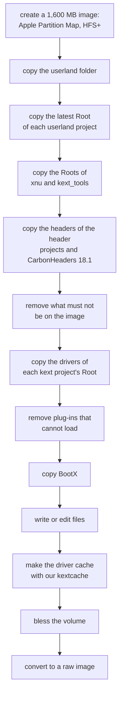

# Making the image

## What you will learn

- What the test image is: a disk image with an Apple Partition Map and one HFS+ volume, made by one script on the build machine.
- In which order the script fills it: the userland, the kernel, the headers, the drivers and BootX, each from the latest Root of its project.
- Which files it removes, which 25 it writes or edits, and why each is needed.
- How it makes the driver cache and blesses the volume, so that Open Firmware can start it.
- How every other file on the image is checked against the project's builds, and how the image reaches QEMU and the test Mac, an iMac G5 (`PowerMac12,1`).

## One script

The image is made by [scripts/make-test-image](https://github.com/nyg/PowerDarwin/blob/master/scripts/make-test-image), run on the build machine itself, not over SSH from the current Mac as the staging scripts are, after the builds a test needs. It takes no arguments: it reads the latest Roots from the build folder, `~/9L30/Roots`, and writes the image to `/private/var/tmp/darwin9-step1.dmg`, a name that has stayed since Step 1. Everything it does is in that one file, about 140 lines of shell, so that what goes into an image is in the repo, beside the test that used it.

The script grew with the steps: each new boot test added a project's Root, a file it writes or a file it removes. What follows is the script as it is after Step 10.



## The disk image

```sh
hdiutil create -size 1600m -layout SPUD -fs HFS+J -volname Darwin9 $image.dmg
hdiutil attach -owners on -nobrowse -mountpoint $mount $image.dmg
```

`hdiutil` is Leopard's tool for disk images. `-layout SPUD` gives the image an Apple Partition Map with a single partition, the partition table that Open Firmware reads on PowerPC Macs ([the boot chain](../background/boot-chain.md)). `-fs HFS+J` formats that partition as journaled HFS+, the file system of Mac OS X, and names the volume `Darwin9`. The image holds 1,600 MB, up from 1 GB until Step 10, whose compilers and languages brought the files on it to 1.1 GB; it still fits the iMac's 2.1 GB `Darwin9` partition.

`-owners on` matters. It makes Leopard honour the owners of the files on the image's volume, which it may otherwise ignore on a disk it did not start from. A system volume needs the real owners: `/etc/master.passwd` must belong to root, and launchctl skips a job file that root does not own (`Dubious ownership on file (skipping)`). With owners on, the owner and group of every file are kept as the Roots record them.

## Filling it

### The userland

The script copies, with `ditto`, which keeps owners, modes and links:

1. The userland folder, `/private/var/tmp/step1-chroot` on the build machine. It is the folder of the first chroot tests: the Roots of Libsystem, Libm, dyld, bash, ncurses (without `usr/lib/libncurses.5.dylib`, the Apple binary its source carries), libiconv, libgcc, bsm, libutil, libedit, launchd, file_cmds, shell_cmds and diskdev_cmds, then IOKitUser, CF, ICU, objc4, autozone, libstdcxx and zlib, in one folder ([How testing is done](testing.md)). No script in the repo makes it yet.
2. The latest Root of each project of its `userland_projects` list, in order: Libsystem, launchd, files, pam, system_cmds, CF, Security, configd, DirectoryService, OpenSSH, ntp, securityd, bless and others, then, since Step 10, Csu, SystemStubs, cctools, ld64, gcc, gcc_42, gcc_select, gnumake, perl, expat, libffi, python, ruby and samba, 61 in all. A later Root replaces a file that an earlier one, or the userland folder, put there. That is how launchd's latest Root, linked with Security again, replaces the build without Security that the userland folder still holds from [D26](https://github.com/nyg/PowerDarwin/blob/master/DEVIATIONS.md#d26).
3. The latest Roots of `xnu`, which holds the kernel, `/mach_kernel`, and its `System.kext`, and of `kext_tools`, which holds `kextd`, `kextload` and `kextcache`.

"Latest" means the Root with the highest `~N` ([darwinbuild and the build machine](darwinbuild.md)), found by the same `latest` function as in the other scripts. The image therefore always holds the last build of each project, and the test records which that was.

### The headers

A compiler on the image needs the headers of every library it links ([Step 10](../steps/step-10-working-unix.md)). For each project of its `header_projects` list, the script copies only the `usr/include` folder of the latest Root: Libc_headers, architecture, Librpcsvc, Libsyscall, Libinfo, Libm, libdyld, launchd_libs, CommonCrypto, removefile, copyfile, Libnotify, bsm, mDNSResponder, cctools_ofiles and objc4, 16 in all. Their libraries, where they have any, are on the image already, as parts of libSystem or from the userland folder.

CarbonHeaders has no 9L30 source, so the script installs CarbonHeaders 18.1, of Mac OS X 10.6, from its staged source with the project's own Makefile ([D111](https://github.com/nyg/PowerDarwin/blob/master/DEVIATIONS.md#d111)):

```sh
make -s -C ~/9L30/Sources/CarbonHeaders-18.1 install DSTROOT=$carbon KERNEL_SYLINKS= DO_CARBON_CORE_FILES=install_carbon_core_headers
```

It copies the nine headers this installs into `/usr/include`, and `MacTypes.h` again into a `CarbonCore.framework` inside an otherwise empty `CoreServices.framework`, with the `Versions/Current` links a framework has, where CF's `CFBase.h` includes it ([D16](https://github.com/nyg/PowerDarwin/blob/master/DEVIATIONS.md#d16)).

### What it removes

Then the script removes what a Root installs and the image must not hold:

| Removed | What it is | Why |
|---|---|---|
| `/mach_kernel.ctfsys` | a copy of the kernel with the type data, in CTF, that dtrace reads, merged in by xnu's `makedefs/MakeInc.rule` | not booted, and dtrace is not built |
| `/usr/local/lib/SystemConfiguration` | static libraries from configd's plug-ins project | only configd's build links them |
| `/AppleInternal` | headers some Roots install there for other builds, such as Cyrus SASL's ([D78](https://github.com/nyg/PowerDarwin/blob/master/DEVIATIONS.md#d78)) | only builds use them |
| `com.apple.DirectoryServicesInstallDaemon.plist` | an installer's job with the same label as DirectoryService's own | launchd refuses the second (`com.apple.DirectoryServices: Already loaded`); Leopard's installed system has no such job |
| `CM4040.kext`, `CRYPTOCardPCCard.kext`, `SCR24X_Apple_Driver.kext`, the bundles in `/usr/libexec/SmartCardServices/drivers` and `/Library/Application Support/Mozilla` | vendors' smart-card reader drivers and `pkcs11.shlb`, prebuilt in SmartCardServices' source | rule 6: prebuilt binaries |
| `/usr/share/misc/bootblockdata` | 68k boot blocks, prebuilt in bless' source ([D91](https://github.com/nyg/PowerDarwin/blob/master/DEVIATIONS.md#d91)) | rule 6 |
| `/Developer` | Xcode's folder, where some of the toolchain's Roots install documentation | not part of the system |
| `wininst-*.exe` in Python's `distutils` | Windows programs, prebuilt in Python's source, from which `distutils` makes Windows installers | rule 6 |

### The drivers

For each project of its `kext_projects` list, from IOPCIFamily to OpenSMU and OpenOnyx, the script copies only the `System/Library/Extensions` folder of the latest Root, the kexts, and leaves out the headers and tools a driver's Root may also hold. Then it removes three plug-ins that cannot work on the image: the `AOAHALPlugin.bundle` among IOAudioFamily.kext's plug-ins, which only the closed CoreAudio loads ([D89](https://github.com/nyg/PowerDarwin/blob/master/DEVIATIONS.md#d89)), and AppleOnboardAudio.kext's `AppleOnyxAudio.kext` and `AppleToonieAudio.kext`, codec drivers that Apple published only as empty stubs; OpenOnyx drives the iMac's codec instead ([D94](https://github.com/nyg/PowerDarwin/blob/master/DEVIATIONS.md#d94)).

Last, it copies the BootX Root, which holds the boot loader in two forms in `/usr/standalone/ppc`: `bootx.xcoff` and `bootx.bootinfo`, the form Open Firmware loads.

## The files it writes

Twenty-five files on the image come from no Root: the script writes them, or edits a file a Root installed.

| File | What the script does | Why | Since |
|---|---|---|---|
| `/Library/Preferences/SystemConfiguration/com.apple.Boot.plist` | writes it, naming `mach_kernel` with empty kernel flags | BootX reads it to find the kernel and its arguments | Step 1 |
| `/System/Library/Extensions.mkext` | makes it with our kextcache (below) | the driver cache BootX loads with the kernel | Step 1 |
| `/etc/master.passwd` | writes the test password's hash into root's entry | without `passwd` ([D44](https://github.com/nyg/PowerDarwin/blob/master/DEVIATIONS.md#d44)), nothing else can set it | Step 2 |
| `/System/Library/LaunchDaemons/com.apple.getty.plist` | copies it from system_cmds' source | launchd's job for getty on the console; Apple installs it only on embedded systems, and Leopard's console login, loginwindow, is closed | Step 2 |
| `/var/db/dslocal/nodes/Default/users/root.plist` | writes the same hash into root's record | DirectoryService's local directory, which checks SSH logins | Step 3 |
| `/System/Library/LaunchDaemons/ssh.plist` | sets `Disabled` to false | as turning on Remote Login does, with `launchctl load -w` | Step 3 |
| `/etc/ntp.conf` | writes `server time.euro.apple.com` | as Leopard's Date & Time preferences do | Step 4 |
| `/var/db/dyld/shared_region_roots/Darwin.paths` | lists `/bin/sh`, `/bin/bash`, configd, DirectoryService and sshd | dyld's shared cache needs a list of programs; Leopard's lists name closed packages | Step 4 |
| `/etc/rc.common`, `/etc/hostconfig` | copies them from launchd's source | SystemStarter's target installs them, and it is not built ([D21](https://github.com/nyg/PowerDarwin/blob/master/DEVIATIONS.md#d21)); `rc.audit` reads `rc.common` at boot | Step 8 |
| `/System/Library/CoreServices/SystemVersion.plist` | writes `Darwin`, `9.8`, `9L30` | launchctl reads it at boot and sets the kernel's `kern.osversion` from it; no project the image is built from installs it | Step 8 |
| `/Library/Preferences/SystemConfiguration/autodiskmount.plist` | sets `AutomountDisksWithoutUserLogin` | DiskArbitration mounts removable disks only for a console user, whom only loginwindow registers; Apple's servers set the same | Step 9 |
| `/usr/bin/dsymutil` | writes a script that exits 0 | gcc runs `dsymutil` after a one-step `-g` build, as `configure` scripts make, and Apple's is closed ([D112](https://github.com/nyg/PowerDarwin/blob/master/DEVIATIONS.md#d112)) | Step 10 |
| Nine headers in `/usr/include`, and `MacTypes.h` in `CarbonCore.framework` | installs them from CarbonHeaders 18.1 (above) | CarbonHeaders' 9L30 version has no source ([D111](https://github.com/nyg/PowerDarwin/blob/master/DEVIATIONS.md#d111)) | Step 10 |
| `/etc/smb.conf` | writes one share, `Shared`, of `/Users/Shared`, with `tdbsam` passwords, `opendirectory = no` and `use spnego = no` | passwords that `smbpasswd` sets, and a login that today's Mac clients can complete ([D113](https://github.com/nyg/PowerDarwin/blob/master/DEVIATIONS.md#d113), [Step 10](../steps/step-10-working-unix.md)) | Step 10 |
| `/System/Library/LaunchDaemons/smbd.plist` | sets `Disabled` to false | as turning on file sharing does; the script also removes `com.apple.smb.server.preferences.plist`, whose job would unload smbd ([D113](https://github.com/nyg/PowerDarwin/blob/master/DEVIATIONS.md#d113)) | Step 10 |

It also makes `/Users/Shared`, writable by everyone with the sticky bit, as on Leopard, and replaces the link `/etc/localtime`, which system_cmds points at US/Pacific, with a link to the build machine's own time zone, or to UTC if the image has no such zone ([Step 8](../steps/step-8-clean-boot.md)).

### The test password

Since `passwd` is not built, the script sets root's password itself. It reads a DES hash, the old Unix form that `/etc/master.passwd` and DirectoryService both accept, from `~/9L30/root-password.hash` on the build machine, made there with `openssl passwd -crypt -stdin`. The file is outside the repo, and so is the password: anyone rebuilding the image makes their own. Without the file, root's entry keeps the `*` the `files` project gives it, and nobody can log in.

### Some of the reasons in detail

`com.apple.getty.plist` is a launchd job that system_cmds' source carries for Apple's embedded systems. Leopard's console shows loginwindow's graphical login, which is closed, so the image needs getty's text login instead ([Step 2](../steps/step-2-console-login.md)).

`Darwin.paths` is there because dyld asks for a shared cache, one file holding the system's libraries already linked, whenever a program starts without one. launchd then runs `update_dyld_shared_cache`, which reads the folder `/var/db/dyld/shared_region_roots/` for lists of programs whose libraries to put in the cache. On Leopard that folder lists closed packages, such as Finder and Safari. Without the folder, the tool failed with `/var/db/dyld/shared_region_roots/ does not exist` and launchd started it again every few seconds; with the folder empty, it makes no cache (`no entries found in shared_region_roots`). With `Darwin.paths`, dyld builds a 14 MB cache once, at the first boot ([Step 4](../steps/step-4-everyday-commands.md)).

`autodiskmount.plist` is needed because DiskArbitration waits for a console user before it mounts removable or external disks, and the image has no loginwindow to register one. The setting, which Apple uses on servers, lifts that wait ([Step 9](../steps/step-9-disks-and-devices.md)).

## The driver cache

```sh
sudo "$(latest kext_tools)/usr/sbin/kextcache" -a ppc -l -m $mount/System/Library/Extensions.mkext $mount/System/Library/Extensions
```

BootX loads the kernel and one file of drivers, the driver cache, before the kernel can read the disk itself ([the boot chain](../background/boot-chain.md)). The script makes it with our own kextcache, from the latest kext_tools Root, run on the build machine. `-a ppc` keeps only the PowerPC code of each kext; `-l` takes only the kexts whose `OSBundleRequired` says they are needed to boot from a local disk; `-m` writes them into one mkext file. A kext that only loads later, such as the graphics drivers, which IOGraphics marks `Safe Boot`, stays out of the cache and is loaded from `/System/Library/Extensions` when it is needed; Leopard's own cache leaves them out the same way.

Our kextcache was checked before the image depended on it: run on Leopard's own drivers, it made a cache of their 169 kexts byte for byte the same as Apple's, 6,220,103 bytes.

## Blessing

```sh
sudo bless --folder $mount/System/Library/CoreServices --bootinfo $mount/usr/standalone/ppc/bootx.bootinfo
```

Open Firmware usually finds the boot loader without a path. The volume header names one folder as the blessed folder, and Open Firmware looks there for a file whose HFS type is `tbxi`. `bless --folder` records `/System/Library/CoreServices` in the volume header, and `--bootinfo` copies our `bootx.bootinfo` into it as `BootX`, with type `tbxi` and creator `chrp`. The script then prints the file's type and creator and the blessed folder, as a check. The `bless` run here is the build machine's, Leopard's own tool: it only writes the volume header and copies our file, and nothing of it goes onto the image.

## Checking every file

Rule 6 says that the image holds only what the project builds or its scripts write ([The rules](rules.md)). [scripts/check-image](https://github.com/nyg/PowerDarwin/blob/master/scripts/check-image) proves it for each image. Like `make-test-image`, it runs on the build machine itself, where the image and the Roots are:

```text
check-image <image.dmg> <build folder> <userland folder> [project...]
```

1. It mounts the image read-only.
2. It computes the MD5 of every file in the userland folder and in the latest Root of each project named, or of every project in the build folder's `Roots/` if none is named. Those are the known files.
3. It computes the MD5 of every file on the image.
4. It prints how many files the image holds, and the path of each whose MD5 is not among the known ones.

The check compares contents, not names. A file from Leopard at the same path as ours would have a name the Roots know and a content they do not, and would be listed. Since `Roots/<project>/` holds only Roots that darwinbuild built here, and the downloaded Roots stay packed in `Roots/.DownloadCache/`, a file that passes came out of one of our builds.

The only files it may list are the 25 of the table above. Most new images were checked this way: on 21 November 2026, for instance, all 12,301 files of the image came from our builds except the twelve that `make-test-image` writes or edits, of which `autodiskmount.plist` was new. At Step 1 the image held 6,763 files, with two not from builds, the boot plist and the driver cache. After Step 9 it held 12,340 files, with twelve not from builds. After Step 10 it holds 28,525, with the 25 that the table lists.

## From the image to the machines

The script ends by converting the image:

```sh
hdiutil convert $image.dmg -format UDTO -o $image
gzip -1 -c $image.cdr > $image.cdr.gz
```

`-format UDTO` writes a raw copy of every sector, with no disk-image structure around it, as `darwin9-step1.cdr`. That is the form QEMU reads: the compressed copy is moved to the current Mac, unpacked there, and given to [scripts/boot-qemu](https://github.com/nyg/PowerDarwin/blob/master/scripts/boot-qemu) as a raw disk.

The iMac gets the `.dmg` itself. Leopard, on one partition of the iMac's disk, copies it with `asr` onto another, named `Darwin9`, from which the iMac then starts. [How testing is done](testing.md) follows both paths to a running system.

## Where to look

- [scripts/make-test-image](https://github.com/nyg/PowerDarwin/blob/master/scripts/make-test-image) and [scripts/check-image](https://github.com/nyg/PowerDarwin/blob/master/scripts/check-image).
- Deviations: [D21](https://github.com/nyg/PowerDarwin/blob/master/DEVIATIONS.md#d21), [D26](https://github.com/nyg/PowerDarwin/blob/master/DEVIATIONS.md#d26), [D44](https://github.com/nyg/PowerDarwin/blob/master/DEVIATIONS.md#d44), [D78](https://github.com/nyg/PowerDarwin/blob/master/DEVIATIONS.md#d78), [D89](https://github.com/nyg/PowerDarwin/blob/master/DEVIATIONS.md#d89), [D91](https://github.com/nyg/PowerDarwin/blob/master/DEVIATIONS.md#d91), [D94](https://github.com/nyg/PowerDarwin/blob/master/DEVIATIONS.md#d94), [D111](https://github.com/nyg/PowerDarwin/blob/master/DEVIATIONS.md#d111), [D112](https://github.com/nyg/PowerDarwin/blob/master/DEVIATIONS.md#d112), [D113](https://github.com/nyg/PowerDarwin/blob/master/DEVIATIONS.md#d113).
- [README.md](https://github.com/nyg/PowerDarwin/blob/master/README.md), "Layout", for the test password's hash file.
- [The boot chain](../background/boot-chain.md), for what Open Firmware and BootX do with the blessed folder and the driver cache.
