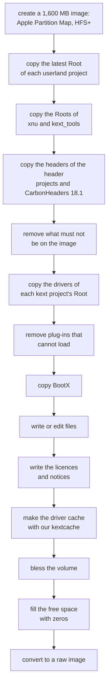

# Making the image

## What you will learn

- What the test image is: a disk image with an Apple Partition Map and one HFS+ volume, made by one script on the build machine.
- In which order the script fills it: the userland, the kernel, the headers, the drivers and BootX, each from the latest Root of its project.
- Which files it removes, which it writes or edits, and why each is needed.
- What the first boot of an image does: root's password, the SSH host keys, then SSH.
- How it makes the driver cache and blesses the volume, so that Open Firmware can start it.
- How every other file on the image is checked against the project's builds, and how the image reaches QEMU and the test Mac, an iMac G5 (`PowerMac12,1`).
- How `install-image` puts the image onto a partition of a PowerPC Mac, sets its time zone, NTP server and root's password, and makes its SSH host keys.
- How a release image differs from a test image, and what a release holds beside it: its source, its licences and notices, and checksums.

## One script

The image is made by [scripts/make-test-image](https://github.com/nyg/PowerDarwin/blob/master/scripts/make-test-image), run on the build machine itself, not over SSH from the current Mac as the staging scripts are, after the builds a test needs. It reads the latest Roots from the build folder, `~/9L30/Roots`, or the one given as `--folder=<path>`, and writes the image to `/private/var/tmp/PowerDarwin.dmg`, a name it has had since 23 November 2026, after `darwin9-step1.dmg` from Step 1 on. `--ntp-server=<host>` and `--time-zone=<zone>` choose two of the files it writes (below), and `--release=<name>` makes a release image instead of a test image ([Releases](#releases)). Everything it does is in that file, about 210 lines of shell, and in the two it takes from the repo, [overlay/usr/libexec/first-boot](https://github.com/nyg/PowerDarwin/blob/master/overlay/usr/libexec/first-boot), which it installs, and [scripts/collect-notices](https://github.com/nyg/PowerDarwin/blob/master/scripts/collect-notices), which it runs, so that what goes into an image is in the repo, beside the test that used it. [scripts/build-image](https://github.com/nyg/PowerDarwin/blob/master/scripts/build-image) runs it once every project is built ([darwinbuild and the build machine](darwinbuild.md)).

The script grew with the steps: each new boot test added a project's Root, a file it writes or a file it removes. What follows is the script as it is after Step 10.



## The disk image

```sh
hdiutil create -size 1600m -layout SPUD -fs HFS+J -volname PowerDarwin $image.dmg
hdiutil attach -owners on -nobrowse -mountpoint $mount $image.dmg
```

`hdiutil` is Leopard's tool for disk images. `-layout SPUD` gives the image an Apple Partition Map with a single partition, the partition table that Open Firmware reads on PowerPC Macs ([the boot chain](../background/boot-chain.md)). `-fs HFS+J` formats that partition as journaled HFS+, the file system of Mac OS X, and names the volume `PowerDarwin`, `Darwin9` until 23 November 2026. The image holds 1,600 MB, up from 1 GB until Step 10, whose compilers and languages brought the files on it to 1.1 GB; it still fits the iMac's 2.1 GB `Darwin9` partition.

`-owners on` matters. It makes Leopard honour the owners of the files on the image's volume, which it may otherwise ignore on a disk it did not start from. A system volume needs the real owners: `/etc/master.passwd` must belong to root, and launchctl skips a job file that root does not own (`Dubious ownership on file (skipping)`). With owners on, the owner and group of every file are kept as the Roots record them.

## Filling it

### The userland

The script copies, with `ditto`, which keeps owners, modes and links:

1. The latest Root of each project of its `userland_projects` list, in order: first the 18 that, with Libsystem, launchd and CF, made the folder of the first chroot tests ([How testing is done](testing.md)), Libm, dyld, bash, ncurses, libiconv, libgcc, bsm, libutil, libedit, file_cmds, shell_cmds, diskdev_cmds, IOKitUser, ICU, objc4, autozone, libstdcxx and zlib; then Libsystem, launchd, files, pam, system_cmds, CF, Security, configd, DirectoryService, OpenSSH, ntp, securityd, bless and others; then, since Step 10, Csu, SystemStubs, cctools, ld64, gcc, gcc_42, gcc_select, gnumake, perl, expat, libffi, python, ruby and samba; then DarwinTools, for `sw_vers` ([D121](https://github.com/nyg/PowerDarwin/blob/master/DEVIATIONS.md#d121)); and last gnuzip, awk, gnutar, file, lsof, top and curl, the everyday tools that Step 10 left out, 87 in all. A later Root replaces a file that an earlier one put there. Until 22 November 2026 the first 18 came from that folder, put together by hand. An image made each way holds the same files with the same contents, except for darwinbuild's receipts in `/usr/local/darwinbuild/receipts`: those of the 18 projects are new, and one left by an older build of Libsystem is gone.
2. The latest Roots of `xnu`, which holds the kernel, `/mach_kernel`, and its `System.kext`, and of `kext_tools`, which holds `kextd`, `kextload` and `kextcache`.

"Latest" means the Root with the highest `~N` ([darwinbuild and the build machine](darwinbuild.md)), found by the same `latest` function as in the other scripts. The image therefore always holds the last build of each project, and the test records which that was.

### The headers

A compiler on the image needs the headers of every library it links ([Step 10](../steps/step-10-working-unix.md)). For each project of its `header_projects` list, the script copies only the `usr/include` folder of the latest Root: Libc_headers, architecture, Librpcsvc, Libsyscall, Libinfo, Libm, libdyld, launchd_libs, CommonCrypto, removefile, copyfile, Libnotify, bsm, mDNSResponder, cctools_ofiles and objc4, 16 in all. Their libraries, where they have any, are on the image already, as parts of libSystem or from the Roots of the userland projects.

CarbonHeaders has no 9L30 source, so the script installs CarbonHeaders 18.1, of Mac OS X 10.6, from its staged source with the project's own Makefile ([D111](https://github.com/nyg/PowerDarwin/blob/master/DEVIATIONS.md#d111)):

```sh
make -s -C $sources/CarbonHeaders-18.1 install DSTROOT=$carbon KERNEL_SYLINKS= DO_CARBON_CORE_FILES=install_carbon_core_headers
```

It copies the nine headers this installs into `/usr/include`, and `MacTypes.h` again into a `CarbonCore.framework` inside an otherwise empty `CoreServices.framework`, with the `Versions/Current` links a framework has, where CF's `CFBase.h` includes it ([D16](https://github.com/nyg/PowerDarwin/blob/master/DEVIATIONS.md#d16)).

### What it removes

Then the script removes what a Root installs and the image must not hold:

| Removed | What it is | Why |
|---|---|---|
| `/mach_kernel.ctfsys` | a copy of the kernel with the type data, in CTF, that dtrace reads, merged in by xnu's `makedefs/MakeInc.rule` | not booted, and dtrace is not built |
| `/usr/local/lib/SystemConfiguration` | static libraries from configd's plug-ins project | only configd's build links them |
| `/AppleInternal` | headers some Roots install there for other builds, such as Cyrus SASL's ([D78](https://github.com/nyg/PowerDarwin/blob/master/DEVIATIONS.md#d78)) | only builds use them |
| `com.apple.DirectoryServicesInstallDaemon.plist` | an installer's job with the same label as DirectoryService's own | launchd refuses the second (`com.apple.DirectoryServices: Already loaded`); Leopard's installed system has no such job |
| `CM4040.kext`, `CRYPTOCardPCCard.kext`, `SCR24X_Apple_Driver.kext`, the bundles in `/usr/libexec/SmartCardServices/drivers` and `/Library/Application Support/Mozilla` | vendors' smart-card reader drivers and `pkcs11.shlb`, prebuilt in SmartCardServices' source | rule 5: prebuilt binaries |
| `/usr/lib/libncurses.5.dylib` | an Apple binary from 2006, prebuilt in ncurses' source | rule 5 |
| `/usr/share/misc/bootblockdata` | 68k boot blocks, prebuilt in bless' source ([D91](https://github.com/nyg/PowerDarwin/blob/master/DEVIATIONS.md#d91)) | rule 5 |
| `/Developer` | Xcode's folder, where some of the toolchain's Roots install documentation | not part of the system |
| `wininst-*.exe` in Python's `distutils` | Windows programs, prebuilt in Python's source, from which `distutils` makes Windows installers | rule 5 |

### The drivers

For each project of its `kext_projects` list, from IOPCIFamily to OpenSMU, OpenPMU and OpenOnyx, the script copies only the `System/Library/Extensions` folder of the latest Root, the kexts, and leaves out the headers and tools a driver's Root may also hold. Then it removes three plug-ins that cannot work on the image: the `AOAHALPlugin.bundle` among IOAudioFamily.kext's plug-ins, which only the closed CoreAudio loads ([D89](https://github.com/nyg/PowerDarwin/blob/master/DEVIATIONS.md#d89)), and AppleOnboardAudio.kext's `AppleOnyxAudio.kext` and `AppleToonieAudio.kext`, codec drivers that Apple published only as empty stubs; OpenOnyx drives the iMac's codec instead ([D94](https://github.com/nyg/PowerDarwin/blob/master/DEVIATIONS.md#d94)).

Last, it copies the BootX Root, which holds the boot loader in two forms in `/usr/standalone/ppc`: `bootx.xcoff` and `bootx.bootinfo`, the form Open Firmware loads.

## The files it writes

Twenty-three files on the image, and those of the folder `/usr/share/doc/PowerDarwin`, come from no Root: the script writes them, or edits a file a Root installed. A test image made from a build folder that holds `root-password.hash` has two more, `/etc/master.passwd` and root's record in the local directory.

| File | What the script does | Why | Since |
|---|---|---|---|
| `/Library/Preferences/SystemConfiguration/com.apple.Boot.plist` | writes it, naming `mach_kernel` with empty kernel flags | BootX reads it to find the kernel and its arguments | Step 1 |
| `/System/Library/Extensions.mkext` | makes it with our kextcache (below) | the driver cache BootX loads with the kernel | Step 1 |
| `/etc/master.passwd` | in a test image only, writes the test password's hash into root's entry | without `passwd` ([D44](https://github.com/nyg/PowerDarwin/blob/master/DEVIATIONS.md#d44)), nothing else can set it | Step 2 |
| `/System/Library/LaunchDaemons/com.apple.getty.plist` | copies it from system_cmds' source, and adds `Program`, `/usr/libexec/first-boot`, which launchd then runs with getty's arguments | launchd's job for getty on the console; Apple installs it only on embedded systems, and Leopard's console login, loginwindow, is closed | Step 2 |
| `/var/db/dslocal/nodes/Default/users/root.plist` | in a test image only, writes the same hash into root's record | DirectoryService's local directory, which checks SSH logins | Step 3 |
| `/usr/libexec/first-boot` | installs it from the repo's `overlay/usr/libexec/first-boot` | at the first boot, it sets root's password, makes the SSH host keys, then turns SSH on (below); until then OpenSSH's `ssh.plist` stays `Disabled`, as Apple installs it ([D124](https://github.com/nyg/PowerDarwin/blob/master/DEVIATIONS.md#d124)) | Releases |
| `/etc/ntp.conf` | writes `server` and the host of `--ntp-server`, by default the build machine's own NTP server, the first in its `/etc/ntp.conf`, or else `time.apple.com`, which a release image always has | as Leopard's Date & Time preferences do; until 23 November 2026 always `time.euro.apple.com` | Step 4 |
| `/var/db/dyld/shared_region_roots/Darwin.paths` | lists `/bin/sh`, `/bin/bash`, configd, DirectoryService and sshd | dyld's shared cache needs a list of programs; Leopard's lists name closed packages | Step 4 |
| `/etc/rc.common`, `/etc/hostconfig` | copies them from launchd's source | SystemStarter's target installs them, and it is not built ([D21](https://github.com/nyg/PowerDarwin/blob/master/DEVIATIONS.md#d21)); `rc.audit` reads `rc.common` at boot | Step 8 |
| `/System/Library/CoreServices/SystemVersion.plist` | writes `Darwin`, `9.8`, `9L30` | launchctl reads it at boot and sets the kernel's `kern.osversion` from it, and `sw_vers` prints it; no project the image is built from installs it, as DarwinTools' own is Darwin 8.0's and is not built ([D121](https://github.com/nyg/PowerDarwin/blob/master/DEVIATIONS.md#d121)) | Step 8 |
| `/Library/Preferences/SystemConfiguration/autodiskmount.plist` | sets `AutomountDisksWithoutUserLogin` | DiskArbitration mounts removable disks only for a console user, whom only loginwindow registers; Apple's servers set the same | Step 9 |
| `/usr/bin/dsymutil` | writes a script that exits 0 | gcc runs `dsymutil` after a one-step `-g` build, as `configure` scripts make, and Apple's is closed ([D112](https://github.com/nyg/PowerDarwin/blob/master/DEVIATIONS.md#d112)) | Step 10 |
| Nine headers in `/usr/include`, and `MacTypes.h` in `CarbonCore.framework` | installs them from CarbonHeaders 18.1 (above) | CarbonHeaders' 9L30 version has no source ([D111](https://github.com/nyg/PowerDarwin/blob/master/DEVIATIONS.md#d111)) | Step 10 |
| `/etc/smb.conf` | writes one share, `Shared`, of `/Users/Shared`, with `tdbsam` passwords, `opendirectory = no` and `use spnego = no` | passwords that `smbpasswd` sets, and a login that today's Mac clients can complete ([D113](https://github.com/nyg/PowerDarwin/blob/master/DEVIATIONS.md#d113), [Step 10](../steps/step-10-working-unix.md)) | Step 10 |
| `/System/Library/LaunchDaemons/smbd.plist` | sets `Disabled` to false | as turning on file sharing does; the script also removes `com.apple.smb.server.preferences.plist`, whose job would unload smbd ([D113](https://github.com/nyg/PowerDarwin/blob/master/DEVIATIONS.md#d113)) | Step 10 |
| `/usr/share/doc/PowerDarwin/` | writes `NOTICE`, copies the APSL 2.0 and 1.1 and the Apache License 2.0 from the repo's `LICENSES/` into `licenses/`, and writes into `notices/` one file per project built, with `collect-notices` (below) | the licences ask that binaries come with their texts and notices, and the APSL with a notice saying where the source is ([Releases](#releases)) | Releases |

It also gives the volume's root folder to root and the group admin, writable by both, with the sticky bit, as on Leopard: `hdiutil` gives it to the user who makes the image, and every image until 26 November 2026 had it so. The nine CarbonHeaders headers go to root the same way, as `make` installs them as that user. It makes `/Users/Shared`, writable by everyone with the sticky bit, as on Leopard, and replaces the link `/etc/localtime`, which system_cmds points at US/Pacific, with a link to the zone of `--time-zone`, by default the build machine's own, UTC in a release image, or UTC if the image has no such zone ([Step 8](../steps/step-8-clean-boot.md)).

### Root's password

Since `passwd` is not built ([D44](https://github.com/nyg/PowerDarwin/blob/master/DEVIATIONS.md#d44)), the image itself has no command that sets root's password. A test image takes it from the build machine: the script reads a DES hash, the old Unix form that `/etc/master.passwd` and DirectoryService both accept, from `root-password.hash` in the build folder, made there with `openssl passwd -crypt -stdin`, and writes it into root's entry in both. The file is outside the repo, and so is the password: anyone rebuilding the image makes their own. A release image ignores the file, and so does a build folder without it: root's entry keeps the `*` the `files` project gives it, which no password matches, until `install-image` (below) or the first boot sets one.

### The first boot

launchd starts getty from `com.apple.getty.plist` at every multi-user boot. With `Program` set to `/usr/libexec/first-boot`, it runs that script instead, with getty's arguments, `std.9600 console`, as Apple's own `ssh.plist` runs `sshd-keygen-wrapper` with sshd's ([D124](https://github.com/nyg/PowerDarwin/blob/master/DEVIATIONS.md#d124)). Once `/var/db/.PowerDarwinSetupDone` exists, first-boot starts getty at once, with the same arguments. Until then, it writes to the console and reads from it, and does three things, each only if it is not done yet:

1. Root's password. If root's hash is `*` in `/etc/master.passwd` or in the local directory, or the two differ, it asks for a password twice, refuses an empty one, makes its DES hash with the image's `openssl passwd -crypt -stdin`, writes it into both files, and stops DirectoryService, which launchd starts again with the new hash.
2. The SSH host keys. For each of the three keys that `sshd-keygen-wrapper` would make, `/etc/ssh_host_key`, `/etc/ssh_host_rsa_key` and `/etc/ssh_host_dsa_key`, it runs `ssh-keygen` with the wrapper's arguments, for the types `rsa1`, `rsa` and `dsa`.
3. SSH. It sets `Disabled` to false in `ssh.plist` and loads the job with `launchctl load`, as turning on Remote Login does.

Then it writes the mark, and starts getty. A release image starts with no password, no host keys and SSH off, so port 22 takes no connection before root has a password and the keys exist, and `sshd-keygen-wrapper` finds the three keys at its first run and makes none: the 105 `ssh-keygen` of an earlier first boot ([Installing it](#installing-it)) cannot start. A test image with the test password, or an image that `install-image` put onto a partition, has root's password already, and the second has its keys too, so its first boot asks nothing.

Each file is written beside its place, as `<file>.first-boot`, then moved into it with `mv`, which replaces it in one step, and `sync` follows: a machine switched off halfway keeps either the old file or the new one. A key's `.pub` file is moved before the key, the file that `sshd-keygen-wrapper` looks for. The mark is written last and every step checks what is done, so the next boot does again whatever was not finished. If root still has no password when the script ends, it exits without starting getty, and launchd starts it again, so the question comes back. In single-user mode, `-s`, launchd starts a shell before it loads any job, and first-boot does not run.

In QEMU, on 26 November 2026, a release image asked for the password about 30 seconds after it started, refused an empty one and two that differed, and showed none of what was typed. Until the password was set and the keys made, every connection to its SSH port was reset; sshd answered about a minute after the password, and took it. A second boot asked nothing and kept the keys, two copies of the image made different keys, a copy switched off while it made its keys finished them at its next boot without asking again, and a copy that `install-image` had put onto a disk image only turned SSH on, with the keys `install-image` made.

On the iMac G5, the same evening, the second test release image, `9L30-test2`, was checked against its `SHA256SUMS`, unpacked, and restored with `asr` by hand onto a partition, which then got one test-only line in `/etc/fstab`, to mount a Leopard partition read-only; the Mac started it verbosely. The console asked for root's password, which was typed there, about 30 seconds after the kernel started. first-boot made the three keys in 5 seconds, 21:53:25 to 21:53:30 UTC, wrote the mark at 21:53:30, and sshd answered at 21:53:33; before, the SSH port refused every connection. The password set at the console then logged in over SSH, `ssh.plist` said `Disabled` false, no `.first-boot` file was left, and the clock was in UTC. A second boot went straight to `login:`, and sshd answered with the same RSA host key.

### Some of the reasons in detail

`com.apple.getty.plist` is a launchd job that system_cmds' source carries for Apple's embedded systems. Leopard's console shows loginwindow's graphical login, which is closed, so the image needs getty's text login instead ([Step 2](../steps/step-2-console-login.md)).

`Darwin.paths` is there because dyld asks for a shared cache, one file holding the system's libraries already linked, whenever a program starts without one. launchd then runs `update_dyld_shared_cache`, which reads the folder `/var/db/dyld/shared_region_roots/` for lists of programs whose libraries to put in the cache. On Leopard that folder lists closed packages, such as Finder and Safari. Without the folder, the tool failed with `/var/db/dyld/shared_region_roots/ does not exist` and launchd started it again every few seconds; with the folder empty, it makes no cache (`no entries found in shared_region_roots`). With `Darwin.paths`, dyld builds a 14 MB cache once, at the first boot ([Step 4](../steps/step-4-everyday-commands.md)).

`autodiskmount.plist` is needed because DiskArbitration waits for a console user before it mounts removable or external disks, and the image has no loginwindow to register one. The setting, which Apple uses on servers, lifts that wait ([Step 9](../steps/step-9-disks-and-devices.md)).

## The driver cache

```sh
sudo "$(latest kext_tools)/usr/sbin/kextcache" -a ppc -l -m $mount/System/Library/Extensions.mkext $mount/System/Library/Extensions
```

BootX loads the kernel and one file of drivers, the driver cache, before the kernel can read the disk itself ([the boot chain](../background/boot-chain.md)). The script makes it with our own kextcache, from the latest kext_tools Root, run on the build machine. `-a ppc` keeps only the PowerPC code of each kext; `-l` takes only the kexts whose `OSBundleRequired` says they are needed to boot from a local disk; `-m` writes them into one mkext file. A kext that only loads later, such as the graphics drivers, which IOGraphics marks `Safe Boot`, stays out of the cache and is loaded from `/System/Library/Extensions` when it is needed; Leopard's own cache leaves them out the same way.

Our kextcache was checked before the image depended on it: run on Leopard's own drivers, it made a cache of their 169 kexts byte for byte the same as Apple's, 6,220,103 bytes.

## Blessing

```sh
sudo bless --folder $mount/System/Library/CoreServices --bootinfo $mount/usr/standalone/ppc/bootx.bootinfo
```

Open Firmware usually finds the boot loader without a path. The volume header names one folder as the blessed folder, and Open Firmware looks there for a file whose HFS type is `tbxi`. `bless --folder` records `/System/Library/CoreServices` in the volume header, and `--bootinfo` copies our `bootx.bootinfo` into it as `BootX`, with type `tbxi` and creator `chrp`. The script then prints the file's type and creator and the blessed folder, as a check. The `bless` run here is the build machine's, Leopard's own tool: it only writes the volume header and copies our file, and nothing of it goes onto the image.

## Checking every file

Rule 5 says that the image holds only what the project builds or its scripts write ([The rules](rules.md)). [scripts/check-image](https://github.com/nyg/PowerDarwin/blob/master/scripts/check-image) proves it for an image. Like `make-test-image`, it runs on the build machine itself, where the image and the Roots are:

```text
check-image <image.dmg> <build folder> [project...]
```

1. It mounts the image read-only.
2. It computes the MD5 of every file in the latest Root of each project named, or of every project in the build folder's `Roots/` if none is named. Those are the known files.
3. It computes the MD5 of every file on the image.
4. It prints how many files the image holds, and the path of each whose MD5 is not among the known ones.

The check compares contents, not names. A file from Leopard at the same path as ours would have a name the Roots know and a content they do not, and would be listed. Since `Roots/<project>/` holds only Roots that darwinbuild built here, and the downloaded Roots stay packed in `Roots/.DownloadCache/`, a file that passes came out of one of our builds.

The only files it may list are those of the table above: 23, and those of `/usr/share/doc/PowerDarwin`, with two more in a test image with the test password. Most new images were checked this way: on 21 November 2026, for instance, all 12,301 files of the image came from our builds except the twelve that `make-test-image` writes or edits, of which `autodiskmount.plist` was new. At Step 1 the image held 6,763 files, with two not from builds, the boot plist and the driver cache. After Step 9 it held 12,340 files, with twelve not from builds. After Step 10 it holds 28,525, with the 25 that the table lists. Since `make-test-image` copies every Root itself, with the 18 receipts this adds, it holds 28,542, and the check, which no longer takes a folder of files to trust, lists the same 25. The first release image, made on 26 November 2026 for a test, in a build folder of 178 projects, holds 28,494 files: the check lists the 23 of the table, and the 178 files of `/usr/share/doc/PowerDarwin`, of which 174 are notices. The second, made the same evening with awk, gnutar, gnuzip, file, lsof, top and curl on it, holds 28,629, and the check lists the same 201.

## From the image to the machines

Before it detaches the image, the script fills the volume's free space with zeros: `dd` writes one file of zeros until the volume is full, and the script removes it. The files it removed from the Roots (above) are gone from the volume's catalog, but their blocks are still on the disk until something overwrites them, and a raw copy of the disk would carry them, prebuilt Apple binaries among them, which rule 5 keeps out of the image. Zeros also compress far better.

The script ends by converting the image:

```sh
hdiutil convert $image.dmg -format UDTO -o $image
gzip -1 -c $image.cdr > $image.cdr.gz
```

`-format UDTO` writes a raw copy of every sector, with no disk-image structure around it, as `PowerDarwin.cdr`. That is the form QEMU reads: the compressed copy is moved to the current Mac, unpacked there, and given to [scripts/boot-qemu](https://github.com/nyg/PowerDarwin/blob/master/scripts/boot-qemu) as a raw disk.

The iMac gets the `.dmg` itself. Leopard, on one partition of the iMac's disk, copies it with `asr` onto another, named `Darwin9`, from which the iMac then starts. [How testing is done](testing.md) follows both paths to a running system.

## Installing it

[scripts/install-image](https://github.com/nyg/PowerDarwin/blob/master/scripts/install-image) does that copy for anyone, on any PowerPC Mac, from Leopard and as root. It asks where the image goes, then the time zone, the NTP server, root's password and whether to make PowerDarwin the startup disk, and only once it has every answer, and the word `yes`, does it change a disk:

| Choice | Option | What it does |
|---|---|---|
| A new partition | `--shrink=<volume> --size=<size>` | `diskutil resizeVolume` shrinks a Journaled HFS+ volume, which keeps its files, Leopard's own included, and makes a partition named `PowerDarwin` of that size, 10 GB if none is given, in the space freed at its end |
| An existing partition | `--partition=<partition>` | the partition is erased; one that holds no HFS+ volume is first formatted with `diskutil eraseVolume` |
| A whole disk | `--disk=<disk>` | `diskutil partitionDisk` erases the disk and gives it an Apple Partition Map with one partition |

It refuses a disk without an Apple Partition Map, from which a PowerPC Mac cannot start, a partition of less than 2 GB, and the partition or disk of the running system, the image or the script. The new partition is found by its volume's UUID, not its number: Leopard's `diskutil` renumbers partitions when it adds one, and `eraseVolume` puts 128 MB of free space in front of the partition it formats, which renumbers it and every one after it. Open Firmware's `boot-device` names the startup disk by its partition number, so when the startup volume's number changes, the script makes it the startup disk again with `bless --mount <volume> --setOF`.

Then `asr`, Apple Software Restore, copies the image onto the partition. `asr` copies blocks only from an image it has scanned, so the script first converts `PowerDarwin.dmg` to a compressed copy beside it, `PowerDarwin-asr.dmg`, and scans that with `asr imagescan`; it does so again only when the image is newer. `asr restore --erase` writes the image's volume onto the partition and grows it to the partition's size. The script turns on owners for the volume with `vsdbutil -a`, and then writes again four of the files of the table above:

- `/etc/localtime`, a link to the zone chosen, which must be in the image's `/usr/share/zoneinfo`; Leopard's own zone is offered.
- `/etc/ntp.conf`, with the server chosen; Leopard's own is offered, or else `time.apple.com`.
- root's entry in `/etc/master.passwd` and root's record in the local directory, `root.plist`, with the DES hash of the password typed, made with `openssl passwd -crypt`, of which only the first 8 characters count.

It then makes the SSH host keys. The image holds none, as it is restored onto more than one machine, and the first boot would otherwise make them without a lock. For each connection to port 22, launchd runs Apple's `sshd-keygen-wrapper`, from OpenSSH 95.1.5, before `sshd`: it makes each of the three keys whose file is missing, `/etc/ssh_host_key`, `/etc/ssh_host_rsa_key` and `/etc/ssh_host_dsa_key`, and `ssh-keygen` writes a key's file only once the key is made. Every connection made in those seconds therefore starts its own `ssh-keygen`: on the first boot of an installed image, a test that tried port 22 to see when the iMac was up started 105 of them, which slowed one another on its one processor and raised the load average to 128, and sshd answered no client for about 7 minutes. The script removes any of the six files, keys and `.pub` files, that the image holds, then runs Leopard's `ssh-keygen` with the wrapper's arguments, `-q -t <type> -f <file> -N "" -C ""`, for the types `rsa1`, `rsa` and `dsa`, so that the wrapper finds all three and makes none. An image started another way, in QEMU or restored by hand, gets its keys from first-boot instead (above), before SSH is on.

With `--startup-disk`, or a yes, it ends with `bless --mount <volume> --setOF`, which makes PowerDarwin the startup disk.

## Releases

### A release image

`make-test-image --release=<name>` makes the image that a release publishes. `<name>` is the release's name, which is also its tag on GitHub. Three things change from a test image: the script ignores `root-password.hash`, so root has no password; the time zone is UTC and the NTP server `time.apple.com`, Leopard's own default, instead of the build machine's, unless `--time-zone` or `--ntp-server` says otherwise; and the image's `NOTICE` names the release, whose page holds the source. Everything else, files and checks, is the same.

### The notices

[scripts/collect-notices](https://github.com/nyg/PowerDarwin/blob/master/scripts/collect-notices) `<source folder> <APSL 2.0 text> <output file>` reads one project's staged source, after its patches, and writes two things into the output file: every licence file of the source, `COPYING`, `LICENSE`, `COPYRIGHT`, `NOTICE` and the like, but the APSL 2.0, which `licenses/` holds already; and every distinct comment, among the first 400 lines of its C, C++, Objective-C, assembler, yacc and lex files, that holds a copyright and licence terms, but those under the APSL or a GNU licence, whose texts are elsewhere. Those are the BSD, MIT, ISC and similar notices whose licences ask that a binary come with them. Each notice is written once, with the first three files it heads. `make-test-image` runs it once for the source of each project with a Root in the build folder, which for a project built from another's source, such as Libc_debug from Libc's, is the source that `darwinxref original` names, and for CarbonHeaders 18.1, into `/usr/share/doc/PowerDarwin/notices/<project>-<version>.txt`: more projects than the image holds, which costs a few files and keeps none out. Apple's builds of some projects, bash, OpenSSH, Perl, Python and others, also install the licences of the code they did not write into `/usr/local/OpenSourceLicenses`, as they do on Leopard.

### What a release holds

| File | What it is |
|---|---|
| `PowerDarwin-<name>.img.gz` | the raw image, with an Apple Partition Map and one HFS+ volume, gzipped: QEMU starts it once unpacked, `install-image --image=` puts it onto a Mac's partition, and it is the form that a USB key would take, once Step 14 is reached |
| `PowerDarwin-<name>-source.tar` | the kit that built it, without its Roots: this repository at the release's commit, with its patches, replacements, build lists and scripts, every source tarball as it was fetched, each with its SHA-256 in `manifest/9L30.sha256`, and D49's generated parser in `inputs/` |
| `SHA256SUMS` | the SHA-256 of the two, in the form `shasum -a 256 -c` and `sha256sum -c` read |

One image serves QEMU and the Macs, so there is one file to download and to check. Each file is under 2 GiB, GitHub's limit for a file of a release: in the test release of 26 November 2026, made from a build folder on the build machine, the image was 182 MB gzipped, 1,678 MB unpacked with 667 MB used, and the source 1,183 MB. The release is in `nyg/PowerDarwin`, as the image is this project's own work, and the source is in the same release as the image. `nyg/PowerDarwin-roots` keeps the inputs of a build: Apple's Roots, and the source tarballs that GitHub's copies of Apple's projects lack.

### make-release

[scripts/make-release](https://github.com/nyg/PowerDarwin/blob/master/scripts/make-release) runs as root on the build machine, from the kit that built the image, after `make-test-image --release=<name>`. It refuses an image that:

- holds a file that `check-image` finds in no Root and that `make-test-image` does not write;
- has a `NOTICE` that does not name the release, or lacks its licence texts or notices;
- has a password for any account in `/etc/master.passwd` or the local directory, a shadow hash, Samba accounts, SSH host keys, or the first boot's mark, or has SSH on, or does not run first-boot before getty;
- holds a file that a boot or a build would leave: `.DS_Store`, `.fseventsd`, `.Spotlight-V100`, a shell history, a swap file, dyld's shared cache, BootCache's playlist, or a non-empty log or temporary file;
- holds, in any file, the build machine's user folder, the build folder's or the kit's path, the machine's host names, the MAC address or IPv4 address of any of its interfaces, or the hash of `root-password.hash`.

Then it writes the three files and `release-notes.md`, the text of the release's page, into `/private/var/tmp/PowerDarwin-<name>`. It checks every source tarball of the kit against `manifest/9L30.sha256` first, as `build-image` does. The test release took it 8 minutes 30 seconds on the build machine, an iMac G5 (`PowerMac12,1`).

[scripts/publish-release](https://github.com/nyg/PowerDarwin/blob/master/scripts/publish-release) runs on the current computer, in a clone of the repository, on that folder copied there. It checks the files against `SHA256SUMS`; the source tar's repository files against the tree of the commit it is given, which must be on GitHub, file by file and mode by mode; and the source tar's tarballs against its own `manifest/9L30.sha256`. It refuses a name that is already a release or a tag. Then it prints the `gh release create` command that makes the release and its tag at that commit, with the three files, and runs it only when given `--yes`. Nothing is uploaded by hand, and the release records the commit whose scripts made its image.

### What the build machine leaves

A test image takes the build machine's time zone and NTP server, and its test password's hash; a release image takes none of them. An audit of the first release image, file by file, for the build machine's user folder, the build folder's and the kit's paths, its host names, the MAC and IPv4 addresses of its interfaces and the owner of each file found these, and `make-test-image` now removes or changes them:

- The volume's root folder, and the nine CarbonHeaders headers, belonged to the build machine's user (above).
- Leopard adds `/.Trashes` and an empty `/.com.apple.timemachine.supported` to a volume it mounts, and the script now removes both before it detaches the image. `check-image` cannot see an empty file: its MD5 is that of every empty file of the Roots.
- The blocks of the files removed from the Roots stayed in the raw image (zeros now, above).

Four programs keep the names of the machine and the user that built them, as Apple's own keep those of Apple's build machine, and the image script cannot remove them without changing a built binary: Perl's configuration (`Config_heavy.pl` and `CORE/config.h`) records the host name and the user who ran `Configure`, as `cf_by`, `cf_email`, `perladmin`, `myhostname` and `myuname`; Vim records them as "Compiled by"; Samba's `smbd` and `vfstest` record the host's `uname` as "Built on"; and `lsof` records the host name and its `uname -a`, both of which `lsof -v` prints. Leopard's own Perl says `_www@b04.apple.com`. So `build-image` builds every project under neutral names, the host name `powerdarwin.invalid` and the login name `root`, and in UTC, through `run-darwinbuild` ([D125](https://github.com/nyg/PowerDarwin/blob/master/DEVIATIONS.md#d125), [darwinbuild and the build machine](darwinbuild.md#what-a-build-records)). `make-release` refuses an image that holds the build machine's own host names, and takes `powerdarwin.invalid` as a name that may be published; a Root built without `run-darwinbuild` therefore stops a release, and `--public` declares any other name that may be published. The kernel's version string names `root`, the user that ran darwinbuild. Before D125, the dates of the builds were in `US/Pacific`, the zone of the BuildRoot that system_cmds' Root sets, and not the build machine's.

### What the licences ask

This is the project's reading of the licences, not legal advice.

- The APSL 2.0, which covers most of Darwin, asks that whoever deploys Covered Code with changes make the source of those changes available, for as long as they deploy it or 12 months, whichever is longer (section 2.2(c)), and that a copy of the licence go with every copy of the source (2.1(b)). Whoever deploys it "in object code, executable form only" must also include "a prominent notice, in the code itself as well as in related documentation, stating that Source Code of the Covered Code is available" and where (2.3). The release holds the source and the patches, the source tarballs hold Apple's licence files, and the image's `NOTICE` says where the source is.
- The GNU General Public License, version 2, of bash, gcc, cctools' assembler, GNU make, grep, GNU sort in text_cmds and Samba, asks that a copy of the licence go with the program (section 1), and that the executable come with "the complete corresponding machine-readable source code" (3(a)): "all the source code for all modules it contains, plus any associated interface definition files, plus the scripts used to control compilation and installation of the executable", with no exception for what an operating system ships when "that component itself accompanies the executable", as it does on an image. Offering "equivalent access to copy the source code from the same place" counts as distributing it. The release's source tar is that source, with darwinbuild's source, the build lists and the scripts, in the same place as the image; the licence texts are in the sources and in the notices on the image. No source of the image's projects carries the GPL version 3.
- The BSD, MIT and ISC licences of the commands, libraries and drivers from BSD, of OpenSSL, OpenSSH, Kerberos, `sw_vers` ([D121](https://github.com/nyg/PowerDarwin/blob/master/DEVIATIONS.md#d121)) and of this project's own replacements ask that a binary come with their copyright notices and terms, "in the documentation and/or other materials provided with the distribution". `/usr/share/doc/PowerDarwin/notices` holds them, beside the licence files of each source.
- The Apache License 2.0 of launchd and autozone asks for a copy of the licence (section 4(a)), which `licenses/` holds.

What a lawyer should confirm is listed with the pull request that added these scripts: whether the notices on the image meet the BSD clauses and APSL 2.3's "in the code itself", whether the release's page is a "same place" in the GPL's sense, whether the advertising clauses of the older BSD and OpenSSL licences apply to the project's announcements, and whether the Apple Roots in the build environment, which the image does not hold, need anything.

## Where to look

- [scripts/make-test-image](https://github.com/nyg/PowerDarwin/blob/master/scripts/make-test-image), [scripts/check-image](https://github.com/nyg/PowerDarwin/blob/master/scripts/check-image), [scripts/install-image](https://github.com/nyg/PowerDarwin/blob/master/scripts/install-image), [overlay/usr/libexec/first-boot](https://github.com/nyg/PowerDarwin/blob/master/overlay/usr/libexec/first-boot), [scripts/collect-notices](https://github.com/nyg/PowerDarwin/blob/master/scripts/collect-notices), [scripts/make-release](https://github.com/nyg/PowerDarwin/blob/master/scripts/make-release) and [scripts/publish-release](https://github.com/nyg/PowerDarwin/blob/master/scripts/publish-release).
- [LICENSES/APSL-2.0.txt](https://github.com/nyg/PowerDarwin/blob/master/LICENSES/APSL-2.0.txt), sections 2.1 to 2.3, and the GNU General Public License, version 2, in bash's `COPYING`, sections 1 and 3.
- Deviations: [D21](https://github.com/nyg/PowerDarwin/blob/master/DEVIATIONS.md#d21), [D26](https://github.com/nyg/PowerDarwin/blob/master/DEVIATIONS.md#d26), [D44](https://github.com/nyg/PowerDarwin/blob/master/DEVIATIONS.md#d44), [D78](https://github.com/nyg/PowerDarwin/blob/master/DEVIATIONS.md#d78), [D89](https://github.com/nyg/PowerDarwin/blob/master/DEVIATIONS.md#d89), [D91](https://github.com/nyg/PowerDarwin/blob/master/DEVIATIONS.md#d91), [D94](https://github.com/nyg/PowerDarwin/blob/master/DEVIATIONS.md#d94), [D111](https://github.com/nyg/PowerDarwin/blob/master/DEVIATIONS.md#d111), [D112](https://github.com/nyg/PowerDarwin/blob/master/DEVIATIONS.md#d112), [D113](https://github.com/nyg/PowerDarwin/blob/master/DEVIATIONS.md#d113), [D121](https://github.com/nyg/PowerDarwin/blob/master/DEVIATIONS.md#d121), [D124](https://github.com/nyg/PowerDarwin/blob/master/DEVIATIONS.md#d124), [D125](https://github.com/nyg/PowerDarwin/blob/master/DEVIATIONS.md#d125).
- [README.md](https://github.com/nyg/PowerDarwin/blob/master/README.md), "Install it", for `install-image` and the test password's hash file.
- In OpenSSH-95.1.5: `sshd-keygen-wrapper` and `launchd-ssh.plist`, for the host keys.
- [The boot chain](../background/boot-chain.md), for what Open Firmware and BootX do with the blessed folder and the driver cache.
