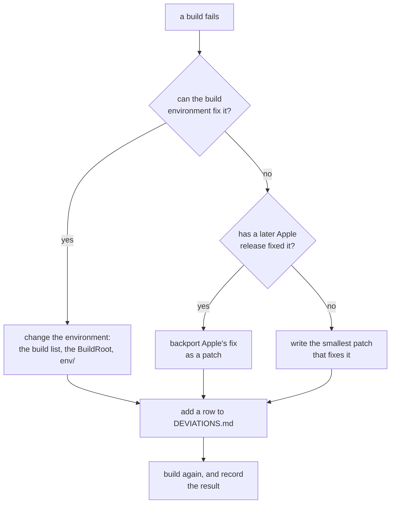

# The rules and why they exist

## What you will learn

- The five rules of README.md, and the reason behind each.
- The order in which a build failure is fixed: the build environment first, then Apple's own later fix, and only then a new patch.
- How the rules are checked: by comparing our binaries with Apple's, and by checking every file on the image against the project's builds.
- How the rules changed as the work went on.
- The seven kinds of deviation, which the step chapters use to sort every change.

## Why rules at all

Building Darwin 9 means building some four hundred projects that Apple never built outside its own build system, and dozens of them fail at first. Each failure can be fixed in many ways, and the easy ones, such as copying a file from Leopard or editing a source until it compiles, would give an image that boots but says nothing about what Apple's published sources make. The rules decide, before any failure, which fixes are allowed and in which order. They were written before the first build, in commit `55f21a1`, with the goal of Step 1.

## The five rules

### Rule 1: Apple's release, as published

> Projects and versions are those of darwinbuild's `9L30` build list (`manifest/9L30.tsv`). Sources are fetched as Apple published them, checked by their SHA-256 (`manifest/9L30.sha256`), and never edited in place. A project changes version only to take Apple's own fix from a later release, or, when Apple never published 9L30's version, to build the nearest one it did publish.

Every comparison in the project rests on this rule. Leopard's own binaries are the reference: when our build of a project imports and exports the same symbols as Apple's binary of the same version, and its code has the same size, the build is as Apple made it. If the versions differed, every difference could come from the version, and the comparison would prove nothing. Projects also build against each other's headers, so a library at another version could change an interface that the other 385 projects expect.

The hash lets anyone check that a source is the one Apple published, byte for byte. Keeping the source untouched means that every change the project makes is somewhere else, in a patch file, where it can be read on its own with its reason ([Leopard 9L30](sources-and-roots.md) shows how the patches are applied when a source is staged, and where the 14 projects with no tag on Apple's GitHub come from).

The rule allows two moves. One is taking Apple's own later fix, as rule 2 describes, which is usually a few functions of a later release rather than the whole later version. The other is for a version Apple never published: Leopard's versions of the ATA disk driver and the SCSI family are missing, so Panther's, the nearest published, stand in for them ([D40](https://github.com/nyg/PowerDarwin/blob/master/DEVIATIONS.md#d40), [D85](https://github.com/nyg/PowerDarwin/blob/master/DEVIATIONS.md#d85)), and CarbonHeaders 18.1, from Apple's GitHub, gives the headers the build list's CarbonHeaders lacks ([D73](https://github.com/nyg/PowerDarwin/blob/master/DEVIATIONS.md#d73), [D111](https://github.com/nyg/PowerDarwin/blob/master/DEVIATIONS.md#d111)). configd_plugins 91 was never published either, so its plug-ins are built from configd 212.2's source ([D58](https://github.com/nyg/PowerDarwin/blob/master/DEVIATIONS.md#d58)). Panther's two drivers are deviations of the kind `closed-replacement`, and closed parts of Leopard as far as the project is concerned.

### Rule 2: the smallest fix, in this order

> Change the build environment; failing that, take Apple's fix from another release; only then write a new patch, as small as possible, with no reformatting or unrelated change. Where the missing part is closed, leave out the feature that needs it, or write an open replacement in `replacements/`.

Most failures do not come from a fault in Apple's code. They come from the gap between Apple's build system and ours: Apple built Leopard with its own internal tools, closed headers and a complete set of every project's files, where darwinbuild builds each project in a BuildRoot holding only what its build list names ([darwinbuild and the build machine](darwinbuild.md)). The truest fix then closes that gap and leaves the code as Apple wrote it. A missing header is put where the build looks for it; a tool that crashes is wrapped; a missing dependency is added to the build list.

When the code itself is at fault, Apple may have fixed it in a later release, and Apple's fix is the best one there is: Apple's own code, and in most cases the very change Apple made to solve the same problem. Every later release on Apple's GitHub is a place to look. These rows name the release in their `Upstream` column:

| Deviation | Taken from | What it fixes |
|---|---|---|
| [D23](https://github.com/nyg/PowerDarwin/blob/master/DEVIATIONS.md#d23) | IOKitUser 502, Mac OS X 10.6 | a script step that finds MIG output only where Apple's Xcode put it |
| [D33](https://github.com/nyg/PowerDarwin/blob/master/DEVIATIONS.md#d33) | IOUSBFamily 378.4.3 | three headers whose include guards are never closed |
| [D53](https://github.com/nyg/PowerDarwin/blob/master/DEVIATIONS.md#d53) | DirectoryService 621 | a script step that finds MIG headers only where Apple's Xcode put them |
| [D54](https://github.com/nyg/PowerDarwin/blob/master/DEVIATIONS.md#d54) | CF-550 | two bundle functions and a key that code signing needs |
| [D56](https://github.com/nyg/PowerDarwin/blob/master/DEVIATIONS.md#d56) | swift-corelibs-foundation | `CFStringTransform`, which Apple's closed CoreFoundation has, from Apple's later open one |
| [D62](https://github.com/nyg/PowerDarwin/blob/master/DEVIATIONS.md#d62) | CF-635 | binary property lists written to a stream |
| [D83](https://github.com/nyg/PowerDarwin/blob/master/DEVIATIONS.md#d83) | ntp-45.1, Mac OS X 10.6 | `ntpd-wrapper`'s wait for DNS at boot |

Only when neither works is the fix a new patch, and then the smallest that fixes the error. A reader can then check it in a minute, and anyone who later finds Apple's own fix can swap it in. [D46](https://github.com/nyg/PowerDarwin/blob/master/DEVIATIONS.md#d46) is one: a function of Libinfo passes the wrong pointer when DirectoryService is not running, and its row says why no backport exists: "Libinfo 330 (10.6) replaced this code, so there is no fix to backport." The patch changes one argument.

When the error is a missing closed part, such as a header of Apple's closed Foundation, the same order holds. The build environment comes first, with closed headers or stubs that only the build uses. Failing that, a patch turns off the feature that needs the closed part, or the project writes an open replacement for it, such as [OpenSMU](../synthesis/opensmu.md).

### Rule 3: every change documented

> Every patch, build-environment workaround and replacement is listed in DEVIATIONS.md. The files that `scripts/make-test-image` writes or edits on the image are listed in the book's Making the image.

[DEVIATIONS.md](https://github.com/nyg/PowerDarwin/blob/master/DEVIATIONS.md) has one row per change, with six columns: its ID, the project, its kind (below), what was changed, the error it fixes, quoted exactly, and `Upstream`, the later Apple release with the same fix, or "none". The error is quoted so that someone who meets the same message in their own build can search for it and find the fix. An ID is never reused: a row that no longer applies keeps its ID, since commits, other rows and the book name it.

DEVIATIONS.md records what was changed, with the error that called for it. With it, the build lists and the scripts, every step can be repeated, and every change traced to the failure that called for it.

### Rule 4: the release's own toolchain

> Builds use `gcc` 5465, `gcc_42` 5531, `cctools` 667.3 and `ld64` 77.1.

These are the compilers, the assembler and the linkers of Mac OS X 10.5.8, as its build list names them. Two reasons hold the project to them. Apple's sources were written for those compilers, and a later compiler may reject code they accepted, or compile it differently. And the comparisons with Apple's binaries go down to the instructions: our AppleMacRISC4PE has 116 of its 123 functions the same instruction for instruction as Apple's, and a different compiler would not produce the same instructions.

darwinbuild installs those four projects into every BuildRoot from their Roots, and links the tools of its copy of Xcode to them, so Xcode projects are compiled by the same compilers ([darwinbuild and the build machine](darwinbuild.md)). Until Step 10 those Roots were Apple's; since then they are our builds of the four, which give the same output as Apple's for the same input, and which the image carries too ([Step 10](../steps/step-10-working-unix.md)). The build script at the top of each log prints the compiler's and the assembler's versions, so every log shows which ones a build used.

### Rule 5: open source only in the image

> The image holds only what is built from open source or written by this repo's scripts: no Apple binary, and no prebuilt binary that a source carries. Closed tools may run the build.

The goal is a Darwin 9 made from Apple's published sources. A closed binary on the image would hide what the sources cannot do: with Apple's AppleSMU, the image would have restarted and kept time from the first boot, and would not show that this needs a driver Apple never published. With the rule, every closed part the system needs shows up, either as something missing, such as the clock in QEMU, or as an open replacement written for it, such as OpenSMU.

The rule draws a line between running the build and the result. Closed tools may build: Leopard runs darwinbuild, Xcode runs Xcode projects, Apple's Roots fill the first BuildRoots, and the SDK's headers stand in where no project publishes them ([D36](https://github.com/nyg/PowerDarwin/blob/master/DEVIATIONS.md#d36)). None of it may reach the image.

A source sometimes carries a binary of its own. ncurses' source holds an Apple `libncurses.5.dylib` from 2006 in a compressed archive, SmartCardServices' source holds vendors' prebuilt drivers for smart-card readers, and bless' source holds 68k boot blocks as a binary blob ([D91](https://github.com/nyg/PowerDarwin/blob/master/DEVIATIONS.md#d91)). They are published with the source, but cannot be rebuilt from it, so they stay off the image too.

## How the rules are checked

The rules are checked by the scripts and by comparisons, not by trust.

- Rule 1: `scripts/fetch-sources` checks every tarball against `manifest/9L30.sha256`, `scripts/stage-sources` reads each version from `manifest/9L30.tsv`, and it applies no change but the files in `patches/`.
- Rule 3: every patch, file of `env/` and replacement has its row, and each step of `scripts/prepare-buildroot` is named after the row it puts in place.
- Rules 1, 2 and 4: our binaries are compared with Leopard's, on the PowerPC slice: the symbols each imports and exports, with `nm`; the sizes of its code and data, with `size`; and, for a few drivers and BootX, the disassembly of each function. When they match, the build is as Apple's. When they do not, the difference is tracked down, such as Apple's quarantine functions missing from our first libSystem, which became [D15](https://github.com/nyg/PowerDarwin/blob/master/DEVIATIONS.md#d15). [How testing is done](testing.md) shows how the comparisons are made.
- Rule 5: the MD5 of every file on an image is compared with the files of the project's builds, and only the files `make-test-image` writes or edits may be unknown. Most new images were checked this way: on 21 November 2026, for instance, all 12,301 files of the image came from our builds except the twelve that `make-test-image` writes or edits. [Making the image](making-the-image.md) explains the check.

## How the rules changed

The rules have changed four times, each time to say more exactly what was already done. Their numbers here are today's.

- Rule 3 gained `replacements/` in commit `133c877`, on 19 November, when the first stubs for closed libraries were written: the sandbox library's ([D13](https://github.com/nyg/PowerDarwin/blob/master/DEVIATIONS.md#d13)) and, soon after, the quarantine library's ([D15](https://github.com/nyg/PowerDarwin/blob/master/DEVIATIONS.md#d15)).
- Rule 1, then a rule of its own on sources, gained a clause in commit `2867afc`, the same day, once the search for IOATABlockStorage 200.1.8 and IOSCSIArchitectureModelFamily 200.3.6 had found that neither was ever published.
- Rule 5 first read: "The final image contains no Apple binary: darwinbuild's Roots and the host's SDK only bootstrap the first build." Commit `4ac9c86`, on 21 November, widened it to every prebuilt binary a source carries and named the closed tools that may run the build.
- On 22 November, in commit `abd1898`, the six rules became five: the rule on versions and the rule on sources merged into rule 1, which now also lets a project Apple never published at 9L30's version be built at the nearest version it did publish.

Rule 5 applies to the image a step is proved with, and the early test images did not meet it. The first boot in QEMU, on 19 November, used Leopard's BootX and Leopard's drivers with our kernel and userland, and our drivers replaced Leopard's one project at a time. The twelfth boot test, the next day, was the first whose every file came from our builds or the script; that is what Step 1 asks.

Deviations change too. A `deferred` deviation turns a feature off until the project it needs is built, and is dropped once it is. [D26](https://github.com/nyg/PowerDarwin/blob/master/DEVIATIONS.md#d26) built launchctl without Security, and [D45](https://github.com/nyg/PowerDarwin/blob/master/DEVIATIONS.md#d45) made the console login's `pam_launchd` optional, both because securityd was not built yet. When securityd was built, in commit `a4d892a`, both were undone: launchctl links Security again and `pam_launchd` is required, as Apple ships them. Their rows stay, marked `dropped`.

## The seven kinds of deviation

Every row of DEVIATIONS.md has one of seven kinds. The step chapters use them to say at a glance what sort of change a fix is.

| Kind | Meaning | Examples |
|---|---|---|
| `build-env` | the build environment changes; no source changes | [D6](https://github.com/nyg/PowerDarwin/blob/master/DEVIATIONS.md#d6), a `/usr/bin/arch` that prints `ppc`; [D36](https://github.com/nyg/PowerDarwin/blob/master/DEVIATIONS.md#d36), SCSI headers from the SDK |
| `bitrot` | a dead URL or a vanished host tool | [D2](https://github.com/nyg/PowerDarwin/blob/master/DEVIATIONS.md#d2), the build lists' dead site; [D25](https://github.com/nyg/PowerDarwin/blob/master/DEVIATIONS.md#d25), darwinbuild's rewrite of Xcode's paths |
| `bug` | a fault in Apple's source or build list | [D29](https://github.com/nyg/PowerDarwin/blob/master/DEVIATIONS.md#d29), a dependency missing from AppleGPIO's entry; [D46](https://github.com/nyg/PowerDarwin/blob/master/DEVIATIONS.md#d46), Libinfo's wrong pointer |
| `closed-replacement` | something new that stands in for a closed Apple binary | [D13](https://github.com/nyg/PowerDarwin/blob/master/DEVIATIONS.md#d13), the sandbox stub; [D81](https://github.com/nyg/PowerDarwin/blob/master/DEVIATIONS.md#d81), OpenSMU |
| `closed-dependency` | a feature turned off because it needs closed Apple code | [D12](https://github.com/nyg/PowerDarwin/blob/master/DEVIATIONS.md#d12), Libc's dtrace probes; [D127](https://github.com/nyg/PowerDarwin/blob/master/DEVIATIONS.md#d127), OpenDirectory's Objective-C classes |
| `deferred` | a feature turned off until the open project it needs is built | [D44](https://github.com/nyg/PowerDarwin/blob/master/DEVIATIONS.md#d44), `passwd` and `chpass` in system_cmds' first build; [D72](https://github.com/nyg/PowerDarwin/blob/master/DEVIATIONS.md#d72), SASL's MySQL plug-in |
| `dropped` | no longer applied; the row keeps its ID, which commits and the book still name | [D26](https://github.com/nyg/PowerDarwin/blob/master/DEVIATIONS.md#d26), [D45](https://github.com/nyg/PowerDarwin/blob/master/DEVIATIONS.md#d45) |

Two pairs are easy to confuse. A `bug` is a fault in what Apple published; a `bitrot` is something that worked when Apple built Leopard and no longer does, through no fault of the source. A `closed-dependency` turns a feature off for good, since its closed part has no published source; a `deferred` one turns it off only until an open project is built. [Kinds of deviation](../synthesis/kinds-of-deviation.md) sorts every row by kind and by cause, with worked examples of each.

## Where to look

- [README.md](https://github.com/nyg/PowerDarwin/blob/master/README.md), "Rules".
- [DEVIATIONS.md](https://github.com/nyg/PowerDarwin/blob/master/DEVIATIONS.md): its header, its columns and the list of kinds after the table.
- Commits: `55f21a1` (the goal and the rules), `133c877` (rule 3), `2867afc` (rule 1), `4ac9c86` (rule 5), `abd1898` (five rules), `a4d892a` (D26 and D45 dropped).
- The deviations named in this chapter, in particular [D46](https://github.com/nyg/PowerDarwin/blob/master/DEVIATIONS.md#d46) for a patch with no fix to backport.
