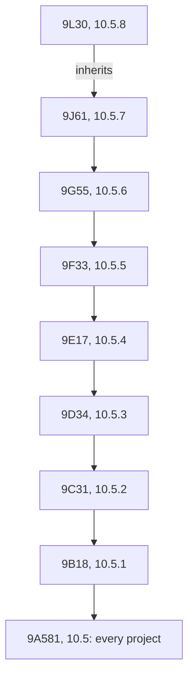
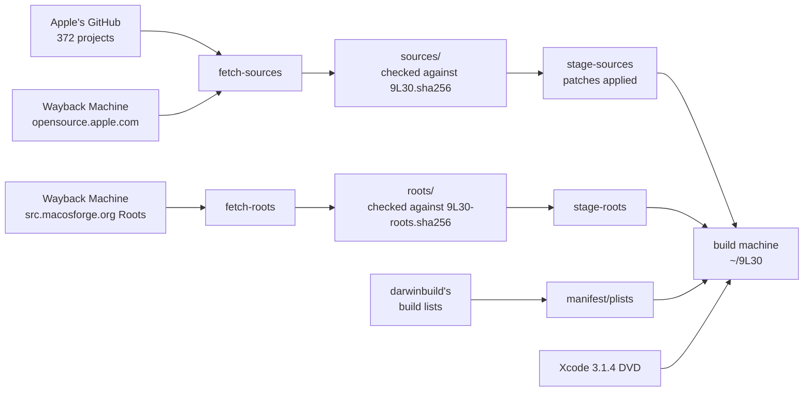

# Leopard 9L30: build numbers, build lists, sources and Roots

## What you will learn

- How Apple names each release of Mac OS X with a build number, and why the project builds the versions of `9L30`, Mac OS X 10.5.8.
- What darwinbuild's build lists are, and how nine of them, each inheriting from the one before, give the version of every project in 10.5.8.
- What a project and its version are, and how a driver's own version shows which project version built it.
- Where Apple's sources are today, which few are missing, and how every download is checked against a recorded hash.
- What a Root is, and why the build cannot start without Apple's.

## Build numbers

Apple gives every build of Mac OS X a build number, such as `9L30`. Every build of Leopard, whose kernel reports itself as Darwin 9, starts with 9, and the letter after it moves on with each update, as the table shows. `9A581` is the build Apple shipped as 10.5, and `9L30` is the build Apple shipped as 10.5.8.

Leopard had nine releases, and the project knows each of them by its build number:

| Build | Mac OS X | Darwin |
|---|---|---|
| `9A581` | 10.5 | 9.0 |
| `9B18` | 10.5.1 | 9.1 |
| `9C31` | 10.5.2 | 9.2 |
| `9D34` | 10.5.3 | 9.3 |
| `9E17` | 10.5.4 | 9.4 |
| `9F33` | 10.5.5 | 9.5 |
| `9G55` | 10.5.6 | 9.6 |
| `9J61` | 10.5.7 | 9.7 |
| `9L30` | 10.5.8 | 9.8 |

The letters of the public releases skip H, I and K.

### Why `9L30`

The project builds the versions of `9L30`, and nothing else, for two reasons.

- It is the last Leopard, so it holds every fix Apple made to it. Leopard is also the last Mac OS X that runs on PowerPC: 10.6 is for Intel Macs only.
- Exact versions make every result comparable. When our build of a project imports the same symbols and has the same sections as Apple's binary of the same version, the build is right; if the versions differed, a difference could come from either.

The third reason is rule 1 of the project: "Projects and versions are those of darwinbuild's `9L30` build list (`manifest/9L30.tsv`)." A project changes version only to take Apple's own fix from a later release, or to build the nearest version Apple published when it never published 9L30's. [The rules](rules.md) explains it with the other four.

## Projects and versions

Apple publishes the open part of Mac OS X as projects. A project is one source tree with its own build: `xnu` is the kernel, `bash` the shell, `Libc` the C library, `IOUSBFamily` the USB drivers. Each project has its own version, which counts Apple's own releases of that tree, not the version of any software inside it. `bash` 76.2 is GNU bash 3.2 with Apple's changes; `OpenSSH` 95.1.5 builds OpenSSH 5.1p1. A release of Mac OS X is then a list of project versions: `xnu` 1228.15.4, `bash` 76.2, `Libc` 498.1.7, and some four hundred more.

A few entries of that list are not projects with source of their own. A build alias builds one part of another project's source: `Libc_debug` and `Libc_profile` are Libc built with debugging or profiling, `Libsyscall` is the system-call part of xnu, `launchd_libs` the libraries of launchd, `DirectoryServiceDaemon` the daemon of DirectoryService. The 9L30 list holds 410 entries, one per line of `manifest/9L30-roots-used.tsv`, of which 385 are projects of their own; `manifest/9L30.tsv` lists them and configd_plugins, 386 in all.

### A driver's version

A driver carries a version of its own, the `CFBundleVersion` in its `Info.plist`, and for most of Apple's drivers the project version is written from it. `AppleKeyLargo.kext` 1.7.2f1 comes from the project AppleKeyLargo 172.3.1, and `AppleMacRISC4PE.kext` 2.0.4d9 from AppleMacRISC4PE 204.0.9. The digits of the driver's version, without their dots, make the project version's first number; the letter, `d` for a development build or `f` for a final one, gives the second number, 0 or 3; and the number after the letter gives the third.

This lets anyone read, from a driver installed on a running Leopard, which project version built it. [hardware/powermac12-1.md](https://github.com/nyg/PowerDarwin/blob/master/hardware/powermac12-1.md) does exactly that for every driver that Leopard loads on the project's test Mac, an iMac G5 (`PowerMac12,1`): each carries its project's `9L30` version, except AppleGPIO, whose drivers say 1.3.0d0 while the list names AppleGPIO 131.0.0. The families, the drivers that others build on, do not always follow it: IOPCIFamily 110 builds `IOPCIFamily.kext` 2.6. The same reading shows that Leopard runs the SCSI family 2.1.1, where the build list names version 200.3.6, from its `9A581` entry, which no later list changes.

## Build lists

A list of project versions for one build is a build list. darwinbuild, the tool that builds Darwin projects and the subject of [the next chapter](darwinbuild.md), keeps one per build, as a property list: a text file of nested dictionaries and lists in the old NeXT format that Apple's tools still read. darwinbuild's own repository holds the nine of Leopard, and [manifest/plists/](https://github.com/nyg/PowerDarwin/blob/master/manifest/plists/) holds a copy of each.

The first, `9A581.plist`, is long: it names every project of 10.5.0, with its version and the projects it depends on, and sets the build environment that darwinbuild gives every build, such as `RC_ARCHS = "ppc i386"`, the processors to build for. Every later list is short. It names only the projects whose version changed in that update, and says which list it builds on, with the key `inherits`. This is the whole of `9B18.plist`, 10.5.1, but for seven of its nine projects:

```text
{
	build = 9B18;
	inherits = 9A581;
	darwin = "Darwin 9.1";
	macosx = "Mac OS X 10.5.1";
        binary_sites = (
                "http://src.macosforge.org/Roots/9B18/",
        );
	projects = {
		IOKitUser = {
			version = 376.0.1;
		};
		xnu = {
			version = 1228.0.2;
		};
		...
	};
}
```

So the version of a project in 10.5.8 is found by starting at `9A581` and reading each later list in turn, each version replacing the one before. xnu was 1228 in 10.5.0, 1228.0.2 in 10.5.1, and 1228.15.4 in 10.5.8, the last list that changes it.



[scripts/resolve-buildlist](https://github.com/nyg/PowerDarwin/blob/master/scripts/resolve-buildlist) does that reading. It parses the property lists, follows `inherits` down to `9A581`, applies the lists in order, and prints each entry with its version, the build that last set that version, and, for an alias, the project whose source it uses. Its output for `9L30` is [manifest/9L30-roots.tsv](https://github.com/nyg/PowerDarwin/blob/master/manifest/9L30-roots.tsv), one line per entry:

```text
adv_cmds	119	9D34
apache	731.0.3	9J61
Libc_debug	498.1.7	9J61	Libc
```

[manifest/9L30.tsv](https://github.com/nyg/PowerDarwin/blob/master/manifest/9L30.tsv) is the list that rule 1 pins: the 386 projects, each with its version and where its source comes from. Nothing else in the project chooses a version: the scripts that fetch and stage a project read it from there, and darwinbuild reads the same versions from the build lists.

The build lists are darwinbuild's input as much as the project's. darwinbuild would download them from `svn.macosforge.org`, which no longer exists, so they are copied into the build folder before darwinbuild starts ([D2](https://github.com/nyg/PowerDarwin/blob/master/DEVIATIONS.md#d2)). The copy of `9A581.plist` in the repo is not quite darwinbuild's: where Apple's list gives a project too few dependencies, or lacks a setting the build needs, the fix is a change to it, and each such change is a deviation, such as [D29](https://github.com/nyg/PowerDarwin/blob/master/DEVIATIONS.md#d29) or [D92](https://github.com/nyg/PowerDarwin/blob/master/DEVIATIONS.md#d92) for dependencies, [D25](https://github.com/nyg/PowerDarwin/blob/master/DEVIATIONS.md#d25) for the environment or [D51](https://github.com/nyg/PowerDarwin/blob/master/DEVIATIONS.md#d51) for a configuration. The eight later lists are darwinbuild's, unchanged.

## Where the sources are

### Apple's GitHub

Since 4 October 2021, Apple publishes its open source on GitHub, under the organisation [apple-oss-distributions](https://github.com/apple-oss-distributions): one repository per project, and one tag per version, named `<project>-<version>`. GitHub serves each tag as a tarball, so the source of bash 76.2 is one download:

```text
https://github.com/apple-oss-distributions/bash/archive/refs/tags/bash-76.2.tar.gz
```

Of the 386 projects of `9L30`, 372 have their exact tag there; `manifest/9L30.tsv` marks them `github`. Apple's index at [opensource.apple.com/releases](https://opensource.apple.com/releases/) lists, under "Mac OS X 10.5.8", the projects of that release, 369 of them.

The tarball's top folder is named after the repository and the tag, `bash-bash-76.2`, where darwinbuild expects `bash-76.2`. The folder is renamed when the source is staged on the build machine, and nothing in it changes ([D1](https://github.com/nyg/PowerDarwin/blob/master/DEVIATIONS.md#d1)).

### The archived opensource.apple.com

The other 14 projects are marked `archive`. Before GitHub, Apple served every project as a tarball from `www.opensource.apple.com/tarballs/<project>/`. Those pages are gone, but the Wayback Machine, the Internet Archive's copy of old web pages, kept many of the files. A tarball is fetched from it with an address such as:

```text
https://web.archive.org/web/2012id_/http://www.opensource.apple.com/tarballs/SQLite/SQLite-46.1.tar.gz
```

`2012` asks for the copy nearest to that year, and `id_` for the file exactly as it was archived, without the Wayback Machine's own changes to it. Such a project is fetched only when a step needs it: so far, autozone 77.1 and SQLite 46.1.

Two of the 14 are drivers known never to have been published: `IOATABlockStorage` 200.1.8, the driver of ATA and SATA disks, and `IOSCSIArchitectureModelFamily` 200.3.6, the SCSI family through which CD drives and USB disks are reached. Apple shipped both in Leopard as binaries only. The last versions it published are Panther's, 130.3.1 and 139.0.2, and the project builds those in their place ([D40](https://github.com/nyg/PowerDarwin/blob/master/DEVIATIONS.md#d40), [D85](https://github.com/nyg/PowerDarwin/blob/master/DEVIATIONS.md#d85)), as [Step 1, part 2](../steps/step-1-drivers-and-bootx.md) and [Step 9](../steps/step-9-disks-and-devices.md) tell. A third, CarbonHeaders, whose `9G55` version neither GitHub nor Apple's 10.5.8 page lists, is needed only for its headers in the build environment ([D10](https://github.com/nyg/PowerDarwin/blob/master/DEVIATIONS.md#d10)). A fourth, configd_plugins 91, was never published either; its plug-ins are built from configd 212.2's source, which carries them ([D58](https://github.com/nyg/PowerDarwin/blob/master/DEVIATIONS.md#d58)).

### Xcode 3.1.4

One input is not a source. The build machine needs Xcode 3.1.4, Apple's developer tools for Leopard, closed like the rest of Xcode. Apple still offers it, as `xcode314_2809_developerdvd.dmg`, at developer.apple.com/download/all to anyone with a free Apple account. [darwinbuild and the build machine](darwinbuild.md) explains why it is needed and what darwinbuild does with it.

## Hashes, and sources never edited

[scripts/fetch-sources](https://github.com/nyg/PowerDarwin/blob/master/scripts/fetch-sources) downloads the sources into `sources/`, which is not committed. With no arguments it fetches every `github` project, six at a time; with project names, it fetches those, `archive` ones included. It never fetches a file twice. For each new tarball it records its SHA-256 hash in [manifest/9L30.sha256](https://github.com/nyg/PowerDarwin/blob/master/manifest/9L30.sha256), and at the end it checks every tarball in `sources/` against the hashes recorded there.

`fetch-sources` knows only the versions in `manifest/9L30.tsv`. The archive projects a step needs are fetched by name, as `scripts/fetch-sources autozone SQLite`. The four other tarballs whose hashes `9L30.sha256` records, Panther's IOATABlockStorage 130.3.1 and IOSCSIArchitectureModelFamily 139.0.2, CarbonHeaders 18.1 ([D73](https://github.com/nyg/PowerDarwin/blob/master/DEVIATIONS.md#d73)) and Security-55471 ([D49](https://github.com/nyg/PowerDarwin/blob/master/DEVIATIONS.md#d49)), are downloaded by hand from their tag on Apple's GitHub as `sources/<project>-<version>.tar.gz`. Until every recorded tarball is there, the script's last check names the missing ones.

The hashes make the download repeatable. Someone fetching the sources later, from GitHub or the Wayback Machine, gets exactly the bytes this project built from, or `shasum` says which file differs. The four tarballs that a deviation brings in also have their hashes in their row of DEVIATIONS.md.

Rule 1 also says that a source is never edited in place. A fix is a patch file in a folder of [patches/](https://github.com/nyg/PowerDarwin/blob/master/patches/) named after the project and version it applies to, such as `patches/bash-76.2/`, and it is applied to a copy of the source when the source is staged on the build machine, by `scripts/stage-sources` ([darwinbuild and the build machine](darwinbuild.md)). The tarball in `sources/` keeps its hash; the change is a file anyone can read, with its row in DEVIATIONS.md.

## Roots

### What a Root is

When a Darwin project is built, it installs its files into an empty folder instead of the system: a destination root, `DSTROOT` in Apple's makefiles. The folder then holds exactly what the project would put on a Mac, at the paths it would go to: `usr/bin/grep` and its manual page for grep, `System/Library/Extensions/IOUSBFamily.kext` for the USB drivers. darwinbuild keeps that folder, and calls it a Root. A Root packed as `<project>.root.tar.gz` is ready to unpack onto a volume. A headers Root, `<project>.hdrs.tar.gz`, holds only the headers a project installs, for the projects that compile against them.

darwinbuild's site served Roots of most projects for each Leopard build, at `src.macosforge.org/Roots/<build>/`: the address in each build list's `binary_sites`. That site is gone. The Wayback Machine kept copies of many of its files from 2011; [RESOURCES.md](https://github.com/nyg/PowerDarwin/blob/master/RESOURCES.md) says where else they were looked for, such as macos-powerpc.org, whose `Roots/` folder was empty.

### Why the build needs them

darwinbuild builds each project inside a nearly empty volume, which holds only what the project needs: the compiler, the shell, the headers and libraries it uses, all installed from Roots ([darwinbuild and the build machine](darwinbuild.md)). At the start nothing is built yet, so those Roots can only be Apple's. Every build runs shell commands, so darwinbuild installs `bash` into every build environment, and `bash` itself cannot be built without a compiler and a C library that were built before it. Apple's Roots break that circle. As the project builds its own Roots, darwinbuild takes ours in place of Apple's, project by project.

Apple's Roots are Apple binaries, and some are binaries of closed projects, such as the Carbon headers that [D10](https://github.com/nyg/PowerDarwin/blob/master/DEVIATIONS.md#d10) unpacks into the build environment. They run the build; none of them reaches the image. Rule 5 says so, and [Making the image](making-the-image.md) shows how every file on the image is checked.

### Fetching them

[scripts/fetch-roots](https://github.com/nyg/PowerDarwin/blob/master/scripts/fetch-roots) fetches them into `roots/`, which is not committed either:

1. It follows `inherits` from `9L30` down to `9A581` and, for each of the nine builds, saves the Wayback Machine's listing of that build's `Roots/` folder.
2. For each entry of `manifest/9L30-roots.tsv`, it looks for the Root and the headers Root, first in the build that set the entry's version and in later builds, which have the same version, then in earlier builds, which have older ones.
3. It records what it found in [manifest/9L30-roots-used.tsv](https://github.com/nyg/PowerDarwin/blob/master/manifest/9L30-roots-used.tsv): `exact` when the Root has the entry's version, `older` when only an earlier build had one, `none` when no build had it. Of the 410 entries, 320 are `exact`, 32 `older` and 58 `none`.
4. It downloads each file, two at a time and two seconds apart, since the Wayback Machine refuses connections after a burst of requests, retries a refused one up to eight times, and keeps a file only if `gzip -t` finds it whole.
5. It records the SHA-256 of each new file in [manifest/9L30-roots.sha256](https://github.com/nyg/PowerDarwin/blob/master/manifest/9L30-roots.sha256) and checks the files already recorded.

An `older` Root stands in for a project only until the project is built from source; it never stands for the version itself ([D3](https://github.com/nyg/PowerDarwin/blob/master/DEVIATIONS.md#d3)). darwinbuild does the same on its own: when a build's folder has no Root for a project, it looks in the build that list inherits from.

### From the current Mac to the build machine

The sources, Roots and build lists all reach the build machine from another Mac. Leopard cannot fetch them itself: its TLS is too old for GitHub and archive.org. So a current Mac downloads, checks the hashes, and copies to the build machine over SSH with the staging scripts of [the next chapter](darwinbuild.md): `scripts/stage-roots` puts the chosen Roots and headers Roots where darwinbuild looks before it downloads anything, so darwinbuild tries the dead `binary_sites` only for a file that is not there: the Root of one of the 58 `none` entries, where it stops with `ERROR: could not find root` until the project is built from source, or a headers Root that was not staged, where it then takes the project's staged Root instead.



## Where to look

- [manifest/](https://github.com/nyg/PowerDarwin/blob/master/manifest/): [9L30.tsv](https://github.com/nyg/PowerDarwin/blob/master/manifest/9L30.tsv), [9L30.sha256](https://github.com/nyg/PowerDarwin/blob/master/manifest/9L30.sha256), [plists/](https://github.com/nyg/PowerDarwin/blob/master/manifest/plists/), [9L30-roots.tsv](https://github.com/nyg/PowerDarwin/blob/master/manifest/9L30-roots.tsv), [9L30-roots-used.tsv](https://github.com/nyg/PowerDarwin/blob/master/manifest/9L30-roots-used.tsv), [9L30-roots.sha256](https://github.com/nyg/PowerDarwin/blob/master/manifest/9L30-roots.sha256).
- Scripts: [resolve-buildlist](https://github.com/nyg/PowerDarwin/blob/master/scripts/resolve-buildlist), [fetch-sources](https://github.com/nyg/PowerDarwin/blob/master/scripts/fetch-sources), [fetch-roots](https://github.com/nyg/PowerDarwin/blob/master/scripts/fetch-roots).
- [README.md](https://github.com/nyg/PowerDarwin/blob/master/README.md): rule 1, and "Build it".
- [RESOURCES.md](https://github.com/nyg/PowerDarwin/blob/master/RESOURCES.md), "Apple's sources and binaries".
- [hardware/powermac12-1.md](https://github.com/nyg/PowerDarwin/blob/master/hardware/powermac12-1.md), for driver versions read from Leopard.
- Deviations: [D1](https://github.com/nyg/PowerDarwin/blob/master/DEVIATIONS.md#d1), [D2](https://github.com/nyg/PowerDarwin/blob/master/DEVIATIONS.md#d2), [D3](https://github.com/nyg/PowerDarwin/blob/master/DEVIATIONS.md#d3), [D10](https://github.com/nyg/PowerDarwin/blob/master/DEVIATIONS.md#d10), [D25](https://github.com/nyg/PowerDarwin/blob/master/DEVIATIONS.md#d25), [D29](https://github.com/nyg/PowerDarwin/blob/master/DEVIATIONS.md#d29), [D40](https://github.com/nyg/PowerDarwin/blob/master/DEVIATIONS.md#d40), [D49](https://github.com/nyg/PowerDarwin/blob/master/DEVIATIONS.md#d49), [D51](https://github.com/nyg/PowerDarwin/blob/master/DEVIATIONS.md#d51), [D58](https://github.com/nyg/PowerDarwin/blob/master/DEVIATIONS.md#d58), [D73](https://github.com/nyg/PowerDarwin/blob/master/DEVIATIONS.md#d73), [D85](https://github.com/nyg/PowerDarwin/blob/master/DEVIATIONS.md#d85), [D92](https://github.com/nyg/PowerDarwin/blob/master/DEVIATIONS.md#d92).
- Commits `73cc93f`, which pinned the versions and fetched the sources, and `456ab39`, which fetched the Roots.
- darwinbuild's build lists, in the `plists/` folder of [macosforge/darwinbuild](https://github.com/macosforge/darwinbuild) on its `Darwin9` branch.
