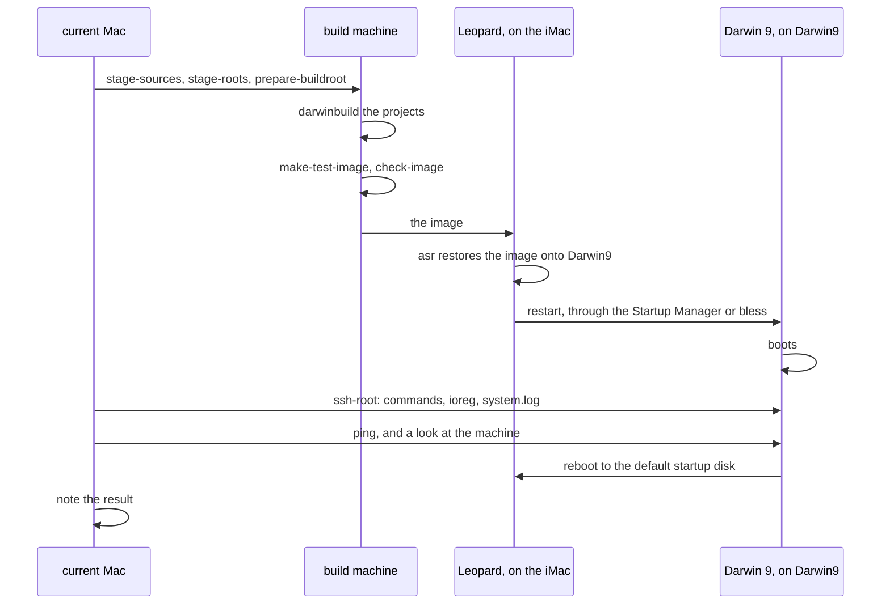

# How testing is done

## What you will learn

- The three test benches, a chroot on the build machine, QEMU's `mac99` and a real Mac, and what each can and cannot prove.
- How `scripts/boot-qemu` starts the image, and how a test talks to it: the serial log, SSH through a forwarded port, and typing and screenshots through QEMU's monitor.
- How one test cycle goes on the test Mac, an iMac G5 (`PowerMac12,1`), from the build to Leopard again.
- How our binaries are compared with Leopard's: imports and exports, section sizes, disassembly, and `kextload -n`.
- On which machine each step was proved.

## Three benches

A build that succeeds proves only that the compiler and the linker were satisfied. Whether the result runs is tested on three benches, each closer to a real Mac and slower to use than the one before.

### A chroot on the build machine

`chroot` runs a program with another folder as its `/`, so that every path it opens is looked up in that folder. A folder holding only our Roots is then a small Darwin 9 system without a kernel of its own: its programs run on the build machine's kernel, but load only our libraries.

The first test of our files, on 19 November 2026, was such a folder: the Roots of Libsystem, Libm, dyld, bash, ncurses (without Apple's prebuilt `libncurses.5.dylib`), libiconv, libgcc, bsm, libutil, libedit, launchd, file_cmds, shell_cmds and diskdev_cmds, 3,383 files. Our `/bin/sh` ran on our dyld and our libSystem, and `ls`, `mount` and `fsck_hfs` ran. `launchctl` stopped at `dyld: Library not loaded: /System/Library/Frameworks/IOKit.framework/Versions/A/IOKit`, which showed the next projects to build. With the Roots of IOKitUser, CF, ICU, objc4, autozone, libstdcxx and zlib added, `launchctl help` ran, and dyld loaded only our files. That folder became the userland folder that every image still starts from ([Making the image](making-the-image.md)).

A chroot has a limit that matters on Darwin. Programs find launchd, and through it every other daemon, by Mach messages, not by paths, and a chroot does not change which launchd a program reaches: it is the build machine's own, running Leopard. A command that talks to launchd from inside the chroot would therefore ask Leopard's launchd to start or stop Leopard's jobs. Only commands that do not talk to launchd were run there. Our `launchd` itself refused, as it does whenever it is not process 1: `This program is not meant to be run directly.`

The BuildRoot is a chroot too, and every build tests the Roots installed in it. Our `/bin/sh` first showed its parser bug there, as ncurses failing to build ([D20](https://github.com/nyg/PowerDarwin/blob/master/DEVIATIONS.md#d20)).

### QEMU's `mac99`

QEMU emulates a whole PowerPC Mac on the current Mac. Its `mac99` machine is a G4 Power Mac, `PowerMac3,1`, with OpenBIOS as its Open Firmware ([PowerPC Macs](../background/powerpc-macs.md)). It is the bench anyone can run: no PowerPC Mac is needed, and nothing has to be restored before a test. The project used QEMU 11.1.3.

[scripts/boot-qemu](https://github.com/nyg/PowerDarwin/blob/master/scripts/boot-qemu) `<raw image> [boot-args] [CD image] [USB disk image]` starts it:

```sh
exec qemu-system-ppc \
   -M mac99,via=pmu \
   -m 1024 \
   -drive file="$image",format=raw,media=disk \
   ${cd_args[@]+"${cd_args[@]}"} \
   ${usb_args[@]+"${usb_args[@]}"} \
   -boot c \
   -prom-env "boot-args=$boot_args" \
   -g 1024x768x32 \
   -nic user,model=sungem,hostfwd=tcp:127.0.0.1:"$ssh_port"-:22 \
   -monitor unix:"$monitor",server,nowait \
   -serial file:"${image%.*}.serial.log"
```

- `via=pmu` gives the machine a PMU, the power controller of many G4 Macs, and puts its keyboard on USB.
- `-prom-env` sets the Open Firmware variable `boot-args`, the kernel's arguments, before the machine starts: `-v -s` by default, a verbose boot to a single-user shell, or `-v` for a multi-user boot.
- The optional CD image goes where QEMU's own CD drive would, on the second IDE bus, and the optional USB disk on QEMU's USB controller. Step 9's tests added an EHCI controller, `-device usb-ehci`, since QEMU's OHCI model stops (below).
- `-nic user,model=sungem` gives the guest a model of Apple's GMAC Ethernet, the chip of the iMac, on QEMU's user network: QEMU answers DHCP with `10.0.2.15` and is the name server at `10.0.2.3`. `hostfwd` forwards port 2222 of the current Mac, or `QEMU_SSH_PORT`, to the guest's port 22, so SSH reaches the guest at `127.0.0.1`.
- `-monitor` opens QEMU's monitor, its command line, on a Unix socket named by `QEMU_MONITOR`, `/tmp/darwin9-qemu.sock` by default. Through it, a script can press keys in the guest, take a screenshot of its screen, or plug in a disk while the guest runs, as Step 9's FAT32 test did.
- `-serial` writes the guest's serial port to a log file beside the image.

Before SSH worked, in Steps 1 and 2, tests were typed at the guest's console. [scripts/qemu-type](https://github.com/nyg/PowerDarwin/blob/master/scripts/qemu-type) `<monitor socket> <screenshot.png> <line>...` does it: it turns each character of each line into the monitor's `sendkey` command, `sendkey shift-4` for `$`, presses Return, waits four seconds, and at the end saves the screen with `screendump`, converted to PNG. The screenshots in [reference/qemu-userland-test/](https://github.com/nyg/PowerDarwin/blob/master/reference/qemu-userland-test/) are such screen dumps, some cropped. Its `kextstat.txt`, the first list of drivers our kernel loaded, was written to the image by the guest and read back on the current Mac.

What QEMU cannot prove is anything about the iMac. `mac99` is a G4 with a PMU, a UniNorth north bridge and ATA disks; the iMac has a G5, a U4, an SMU and SATA disks, and its drivers have nothing to match in QEMU. QEMU also lacks what no open driver gives it yet: its PMU's driver, ApplePMU, is closed, so the clock starts at 1970, and the processor driver waits for it without end, which keeps IOKit busy, so configd waits 60 seconds before naming `en0` at every boot ([Step 8](../steps/step-8-clean-boot.md)). And its models are not real hardware: its model of the OHCI USB controller stopped about 90 seconds after boot, where its EHCI controller worked ([Step 9](../steps/step-9-disks-and-devices.md)).

### A real Mac: the iMac G5

A real Mac is the only bench that tests the drivers of real hardware, its firmware, and the timing of a real boot. The project's test Mac is the iMac, the reference machine on which every step from Step 1 on was proved.

The image goes onto a spare partition of the iMac's disk, at least as large as the image, named `Darwin9`, beside Leopard's own. Leopard, started on the iMac, copies the image onto that partition with `asr`, Apple Software Restore.

Three ways start the iMac from `Darwin9`:

- From Open Firmware's prompt, which Command-Option-O-F held at power-on opens. The first tests set the kernel's arguments and booted the partition by its device path: `setenv boot-args -v -s`, then `boot sata/k2-sata@0/@0:4,\\:tbxi`, which asks for the file of type `tbxi` in the blessed folder of the SATA disk's partition 4 ([the boot chain](../background/boot-chain.md)), where 4 is that partition's number on the SATA disk, as `diskutil list` shows it on Leopard.
- From the Startup Manager, which Option held at power-on opens and which lists every volume with a blessed folder. From Step 4 on, tests chose `Darwin9` there; `boot-args` kept the `-v` set at the prompt.
- With `bless`. Since Step 9, our own `bless --mount / --setOF` makes the running system the startup disk, by setting Open Firmware's `boot-device`, and Leopard's `bless --mount /Volumes/Darwin9 --setOF` does the same from Leopard.

Leopard is the iMac's default startup disk, so `reboot` from Darwin 9 returns to Leopard; after a test that used `bless`, `bless --mount /Volumes/Leopard --setOF` sets it back.

From Step 3 on, every test logs in over SSH from the current Mac, without anyone at the iMac. [scripts/ssh-root](https://github.com/nyg/PowerDarwin/blob/master/scripts/ssh-root) `<host> <port> <command>` does it in one command, for the iMac on port 22 as for QEMU's forwarded port. It reads the test password from `DARWIN9_ROOT_PASSWORD`, types it when sshd asks, and returns the command's exit status. It also turns on the older key-exchange and host-key algorithms that OpenSSH 5.1 offers and a current client turns off, and does not keep the host key, since each new image makes new ones.

What is measured depends on the step. The time from boot to the first SSH login, 18 seconds by Step 8, shows how cleanly the system boots. `/var/log/system.log`, read over SSH, shows every error of a boot. `ioreg`, from Step 7 on, prints the IORegistry, and with it the drivers that matched, OpenSMU's sensor readings and fan speeds, and the sound driver's controls. Some things can only be seen at the machine: whether `shutdown -h now` switched the iMac off, which a test also checks by watching it stop answering `ping`, 33 seconds after the command in Step 5; and whether the fans are quiet, or the speakers play a tone.

Leopard, started on the same iMac, is measured the same way, so that Darwin 9 is compared with it under the same conditions: the fan speeds and temperatures of Step 7 were read on both on the same day, and the clock that Darwin 9 wrote in Step 5 was read back by Leopard. [Leopard's captures on the iMac](https://github.com/nyg/PowerDarwin/blob/master/reference/imacg5/) keep what Leopard runs on the iMac, captured once: the drivers it loads (`kextstat.txt`, `loaded-kexts.tsv`), the kexts it has, its packages, and the first lines of its kernel's boot log. Its full IORegistry and NVRAM are kept out of the repo, as they identify the machine.

### One test cycle on the iMac



## Comparing with Leopard's binaries

A system that boots can still differ from Apple's in ways no test shows at once: a function missing from a library, a driver compiled from source that is not the one Apple shipped. So each project's build is also compared with Leopard's binary of the same version, at the same path, on the build machine's own Leopard.

### Symbols and sections

A Mach-O binary lists the symbols it exports, the functions and data it offers to others, and the symbols it imports, which the dynamic linker or the kernel's kext loader must find elsewhere. `nm -u` prints the imports, `nm -g` the exports, `size` the sizes of its code and data segments, and `lipo -info` its architectures. [scripts/cmp-binaries](https://github.com/nyg/PowerDarwin/blob/master/scripts/cmp-binaries) `<build folder> <Leopard root> <project>...` runs on the build machine, which holds both our Roots and Leopard; a Leopard root of `/` names the running system. It runs all four on every Mach-O file of a project's latest Root and on Leopard's file at the same path, `lipo -info` on the whole file and the others on the PowerPC slice, and prints one line per file, with the first lines of any difference.

Two builds of one source with the same compilers import and export the same symbols, and their sections have the same sizes, unless something in the build differs. When ours match, the build is Apple's: IONetworkingFamily exports the same 833 symbols as Apple's kext and imports the same 548, Security.framework exports the same 734 functions. When they differ, the difference is explained, and it usually points at something the published source lacks: our IONDRVSupport has no `IOATINDRV` and `IOATI128NDRV` classes, which are not in the source, and its code is 82,480 bytes against Apple's 91,560.

### Disassembly

For a few binaries, the comparison goes down to the instructions. `otool -tV` disassembles a binary function by function. [scripts/cmp-disassembly](https://github.com/nyg/PowerDarwin/blob/master/scripts/cmp-disassembly) compares Apple's binary and ours:

```text
cmp-disassembly <apple.dis> <ours.dis> <apple.cstring> <ours.cstring> <apple.nm> <ours.nm> [function...]
```

It is a Python 3 program, which Leopard's Python 2.5 cannot run, so it runs on the current Mac. Its six inputs are text files made on the build machine, three for each binary:

- `otool -arch ppc -tV <binary>`, the disassembly of the PowerPC slice;
- `otool -arch ppc -v -s __TEXT __cstring <binary>`, the `__cstring` section, which holds the binary's C strings;
- `nm -arch ppc <binary>`, its symbol table.

It compares the two disassemblies function by function. Addresses differ between any two builds, so it compares a branch's target as an offset from the start of its function, and the address of a string as the string itself. It prints how many functions are identical and which differ, and a diff of any function named.

That is how AppleMacRISC4PE, the iMac's platform driver, was checked: 116 of its 123 functions are the same instruction for instruction, 2 differ only in a line number that a `panic` message quotes, and the last 5 are shorter, because the published source leaves parts of them out ([D39](https://github.com/nyg/PowerDarwin/blob/master/DEVIATIONS.md#d39)). BootX was compared word by word: of the 43,061 words of its XCOFF file, 600 differ, 583 of them stack-frame offsets in loads, stores and additions.

### Linking a kext without loading it

A kext imports symbols from the kernel and from other kexts, and the kernel's loader refuses it if one is missing. On Leopard, `kextload -n` links a kext against the running kernel and the kexts it depends on, and stops before loading it. Leopard's kernel is the same xnu version as ours, so a kext that links there finds every symbol it needs in ours too. OpenSMU was checked that way before it first went onto the image ([Step 5](../steps/step-5-clock-and-power.md)).

For Panther's SCSI family, which stands in for Leopard's unpublished one, the question was the other way round: do Leopard's kexts that use the family find everything they import in Panther's? [scripts/check-family-imports](https://github.com/nyg/PowerDarwin/blob/master/scripts/check-family-imports) `[--skip <folder>]... <family source> <kext>...`, a Python 3 program too, run on the current Mac, reads the family's source for the classes it defines and the methods it implements, demangles every C++ symbol the kexts import, and lists each import from those classes that the source does not define ([D85](https://github.com/nyg/PowerDarwin/blob/master/DEVIATIONS.md#d85), [Step 9](../steps/step-9-disks-and-devices.md)).

### Behaviour

Last, the running systems are compared. `kextstat` on the image against Leopard's list shows which drivers are missing; the IORegistry of a driver under Darwin 9 against the same driver's under Leopard shows whether it found the same hardware and published the same properties; and Leopard's own `system.log` shows which messages Leopard logs as well, so that Step 8 could tell the errors of the image from those that come from Apple's own files.

## Where each step was proved

Every step's goal names the machine it is proved on. Steps 1 and 2 name both QEMU and the iMac; from Step 3 on, the goals are the iMac's, and QEMU tests what it can.

| Step | QEMU's `mac99` | iMac G5 |
|---|---|---|
| 1, a single-user shell | reached | reached |
| 2, a console login | reached | reached |
| 3, Ethernet and SSH | reached | reached |
| 4, everyday commands | reached | reached |
| 5, clock, restart, power-off | no SMU | reached |
| 6, securityd | tested | reached |
| 7, fan control | no SMU | reached |
| 8, a clean boot | tested, the 60-second wait remains | reached |
| 9, disks and devices | CDs and USB disks tested | reached, but for CDs, mounted in QEMU only |

## Where to look

- Scripts: [boot-qemu](https://github.com/nyg/PowerDarwin/blob/master/scripts/boot-qemu), [qemu-type](https://github.com/nyg/PowerDarwin/blob/master/scripts/qemu-type), [ssh-root](https://github.com/nyg/PowerDarwin/blob/master/scripts/ssh-root), [cmp-binaries](https://github.com/nyg/PowerDarwin/blob/master/scripts/cmp-binaries), [cmp-disassembly](https://github.com/nyg/PowerDarwin/blob/master/scripts/cmp-disassembly), [check-family-imports](https://github.com/nyg/PowerDarwin/blob/master/scripts/check-family-imports).
- [reference/qemu-userland-test/](https://github.com/nyg/PowerDarwin/blob/master/reference/qemu-userland-test/): the screenshots of the first QEMU boots and `kextstat.txt`.
- [Leopard's captures on the iMac](https://github.com/nyg/PowerDarwin/blob/master/reference/imacg5/): what Leopard runs on the iMac.
- [README.md](https://github.com/nyg/PowerDarwin/blob/master/README.md), the goals of Steps 1 to 9.
- Deviations: [D20](https://github.com/nyg/PowerDarwin/blob/master/DEVIATIONS.md#d20), [D39](https://github.com/nyg/PowerDarwin/blob/master/DEVIATIONS.md#d39), [D85](https://github.com/nyg/PowerDarwin/blob/master/DEVIATIONS.md#d85).
