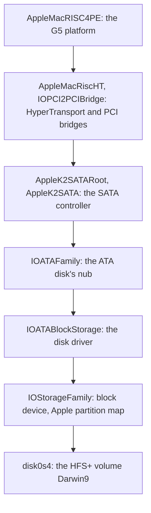
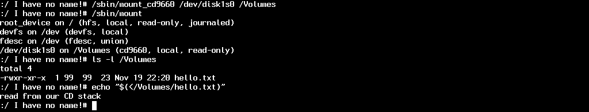
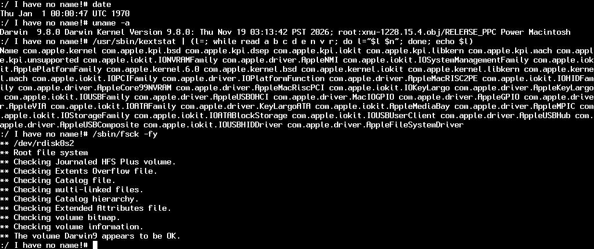

# Step 1, part 2: drivers, BootX and the iMac

## What you will learn

- Which drivers stand between the kernel and the root disk, in QEMU's `mac99` and on an iMac G5 (`PowerMac12,1`), and what each layer does.
- How the drivers were replaced test by test, from 15 of the 38 that QEMU loads to every one, with USB, the keyboard and the CD on the way.
- How BootX, the boot loader, was built and compared with Apple's, word by word.
- How the iMac's platform driver was built although its source uses 66 register values that no published header defines.
- Why the disk driver on the image is Panther's, not Leopard's, and what that costs.

## The goal

README.md sets Step 1 as: "A disk image whose files all come from this repo's builds boots to a single-user root shell (`-v -s`) in QEMU `mac99` and on an iMac G5."

At the end of [part 1](step-1-kernel-and-userland.md), the kernel and every program on the image were ours, and QEMU booted it to a root shell. BootX and all 38 drivers that QEMU loaded were still Leopard's. This part replaces them, then proves the step on the iMac.

## Background: from the kernel to the root disk

A driver is the code that knows one kind of hardware: which registers to read and write, which interrupts to expect ([Hardware and boot basics](../background/hardware-basics.md)). In xnu, drivers are IOKit objects in kexts. IOKit starts, for each node of Open Firmware's device tree, the driver whose `Info.plist` matches it best; that driver may publish new nodes, called nubs, for the devices behind it, and so on down. Families hold the code shared by a whole class of hardware: IOPCIFamily for PCI, IOATAFamily for ATA disks, IOStorageFamily for anything that holds blocks.

To mount the root volume, the kernel needs a chain of drivers from the machine itself to the disk's partition. In QEMU, the first boot printed that chain in full:

```text
Got boot device = IOService:/MacRISC2PE/pci@f2000000/AppleMacRiscPCI/mac-io@C/AppleKeyLargo/ata-3@20000/KeyLargoATA/ATADeviceNub@0/AppleATADiskDriver/IOATABlockStorageDevice/IOBlockStorageDriver/QEMU HARDDISK QEMU HARDDISK/IOApplePartitionScheme/disk image@2
```

Read from left to right: the platform driver (AppleMacRISC2PE, for G4-era Macs), the PCI bus, the Mac I/O chip (AppleKeyLargo), its ATA controller (KeyLargoATA), the disk on it (IOATAFamily's nub), the disk driver (AppleATADiskDriver, in IOATABlockStorage), the block layer and partition map (IOStorageFamily), and partition 2. The iMac's chain has the same shape with other drivers:



Every link must be a driver that loads, or the kernel waits forever with `Still waiting for root device`.

## What was built

Each boot test in QEMU swapped some of Leopard's kexts for ours and counted what loaded. The share of our drivers grew like this:

```mermaid
xychart-beta
    title "Drivers loaded in QEMU, all and ours"
    x-axis ["4th test", "5th", "6th", "7th"]
    y-axis "drivers" 0 --> 40
    bar [38, 38, 38, 24]
    bar [15, 22, 27, 23]
```



The taller bar is every driver loaded from the driver cache; the shorter one, drawn over it, is ours. In the twelfth test, Panther's IOATABlockStorage replaced the last of Apple's drivers, and every file on the image was ours.

### The root disk in QEMU

The first 13 driver projects were those on QEMU's root-disk chain and its neighbours, such as AppleMPIC, the interrupt controller, and AppleCore99NVRAM. Most built in seconds. The fourth boot test stopped at `Still waiting for root device`, after `extension "com.apple.iokit.IOATAPIProtocolTransport" cannot be found`. Apple's `IOATAFamily.kext` carries three other drivers inside it as plug-ins, IOATABlockStorage among them; ours, built from IOATAFamily's own project, carries none, since other projects build them. make-test-image had skipped Apple's whole kext because ours was there, and with it the disk driver. With Leopard's plug-ins added back, the image booted through our drivers on the chain above, and 15 of the 38 drivers were ours.

### USB and the keyboard

QEMU's `mac99`, as boot-qemu starts it, has no ADB keyboard; its keyboard is a USB device. USB has a host controller, the chip that runs the bus, here an OHCI, the USB 1.1 kind; drivers for each device class sit behind it. A keyboard is a HID, a human interface device, whose reports IOHIDFamily turns into key presses for the console. IOUSBFamily and IOHIDFamily took six deviations between them ([D30](https://github.com/nyg/PowerDarwin/blob/master/DEVIATIONS.md#d30) to [D35](https://github.com/nyg/PowerDarwin/blob/master/DEVIATIONS.md#d35)), one of them a story below. In the fifth test, the keyboard typed through our AppleUSBOHCI, IOUSBHIDDriver and IOHIDFamily, and 22 of the 38 drivers were ours.

### The CD

CD and DVD drives speak ATAPI, SCSI commands carried over the ATA bus, so reading a CD takes IOATAPIProtocolTransport, which carries the commands, SCSI drivers that send them, and IOCDStorageFamily, which presents the disc. In the sixth test, with a 900 KB ISO 9660 image as QEMU's CD, `/sbin/mount_cd9660 /dev/disk1s0 /Volumes` mounted it and read its file:



27 of the 38 drivers were ours. Of the other 11, only BootCache has published source; Leopard's IOSCSIArchitectureModelFamily with its three plug-ins, IOATABlockStorage, ApplePMU, XsanFilter, the application firewall and the TMSafetyNet and seatbelt security policies have none.

### A smaller image

The seventh test copied, of Leopard's kexts, only IOATABlockStorage. The image still booted, and loaded 24 drivers, 23 of them ours:



Without ApplePMU, the closed driver of QEMU's power controller, the clock started at 1970 (`Thu Jan  1 00:00:47 UTC 1970`), a problem [Step 5](step-5-clock-and-power.md) explains. Without IOSCSIArchitectureModelFamily, IOATAPIProtocolTransport did not load, so there was no CD. Checked by MD5, every one of the image's 6,744 files came from our builds except BootX, the eight files of `IOATABlockStorage.kext`, and the two the script writes: `Extensions.mkext` and `com.apple.Boot.plist`.

### BootX

BootX is the boot loader that Open Firmware starts: it reads the kernel and the driver cache from the HFS+ volume and jumps into the kernel ([the boot chain](../background/boot-chain.md)). BootX 81 built in 17 seconds. Its `bootx.bootinfo` and `bootx.xcoff` are each the size of Leopard's, with an identical bootinfo header. Of the XCOFF program's 43,061 words, 600 differ: 583 loads, stores and additions with other stack-frame offsets, 10 words of the Mach-O load commands that BootX carries in its text, 3 data pointers 4 or 8 bytes later, and the 4 of its UUID.

make-test-image copies the BootX Root into the image, and `bless --bootinfo` copies `bootx.bootinfo` into the blessed folder as `BootX`, with type `tbxi` and creator `chrp`, by which Open Firmware finds it. In the eighth test, QEMU's OpenBIOS loaded our BootX, which loaded our kernel and driver cache, and the image booted to the same shell.

### The iMac's own drivers

The iMac needs drivers QEMU never loads: AppleK2SATARoot and AppleK2SATA for its SATA controller, AppleMacRISC4PE for the G5 platform, AppleFlashNVRAM, AppleI2C and IOGraphics. All but AppleMacRISC4PE import and export the same symbols as Apple's, except IOGraphics' IONDRVSupport, which imports one symbol fewer and lacks the 37 exports of two classes for old ATI cards that are not in the published source. IOGraphics stays out of the driver cache, as it does from Leopard's: its `OSBundleRequired` is `Safe Boot`, which `kextcache -l` leaves out, and a single-user shell keeps the firmware's framebuffer, the plain screen memory Open Firmware sets up, which the console writes into. The ninth to eleventh tests booted QEMU to the same shell with these drivers on the image.

## What broke and how it was fixed

### Register offsets the published source lacks (D39)

AppleMacRISC4PE is the platform driver of G5 Macs. Among other things it drives the U3 or U4 north bridge, the chip that joins the processor to memory and I/O, through registers, each at a fixed offset from the chip's base address ([Hardware and boot basics](../background/hardware-basics.md)). Its source names them by constants, such as `kU4APIExceptionRegister`. Its first build stopped at once:

```text
MacRISC4PE.cpp:183: error: 'kUniNRevision3_2_1' was not declared in this scope
```

and 68 other undeclared names in `MacRISC4PE.cpp`, `MacRISC4CPU.cpp` and `U3.cpp`: 66 register offsets, bit masks, shifts and version tests, and three local variables of `U3.cpp`, `syndromes`, `upperSyndrome` and `lowerSyndrome`, assigned but never declared. No header of the published source defines the constants. 15 are in the `U3.h` of AppleMacRISC4PE 101.2.3, from Mac OS X 10.2.7, whose later versions dropped them, and 2 are in AppleMacRISC2PE's `UniN.h`. The other 49 are mostly for ECC, the memory's error correction, and for the DART, the north bridge's table that translates the addresses devices use for DMA. Linux defines 13 of them with the same values in `cpc925_edac.c`, its driver for IBM's CPC925, which Apple calls the U3, and its `dart.h` has the DART's exception register of each bridge. Apple's source export removed them, as it removed a declaration from IOUSBFamily ([D35](https://github.com/nyg/PowerDarwin/blob/master/DEVIATIONS.md#d35), below).

[D39](https://github.com/nyg/PowerDarwin/blob/master/DEVIATIONS.md#d39)'s [patch](https://github.com/nyg/PowerDarwin/blob/master/patches/AppleMacRISC4PE-204.0.9/0001-define-u3-and-u4-registers.patch) adds all 66 to `U3.h` and declares the three locals.

The 15 values that 101.2.3's `U3.h` defines are the same in the patch, and so is `kUniNSave` from `UniN.h`; `kUniNVSPSoftReset` is `0x10`, where `UniN.h`, written for the older UniNorth bridges, has `0x170`. Where the code only uses some bits together, the patch orders them as the matching exception bits.

With the patch, the kext built in 10 seconds, and it was compared with Apple's function by function ([How testing is done](../method/testing.md)). 116 of its 123 functions are the same, and 2 more differ only in the line number a `panic` message quotes. The other 5 are shorter than Apple's, because the published source leaves parts of them out: the model name passed to the kernel for panic logs, and steps taken only on a U3, on a U3 Heavy, or before sleep on a PCI-X bridge. The iMac has a U4, and a HyperTransport bridge that is not PCI-X, so only the model name in panic logs applies to it.

### Panther's disk driver for Leopard (D40)

IOATABlockStorage is the driver that turns block reads and writes into ATA commands for a hard disk: the `AppleATADiskDriver` in QEMU's chain. Leopard's version, 200.1.8, was never published. Apple's GitHub and the archived opensource.apple.com both stop at 130.3.1, from Mac OS X 10.3 Panther. Until the twelfth test, the image therefore carried Leopard's binary, the last of Apple's files on it.

[D40](https://github.com/nyg/PowerDarwin/blob/master/DEVIATIONS.md#d40) builds Panther's 130.3.1 in its place, staged with `scripts/stage-sources <host> IOATABlockStorage=130.3.1` and built with `darwinbuild IOATABlockStorage 130.3.1`; the build list, which names the project as binary-only, gains a kext's dependencies. Two headers then got in the way. Its `ATASMARTLib` plug-in includes `IOATAStorageDefines.h` from IOKit.framework, where nothing had installed it:

```text
UserClientLib/ATASMARTLib.h:39:52: error: IOKit/storage/ata/IOATAStorageDefines.h: No such file or directory
```

and with only that fixed, the kext found Leopard's copy of the same header in Kernel.framework, the folder of headers for code that runs in the kernel, placed there earlier from the SDK for IOATAPIProtocolTransport ([D36](https://github.com/nyg/PowerDarwin/blob/master/DEVIATIONS.md#d36)), which lacks a type Panther's code uses:

```text
IOATABlockStorageDriver.h:159: error: 'IOATAPowerState' does not name a type
```

So 130.3.1's headers are built first and copied into the build environment, as with IOBDStorageFamily's in part 1. IOATAPIProtocolTransport, rebuilt against Panther's header, compiles to the same code.

The result is plainly Panther's: `IOATABlockStorage.kext` version 1.3.0 with the driver class `IOATABlockStorageDriver`, where Apple's 2.0.6 has `AppleATADiskDriver`; 468 imported symbols against 522, 215 exported against 337, 40,316 bytes of `ppc` code against 70,280; and Panther's `ATASMARTLib.plugin` inside. It declares no kernel dependency in its `OSBundleLibraries`, the list of kernel interfaces a kext needs, which Leopard's loader accepts with a notice at every boot:

```text
Extension "com.apple.iokit.IOATABlockStorage" has no explicit kernel dependency; using version 6.0.
```

In the twelfth test, the root disk was reached through `IOATABlockStorageDriver`, and every file on the image came from our builds.

### A declaration removed by Apple's source export (D35)

IOUSBFamily failed five times, the last at:

```text
IOUSBWorkLoop.cpp:62: error: 'fLockGroup' was not declared in this scope
```

`IOUSBWorkLoop::free` releases a lock group, `fLockGroup`, if it has one. The published `IOUSBWorkLoop.h` never declares it. Leopard's own copy of the header, in its Kernel.framework, does, inside a block marked `#ifndef __OPEN_SOURCE__`: the export that made the published source removed that block, but not the code in `IOUSBWorkLoop.cpp` that uses it. IOUSBFamily 378.4.3, a later release, has the same gap, so there was no later fix to backport.

[D35](https://github.com/nyg/PowerDarwin/blob/master/DEVIATIONS.md#d35)'s [patch](https://github.com/nyg/PowerDarwin/blob/master/patches/IOUSBFamily-349.4.3/0003-declare-workloop-lock-group.patch) adds the one line, `lck_grp_t * fLockGroup;`, where Apple's header has it. Nothing in the published source ever sets it, and IOKit zeroes every object when it allocates it (`OSObject::operator new` in xnu calls `bzero`), so `free` finds it empty and does nothing.

### Every other deviation of this part

- [D29](https://github.com/nyg/PowerDarwin/blob/master/DEVIATIONS.md#d29): AppleGPIO includes IOI2CFamily's private headers, so the build list makes IOI2CFamily one of its dependencies.
- [D30](https://github.com/nyg/PowerDarwin/blob/master/DEVIATIONS.md#d30): Kernel.framework's `TargetConditionals.h` becomes the symlink CarbonHeaders' Makefile installs, which the 9G55 Root lacks.
- [D31](https://github.com/nyg/PowerDarwin/blob/master/DEVIATIONS.md#d31): IOHIDFamily needs a UPS header that PowerManagement installs only in a full build, so PowerManagement becomes a build dependency.
- [D32](https://github.com/nyg/PowerDarwin/blob/master/DEVIATIONS.md#d32): IOHIDFamily is built without `hidd`, the daemon of the HID event system that Apple published as empty files ([D22](https://github.com/nyg/PowerDarwin/blob/master/DEVIATIONS.md#d22)).
- [D33](https://github.com/nyg/PowerDarwin/blob/master/DEVIATIONS.md#d33): three IOUSBFamily headers never close their include guards (`unterminated #ifndef`); the final `#endif` is added, as IOUSBFamily 378.4.3 does.
- [D34](https://github.com/nyg/PowerDarwin/blob/master/DEVIATIONS.md#d34): IOUSBFamily is built without USB Prober, a Cocoa developer app on the closed Foundation.
- [D36](https://github.com/nyg/PowerDarwin/blob/master/DEVIATIONS.md#d36): the public SCSI and ATA headers of the two unpublished Leopard families are copied from Xcode 3.1.4's SDK into the build environment.
- [D37](https://github.com/nyg/PowerDarwin/blob/master/DEVIATIONS.md#d37): IOATAPIProtocolTransport includes a private SCSI header, which comes from Panther's IOSCSIArchitectureModelFamily 139.0.2; the kext imports exactly the symbols Apple's does.
- [D38](https://github.com/nyg/PowerDarwin/blob/master/DEVIATIONS.md#d38): IOGraphics includes AppleI2C's `PPCI2CInterface.h`, which AppleI2C installs only in a full build, so AppleI2C becomes a build dependency.

## How it was proved

In QEMU, the twelfth boot test on 20 November 2026 booted the image to the single-user shell, its root disk reached through our `IOATABlockStorageDriver`. Checked by MD5 against the folder of the first chroot tests and the Roots that make-test-image copied, every one of the image's 6,763 files came from our builds, except the two the script writes: `com.apple.Boot.plist` and the `Extensions.mkext` that our kextcache makes.

On the iMac, the first boot test came a little earlier, with Leopard's IOATABlockStorage still on the image. The image was restored with `asr` onto `Darwin9`, a 2.1 GB partition of the internal disk, and started from Open Firmware's prompt with `setenv boot-args -v -s` and `boot sata/k2-sata@0/@0:4,\\:tbxi`: partition 4 of the SATA disk, and the file of type `tbxi` in its blessed folder ([the boot chain](../background/boot-chain.md)). Our BootX loaded our kernel and driver cache, and the iMac reached the same shell (`BSD root: disk0s4`), its disk reached through our AppleMacRISC4PE, AppleMacRiscHT, IOPCI2PCIBridge, AppleK2SATARoot and AppleK2SATA. Our AppleKauaiATA, the optical drive's bus, started (`AppleKauaiATA shasta-ata features enabled`), and AppleMacRISC4PE turned on the U4's DART (`DART enabled`). Without AppleSMU, the kernel waited about 30 seconds for the clock and went on without it, as QEMU did without ApplePMU.

The second boot test on the iMac G5 restored the twelfth test's image. It booted to the same shell, its disk reached through our `IOATABlockStorageDriver` after the same notice about its kernel dependency. With every file on the volume from our builds, Step 1 was reached in QEMU and on the iMac.

## What is still missing

- No CD on either machine: IOATAPIProtocolTransport needs IOSCSIArchitectureModelFamily, whose Leopard source is unpublished; [Step 9](step-9-disks-and-devices.md) builds Panther's in its place. In QEMU, a CD on the root disk's bus lost the root disk, which was not investigated.
- No clock and no power control: ApplePMU and AppleSMU are closed. [Step 5](step-5-clock-and-power.md) writes OpenSMU for the iMac; QEMU's clock still starts at 1970.
- No graphics driver at boot: the console stays on the firmware's framebuffer.
- AppleMacRISC4PE lacks the parts above that the published source leaves out; on the iMac, panic logs lack the model name.
- IOATABlockStorage is Panther's, a smaller driver than Leopard's 2.0.6, and its notice stays in every boot log, as [Step 8](step-8-clean-boot.md) records.

## Where to look

- DEVIATIONS.md, [D29](https://github.com/nyg/PowerDarwin/blob/master/DEVIATIONS.md#d29) to [D40](https://github.com/nyg/PowerDarwin/blob/master/DEVIATIONS.md#d40).
- [patches/AppleMacRISC4PE-204.0.9/](https://github.com/nyg/PowerDarwin/blob/master/patches/AppleMacRISC4PE-204.0.9/), [patches/IOUSBFamily-349.4.3/](https://github.com/nyg/PowerDarwin/blob/master/patches/IOUSBFamily-349.4.3/), [patches/IOHIDFamily-258.14/](https://github.com/nyg/PowerDarwin/blob/master/patches/IOHIDFamily-258.14/).
- [scripts/make-test-image](https://github.com/nyg/PowerDarwin/blob/master/scripts/make-test-image), [scripts/stage-sources](https://github.com/nyg/PowerDarwin/blob/master/scripts/stage-sources), [manifest/plists/9A581.plist](https://github.com/nyg/PowerDarwin/blob/master/manifest/plists/9A581.plist).
- [reference/qemu-userland-test/](https://github.com/nyg/PowerDarwin/blob/master/reference/qemu-userland-test/): `our-drivers.png`, `usb-hid-drivers.png`, `cd-read.png`, `optical-drivers.png` and `minimal-image.png`.
- [hardware/powermac12-1.md](https://github.com/nyg/PowerDarwin/blob/master/hardware/powermac12-1.md): the drivers an iMac G5 loads, mapped to 9L30 projects.
- In AppleMacRISC4PE-204.0.9: `U3.cpp` (`sHandleChipFault`, `readUniNReg`) and `MacRISC4PE.cpp`. In IOUSBFamily-349.4.3: `IOUSBWorkLoop.cpp`. In xnu-1228.15.4: `libkern/c++/OSObject.cpp` (`operator new`).
- Commits `3ba3d86` (the root-disk drivers), `04ea058` (USB and HID), `2867afc` (CD and DVD), `67fa9e1` (only IOATABlockStorage from Leopard), `c955cb1` (BootX), `5305fa6` (the iMac's SATA, graphics and platform drivers), `aceebda` (AppleFlashNVRAM and AppleI2C), `92773b2` (the first boot of the iMac) and `aab604e` (Panther's IOATABlockStorage and Step 1 on the iMac).
