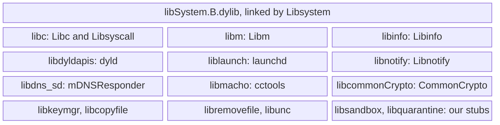
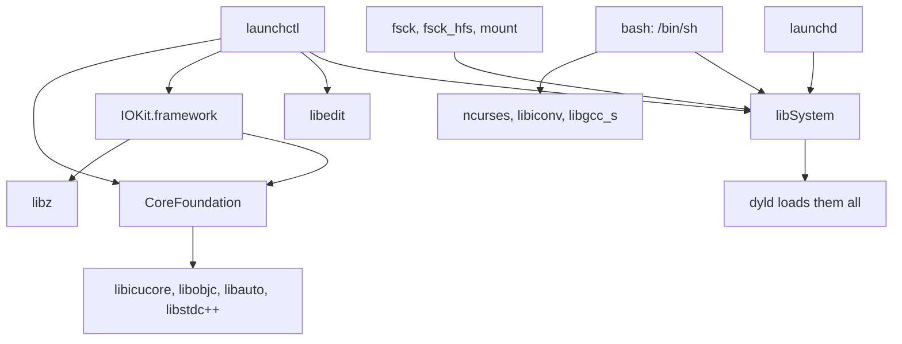
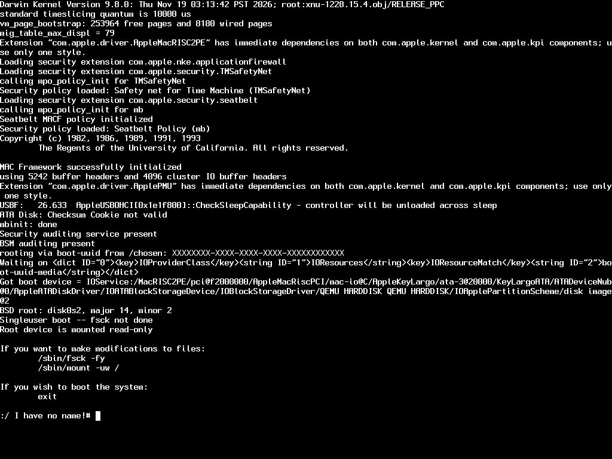
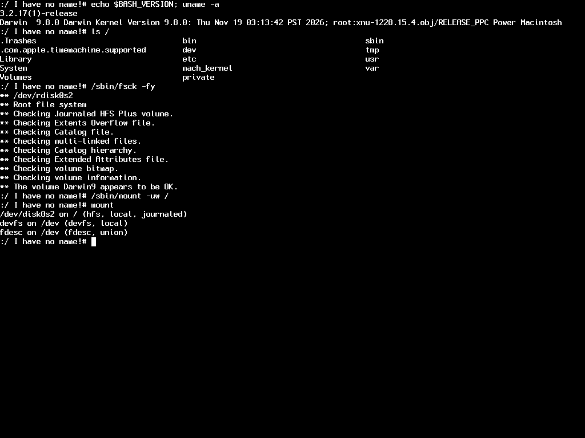

# Step 1, part 1: the kernel and a userland that boots

## What you will learn

- How xnu, Darwin's kernel, was built from Apple's source, and how it first started an iMac G5 (`PowerMac12,1`) with Leopard's own programs around it.
- What libSystem is, why every program on the system needs it, and why it was the first thing built after the kernel.
- Which programs a single-user shell needs, and how they were tried in a chroot before anything was booted.
- How our kextcache made the driver cache, and how QEMU's `mac99` first booted our kernel and programs to a root shell.
- Five failures in full: a shell that read `#` as a comment, three closed libraries, and a debug-symbol tool that crashed on every binary.

## The goal

README.md sets Step 1 as: "A disk image whose files all come from this repo's builds boots to a single-user root shell (`-v -s`) in QEMU `mac99` and on an iMac G5."

`-v` and `-s` are boot arguments, words that Open Firmware hands the kernel at boot ([the boot chain](../background/boot-chain.md)). `-v` makes the boot verbose, printing the kernel's messages instead of a grey screen. `-s` asks for single-user mode: the kernel starts launchd, launchd starts a root shell on the console and nothing else, and the root volume stays read-only until someone mounts it for writing. It is the smallest useful Unix system.

This chapter covers the kernel and the programs. [Part 2](step-1-drivers-and-bootx.md) covers the drivers and the boot loader, and the step's proof on the iMac.

## Background: what a single-user shell needs

### The kernel

xnu is Darwin's kernel: Mach for tasks, threads and memory, a BSD layer for processes, files and sockets, and IOKit for drivers ([What Darwin is](../background/what-darwin-is.md)). Its build makes `mach_kernel`, the file BootX loads, and `System.kext`, a bundle that tells the driver loader which interfaces the kernel exports. Drivers are separate kexts, loaded from the driver cache.

### libSystem

On most Unix systems, the C library is one project: glibc or a BSD's libc. On Darwin, `/usr/lib/libSystem.B.dylib` is built from more than a dozen projects, each making a static library, which the Libsystem project links into one dynamic library. Every program on the system links it, directly or through another library, so nothing in the userland can be built and run before it.



The parts that matter most in this book:

- Libc: the C library proper, `printf`, `malloc`, threads. Libsyscall, part of xnu's source, adds the stubs that turn a call such as `read()` into a system call; Libsystem merges the two into one `libc`.
- Libinfo: user, group and host lookups such as `getpwnam`. On Leopard it asks DirectoryService, or reads `/etc` files when DirectoryService is not running ([Step 2](step-2-console-login.md)).
- libdyldapis and liblaunch: the calls by which a program talks to dyld, such as `dlopen`, and to launchd.

dyld itself is not part of libSystem. It is `/usr/lib/dyld`, the dynamic linker: the kernel maps it into every program that uses libraries, and dyld then finds and loads `libSystem.B.dylib` and every other library the program names.

### The programs

The kernel starts `/sbin/launchd` as process 1. launchd runs `launchctl`, launchd's command-line tool, which also does the system's setup at boot: it sees `-s`, prints the single-user banner and starts `/bin/sh`, a bash. The user then runs the disk tools: `fsck` to check the volume, `mount` to make it writable.



launchctl is the odd one: it links IOKit and CoreFoundation, Apple's C library of strings, collections and property lists, which needs ICU, the Unicode library `libicucore`, and the Objective-C runtime. CF-Lite, the open part of CoreFoundation, is what Apple publishes as the CF project; Leopard's own CoreFoundation is larger and closed ([What Darwin is](../background/what-darwin-is.md)).

## What was built

darwinbuild built each project on the build machine, inside a BuildRoot filled with the Roots of its dependencies: Apple's prebuilt ones at first, ours as they were built ([darwinbuild](../method/darwinbuild.md)). Most of this chapter's failures come from that environment, not from the code being built. In order, on 19 November 2026:

1. `bootstrap_cmds`, `file_cmds` and `shell_cmds`, small command projects.
2. xnu 1228.15.4, in 22.5 minutes, on the third attempt: a `mach_kernel` of 10,354,156 bytes, against 10,367,028 for Apple's, built as a [fat binary](../method/darwinbuild.md), one file with one copy, or slice, per architecture, here `i386` and `ppc`. It announces itself as `Darwin Kernel Version 9.8.0: Thu Nov 19 03:13:42 PST 2026; root:xnu-1228.15.4.obj/RELEASE_PPC`.
3. libSystem's parts, then Libsystem, with four slices: `ppc7400` (the G4 and later PowerPC processors), `ppc64`, `i386` and `x86_64`. Its `ppc7400` slice exported the same 4,084 symbols as Leopard's, but for the quarantine functions, which the fifth build added, and one version string.
4. dyld 97.1, a four-way `/usr/lib/dyld`.
5. The rest of the shell's world: libiconv, bsm, libutil, libedit, libgcc, ncurses and bash; launchd and diskdev_cmds, which holds the disk tools.
6. For launchctl: IOKitUser, which makes IOKit.framework, CF, ICU, objc4, autozone, libstdcxx and zlib.
7. kext_tools, the driver-loading tools.

### The kernel's first boot

The kernel booted the iMac the day it was built. Copied onto Leopard's volume as `/mach_kernel.darwin9` and loaded by Leopard's BootX with `-v -s`, among Leopard's own drivers and programs, it reached a single-user shell: the kernel's build was sound before anything was built on top of it.

### kext_tools and the driver cache

kext_tools makes `kextcache`, `kextd`, `kextload`, `kextstat` and the other driver tools. The driver cache, `Extensions.mkext`, is one file holding every kext needed to reach the root disk, which BootX loads with the kernel ([the boot chain](../background/boot-chain.md)). Tried under Leopard, our `kextstat` printed the same 98 lines as Apple's, and our `kextcache -a ppc -l -m` made a cache of 169 kexts byte-identical to Apple's, 6,220,103 bytes. From then on, [make-test-image](https://github.com/nyg/PowerDarwin/blob/master/scripts/make-test-image) made the image's driver cache with our kextcache.

## What broke and how it was fixed

### A shell that read `#` as a comment (D20)

ncurses' build failed in its install step, when our `/bin/sh` ran one of its scripts:

```text
MKhashsize.sh: line 10: unexpected EOF while looking for matching ``'
```

Line 10 of that script is ordinary shell:

```sh
TABSIZE=`grep -v '^[ #]' $CAPS | grep -v "^$" | grep -v "^capalias"| grep -v "^infoalias" | wc -l`
```

Our bash had read the `#` inside the single quotes inside the backquotes as the start of a comment, swallowed the rest of the line with its closing backquote, and reached the end of the file still looking for it. That is bash 3.2's first known bug. Its official fix, `bash32-001`, changes one line of the grammar in `parse.y`, so that a comment is not looked for while scanning backquotes:

```c
check_comment = (flags & P_COMMAND) && qc != '`' && qc != '\'' && qc != '"' && (flags & P_DQUOTE) == 0;
```

Apple's bash 76.2 already carries `bash32-001` to `bash32-017`, applied to its `parse.y`. But bash does not compile `parse.y` directly: bison turns the grammar into a C file, `y.tab.c`, and the source ships that file ready-made. `make` regenerates `y.tab.c` only when `parse.y` is newer. When Apple applied the patches, `parse.y` became newer and `y.tab.c` was regenerated; GitHub's tarball gives every file the same time, so `make` saw nothing to do and compiled the old, unpatched parser.

The fix, [D20](https://github.com/nyg/PowerDarwin/blob/master/DEVIATIONS.md#d20), changes no file. [patches/bash-76.2/touch](https://github.com/nyg/PowerDarwin/blob/master/patches/bash-76.2/touch) lists `bash/parse.y`, and `scripts/stage-sources` touches every file a project's `touch` file lists after unpacking it. bison 2.3 in the build environment then regenerates `y.tab.c`. After the second build, `` x=`echo 'a #b'` `` gave `a #b`, and ncurses built.

### Three closed libraries inside libSystem (D12, D13, D15)

Three of libSystem's ingredients are not in Apple's published sources. The first is DTrace, the tracing framework. Libc declares 18 probes for `plockstat`, a tool that measures lock contention in threaded programs. To use them, Libc's build runs `dtrace -h` to turn the probe definitions into a header, and the linker loads `libdtrace.dylib` to record the probe sites. On Leopard both are closed and lean on other closed frameworks, which the build environment does not have:

```text
dyld: Library not loaded: …/Foundation.framework/Versions/C/Foundation
ld: couldn't dlopen() /usr/lib/libdtrace.dylib: … Library not loaded: …/Symbolication.framework/Versions/A/Symbolication
```

The first comes from `dtrace` in Libc's build, the second from Libsystem's final link. [D12](https://github.com/nyg/PowerDarwin/blob/master/DEVIATIONS.md#d12) turns the feature off with a one-line [patch](https://github.com/nyg/PowerDarwin/blob/master/patches/Libc-498.1.7/0001-no-plockstat.patch) to Libc's `Platforms/MacOSX/Makefile.inc`, as Libc's own iPhone platform file already does; the pthread code then uses its built-in empty probe macros. Those 18 probes are the only DTrace probes in libSystem's parts, and nothing else in libSystem changes.

The second is the sandbox library. Libsystem links `-lsandbox`, Leopard's closed library behind `sandbox_init`, by which a program asks the kernel to restrict itself. Nothing in the build environment provides `libsandbox.a`, so [D13](https://github.com/nyg/PowerDarwin/blob/master/DEVIATIONS.md#d13) adds a new one, in [replacements/sandbox/](https://github.com/nyg/PowerDarwin/blob/master/replacements/sandbox/), with the same seven exported symbols. Its `sandbox_init` always fails, with `ENOTSUP` and the message `sandbox is not available in this Darwin build`: a program that asks for a sandbox learns that it has none, instead of believing it is restricted.

The third is quarantine, the closed library that marks downloaded files, and it went the same way. [env/quarantine.h](https://github.com/nyg/PowerDarwin/blob/master/env/quarantine.h) gives copyfile do-nothing stubs ([D8](https://github.com/nyg/PowerDarwin/blob/master/DEVIATIONS.md#d8)). But darwinbuild installs our libSystem into the build environment, where Apple's own tools then run on it, and they call the library's 35 functions. ncurses' install failed in Apple's `tar`:

```text
dyld: Symbol not found: __qtn_file_alloc  Referenced from: /usr/bin/tar  Expected in: /usr/lib/libSystem.B.dylib
```

[D15](https://github.com/nyg/PowerDarwin/blob/master/DEVIATIONS.md#d15) adds [replacements/quarantine/](https://github.com/nyg/PowerDarwin/blob/master/replacements/quarantine/), a stub with the same symbols, in which every call fails as if no file were quarantined. With both stubs, and with [D65](https://github.com/nyg/PowerDarwin/blob/master/DEVIATIONS.md#d65) in [Step 3](step-3-network-and-ssh.md) for the 64-bit slices, our libSystem exports what Apple's does on all four architectures, but for two version strings.

### A debug-symbol tool that crashed (D7)

xnu's build failed twice before it finished:

```text
Bus error /usr/bin/dsymutil --arch=ppc …/mach_kernel.sys
make[2]: *** [do_build_mach_kernel] Error 138
```

`dsymutil` collects a binary's debugging information into a separate `.dSYM` bundle. darwinbuild copies the build machine's own, from Xcode 3.1.4, into the BuildRoot, and there it crashes on every binary, though it works outside. Exit status 138 is 128 plus signal 10, `SIGBUS`. An empty `.dSYM` was not enough, because xnu's build then runs `lipo` on the file that should be inside it:

```text
lipo: can't open replacement file: …/mach_kernel.sys.dSYM/./Contents/Resources/DWARF//mach_kernel.sys
```

[D7](https://github.com/nyg/PowerDarwin/blob/master/DEVIATIONS.md#d7) renames the copy `dsymutil.real` and puts a small script, [env/dsymutil](https://github.com/nyg/PowerDarwin/blob/master/env/dsymutil), in its place. It runs the real tool; if that fails, it puts a copy of the input binary, thinned to the requested architecture, where the debug file would be, so that later steps still find a file, and exits 0. Only the debug bundles are affected, never the binaries the image holds. Every build since prints `Bus error` once per binary and succeeds.

### Every other deviation of this part

- [D4](https://github.com/nyg/PowerDarwin/blob/master/DEVIATIONS.md#d4): file_cmds includes OpenSSL's headers without listing OpenSSL, so the OpenSSL Root goes into the build environment first.
- [D5](https://github.com/nyg/PowerDarwin/blob/master/DEVIATIONS.md#d5): launchd's headers are built from source for shell_cmds, since no archived Root carries them.
- [D6](https://github.com/nyg/PowerDarwin/blob/master/DEVIATIONS.md#d6): [env/arch](https://github.com/nyg/PowerDarwin/blob/master/env/arch) prints `ppc`, where the Root's `arch` printed `Power Macintosh` and broke `mig` (`gcc-4.0: Invalid arch name : Power`).
- [D9](https://github.com/nyg/PowerDarwin/blob/master/DEVIATIONS.md#d9): Libinfo and UserNotification use Apple's old Project Builder makefiles, whose tools come from project_makefiles, built first.
- [D10](https://github.com/nyg/PowerDarwin/blob/master/DEVIATIONS.md#d10): CarbonCore's headers, such as `MacTypes.h`, come from a 9G55 Root, as headers only, since no source exists for that version.
- [D11](https://github.com/nyg/PowerDarwin/blob/master/DEVIATIONS.md#d11): mDNSResponder is built with the target that makes only `libdns_sd.a` for libSystem; its daemon came later.
- [D14](https://github.com/nyg/PowerDarwin/blob/master/DEVIATIONS.md#d14): our Roots of the parts Libsystem links but does not list are copied into the build environment before it is built.
- [D16](https://github.com/nyg/PowerDarwin/blob/master/DEVIATIONS.md#d16): CF's `CFBase.h` includes `MacTypes.h`, as the header of Apple's closed CoreFoundation does, so that `OSType` and `kNilOptions` exist ([patch](https://github.com/nyg/PowerDarwin/blob/master/patches/CF-476.19/0001-include-mactypes-like-apple.patch)).
- [D17](https://github.com/nyg/PowerDarwin/blob/master/DEVIATIONS.md#d17): libgcc builds its own gcc 4.2.0 and compiles `crt2.o` with it; the patch gives that compiler the deployment target Apple's `gcc` sets by default.
- [D18](https://github.com/nyg/PowerDarwin/blob/master/DEVIATIONS.md#d18): diskdev_cmds includes a Blu-ray header from IOBDStorageFamily without listing it, so its headers are built first.
- [D19](https://github.com/nyg/PowerDarwin/blob/master/DEVIATIONS.md#d19): ncurses unpacks a `.tar.bz2` without listing bzip2, so bzip2 is built first.
- [D21](https://github.com/nyg/PowerDarwin/blob/master/DEVIATIONS.md#d21): launchd is built without SystemStarter, which runs the old `/Library/StartupItems` and needs `CFNotificationCenter`, part of the closed CoreFoundation only. [Step 8](step-8-clean-boot.md) later copies the two files SystemStarter's target installs, `/etc/rc.common` and `/etc/hostconfig`.
- [D22](https://github.com/nyg/PowerDarwin/blob/master/DEVIATIONS.md#d22): Apple published IOKitUser with 24 empty files, the closed HID event system among them; MIG rejects an empty interface file, so the patch leaves it out.
- [D23](https://github.com/nyg/PowerDarwin/blob/master/DEVIATIONS.md#d23): IOKitUser looks for MIG's output where the build machine's Xcode writes it, one folder per architecture; backported from IOKitUser 502.
- [D24](https://github.com/nyg/PowerDarwin/blob/master/DEVIATIONS.md#d24): Xcode's `copyplist` is a Ruby script, so the build machine's Ruby goes into the build environment, as a build tool only.
- [D25](https://github.com/nyg/PowerDarwin/blob/master/DEVIATIONS.md#d25): darwinbuild's copy of Xcode put frameworks under `/XCD/SY/Library`; the build list now sets `SYSTEM_LIBRARY_DIR = /System/Library`.
- [D26](https://github.com/nyg/PowerDarwin/blob/master/DEVIATIONS.md#d26): launchctl was built without Security.framework until [Step 6](step-6-securityd.md), which dropped the deviation.
- [D27](https://github.com/nyg/PowerDarwin/blob/master/DEVIATIONS.md#d27): kextcache no longer links the closed ApplicationServices, from which it uses nothing.
- [D28](https://github.com/nyg/PowerDarwin/blob/master/DEVIATIONS.md#d28): kextd no longer watches AppleRAID sets, which it did through `CFNotificationCenter`.

## How it was proved

### In a chroot

Before anything was booted, the programs were tried in a chroot on the build machine: a folder holding only our Roots, entered with `chroot`, so that programs inside see it as `/` and can load nothing else. The first test held 3,383 files. Our `/bin/sh` ran on our dyld and libSystem and parsed backquotes correctly; `ls`, `mount` and `fsck_hfs` ran; `launchd` started and refused, as it does when it is not process 1 (`This program is not meant to be run directly.`). `launchctl` stopped at `dyld: Library not loaded: /System/Library/Frameworks/IOKit.framework/Versions/A/IOKit`. The second test added IOKitUser, CF, ICU, objc4, autozone, libstdcxx and zlib, 3,939 files in all: `launchctl help` ran, and dyld loaded only our files. Only commands that do not talk to launchd were run, since a chroot shares the build machine's own launchd.

### In QEMU

The first boot test, on 19 November 2026, started QEMU 11.1.3's `mac99` with 1 GB of memory and `boot-args=-v -s` on a 1 GB Apple-partitioned HFS+ image, made by [make-test-image](https://github.com/nyg/PowerDarwin/blob/master/scripts/make-test-image) ([Making the image](../method/making-the-image.md), [How testing is done](../method/testing.md)). It held the second chroot test's userland and our kernel; BootX and every driver were still Leopard's. Our kernel loaded the drivers, found the disk, mounted `disk0s2` read-only, and our launchd and launchctl stopped at our bash:



The prompt reads `I have no name!` because the image had no `/etc/passwd` yet, so bash could not turn user 0 into a name. `uname -a`, `ls /`, `/sbin/fsck -fy`, `/sbin/mount -uw /` and `mount` all worked:



The third boot test added kext_tools, and the image's `Extensions.mkext` came from our kextcache. The image booted to the same shell, and our `kextstat` listed 54 entries: 16 built into the kernel and its `System.kext`, and 38 drivers loaded from the cache, all Apple's. Those 38 became the list of drivers to build next, which [part 2](step-1-drivers-and-bootx.md) follows. After `/sbin/mount -uw /` and a write, `/sbin/mount -ur /` hung; this was not investigated.

## What is still missing

- BootX and all 38 drivers were Leopard's. [Part 2](step-1-drivers-and-bootx.md) replaces them, and proves the step on the iMac.
- The image's `/etc` was empty: no `passwd`, no `ttys`, no accounts. The `files` project fills it in [Step 2](step-2-console-login.md).
- The kernel's objects carry no CTF data, the compact type descriptions DTrace reads, since `ctfconvert`, from the dtrace project, was not in the build environment; no `.dSYM` debug bundle was made either ([D7](https://github.com/nyg/PowerDarwin/blob/master/DEVIATIONS.md#d7)).
- libSystem has no plockstat probes, no working sandbox and no quarantine; by [Step 8](step-8-clean-boot.md), the sandbox stub's only trace in the system log is `update`'s failed `sandbox_init`.
- launchd runs no `/Library/StartupItems` ([D21](https://github.com/nyg/PowerDarwin/blob/master/DEVIATIONS.md#d21)), and IOKit has no HID event system ([D22](https://github.com/nyg/PowerDarwin/blob/master/DEVIATIONS.md#d22)).
- kextcache and kextd link DiskArbitration, not built yet, which [Step 2](step-2-console-login.md) meets at boot.

## Where to look

- DEVIATIONS.md, [D4](https://github.com/nyg/PowerDarwin/blob/master/DEVIATIONS.md#d4) to [D28](https://github.com/nyg/PowerDarwin/blob/master/DEVIATIONS.md#d28).
- [env/dsymutil](https://github.com/nyg/PowerDarwin/blob/master/env/dsymutil), [env/arch](https://github.com/nyg/PowerDarwin/blob/master/env/arch), [env/quarantine.h](https://github.com/nyg/PowerDarwin/blob/master/env/quarantine.h), [replacements/sandbox/](https://github.com/nyg/PowerDarwin/blob/master/replacements/sandbox/), [replacements/quarantine/](https://github.com/nyg/PowerDarwin/blob/master/replacements/quarantine/).
- [patches/bash-76.2/touch](https://github.com/nyg/PowerDarwin/blob/master/patches/bash-76.2/touch), [patches/Libc-498.1.7/](https://github.com/nyg/PowerDarwin/blob/master/patches/Libc-498.1.7/), [patches/kext_tools-117.4/](https://github.com/nyg/PowerDarwin/blob/master/patches/kext_tools-117.4/).
- [scripts/make-test-image](https://github.com/nyg/PowerDarwin/blob/master/scripts/make-test-image), [scripts/boot-qemu](https://github.com/nyg/PowerDarwin/blob/master/scripts/boot-qemu), [scripts/stage-sources](https://github.com/nyg/PowerDarwin/blob/master/scripts/stage-sources).
- [reference/qemu-userland-test/](https://github.com/nyg/PowerDarwin/blob/master/reference/qemu-userland-test/): `boot.png`, `commands.png` and `kextstat.txt`.
- In Libsystem-111.1.4: `Makefile` (the parts it links) and `libsys/build-libc.pl` (Libc and Libsyscall merged). In bash-76.2: `patches/bash32-001`. In ncurses-21: `MKhashsize.sh`.
- Commits `1ee03e6` (staging sources and Roots), `089ea2c` (xnu), `133c877` (Libsystem), `464324f` (the quarantine stub), `a9377f7` (the single-user userland), `7ce1a8f` (the first QEMU boot) and `9cb6623` (kext_tools and the driver cache).
