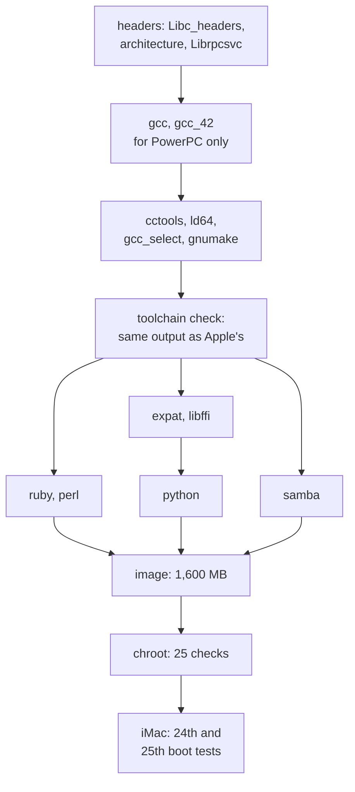
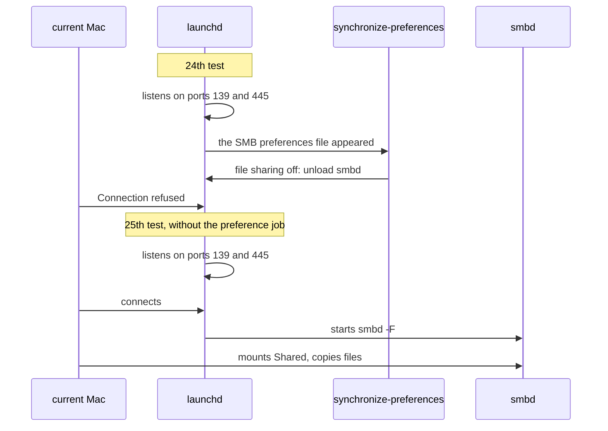

# Step 10: a working Unix system

## What you will learn

- What a C compiler needs on the machine where it runs, besides the compiler.
- How the release's own toolchain was built for PowerPC only, and checked against Apple's builds of it before anything was built with it.
- What stood between Apple's Perl, Python and Ruby and a build from source: DTrace probes, Carbon, and settings that Apple's build list lacks.
- What Apple's Samba needed to build without its closed framework, and why it stopped answering a minute after boot.
- How the step was proved, first in a chroot of the image, then on an iMac G5 (`PowerMac12,1`).
- Which everyday tools and commands were built after the step, how they compare with Leopard's, why Leopard's BIND computes SHA-1 wrong on PowerPC and ours does not, and how far `curl` reaches over HTTPS.

## The goal

README.md sets it as: "The image is a working Unix system: its own compiler builds and links a program, Perl, Python and Ruby run, and Samba shares a folder with another machine."

After Step 9 the image ran every program the earlier steps needed, on the iMac and in QEMU's `mac99`, but it could not make one: every binary on it had been compiled on the build machine. The step was reached on 22 November 2026.

## Background: what compiling needs

`cc hello.c` looks like one program and is several. `cc` is a driver: it runs `cc1`, the compiler proper, which turns C into assembly; `as`, the assembler, which turns that into an object file; and `ld`, the linker, which joins the object file with start-up code and libraries into a program. Each needs files of its own: the headers that `#include` names, such as `stdio.h`; `crt1.o`, the start-up code that calls `main`; and the libraries to link against, `libSystem` first ([Step 1, part 1](step-1-kernel-and-userland.md)).

Rule 4 says which tools: "Builds use `gcc` 5465, `gcc_42` 5531, `cctools` 667.3 and `ld64` 77.1." Until this step the build machine ran Apple's builds of them, from darwinbuild's Roots ([darwinbuild and the build machine](../method/darwinbuild.md)). Step 10 built them from source and put them on the image, so that the system compiles with the same tools that build it.

The image lacked more than the compiler:

- C headers. Libc's are a project of their own, `Libc_headers`, which had not been built: the build environment used a downloaded headers Root. `make-test-image` copied `/usr/include` from only some projects, so the headers of `libSystem`'s parts were missing too.
- `crt1.o`, from Csu, which was built but not on the image.
- CarbonHeaders' headers, such as `AvailabilityMacros.h`, `TargetConditionals.h` and `MacTypes.h`, which many others include. Its 9L30 version has no source; the build environment uses the headers of Apple's 9G55 Root ([D10](https://github.com/nyg/PowerDarwin/blob/master/DEVIATIONS.md#d10)).

## The order of the work



### Headers first

Libc_headers 498.1.7, architecture 254.0.5 and Librpcsvc 15 were built first, each as a headers Root and as a Root, in 6 to 22 seconds each. Their 152, 90 and 30 files are the same as those of Apple's 9A581 Roots, apart from darwinbuild's receipts. They came before the compilers because gcc's build runs `fixincludes` over the build environment's `/usr/include` and installs repaired copies into gcc's own folder: built over Apple's downloaded headers, our gcc would have carried copies of them onto the image.

### The toolchain

gcc 5465 builds `gcc-4.0`, `g++-4.0` and `cpp-4.0`, and gcc_42 5531 builds `gcc-4.2`, `g++-4.2` and `cpp-4.2`, each with its compilers proper. The build list builds every project for `ppc i386` unless it says otherwise, and for gcc that adds Intel cross compilers to the PowerPC ones. The project is for PowerPC only, so `manifest/plists/9A581.plist` sets `RC_ARCHS = ppc` for both ([D100](https://github.com/nyg/PowerDarwin/blob/master/DEVIATIONS.md#d100)), a choice rather than a fix. The compilers make PowerPC code, 32-bit and, with `-m64`, 64-bit, and are themselves `ppc7400` binaries. gcc took 59 minutes on the build machine, and gcc_42 just over two hours.

cctools 667.3 gave the assembler and the binary tools, `as`, `ar`, `ranlib`, `libtool`, `lipo`, `nm`, `otool`, `strip` and the rest, 86 files in 7 minutes; ld64 77.1 gave the linker, `ld`. gcc_select 66 made the links that name the default compiler, `cc`, `gcc`, `c++`, `g++`, `cpp` and `gcov`, all to gcc 4.0, with `c89`, `c99` and `stdint.h`. gnumake 119 gave GNU Make 3.81.

### Checking the toolchain

Once a project is built, darwinbuild installs our Root of it into later build environments in place of Apple's, so a compiler that miscompiled would spread into everything built after it. Before any build used it, our toolchain was compared with Apple's Roots of the same four projects, given the same input:

- bzip2 1.0.5's eight C files and ld64's `Options.cpp`, preprocessed once, compiled with each `cc1` and `cc1plus`, ours and Apple's, at `-O0`, `-Os` and `-O2`, to identical assembly: 54 files of 54;
- our `as` turned the 18 `-O2` files into objects identical to those of Apple's `as`;
- our `ld` linked bzip2 into a binary of 91,284 bytes, identical to the one Apple's `ld` made.

The check says nothing about running code: that bzip2, compiled by calling `cc1` without the driver's flags, hangs at start-up whichever toolchain made it. The tests below ran the code.

## Perl, Python and Ruby

### DTrace probes

Apple's perl 51.1.4, python 30.1.3 and ruby 67.6 wrap Perl 5.8.8, Python 2.5.1 and Ruby 1.8.6 with Apple's changes. All three carry DTrace probes, markers in the code that a tracing tool can switch on. `dtrace -h` turns a project's `.d` file into a header of probe macros, and ld64 loads `libdtrace.dylib` to link any object that holds a probe. libdtrace needs Apple's closed Foundation and Symbolication frameworks, even when built from dtrace's own source, so neither step can run in the build environment. Ruby had already met that wall in Step 1, when it was tried as a build tool:

```text
ld: couldn't dlopen() /usr/lib/libdtrace.dylib: … Library not loaded: …/Symbolication.framework/Versions/A/Symbolication
```

Libc and DirectoryService met it too, and there the probes were patched out ([D12](https://github.com/nyg/PowerDarwin/blob/master/DEVIATIONS.md#d12), [D75](https://github.com/nyg/PowerDarwin/blob/master/DEVIATIONS.md#d75)). This time rule 2's first choice, the build environment, served perl and python. [env/dtrace](https://github.com/nyg/PowerDarwin/blob/master/env/dtrace) goes into it as `/usr/sbin/dtrace` ([D97](https://github.com/nyg/PowerDarwin/blob/master/DEVIATIONS.md#d97)) and does only what their builds ask, `dtrace -h -s <file.d> -o <file.h>`: for each probe of the file it writes a macro that does nothing and an `_ENABLED()` macro that is `(0)`. The probe sites compile to nothing, no object refers to a probe, and ld64 never loads libdtrace.

Ruby's tarball ships its `dtrace.h` already generated, and its build never runs `dtrace -h`, so for Ruby a patch replaces that header with the same kind of macros ([D103](https://github.com/nyg/PowerDarwin/blob/master/DEVIATIONS.md#d103), [0001-dtrace-probes-without-libdtrace.patch](https://github.com/nyg/PowerDarwin/blob/master/patches/ruby-67.6/0001-dtrace-probes-without-libdtrace.patch)):

```c
#define RUBY_GC_BEGIN()
#define RUBY_GC_BEGIN_ENABLED() (0)
```

### Smaller gaps

- The build list gives python and ruby no dependencies at all, and perl none on vim, whose `ex` perl's install step runs. [D101](https://github.com/nyg/PowerDarwin/blob/master/DEVIATIONS.md#d101) adds them, from CF, OpenSSL and SQLite to zlib.
- Perl's build asks `sw_vers` for the system's version, to record a deployment target, and no Root in the build environment has `sw_vers`. [env/sw_vers](https://github.com/nyg/PowerDarwin/blob/master/env/sw_vers) prints Mac OS X 10.5.8, build `9L30` ([D98](https://github.com/nyg/PowerDarwin/blob/master/DEVIATIONS.md#d98)).
- Ruby records its build flags in `rbconfig.rb`, which Apple's build then edits with a diff, `rbconfig.diff`, that expects Apple's flags exactly. [D104](https://github.com/nyg/PowerDarwin/blob/master/DEVIATIONS.md#d104) drops the build list's `-no-cpp-precomp`, which Apple's own build of ruby did not use. darwinxref also puts the flags in another order, which moves the blanks between them, so [D105](https://github.com/nyg/PowerDarwin/blob/master/DEVIATIONS.md#d105) applies the diff with `patch -l`, which lets any run of blanks match any other. A build without D105 failed with `Hunk #2 FAILED at 74.`

### Python without Carbon

Python needed the most. Its Mac modules, the toolbox glue, link the closed Carbon and ApplicationServices frameworks, and its Build Applet and Python Launcher are Carbon applications. [D102](https://github.com/nyg/PowerDarwin/blob/master/DEVIATIONS.md#d102), [0001-without-toolbox-glue-build-applet-and-python-launcher.patch](https://github.com/nyg/PowerDarwin/blob/master/patches/python-30.1.3/0001-without-toolbox-glue-build-applet-and-python-launcher.patch), configures python with `--disable-toolbox-glue`, so that `setup.py` skips the 36 modules of Apple's 99 that need the glue, such as `MacOS`, `_Res` and `gestalt`, and takes the two applications out of its install. The first build with it still failed, in an install step that reads Carbon resource files: `ImportError: No module named _Res`. D102 removes that step too. The next failed in Apple's step that keeps unstripped copies of the modules:

```text
cp: directory /private/var/tmp/python/python-30.1.3.sym/lib-dynload does not exist
```

Apple's `ditto`, given several files and a folder, creates the folder. It is closed, and the shell-script stand-in that darwinbuild puts in its place did not; [env/ditto](https://github.com/nyg/PowerDarwin/blob/master/env/ditto) is darwinbuild's script with that one change ([D99](https://github.com/nyg/PowerDarwin/blob/master/DEVIATIONS.md#d99)). With expat 6 and libffi 10 built first, for its XML parser and `ctypes`, Python built with 62 extension modules: Apple's 99, less the 36 and `_tkinter`, since no Tk is built ([D71](https://github.com/nyg/PowerDarwin/blob/master/DEVIATIONS.md#d71)).

Perl took 22 minutes to build, Ruby 29 and Python 15. `libruby` and the Python framework keep Apple's four architectures, `ppc`, `ppc64`, `i386` and `x86_64`.

## Samba

### Building it

samba 187.8 is Samba 3.0.25b with Apple's changes. It needed four fixes:

- The build list gives it neither CoreFoundation nor Security, which its code includes ([D106](https://github.com/nyg/PowerDarwin/blob/master/DEVIATIONS.md#d106)).
- Its Makefile links every program with `-framework ByteRangeLocking`, a private, closed framework of Apple's, unless `RC_RELEASE` is `Darwin`. [D107](https://github.com/nyg/PowerDarwin/blob/master/DEVIATIONS.md#d107) sets that, Apple's own switch, as [D69](https://github.com/nyg/PowerDarwin/blob/master/DEVIATIONS.md#d69) does for bootp, and gives `smbd` the CoreFoundation and Security links that Apple's build got from CUPS, which the build environment lacks.
- The `darwin_streams` module, a plug-in of smbd's for Mac clients, links the framework itself; [D108](https://github.com/nyg/PowerDarwin/blob/master/DEVIATIONS.md#d108) drops that link. The module calls it only with `darwin_streams:brlm = yes`, which the image's `smb.conf` does not set.
- `prefsync`, the source of the `synchronize-preferences` tool below, announces changes through `CFNotificationCenter`, which CF-Lite lacks: `lib/utils.cpp:135: error: 'CFNotificationCenterRef' was not declared in this scope`. [D109](https://github.com/nyg/PowerDarwin/blob/master/DEVIATIONS.md#d109) makes it only log them.

Samba then built in 25 minutes: `smbd`, `nmbd`, `smbpasswd`, `pdbedit`, `testparm` and the rest.

### Its configuration

`make-test-image` writes `/etc/smb.conf` ([D113](https://github.com/nyg/PowerDarwin/blob/master/DEVIATIONS.md#d113)):

```text
[global]
	workgroup = WORKGROUP
	server string = Darwin 9.8
	security = user
	passdb backend = tdbsam
	opendirectory = no
	use spnego = no
	unix password sync = no
	load printers = no
	printcap name = /dev/null
	disable spoolss = yes
	wide links = no

[Shared]
	path = /Users/Shared
	read only = no
```

Three lines matter most:

- `passdb backend = tdbsam` keeps accounts and password hashes in Samba's own file, set with `smbpasswd -a`.
- `opendirectory = no`. Apple's Samba hands passwords to Apple's directory services by default: samba-187.8's `param/loadparm.c` sets `Globals.bOpenDirectory = True`, and with it `pdb_set_plaintext_passwd`, in `passdb/pdb_get_set.c`, computes no NT hash, so `smbpasswd -a` would store none and every login would fail.
- `use spnego = no`. SPNEGO is the exchange in which client and server agree how to authenticate. The current Mac's client sends a `mechListMIC` field in it, which Samba 3.0.25b's `spnego_parse_auth` (`libsmb/clispnego.c`) rejects with `spnego_parse_auth failed at 380`. Without SPNEGO, the client logs in.

### Stopped a minute after boot



Apple's `smbd.plist` is a launchd job that listens on Samba's ports, 139 and 445, and starts `smbd -F` on the first connection; Apple ships it disabled, and `make-test-image` enables it. In the twenty-fourth boot test on the iMac the ports closed a minute after boot. Another of Samba's jobs runs `synchronize-preferences` whenever the SMB server's preferences file in `/Library/Preferences/SystemConfiguration` changes, a file that the closed Sharing preference pane writes on Leopard. On the image the file appeared at the first boot holding only the NetBIOS name and code page, so `synchronize-preferences` found file sharing off, unloaded smbd and wrote `Disabled` back into `smbd.plist`. D113 removes that job from the image.

## The image

`make-test-image` grew more in this step than in any other ([Making the image](../method/making-the-image.md)). It adds the Roots of Csu, SystemStubs, the toolchain, the languages and Samba, which brought its list to 61 userland projects (79 with the 18 of the first chroot tests, 80 since DarwinTools, 87 since the everyday tools and 100 since the commands after them, below), and the `/usr/include` alone of 16 header projects, from Libc_headers to objc4, whose libraries, where they have any, are already on the image. It leaves out `/Developer`, and Python's `wininst-*.exe`, Windows programs prebuilt in its source, by rule 5. Three more things come from no build:

- `/usr/bin/dsymutil`, a script that exits 0 ([D112](https://github.com/nyg/PowerDarwin/blob/master/DEVIATIONS.md#d112)). A compile and link in one step with `-g` makes gcc run `dsymutil` after linking (`gcc/config/darwin.h` in gcc-5465), as autoconf's `configure` scripts do with `-g -O2`, and Apple's `dsymutil` is closed; the build environment has a wrapper for it ([D7](https://github.com/nyg/PowerDarwin/blob/master/DEVIATIONS.md#d7)). A one-step `-g` build then gets no `.dSYM` bundle, and a two-step build keeps its debugging information in its object files.
- CarbonHeaders 18.1, of Mac OS X 10.6, which [D73](https://github.com/nyg/PowerDarwin/blob/master/DEVIATIONS.md#d73) already uses, installed by its own Makefile: nine headers in `/usr/include`, and `MacTypes.h` again in a `CarbonCore.framework` inside an otherwise empty `CoreServices.framework`, where CF's `CFBase.h` looks for it ([D16](https://github.com/nyg/PowerDarwin/blob/master/DEVIATIONS.md#d16), [D111](https://github.com/nyg/PowerDarwin/blob/master/DEVIATIONS.md#d111)).
- `smb.conf` and the enabled `smbd.plist`.

The image is now made at 1,600 MB, up from 1 GB, which still fits the iMac's 2.1 GB `Darwin9` partition; after the step its root volume held 1.1 GB.

### What the chroot found

The first image of the step was tested in a chroot of the image itself on the build machine, where our programs run on our libraries ([How testing is done](../method/testing.md)). Every C and C++ link failed:

```text
ld: library not found for -lSystemStubs
```

gcc links every program with `-lSystemStubs`, and SystemStubs' Root was not on the image. Built for the build list's `ppc i386`, it would not serve `cc -arch ppc64` either (`ld: warning in /usr/lib/libSystemStubs.a, missing required architecture ppc64`), so [D110](https://github.com/nyg/PowerDarwin/blob/master/DEVIATIONS.md#d110) builds it for all four architectures, as Leopard's is, with the same 46 members in its ppc and ppc64 parts. CoreFoundation programs failed on the header that CF's `CFBase.h` includes, which D111's `CarbonCore.framework` now gives:

```text
CFBase.h:67:79: error: CoreServices/../Frameworks/CarbonCore.framework/Headers/MacTypes.h: No such file or directory
```

### `sw_vers` from Darwin 8 (D121)

`sw_vers` prints the system's name, version and build, and scripts ask it which release they run on: Perl's build does, for its deployment target (above), and so do `build-image` and `install-image`, which stop unless the version starts with 10.5. The images of this step had none, and a script that called it got `sw_vers: command not found`. Leopard's `/usr/bin/sw_vers` comes from a closed project, which no Darwin 9 build list names, and none of the Roots the build uses holds it.

Apple published an open `sw_vers` once, in DarwinTools 1, a project of darwinbuild's Darwin 8.0 build list, `8A428`: one C file under its author's BSD licence, which reads `/System/Library/CoreServices/SystemVersion.plist` through CF's private `_CFCopySystemVersionDictionary`. Its tarball is gone from Apple's site; the Wayback Machine keeps it, and so does nyg/PowerDarwin-roots, from which `fetch-sources` takes it first. [D121](https://github.com/nyg/PowerDarwin/blob/master/DEVIATIONS.md#d121) builds it with the dependencies of its 8A428 entry, renamed for Darwin 9's toolchain. Its Makefile also builds `startupfiletool`, a tool to fill an HFS+ volume's startup file that Leopard does not ship, and installs a `SystemVersion.plist` for Darwin 8.0, so the build runs only its `sw_vers` target, and the image keeps the `SystemVersion.plist` that `make-test-image` writes.

For `-productVersion`, this `sw_vers` prints the file's `MacOSXProductVersion` key if there is one, which Darwin 8's file set to 10.4 for scripts that take their deployment target from it, and `ProductVersion` otherwise. The image's file has no such key, so it prints `9.8`, and `build-image` and `install-image`, run on the image, stop with their message that they need Leopard, as they should. The build environment keeps D98's stand-in: it has no `SystemVersion.plist`, so this `sw_vers` would print nothing there and exit with status 1.

### Everyday tools (D122, D123)

The images of this step lacked seven everyday commands: `awk`, `tar`, `gzip`, `file`, `lsof`, `top` and `curl`. Each is a project of the 9L30 build list, awk 11, gnutar 442.0.1, gnuzip 25, file 23, lsof 33, top 39 and curl 42, and none needs a closed part, so they were built after the step was reached, on 26 November 2026, at the end of the build order ([darwinbuild and the build machine](../method/darwinbuild.md#the-build-order)). Six built at the first try, in 5 seconds for top to 6 minutes for curl, which its entry builds for `ppc` and `ppc64`. gnutar did not link:

```text
Undefined symbols:
  "_qtn_file_apply_to_path", referenced from:
      _apply_qtn_to_path in extract.o
```

Apple's own `quarantine.diff`, among gnutar's patches, makes `tar` mark the files it extracts from a quarantined archive, through the closed quarantine library ([Step 1, part 1](step-1-kernel-and-userland.md)). The build environment's `quarantine.h`, D8's do-nothing stubs, had every function of the library that gnutar calls but that one. [D122](https://github.com/nyg/PowerDarwin/blob/master/DEVIATIONS.md#d122) adds it, so the build environment changes and gnutar's source does not. `tar` marks no file, as nothing on the image is quarantined: the stubbed `qtn_file_alloc` returns `NULL`.

Two of the seven entries name fewer dependencies than their projects use. top's does not name CF, IOKitUser or ncurses, whose libraries it links, and curl's names none at all, though its `configure` looks for OpenSSL, zlib, Kerberos' GSSAPI and LDAP, and leaves out whichever it does not find. darwinbuild leaves every Root it installs in the BuildRoot, and at the end of the order all of them are there: curl built with the same protocols and features as Leopard's, SSL, `libz`, GSS-Negotiate and LDAP among them.

That first curl printed another manual than Leopard's for `curl --manual`. The manual is compiled in, from `src/hugehelp.c`, which `make` regenerates from the man page when the page is newer. Apple's `docs__curl.1.diff` changes the page, and when Apple's build applied it the page became newer, so the manual was made again with Apple's change; GitHub's tarball gives every file the same time, so our build compiled the `hugehelp.c` that curl 7.16.3 ships, made from curl's own page, as bash's parser was in [Step 1, part 1](step-1-kernel-and-userland.md). [D123](https://github.com/nyg/PowerDarwin/blob/master/DEVIATIONS.md#d123) touches the page when the source is staged, as D20 touches bash's grammar, and the manual is made again with the build environment's `nroff`.

### More everyday commands

The image still lacked many of Leopard's everyday commands after those seven: `cmp` and `diff`, `patch`, `man`, `nc`, `rsync`, `zip` and `unzip`, `screen`, `nano`, `crontab`, `dig` and `host`, `telnet` and `logger`, and `bzip2`. Each comes from a project of the 9L30 build list: gnudiff 14 (GNU diffutils 2.8.1), patch_cmds 11 (GNU patch 2.5.8), man 12 (man 1.6c) with groff 31 (groff 1.19.2), netcat 7, rsync 35.2 (rsync 2.6.9), zip 9 (Zip 2.32 and UnZip 5.52), screen 12 (screen 4.0.3), nano 4 (nano 2.0.1), cron 30, bind9 26.1.5 (BIND 9.4.3-P1) and remote_cmds 13.0.2; and bzip2 16.5 (bzip2 1.0.5), which the build order already builds for ncurses' install ([D19](https://github.com/nyg/PowerDarwin/blob/master/DEVIATIONS.md#d19)), and whose Root now goes on the image too. None needs a closed part. They were built on 27 November 2026, at the end of the build order, each at the first try and with no new deviation, in less than a minute for most and 5 minutes for bind9, the longest.

Two of them need more than their own source:

- `telnet` links libtelnet, a static library of the telnet protocol's authentication and encryption, which is a project of its own in the build list, libtelnet 7. remote_cmds names it among the dependencies whose headers and static libraries darwinbuild installs before the build. Until our build of it exists, darwinbuild installs Apple's archived Root, and its code would go into our `telnet`: a prebuilt Apple binary, which rule 5 keeps off the image. So libtelnet is built from source just before remote_cmds, and darwinbuild takes our Root. The library itself stays off the image, as Leopard ships none.
- `man` lays out a page with groff's `nroff`, `tbl` and `eqn`, shows it with `less`, and opens compressed pages with `gunzip` and `bzip2`. Its `configure` looks for each of them in the BuildRoot and writes the paths it finds into `/etc/man.conf`, though man's entry in the build list names none of them. At the end of the order the BuildRoot holds them all, left there by the builds before, so the file is byte for byte the same as Leopard's.

remote_cmds also builds the daemons and the NIS tools that Leopard's does, among them `telnetd`, `tftpd`, `rlogind`, `ntalkd` and `ypbind`, with the launchd jobs of its source, the same files as Leopard's but tftpd's, which starts it with `-s` where Leopard's says `-i`. Each is off, as on Leopard, until its `Disabled` key is set to false or the file it waits for appears. bind9's `named` is off in the same way. cron's job starts `cron` once a table is in `/usr/lib/cron/tabs`, where `crontab` puts it.

## How it was proved

The same 25 checks ran in the chroot and then on the iMac:

- the compiler: `cc`, `cc -O2`, `gcc-4.2`, `cc -arch ppc64`, `cc -g` in one step and in two, `c++` and `g++-4.2` with `std::map` and exceptions, a CoreFoundation program, a static library made with `ar` and `ranlib`, a dylib, `make`, `otool -L` and `nm`;
- perl with POSIX, Socket, Digest::MD5, Storable and threads;
- python with `_ssl`, `hashlib`, `bz2`, `_sqlite3`, `readline`, `_curses`, `plistlib`, `xml.dom.minidom` and `ctypes`, while `import MacOS` fails, which shows that the Carbon modules are really gone;
- ruby with socket, zlib, digest, openssl and readline, its `rbconfig` recording `-arch ppc -arch i386 -Os -pipe -fno-common` as Leopard's does, and `irb`;
- Samba's `testparm`.

In the chroot all 25 passed. smbd, started there after `smbpasswd -a root` with a test password, shared `/Users/Shared`; the current Mac mounted it over SMB1, and a 15-byte file copied one way and a 24-byte and an 8 MB file copied the other kept their checksums. `check-image` found 28,517 files, of which the 20 not from the builds were all written by `make-test-image`.

A chroot cannot show launchd starting smbd, since it reaches the build machine's own launchd, nor our kernel or the real partition. So the image was restored onto `Darwin9` and made the startup disk from Leopard with `bless`, as in [Step 9](step-9-disks-and-devices.md):

1. Twenty-fourth boot test on the iMac G5: sshd answered 76 seconds after the restart, and the 25 checks passed on the iMac itself. smbd was unloaded a minute after boot, as above; with the preference job removed and smbd loaded again, the current Mac mounted the share through launchd's smbd.
2. Twenty-fifth boot test, the same partition restarted without the preference job: launchd listened on ports 139 and 445 from boot and started `smbd -F` at the first connection. The current Mac mounted `Shared` as root with the test password, and a 32 MB file copied to the iMac and another copied from it kept their checksums. `gcc --version` reported Apple Inc. build 5465, `ld -v` ld64-77.1, perl 5.008008, Python 2.5.1, ruby 1.8.6 patchlevel 287 `[universal-darwin9.0]`, and `smbd -V` `3.0.25b-apple`. Our `bless` then made Leopard the startup disk again.

The final image, made after these tests, holds 28,525 files, of which the 25 not from the builds are all written by `make-test-image`; the 25 checks pass on it in a chroot. Step 10 was reached on the iMac.

For D121, DarwinTools was built on the build machine, in the build folder of a PowerPC-only build, in a few seconds and without a warning: one `gcc -pipe -no-cpp-precomp -arch ppc -framework CoreFoundation`, then `strip`. Its `sw_vers` is `ppc7400` and links the libraries Leopard's does, CoreFoundation, `libgcc_s.1` and `libSystem.B`, and reads the version files through the same CF functions and keys; it imports `CFRetain`, `CFRelease`, `CFStringCreateWithFormat` and `fprintf` more, and `fwrite` and `printf` less, since Leopard's comes from another source. Run side by side on Leopard, the two printed the same bytes for `-productName`, `-productVersion` and `-buildVersion`; with no option, Leopard's separates names from values with a tab, and this one with spaces. On an image made with it, `check-image` found 28,316 files, all from the builds but the 25 of the table in [Making the image](../method/making-the-image.md), and `/usr/bin/sw_vers` identical to its Root's. Booted in QEMU, it printed:

```text
ProductName:    Darwin
ProductVersion: 9.8
BuildVersion:   9L30
```

and `Darwin`, `9.8` and `9L30` for the three options, the values of the image's `SystemVersion.plist`, which launchctl also gave the kernel as `kern.osversion` `9L30`. Installed with `install-image` on the iMac and started there, it printed the same, and our `bless` then made Leopard the startup disk again.

The seven everyday tools were compared with two sets of Apple's binaries: Leopard 10.5.8's, on the build machine, and Apple's archived Roots of the same versions, but for curl, which has none. All of ours are PowerPC only, where Apple's also carry `i386` ([D115](https://github.com/nyg/PowerDarwin/blob/master/DEVIATIONS.md#d115)).

- `file`, `top`, `gzip` and `curl` have the same instructions and strings as Leopard's, and so does `libcurl.4.dylib`; `curl --manual` prints the same bytes.
- `awk` has the same instructions as Apple's 9A581 Root; Leopard's own `awk`, of 10.5.0, calls `strtod` where ours and the Root call `strtod$UNIX2003`.
- `lsof` has the same instructions at other addresses: it writes the build's date, host name and `uname -a` into the binary, and longer strings move its code.
- `tar` imports six functions fewer than Leopard's, the `__qtn_*` functions that D122's stubs replace.
- The data files are the same but for two kinds of difference: the compressed manual pages differ in their gzip headers only, and `file`'s compiled `magic.mgc` in byte order only, as Apple compiled Leopard's on an Intel Mac; `file` reads either.

On an image made with them, `check-image` found 28,451 files, all from the builds but the 25 of the table in [Making the image](../method/making-the-image.md). Booted in QEMU `mac99`, and then installed with `install-image` on the iMac and started there, each did a real task, both times the same, with files served by the current Mac:

- `awk` summed a column, counted the regular files of `/usr/bin` and their bytes, and found the account with user ID 0 in `/etc/passwd`;
- `tar` made, listed and extracted an archive of a folder holding a symbolic link, plain and with `-z`, and every file kept its MD5;
- `gzip -9` and `gunzip` gave back the same MD5, and so did `gzip -c` piped into `zcat`;
- `file` named Mach-O executables, the two architectures of libSystem one by one, the kernel, text, a shell script, the two archives, and its own big-endian `magic.mgc`. `file -i` prints `regular file`, as on Leopard, whose POSIX patch gives `-i` that meaning; `-I` prints MIME types;
- `lsof` listed launchd's open files and the TCP sockets, launchd's on ports 22, 139 and 445 among them, and `lsof -t -c sshd` found the same process ID as `ps`;
- `top -l 1` printed the process table, and `top -l 2 -o cpu` sorted it by processor use;
- `curl` downloaded a 300,000-byte file from the current Mac over HTTP with its MD5 unchanged, and pages from the internet over HTTP.

On the iMac, sshd answered 87 seconds after the restart, the system log held only the two lines that Step 8 accepts, and our `bless` then made Leopard the startup disk again.

The commands built after them were compared with Leopard 10.5.8's in the same way, program by program, by the disassembly and the strings of each `ppc` slice:

- `cmp`, `diff`, `diff3`, `sdiff`, `patch`, `nc`, `rsync`, `screen`, `crontab`, `bzip2` with its library, 33 of remote_cmds' 35 programs, `logger` among them, and 20 of groff's 22 have the same instructions and strings as Leopard's.
- The eight programs of zip, `zip` and `unzip` among them, and `nano` have the same instructions; the strings of six of the eight and of `nano` differ only in the date of the build, and for `nano` its time, which they print with their version.
- `man` has the same instructions at other addresses, and the same strings, one of them in another place; its `/etc/man.conf` is the same file as Leopard's.
- `cron` calls `daemon$1050` where Leopard's, of 10.5.0, calls `daemon`, as our `awk` calls `strtod$UNIX2003` where Leopard's calls `strtod`.
- `telnet` and `timed` have as many instructions as Leopard's, with the same constants, but in one place each, around a division by a constant, other registers in another order.
- groff's `eqn` and `refer` hold other parsers. Leopard's were made again from their grammars, which Apple did not change, by a bison 2, whose parsers say `memory exhausted`; ours are those that groff 1.19.2 ships, made by another yacc, whose parsers say `yacc stack overflow`. The grammars are older than the parsers in groff's tarball, so `make` keeps the parsers.
- BIND's twelve programs, `dig`, `host`, `nslookup` and `named` among them, are 79 instructions shorter each, with the same strings but for the date of the build in `named` and `lwresd`. Its SHA-1 code, in `lib/isc/sha1.c`, swaps the bytes of each word it reads unless `configure` defines `WORDS_BIGENDIAN`. Ours defines it, as `configure` found a big-endian machine; the `ppc` slice of Leopard's swaps the bytes, so it computes SHA-1 as a little-endian machine would. BIND uses its SHA-1 for TSIG signatures, DNSSEC's DS digests and RSA-SHA1 signatures: for the same key, `dnssec-signzone` wrote a DS record whose SHA-1 digest was `F1A4EA14…` with Leopard's binary and `B0B858C6…` with ours, the digest that Python's `hashlib` computes from the record, and the same SHA-256 digest with both.

On an image made with them, `check-image` found 29,568 files, all from the builds but the 23 of the table in [Making the image](../method/making-the-image.md) and the 191 of `/usr/share/doc/PowerDarwin`, with a notice for each of the 13 new projects, and the checks of `make-release` found it fit to publish. Booted in QEMU `mac99`, where its first boot asked for root's password, each command did a real task, with files served by the current Mac:

- `diff -u` made a patch that `patch` applied, after which `cmp` found the two files the same; `diff -r`, `diff3` and `sdiff` compared folders and files;
- `bzip2 -9`, `bunzip2` and `bzcat` gave back the same bytes;
- `zip -r` packed a folder holding a symbolic link, `zip -T` tested the archive, and `unzip` gave back the same tree; `unzip` also unpacked an archive made by the current Mac's `zip`, with the same MD5s and the link kept;
- `rsync -a` copied 686 manual pages, then copied again only the one changed; it copied a folder over SSH to the same machine, with ours at both ends, and the current Mac's `openrsync` sent a folder to it over SSH;
- `nc` listened on a port and received a line from another `nc`, fetched a file from the current Mac's web server, and found port 22 open with `-z`;
- `telnet` fetched the same file and showed sshd's banner on port 22, and a line that `logger` wrote appeared in `/var/log/system.log`;
- `host`, `dig` and `nslookup` resolved names through QEMU's DNS server, and `dnssec-signzone` wrote a DS record whose SHA-1 and SHA-256 digests were those that Python computes;
- `crontab` installed a table, launchd started `cron` when it appeared, and the job ran every minute;
- `man ls` showed the page in `less` on a terminal, which searched it and quit, and `man` formatted the pages of `diff`, `screen`, `nano`, `cron`, `zip` and `dig`;
- `screen` started a session that was detached, listed as `Detached`, attached again and ended, and `nano` wrote a file of two lines.

Nothing new appeared in the system log. This image has not been started on the iMac yet.

### HTTPS

The image's `curl`, like Leopard's, is curl 7.16.3 on OpenSSL 0.9.7l, the version of the OpenSSL 46.11 project. Its newest protocol is TLS 1.0, and it checks certificates signed with SHA-1 or MD5, not SHA-256, which OpenSSL added in 0.9.8. Its bundle of trusted certificates, `/usr/share/curl/curl-ca-bundle.crt`, is curl's own of 2007, 59 certificates, the same file as Leopard's. In QEMU and on the iMac, against a server on the current Mac that accepts TLS 1.0:

- with the server's test certificate authority given by `--cacert`, curl checked the certificate (`SSL certificate verify ok`), used AES256-SHA, and the file kept its MD5;
- without `--cacert`, it stopped with `SSL certificate problem` (exit 60), as the bundle does not hold the test authority, and with `-k` it went on unchecked;
- a server certificate signed with SHA-256 stopped it with `ASN1_verify:unknown message digest algorithm`, and `-k` let it through.

Current sites refuse the handshake: example.com with `sslv3 alert handshake failure`, apple.com, github.com and web.archive.org with `tlsv1 alert protocol version`, all exit 35. Leopard's own `curl` on the build machine fails the same way on the same sites. HTTPS works with servers that still accept TLS 1.0 and SHA-1 certificates; current sites would need TLS 1.2, which OpenSSL brought in 1.0.1, and no project of the 9L30 build list has it.

## What is still missing

- Other commands of Leopard's, such as `od`, `bc`, `sudo` and `zsh`, which no step has built yet ([What's next](whats-next.md)), and HTTPS to current sites, which need TLS 1.2 (above).
- A boot on the iMac of an image with the commands built after the everyday tools, which were tried in QEMU only.
- DTrace itself, and with it the languages' probes, which compile to nothing.
- Python's 36 Carbon modules, Build Applet and Python Launcher ([D102](https://github.com/nyg/PowerDarwin/blob/master/DEVIATIONS.md#d102)), and `_tkinter`, as no Tk is built.
- `.dSYM` bundles for one-step `-g` builds ([D112](https://github.com/nyg/PowerDarwin/blob/master/DEVIATIONS.md#d112)).
- In Samba: SPNEGO, the byte-range locks of `darwin_streams`, and file sharing set from a preference pane ([D108](https://github.com/nyg/PowerDarwin/blob/master/DEVIATIONS.md#d108), [D113](https://github.com/nyg/PowerDarwin/blob/master/DEVIATIONS.md#d113)). Samba 3.0.25b speaks SMB1 only.
- Intel code: the compilers are PowerPC only, but Perl, Python, Ruby, Samba and most libraries still carried `i386` slices, and some `x86_64`, until [D115](https://github.com/nyg/PowerDarwin/blob/master/DEVIATIONS.md#d115) built every project for PowerPC only.
- A test in QEMU of the compiler, the languages and Samba, which were proved in a chroot and on the iMac only; of this step's work, only the everyday tools were tried in QEMU.

## Where to look

- [D97](https://github.com/nyg/PowerDarwin/blob/master/DEVIATIONS.md#d97) to [D113](https://github.com/nyg/PowerDarwin/blob/master/DEVIATIONS.md#d113), new in this step, and [D121](https://github.com/nyg/PowerDarwin/blob/master/DEVIATIONS.md#d121) to [D123](https://github.com/nyg/PowerDarwin/blob/master/DEVIATIONS.md#d123), which added `sw_vers` and the everyday tools later; [D7](https://github.com/nyg/PowerDarwin/blob/master/DEVIATIONS.md#d7), [D10](https://github.com/nyg/PowerDarwin/blob/master/DEVIATIONS.md#d10), [D12](https://github.com/nyg/PowerDarwin/blob/master/DEVIATIONS.md#d12), [D16](https://github.com/nyg/PowerDarwin/blob/master/DEVIATIONS.md#d16), [D24](https://github.com/nyg/PowerDarwin/blob/master/DEVIATIONS.md#d24), [D71](https://github.com/nyg/PowerDarwin/blob/master/DEVIATIONS.md#d71), [D73](https://github.com/nyg/PowerDarwin/blob/master/DEVIATIONS.md#d73) and [D75](https://github.com/nyg/PowerDarwin/blob/master/DEVIATIONS.md#d75), which they build on.
- [env/dtrace](https://github.com/nyg/PowerDarwin/blob/master/env/dtrace), [env/sw_vers](https://github.com/nyg/PowerDarwin/blob/master/env/sw_vers), [env/ditto](https://github.com/nyg/PowerDarwin/blob/master/env/ditto) and [env/quarantine.h](https://github.com/nyg/PowerDarwin/blob/master/env/quarantine.h), which [scripts/prepare-buildroot](https://github.com/nyg/PowerDarwin/blob/master/scripts/prepare-buildroot) puts into the build environment.
- Patches: [python-30.1.3](https://github.com/nyg/PowerDarwin/blob/master/patches/python-30.1.3/), [ruby-67.6](https://github.com/nyg/PowerDarwin/blob/master/patches/ruby-67.6/), [samba-187.8](https://github.com/nyg/PowerDarwin/blob/master/patches/samba-187.8/), and curl-42's [touch](https://github.com/nyg/PowerDarwin/blob/master/patches/curl-42/touch) list.
- [manifest/plists/9A581.plist](https://github.com/nyg/PowerDarwin/blob/master/manifest/plists/9A581.plist): the entries of gcc, gcc_42, perl, python, ruby, samba and SystemStubs, and those of top and curl, which name fewer dependencies than they use.
- [scripts/make-test-image](https://github.com/nyg/PowerDarwin/blob/master/scripts/make-test-image): `header_projects`, CarbonHeaders, `dsymutil`, `smb.conf`, `smbd.plist` and the image's size; [scripts/check-image](https://github.com/nyg/PowerDarwin/blob/master/scripts/check-image).
- README.md: Step 10, rule 4, and "Features".
- In gcc-5465: `gcc/config/darwin.h`, the `dsymutil` run. In samba-187.8: `samba/source/param/loadparm.c`, `passdb/pdb_get_set.c` and `libsmb/clispnego.c`.
- Commits `f491d41`, which reached the step, and `5264e12`, which added `check-image`.
