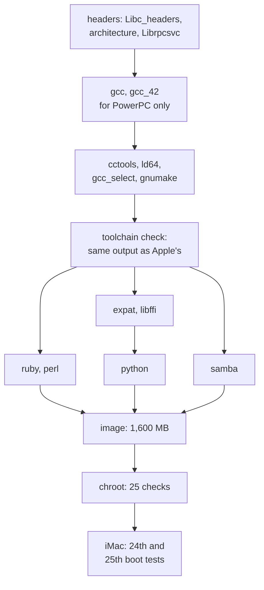
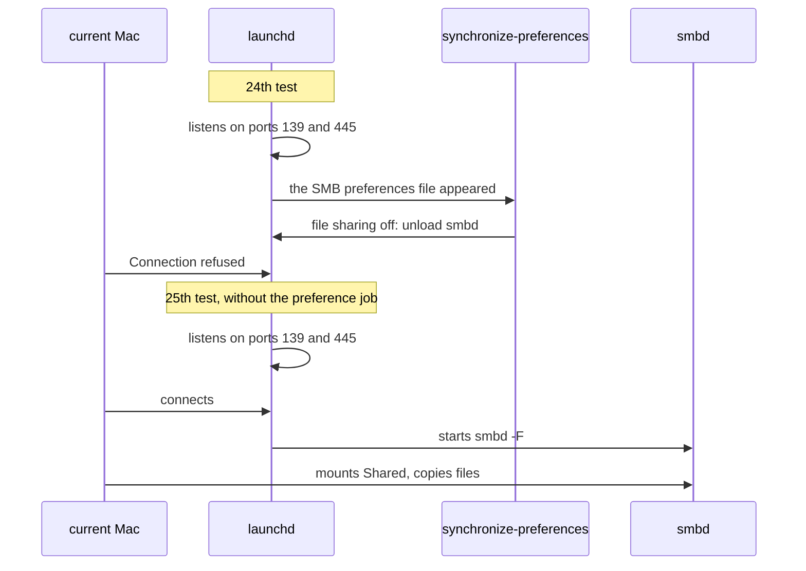

# Step 10: a working Unix system

## What you will learn

- What a C compiler needs on the machine where it runs, besides the compiler.
- How the release's own toolchain was built for PowerPC only, and checked against Apple's builds of it before anything was built with it.
- What stood between Apple's Perl, Python and Ruby and a build from source: DTrace probes, Carbon, and settings that Apple's build list lacks.
- What Apple's Samba needed to build without its closed framework, and why it stopped answering a minute after boot.
- How the step was proved, first in a chroot of the image, then on an iMac G5 (`PowerMac12,1`).

## The goal

README.md sets it as: "The image is a working Unix system: its own compiler builds and links a program, Perl, Python and Ruby run, and Samba shares a folder with another machine."

After Step 9 the image ran every program the earlier steps needed, on the iMac and in QEMU's `mac99`, but it could not make one: every binary on it had been compiled on the build machine. The step was reached on 22 November 2026.

## Background: what compiling needs

`cc hello.c` looks like one program and is several. `cc` is a driver: it runs `cc1`, the compiler proper, which turns C into assembly; `as`, the assembler, which turns that into an object file; and `ld`, the linker, which joins the object file with start-up code and libraries into a program. Each needs files of its own: the headers that `#include` names, such as `stdio.h`; `crt1.o`, the start-up code that calls `main`; and the libraries to link against, `libSystem` first ([Step 1, part 1](step-1-kernel-and-userland.md)).

Rule 4 says which tools: "Builds use `gcc` 5465, `gcc_42` 5531, `cctools` 667.3 and `ld64` 77.1." Until this step the build machine ran Apple's builds of them, from darwinbuild's Roots ([darwinbuild and the build machine](../method/darwinbuild.md)). Step 10 built them from source and put them on the image, so that the system compiles with the same tools that build it.

The image lacked more than the compiler:

- C headers. Libc's are a project of their own, `Libc_headers`, which had not been built: the build environment used a downloaded headers Root. `make-test-image` copied `/usr/include` from only some projects, so the headers of `libSystem`'s parts were missing too.
- `crt1.o`, from Csu, which was built but not on the image.
- CarbonHeaders' headers, such as `AvailabilityMacros.h`, `TargetConditionals.h` and `MacTypes.h`, which many others include. Its 9L30 version has no source; the build environment uses the headers of Apple's 9G55 Root ([D10](https://github.com/nyg/PowerDarwin/blob/master/DEVIATIONS.md#d10)).

## The order of the work



### Headers first

Libc_headers 498.1.7, architecture 254.0.5 and Librpcsvc 15 were built first, each as a headers Root and as a Root, in 6 to 22 seconds each. Their 152, 90 and 30 files are the same as those of Apple's 9A581 Roots, apart from darwinbuild's receipts. They came before the compilers because gcc's build runs `fixincludes` over the build environment's `/usr/include` and installs repaired copies into gcc's own folder: built over Apple's downloaded headers, our gcc would have carried copies of them onto the image.

### The toolchain

gcc 5465 builds `gcc-4.0`, `g++-4.0` and `cpp-4.0`, and gcc_42 5531 builds `gcc-4.2`, `g++-4.2` and `cpp-4.2`, each with its compilers proper. The build list builds every project for `ppc i386` unless it says otherwise, and for gcc that adds Intel cross compilers to the PowerPC ones. The project is for PowerPC only, so `manifest/plists/9A581.plist` sets `RC_ARCHS = ppc` for both ([D100](https://github.com/nyg/PowerDarwin/blob/master/DEVIATIONS.md#d100)), a choice rather than a fix. The compilers make PowerPC code, 32-bit and, with `-m64`, 64-bit, and are themselves `ppc7400` binaries. gcc took 59 minutes on the build machine, and gcc_42 just over two hours.

cctools 667.3 gave the assembler and the binary tools, `as`, `ar`, `ranlib`, `libtool`, `lipo`, `nm`, `otool`, `strip` and the rest, 86 files in 7 minutes; ld64 77.1 gave the linker, `ld`. gcc_select 66 made the links that name the default compiler, `cc`, `gcc`, `c++`, `g++`, `cpp` and `gcov`, all to gcc 4.0, with `c89`, `c99` and `stdint.h`. gnumake 119 gave GNU Make 3.81.

### Checking the toolchain

Once a project is built, darwinbuild installs our Root of it into later build environments in place of Apple's, so a compiler that miscompiled would spread into everything built after it. Before any build used it, our toolchain was compared with Apple's Roots of the same four projects, given the same input:

- bzip2 1.0.5's eight C files and ld64's `Options.cpp`, preprocessed once, compiled with each `cc1` and `cc1plus`, ours and Apple's, at `-O0`, `-Os` and `-O2`, to identical assembly: 54 files of 54;
- our `as` turned the 18 `-O2` files into objects identical to those of Apple's `as`;
- our `ld` linked bzip2 into a binary of 91,284 bytes, identical to the one Apple's `ld` made.

The check says nothing about running code: that bzip2, compiled by calling `cc1` without the driver's flags, hangs at start-up whichever toolchain made it. The tests below ran the code.

## Perl, Python and Ruby

### DTrace probes

Apple's perl 51.1.4, python 30.1.3 and ruby 67.6 wrap Perl 5.8.8, Python 2.5.1 and Ruby 1.8.6 with Apple's changes. All three carry DTrace probes, markers in the code that a tracing tool can switch on. `dtrace -h` turns a project's `.d` file into a header of probe macros, and ld64 loads `libdtrace.dylib` to link any object that holds a probe. libdtrace needs Apple's closed Foundation and Symbolication frameworks, even when built from dtrace's own source, so neither step can run in the build environment. Ruby had already met that wall in Step 1, when it was tried as a build tool:

```text
ld: couldn't dlopen() /usr/lib/libdtrace.dylib: … Library not loaded: …/Symbolication.framework/Versions/A/Symbolication
```

Libc and DirectoryService met it too, and there the probes were patched out ([D12](https://github.com/nyg/PowerDarwin/blob/master/DEVIATIONS.md#d12), [D75](https://github.com/nyg/PowerDarwin/blob/master/DEVIATIONS.md#d75)). This time rule 2's first choice, the build environment, served perl and python. [env/dtrace](https://github.com/nyg/PowerDarwin/blob/master/env/dtrace) goes into it as `/usr/sbin/dtrace` ([D97](https://github.com/nyg/PowerDarwin/blob/master/DEVIATIONS.md#d97)) and does only what their builds ask, `dtrace -h -s <file.d> -o <file.h>`: for each probe of the file it writes a macro that does nothing and an `_ENABLED()` macro that is `(0)`. The probe sites compile to nothing, no object refers to a probe, and ld64 never loads libdtrace.

Ruby's tarball ships its `dtrace.h` already generated, and its build never runs `dtrace -h`, so for Ruby a patch replaces that header with the same kind of macros ([D103](https://github.com/nyg/PowerDarwin/blob/master/DEVIATIONS.md#d103), [0001-dtrace-probes-without-libdtrace.patch](https://github.com/nyg/PowerDarwin/blob/master/patches/ruby-67.6/0001-dtrace-probes-without-libdtrace.patch)):

```c
#define RUBY_GC_BEGIN()
#define RUBY_GC_BEGIN_ENABLED() (0)
```

### Smaller gaps

- The build list gives python and ruby no dependencies at all, and perl none on vim, whose `ex` perl's install step runs. [D101](https://github.com/nyg/PowerDarwin/blob/master/DEVIATIONS.md#d101) adds them, from CF, OpenSSL and SQLite to zlib.
- Perl's build asks `sw_vers` for the system's version, to record a deployment target, and no Root in the build environment has `sw_vers`. [env/sw_vers](https://github.com/nyg/PowerDarwin/blob/master/env/sw_vers) prints Mac OS X 10.5.8, build `9L30` ([D98](https://github.com/nyg/PowerDarwin/blob/master/DEVIATIONS.md#d98)).
- Ruby records its build flags in `rbconfig.rb`, which Apple's build then edits with a diff, `rbconfig.diff`, that expects Apple's flags exactly. [D104](https://github.com/nyg/PowerDarwin/blob/master/DEVIATIONS.md#d104) drops the build list's `-no-cpp-precomp`, which Apple's own build of ruby did not use. darwinxref also puts the flags in another order, which moves the blanks between them, so [D105](https://github.com/nyg/PowerDarwin/blob/master/DEVIATIONS.md#d105) applies the diff with `patch -l`, which lets any run of blanks match any other. A build without D105 failed with `Hunk #2 FAILED at 74.`

### Python without Carbon

Python needed the most. Its Mac modules, the toolbox glue, link the closed Carbon and ApplicationServices frameworks, and its Build Applet and Python Launcher are Carbon applications. [D102](https://github.com/nyg/PowerDarwin/blob/master/DEVIATIONS.md#d102), [0001-without-toolbox-glue-build-applet-and-python-launcher.patch](https://github.com/nyg/PowerDarwin/blob/master/patches/python-30.1.3/0001-without-toolbox-glue-build-applet-and-python-launcher.patch), configures python with `--disable-toolbox-glue`, so that `setup.py` skips the 36 modules of Apple's 99 that need the glue, such as `MacOS`, `_Res` and `gestalt`, and takes the two applications out of its install. The first build with it still failed, in an install step that reads Carbon resource files: `ImportError: No module named _Res`. D102 removes that step too. The next failed in Apple's step that keeps unstripped copies of the modules:

```text
cp: directory /private/var/tmp/python/python-30.1.3.sym/lib-dynload does not exist
```

Apple's `ditto`, given several files and a folder, creates the folder. It is closed, and the shell-script stand-in that darwinbuild puts in its place did not; [env/ditto](https://github.com/nyg/PowerDarwin/blob/master/env/ditto) is darwinbuild's script with that one change ([D99](https://github.com/nyg/PowerDarwin/blob/master/DEVIATIONS.md#d99)). With expat 6 and libffi 10 built first, for its XML parser and `ctypes`, Python built with 62 extension modules: Apple's 99, less the 36 and `_tkinter`, since no Tk is built ([D71](https://github.com/nyg/PowerDarwin/blob/master/DEVIATIONS.md#d71)).

Perl took 22 minutes to build, Ruby 29 and Python 15. `libruby` and the Python framework keep Apple's four architectures, `ppc`, `ppc64`, `i386` and `x86_64`.

## Samba

### Building it

samba 187.8 is Samba 3.0.25b with Apple's changes. It needed four fixes:

- The build list gives it neither CoreFoundation nor Security, which its code includes ([D106](https://github.com/nyg/PowerDarwin/blob/master/DEVIATIONS.md#d106)).
- Its Makefile links every program with `-framework ByteRangeLocking`, a private, closed framework of Apple's, unless `RC_RELEASE` is `Darwin`. [D107](https://github.com/nyg/PowerDarwin/blob/master/DEVIATIONS.md#d107) sets that, Apple's own switch, as [D69](https://github.com/nyg/PowerDarwin/blob/master/DEVIATIONS.md#d69) does for bootp, and gives `smbd` the CoreFoundation and Security links that Apple's build got from CUPS, which the build environment lacks.
- The `darwin_streams` module, a plug-in of smbd's for Mac clients, links the framework itself; [D108](https://github.com/nyg/PowerDarwin/blob/master/DEVIATIONS.md#d108) drops that link. The module calls it only with `darwin_streams:brlm = yes`, which the image's `smb.conf` does not set.
- `prefsync`, the source of the `synchronize-preferences` tool below, announces changes through `CFNotificationCenter`, which CF-Lite lacks: `lib/utils.cpp:135: error: 'CFNotificationCenterRef' was not declared in this scope`. [D109](https://github.com/nyg/PowerDarwin/blob/master/DEVIATIONS.md#d109) makes it only log them.

Samba then built in 25 minutes: `smbd`, `nmbd`, `smbpasswd`, `pdbedit`, `testparm` and the rest.

### Its configuration

`make-test-image` writes `/etc/smb.conf` ([D113](https://github.com/nyg/PowerDarwin/blob/master/DEVIATIONS.md#d113)):

```text
[global]
	workgroup = WORKGROUP
	server string = Darwin 9.8
	security = user
	passdb backend = tdbsam
	opendirectory = no
	use spnego = no
	unix password sync = no
	load printers = no
	printcap name = /dev/null
	disable spoolss = yes
	wide links = no

[Shared]
	path = /Users/Shared
	read only = no
```

Three lines matter most:

- `passdb backend = tdbsam` keeps accounts and password hashes in Samba's own file, set with `smbpasswd -a`.
- `opendirectory = no`. Apple's Samba hands passwords to Apple's directory services by default: samba-187.8's `param/loadparm.c` sets `Globals.bOpenDirectory = True`, and with it `pdb_set_plaintext_passwd`, in `passdb/pdb_get_set.c`, computes no NT hash, so `smbpasswd -a` would store none and every login would fail.
- `use spnego = no`. SPNEGO is the exchange in which client and server agree how to authenticate. The current Mac's client sends a `mechListMIC` field in it, which Samba 3.0.25b's `spnego_parse_auth` (`libsmb/clispnego.c`) rejects with `spnego_parse_auth failed at 380`. Without SPNEGO, the client logs in.

### Stopped a minute after boot



Apple's `smbd.plist` is a launchd job that listens on Samba's ports, 139 and 445, and starts `smbd -F` on the first connection; Apple ships it disabled, and `make-test-image` enables it. In the twenty-fourth boot test on the iMac the ports closed a minute after boot. Another of Samba's jobs runs `synchronize-preferences` whenever the SMB server's preferences file in `/Library/Preferences/SystemConfiguration` changes, a file that the closed Sharing preference pane writes on Leopard. On the image the file appeared at the first boot holding only the NetBIOS name and code page, so `synchronize-preferences` found file sharing off, unloaded smbd and wrote `Disabled` back into `smbd.plist`. D113 removes that job from the image.

## The image

`make-test-image` grew more in this step than in any other ([Making the image](../method/making-the-image.md)). It adds the Roots of Csu, SystemStubs, the toolchain, the languages and Samba, which brought its list to 61 userland projects (79 now, with the 18 of the first chroot tests), and the `/usr/include` alone of 16 header projects, from Libc_headers to objc4, whose libraries, where they have any, are already on the image. It leaves out `/Developer`, and Python's `wininst-*.exe`, Windows programs prebuilt in its source, by rule 5. Three more things come from no build:

- `/usr/bin/dsymutil`, a script that exits 0 ([D112](https://github.com/nyg/PowerDarwin/blob/master/DEVIATIONS.md#d112)). A compile and link in one step with `-g` makes gcc run `dsymutil` after linking (`gcc/config/darwin.h` in gcc-5465), as autoconf's `configure` scripts do with `-g -O2`, and Apple's `dsymutil` is closed; the build environment has a wrapper for it ([D7](https://github.com/nyg/PowerDarwin/blob/master/DEVIATIONS.md#d7)). A one-step `-g` build then gets no `.dSYM` bundle, and a two-step build keeps its debugging information in its object files.
- CarbonHeaders 18.1, of Mac OS X 10.6, which [D73](https://github.com/nyg/PowerDarwin/blob/master/DEVIATIONS.md#d73) already uses, installed by its own Makefile: nine headers in `/usr/include`, and `MacTypes.h` again in a `CarbonCore.framework` inside an otherwise empty `CoreServices.framework`, where CF's `CFBase.h` looks for it ([D16](https://github.com/nyg/PowerDarwin/blob/master/DEVIATIONS.md#d16), [D111](https://github.com/nyg/PowerDarwin/blob/master/DEVIATIONS.md#d111)).
- `smb.conf` and the enabled `smbd.plist`.

The image is now made at 1,600 MB, up from 1 GB, which still fits the iMac's 2.1 GB `Darwin9` partition; after the step its root volume held 1.1 GB.

### What the chroot found

The first image of the step was tested in a chroot of the image itself on the build machine, where our programs run on our libraries ([How testing is done](../method/testing.md)). Every C and C++ link failed:

```text
ld: library not found for -lSystemStubs
```

gcc links every program with `-lSystemStubs`, and SystemStubs' Root was not on the image. Built for the build list's `ppc i386`, it would not serve `cc -arch ppc64` either (`ld: warning in /usr/lib/libSystemStubs.a, missing required architecture ppc64`), so [D110](https://github.com/nyg/PowerDarwin/blob/master/DEVIATIONS.md#d110) builds it for all four architectures, as Leopard's is, with the same 46 members in its ppc and ppc64 parts. CoreFoundation programs failed on the header that CF's `CFBase.h` includes, which D111's `CarbonCore.framework` now gives:

```text
CFBase.h:67:79: error: CoreServices/../Frameworks/CarbonCore.framework/Headers/MacTypes.h: No such file or directory
```

## How it was proved

The same 25 checks ran in the chroot and then on the iMac:

- the compiler: `cc`, `cc -O2`, `gcc-4.2`, `cc -arch ppc64`, `cc -g` in one step and in two, `c++` and `g++-4.2` with `std::map` and exceptions, a CoreFoundation program, a static library made with `ar` and `ranlib`, a dylib, `make`, `otool -L` and `nm`;
- perl with POSIX, Socket, Digest::MD5, Storable and threads;
- python with `_ssl`, `hashlib`, `bz2`, `_sqlite3`, `readline`, `_curses`, `plistlib`, `xml.dom.minidom` and `ctypes`, while `import MacOS` fails, which shows that the Carbon modules are really gone;
- ruby with socket, zlib, digest, openssl and readline, its `rbconfig` recording `-arch ppc -arch i386 -Os -pipe -fno-common` as Leopard's does, and `irb`;
- Samba's `testparm`.

In the chroot all 25 passed. smbd, started there after `smbpasswd -a root` with a test password, shared `/Users/Shared`; the current Mac mounted it over SMB1, and a 15-byte file copied one way and a 24-byte and an 8 MB file copied the other kept their checksums. `check-image` found 28,517 files, of which the 20 not from the builds were all written by `make-test-image`.

A chroot cannot show launchd starting smbd, since it reaches the build machine's own launchd, nor our kernel or the real partition. So the image was restored onto `Darwin9` and made the startup disk from Leopard with `bless`, as in [Step 9](step-9-disks-and-devices.md):

1. Twenty-fourth boot test on the iMac G5: sshd answered 76 seconds after the restart, and the 25 checks passed on the iMac itself. smbd was unloaded a minute after boot, as above; with the preference job removed and smbd loaded again, the current Mac mounted the share through launchd's smbd.
2. Twenty-fifth boot test, the same partition restarted without the preference job: launchd listened on ports 139 and 445 from boot and started `smbd -F` at the first connection. The current Mac mounted `Shared` as root with the test password, and a 32 MB file copied to the iMac and another copied from it kept their checksums. `gcc --version` reported Apple Inc. build 5465, `ld -v` ld64-77.1, perl 5.008008, Python 2.5.1, ruby 1.8.6 patchlevel 287 `[universal-darwin9.0]`, and `smbd -V` `3.0.25b-apple`. Our `bless` then made Leopard the startup disk again.

The final image, made after these tests, holds 28,525 files, of which the 25 not from the builds are all written by `make-test-image`; the 25 checks pass on it in a chroot. Step 10 was reached on the iMac.

## What is still missing

- `awk`, `tar`, `gzip`, `file`, `lsof`, `top` and `curl`, which no step has built yet.
- DTrace itself, and with it the languages' probes, which compile to nothing.
- Python's 36 Carbon modules, Build Applet and Python Launcher ([D102](https://github.com/nyg/PowerDarwin/blob/master/DEVIATIONS.md#d102)), and `_tkinter`, as no Tk is built.
- `.dSYM` bundles for one-step `-g` builds ([D112](https://github.com/nyg/PowerDarwin/blob/master/DEVIATIONS.md#d112)).
- In Samba: SPNEGO, the byte-range locks of `darwin_streams`, and file sharing set from a preference pane ([D108](https://github.com/nyg/PowerDarwin/blob/master/DEVIATIONS.md#d108), [D113](https://github.com/nyg/PowerDarwin/blob/master/DEVIATIONS.md#d113)). Samba 3.0.25b speaks SMB1 only.
- Intel code: the compilers are PowerPC only, but Perl, Python, Ruby, Samba and most libraries still carry `i386` slices, and some `x86_64` ([What's next](whats-next.md)).
- A test in QEMU: Step 10 was proved in a chroot and on the iMac only.

## Where to look

- [D97](https://github.com/nyg/PowerDarwin/blob/master/DEVIATIONS.md#d97) to [D113](https://github.com/nyg/PowerDarwin/blob/master/DEVIATIONS.md#d113), new in this step; [D7](https://github.com/nyg/PowerDarwin/blob/master/DEVIATIONS.md#d7), [D10](https://github.com/nyg/PowerDarwin/blob/master/DEVIATIONS.md#d10), [D12](https://github.com/nyg/PowerDarwin/blob/master/DEVIATIONS.md#d12), [D16](https://github.com/nyg/PowerDarwin/blob/master/DEVIATIONS.md#d16), [D24](https://github.com/nyg/PowerDarwin/blob/master/DEVIATIONS.md#d24), [D71](https://github.com/nyg/PowerDarwin/blob/master/DEVIATIONS.md#d71), [D73](https://github.com/nyg/PowerDarwin/blob/master/DEVIATIONS.md#d73) and [D75](https://github.com/nyg/PowerDarwin/blob/master/DEVIATIONS.md#d75), which they build on.
- [env/dtrace](https://github.com/nyg/PowerDarwin/blob/master/env/dtrace), [env/sw_vers](https://github.com/nyg/PowerDarwin/blob/master/env/sw_vers) and [env/ditto](https://github.com/nyg/PowerDarwin/blob/master/env/ditto), which [scripts/prepare-buildroot](https://github.com/nyg/PowerDarwin/blob/master/scripts/prepare-buildroot) puts into the build environment.
- Patches: [python-30.1.3](https://github.com/nyg/PowerDarwin/blob/master/patches/python-30.1.3/), [ruby-67.6](https://github.com/nyg/PowerDarwin/blob/master/patches/ruby-67.6/), [samba-187.8](https://github.com/nyg/PowerDarwin/blob/master/patches/samba-187.8/).
- [manifest/plists/9A581.plist](https://github.com/nyg/PowerDarwin/blob/master/manifest/plists/9A581.plist): the entries of gcc, gcc_42, perl, python, ruby, samba and SystemStubs.
- [scripts/make-test-image](https://github.com/nyg/PowerDarwin/blob/master/scripts/make-test-image): `header_projects`, CarbonHeaders, `dsymutil`, `smb.conf`, `smbd.plist` and the image's size; [scripts/check-image](https://github.com/nyg/PowerDarwin/blob/master/scripts/check-image).
- README.md: Step 10, rule 4, and "Status".
- In gcc-5465: `gcc/config/darwin.h`, the `dsymutil` run. In samba-187.8: `samba/source/param/loadparm.c`, `passdb/pdb_get_set.c` and `libsmb/clispnego.c`.
- Commits `f491d41`, which reached the step, and `5264e12`, which added `check-image`.
