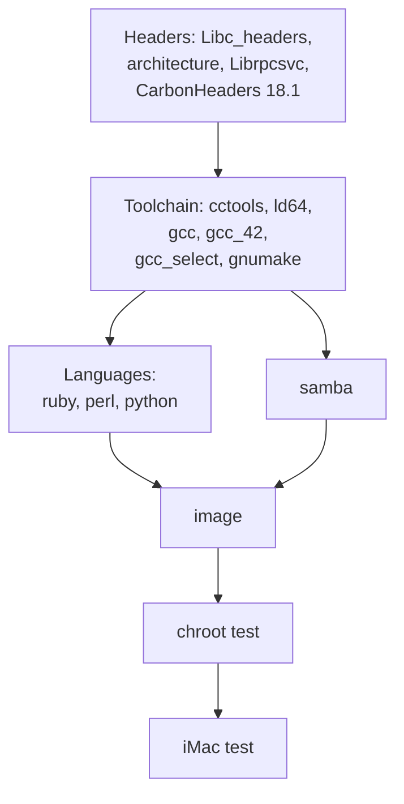

# Step 10: a working Unix system

> Draft: Step 10 is defined and researched, and nothing for it is built yet. This chapter tells the plan, and will be rewritten when the step is reached.

## What you will learn

- What a C compiler needs on the machine where it runs, besides the compiler, and what the image lacks today.
- Why the image's compiler is to be the release's own toolchain, the one that builds the image.
- What stands between Apple's Perl, Python and Ruby and a build from source: DTrace probes, and for Python, Carbon.
- How Samba is to share a folder with another machine, and the settings that Apple's version needs for it.
- How the step is to be proved, and what a test in a chroot cannot show.

## The goal

README.md sets it as: "On the iMac G5, the image is a working Unix system: its own compiler builds and links a program, Perl, Python and Ruby run, and Samba shares a folder with another machine."

After Step 9 the image runs every program the earlier steps needed, on an iMac G5 (`PowerMac12,1`) and in QEMU's `mac99`, but it cannot make one. Every binary on it was compiled on the build machine.

## Background: what compiling needs

`cc hello.c` looks like one program and is several. `cc` is a driver: it runs `cc1`, the compiler proper, which turns C into assembly; `as`, the assembler, which turns that into an object file; and `ld`, the linker, which joins the object file with start-up code and libraries into a program. Each step needs files of its own: the headers that `#include` names, such as `stdio.h`; `crt1.o`, the start-up code that calls `main`; and `libSystem`, to link against ([Step 1, part 1](step-1-kernel-and-userland.md)).

Rule 5 says which tools: "Builds use the toolchain of the release: `gcc` 5465, `gcc_42` 5531, `cctools` 667.3, `ld64` 77.1." So far the build machine has run Apple's binaries of them ([darwinbuild and the build machine](../method/darwinbuild.md)). Step 10 builds them from source and puts them on the image, so that the system compiles with the same tools that built it.

The image lacks more than the compiler:

- No C headers. Libc's headers are a project of their own in the build list, `Libc_headers`, never built here: the build environment uses a downloaded headers Root. `make-test-image` also copies `/usr/include` from only some projects, so the headers of `libSystem`'s parts are missing too.
- No `crt1.o`. It comes from Csu, which is built but not on the image.
- Five headers that many others include, such as `AvailabilityMacros.h` and `TargetConditionals.h`, come from CarbonHeaders, whose 9L30 version has no source; the build environment has the headers of Apple's 9G55 Root ([D10](https://github.com/nyg/PowerDarwin/blob/master/DEVIATIONS.md#d10)). GitHub has CarbonHeaders 18.1, a later release with all five.

## The plan

Every box is planned; none is built.

### Headers first

gcc's build runs `fixincludes` over the build environment's `/usr/include` and installs repaired copies of the headers it finds there. If Apple's downloaded headers are still there when gcc builds, the image gets copies of Apple's files. So the plan builds the header projects first, and darwinbuild then installs our Roots in their place for every later build.

### The toolchain

cctools gives the assembler and the small tools (`ar`, `ranlib`, `nm`, `otool`, `strip`, `lipo`), ld64 the linker, gcc and gcc_42 the two compilers, gcc_select the `cc` and `gcc` links, and gnumake `make`. With the build lists' default `RC_ARCHS`, `ppc i386`, gcc's build also makes compilers for Intel. The project is for PowerPC only, so the two compilers are to be built with `RC_ARCHS = ppc`, one `build-env` deviation.

From cctools on, darwinbuild builds the rest of the toolchain with ours, and every project after that. A compiler that miscompiled would then spread into everything. Two checks are planned before anything else is built with it: compile the same files to assembly with Apple's `cc1` and ours and compare, and rebuild a small project and compare its Root with the earlier one.

One closed tool remains. With `-g`, a compile and link in one step makes the driver run `dsymutil` after linking, and `dsymutil` is Xcode's, closed. The build environment already has a stand-in for it ([D7](https://github.com/nyg/PowerDarwin/blob/master/DEVIATIONS.md#d7)). The image is to get a `dsymutil` that does nothing, a new deviation, since configure scripts compile and link their tests in one step with `-g`, and every one would fail without it.

### Perl, Python and Ruby

Apple's perl, python and ruby projects wrap Perl 5.8.8, Python 2.5.1 and Ruby 1.8.6 with Apple's fixes. All three carry DTrace probes, markers in the code that a tracing tool can switch on. A project's `.d` file is turned into a header by `dtrace -h`, and ld64 loads `libdtrace.dylib` to link any object that holds a probe; libdtrace needs Apple's closed Foundation and Symbolication frameworks. Ruby has already failed there, in Step 1, when it was tried for another project's build: `ld: couldn't dlopen() /usr/lib/libdtrace.dylib: … Library not loaded: …/Symbolication.framework/Versions/A/Symbolication`. Libc and DirectoryService met the same wall ([D12](https://github.com/nyg/PowerDarwin/blob/master/DEVIATIONS.md#d12), [D75](https://github.com/nyg/PowerDarwin/blob/master/DEVIATIONS.md#d75)), and there the probes were patched out.

This time the plan follows rule 3's first choice: an `env/dtrace` in the build environment whose `dtrace -h` writes a header in which every probe macro does nothing, which perl and python then compile against unchanged. Ruby ships its header already generated, so for ruby a patch replaces it.

Each language has a few more needs:

- Perl's build asks `sw_vers` for the system's version, and the build environment has no `sw_vers`; an `env/sw_vers` is to print `10.5.8`. Its install step runs `ex`, which comes from our vim.
- Python's Mac glue includes `Carbon/Carbon.h`, and its Build Applet and Python Launcher need Carbon and AppKit, all closed. The plan configures it with `--disable-toolbox-glue` and drops those two applications, the largest patch set of the step. Its source also carries two Windows executables, `wininst-6.exe` and `wininst-7.1.exe`, which rule 6 keeps off the image. Its XML parser and `ctypes` need expat and libffi, which may be built first.
- No Tk is built ([D71](https://github.com/nyg/PowerDarwin/blob/master/DEVIATIONS.md#d71)), so Python's `_tkinter` and Ruby's Tk binding are left out.

### Samba

samba 187.8 is Samba 3.0.25b with Apple's patches, and speaks SMB1 only. Its build list entry lacks CoreFoundation and Security, and its link names Apple's private `ByteRangeLocking.framework`, closed; the plan adds the dependencies and patches the framework out of the link.

On the image, `make-test-image` is to write an `smb.conf` with one share, local accounts (`security = user`, `passdb backend = tdbsam`) and `opendirectory = no`. Apple's Samba defaults to `opendirectory = yes`, which hands passwords to Apple's directory services, and then `smbpasswd -a` stores no password hash of its own, so every login would fail. A dry run with Leopard's own `smbd` and a current Mac as the client found one more setting. In SPNEGO, the exchange in which client and server agree how to authenticate, the Mac sends a field that Samba 3.0.25b cannot parse; with `use spnego = no`, the share mounted. A Samba this old is to be used on a local network only.

### Room on the disk

`make-test-image` makes a 1 GB image (`hdiutil create -size 1g`). With the compilers and languages the files are expected to pass that, so its size is to grow, within the iMac's 2.1 GB `Darwin9` partition.

## How it will be proved

The first tests are planned in a chroot of the image on the build machine, never calling launchctl, which a chroot shares with the host ([How testing is done](../method/testing.md)):

- the compiler: a C program built with `cc`, `cc -O2` and `gcc-4.2`; a C++ program with `iostream`; a CoreFoundation program; a static library made with `ar` and `ranlib`, and a dynamic library; a Makefile run by `make`; `otool -L` showing only our libraries;
- each language: a one-line program that loads its modules for sockets, compression, hashing and OpenSSL and prints known values, such as the MD5 of `abc`; in Python, `import MacOS` must fail, which shows the Carbon modules are really gone;
- Samba: `smbpasswd -a` for a test account, `smbd` started, the share mounted from another Mac with `mount_smbfs`, and files copied both ways with the same `cksum`.

A chroot cannot show launchd starting `smbd`, our DirectoryService answering user lookups (in a chroot, Libinfo reaches the host's), our kernel, or the space on the real partition. So the same tests are then to run on the iMac over SSH, with the image restored onto `Darwin9`, made the startup disk with `bless` from Leopard and started by a restart, as in [Step 9](step-9-disks-and-devices.md).

## What is still missing

All of the step. What the plan leaves out on purpose: compilers for Intel, the languages' DTrace probes, Python's Carbon modules and applications, Tk, and SPNEGO and SMB2 in Samba.

## Where to look

- README.md: Step 10, and rule 5.
- [D7](https://github.com/nyg/PowerDarwin/blob/master/DEVIATIONS.md#d7) (`dsymutil`), [D10](https://github.com/nyg/PowerDarwin/blob/master/DEVIATIONS.md#d10) (CarbonHeaders), [D12](https://github.com/nyg/PowerDarwin/blob/master/DEVIATIONS.md#d12) and [D75](https://github.com/nyg/PowerDarwin/blob/master/DEVIATIONS.md#d75) (DTrace), [D24](https://github.com/nyg/PowerDarwin/blob/master/DEVIATIONS.md#d24) and [D64](https://github.com/nyg/PowerDarwin/blob/master/DEVIATIONS.md#d64) (the host's Ruby and Python in the build environment), [D59](https://github.com/nyg/PowerDarwin/blob/master/DEVIATIONS.md#d59) (a header of Samba's), [D71](https://github.com/nyg/PowerDarwin/blob/master/DEVIATIONS.md#d71) (tcl without Tk).
- [manifest/plists/9A581.plist](https://github.com/nyg/PowerDarwin/blob/master/manifest/plists/9A581.plist): the entries of gcc, perl, python, ruby and samba.
- [scripts/make-test-image](https://github.com/nyg/PowerDarwin/blob/master/scripts/make-test-image): `userland_projects` and the image's size.
