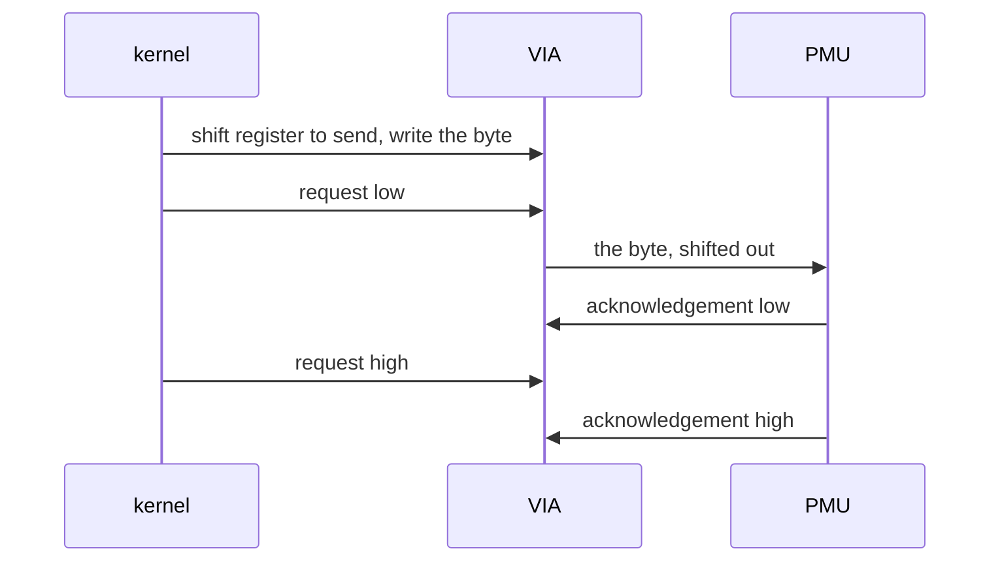

# Step 11: an open driver for the PMU

## What you will learn

- What the PMU is, and how the kernel talks to it through a VIA, a chip older than the Mac itself, one byte at a time.
- What QEMU's `mac99` did while no driver answered its PMU: a clock from 1970, no restart or power-off, and a 60-second wait for the network.
- How the project checked that Apple never published ApplePMU, and which drivers of the image call it, for what.
- How OpenPMU, the project's own driver, reads and sets the clock, restarts and switches off, and why its class needs Apple's name.
- How the step was proved in QEMU, why the driver cannot load on the iMac G5, and what no real PMU Mac has tested yet.

## The goal

README.md sets it as: "In QEMU `mac99`, an open driver for the PMU reads the clock from the hardware at boot, `reboot` restarts the machine, `shutdown -h now` switches it off, and the network comes up without a 60-second wait."

It is Step 5 and part of Step 8 again, for the other kind of power controller. [Step 5](step-5-clock-and-power.md) wrote OpenSMU for the iMac G5's SMU; QEMU's `mac99`, like the G4 Macs and the first G5s, has a PMU instead ([PowerPC Macs](../background/powerpc-macs.md)), whose driver, ApplePMU, is closed. QEMU is the machine anyone can run, so this step also lets anyone check Steps 5 and 8 without an iMac.

## Background: the PMU and its VIA

### The PMU

The PMU, the power management unit, is a small microcontroller on the logic board with firmware of its own. Like the SMU, it keeps the real-time clock and switches the power; on portables it also charges the battery, watches the lid and reads the keyboard. The kernel reaches it through a driver, and Leopard's driver for it, ApplePMU, ships as a binary only.

### The VIA

The SMU takes its commands from memory ([Step 5](step-5-clock-and-power.md)). The PMU takes them one byte at a time, through a VIA: a copy, inside the Mac's I/O controller, of the MOS 6522 Versatile Interface Adapter, a chip of 1977 that the first Macintosh used for its keyboard and its clock. A VIA has 16 registers. Three matter here:

| Register | Offset in the Mac's VIA | Use |
|---|---|---|
| port B | `0x0000` | two wires to the PMU: bit 4, the request, which the kernel drives, and bit 3, the PMU's acknowledgement, which the kernel reads; both are active when low |
| shift register | `0x1400` | the byte going to or coming from the PMU |
| auxiliary control | `0x1600` | among others, whether the shift register sends or receives |

The registers are `0x200` bytes apart, as Apple's AppleVIA-151.0.1 defines them in `AppleVIA.h` (`kAuxControlOffset` `0x01600` and its neighbours).

### One byte, one handshake

Each byte crosses with the same exchange. To send, the kernel sets the shift register to send, writes the byte into it, and pulls the request low; the PMU takes the byte and pulls its acknowledgement low; the kernel lets the request go high; the PMU lets its acknowledgement go high. To receive, the kernel sets the shift register to receive and makes the same exchange, and the byte is in the shift register once the acknowledgement is high again.



A command is a run of such bytes: the command's number, then, for commands whose length varies, a byte with the length, then the data. The reply follows the same way, with a length byte first when its length varies. Which command has which lengths is fixed by the PMU's firmware; NetBSD's [`pmu.c`](https://github.com/NetBSD/src/blob/trunk/sys/arch/macppc/dev/pmu.c), under the BSD licence, records them in two tables, and QEMU's model of the PMU, in its `hw/misc/macio/pmu.c`, answers with the same lengths.

### Where the driver finds it

Open Firmware's device tree has a node `via-pmu` under `mac-io`, the I/O controller. Our AppleVIA, built since Step 1, matches it, takes over the VIA's interrupt registers, and publishes a nub named `pmu`, of the class `AppleVIADevice`, whose memory is the VIA's. That nub is where ApplePMU starts on Leopard. In QEMU, `ioreg` shows it under AppleVIA, at offset `0x16000` of `mac-io`, `0x2000` bytes long, with nothing matched on it.

## Before: QEMU with nobody to ask

The image of Step 10, booted in QEMU, showed the three symptoms of a missing power-controller driver ([Step 5](step-5-clock-and-power.md), [Step 8](step-8-clean-boot.md)):

- `ApplePlatformExpert::getGMTTimeOfDay can not provide time of day RTC did not show up`, after ApplePlatformExpert's 30-second wait for `IORTC`; every log line until ntpd's first step was dated `Jan  1 01:00`, and every later setting of the clock logged `ApplePlatformExpert::setGMTTimeOfDay can not set time of day RTC did not show up`.
- `shutdown -h now` ended at `CPU halted`, and `reboot` at `MACH Reboot`, with QEMU still running.
- 60 seconds after configd started, `InterfaceNamer: timed out waiting for IOKit to quiesce`, with the services still busy, the last of them the processor's nub, `PowerMac3,1/MacRISC2PE/PowerPC,G4@0 [1]`. kextd timed out the same way, with `IOKitWaitQuiet() timed out waiting to write kernel symbols`.

The busy nub is AppleMacRISC2PE's processor driver, `MacRISC2CPU`, waiting in its `start`, in AppleMacRISC2PE-187.0.5's `MacRISC2CPU.cpp`:

```cpp
    pmu = waitForService(serviceMatching("ApplePMU"));
	uniN = waitForService(serviceMatching("AppleUniN"));
    if ((pmu == 0) || (uniN == 0)) return false;
```

`serviceMatching("ApplePMU")` matches a registered service of the class `ApplePMU` or of any class derived from it. On the iMac, AppleMacRISC4PE waits for a resource instead, which OpenSMU could publish under any class name ([Step 8](step-8-clean-boot.md)); here only a class with Apple's name will do.

## Rule 2: was ApplePMU ever published?

Rule 2 takes Apple's own source first, from any release ([The rules](../method/rules.md)). For ApplePMU there is none:

- xnu, the kernel, had a folder `iokit/Drivers/platform/drvApplePMU/` from xnu-123.5, the first on Apple's GitHub, to xnu-344.49, the last of Mac OS X 10.2. In every one of them it holds only `IOPMUADBController.cpp` and its header: ApplePMU's client for the ADB keyboard bus, which IOADBFamily-6 later carried. AppleCuda, the driver of the older Cuda chip, is in xnu-123.5 to 201.42.3 in full, and later on its own.
- Apple's GitHub has no repository named for it, while AppleCuda and AppleVIA have theirs.
- The Wayback Machine has captured `opensource.apple.com/tarballs/` and `/source/` pages for AppleCuda and AppleVIA, and none for ApplePMU.

So the project wrote a replacement, under rule 2's last clause, as it did for AppleSMU.

## Who calls ApplePMU

Before writing it, the project listed every caller of ApplePMU in the sources it builds, and what each asks for. The calls go through IOKit's `callPlatformFunction`, by name, so a missing function is not a missing symbol: it returns `kIOReturnUnsupported`, and each caller decides what that means.

| Caller | Project | Asks for | OpenPMU |
|---|---|---|---|
| `IOKitInitializeTime`, `ApplePlatformExpert::getGMTTimeOfDay` and `setGMTTimeOfDay` | xnu-1228.15.4 | the `IORTC` resource and the `PE_read_write_time_of_day` hook | both |
| `PEHaltRestart` | xnu-1228.15.4 | the `PE_halt_restart` hook | yes |
| `MacRISC2CPU::start` | AppleMacRISC2PE-187.0.5 | a registered service of the class `ApplePMU` | yes |
| `MacRISC2CPU::quiesceCPU`, `performPMUSpeedChange` | AppleMacRISC2PE-187.0.5 | `sleepNow`, `setSpeedNow`, `cpuReset`, at sleep and at a change of processor speed | unsupported |
| `MacRISC4CPU::start`, `AppleU3` | AppleMacRISC4PE-204.0.9 | the `IOPMU` resource; later `sleepNow`, `setSpeedNow` | the resource; the calls unsupported |
| `IOPMrootDomain::receivePowerNotification` | xnu-1228.15.4 | `prepareForSleep`, `recoverFromSleep`, on a message that only ApplePMU sends | never called |
| `IOGetHardwareClamshellState` | IOGraphics-305.14 | `sendMiscCommand`, command `0xdc`: the switches, of which bit 0 is a laptop's lid | yes |
| `IOI2CControllerPMU` | IOI2CFamily-111.0.2 | `sendMiscCommand`, command `0x9a`: the PMU's I²C bus | yes, untested |
| `PPCI2CInterface`, personality `PmuAppleI2C` | AppleI2C-400.0.3 | `sendMiscCommand` `0x9a`, and `registerForPMUInterrupts` | the first, untested; the second unsupported |

`sendMiscCommand` is ApplePMU's general entry: its one parameter points to a block with the command's number, the length and address of the data to send, and the address of a length and of a buffer for the reply. Projects the image does not build call ApplePMU too: IOADBFamily's ADB controller, AppleADBKeyboard, IOPCCardFamily's PC Card eject, and the PowerManagement daemon. AppleGPIO's `IOI2CDriveBayMGPIO` has its call to `registerForPMUInterrupts` commented out.

## OpenPMU

OpenPMU is a new kext, under the MIT licence, in [replacements/OpenPMU/](https://github.com/nyg/PowerDarwin/blob/master/replacements/OpenPMU/), recorded as [D118](https://github.com/nyg/PowerDarwin/blob/master/DEVIATIONS.md#d118), a `closed-replacement`. It speaks the protocol NetBSD's `pmu.c` speaks; no code comes from it.

| File | What it holds |
|---|---|
| [OpenPMU.cpp](https://github.com/nyg/PowerDarwin/blob/master/replacements/OpenPMU/OpenPMU.cpp) | the byte handshake, the command table, the clock, restart and power-off, `sendMiscCommand`, `start` |
| [OpenPMU.h](https://github.com/nyg/PowerDarwin/blob/master/replacements/OpenPMU/OpenPMU.h) | the two classes |
| [Info.plist](https://github.com/nyg/PowerDarwin/blob/master/replacements/OpenPMU/Info.plist), [OpenPMU_info.c](https://github.com/nyg/PowerDarwin/blob/master/replacements/OpenPMU/OpenPMU_info.c), [Makefile](https://github.com/nyg/PowerDarwin/blob/master/replacements/OpenPMU/Makefile), [LICENSE](https://github.com/nyg/PowerDarwin/blob/master/replacements/OpenPMU/LICENSE) | the packaging, the build and the licence |

### Matching only a PMU

Its one personality asks IOKit to start `OpenPMU` on a nub of the class `AppleVIADevice` named `pmu`. AppleVIA makes that nub only for a `via-pmu` node: for a `via-cuda` node it names its nub `cuda`. Its `OSBundleRequired` is `Root`, so it is in the driver cache and starts before the kernel first asks for the time.

The iMac G5 has no `via-pmu` node: Leopard's registry of the iMac, in `reference/imacg5/`, holds no `via-pmu`, `via-cuda` or `pmu` entry, and Leopard loads neither AppleVIA nor ApplePMU there. With no `AppleVIADevice`, OpenPMU has nothing to match, so the iMac runs OpenSMU alone, as before.

### Two classes, one name

`MacRISC2CPU` waits for the class `ApplePMU`, so [OpenPMU.h](https://github.com/nyg/PowerDarwin/blob/master/replacements/OpenPMU/OpenPMU.h) declares a class of that name, empty, and `OpenPMU` derives from it. `ioreg -c OpenPMU` and `ioreg -c ApplePMU` both find the driver. The name is the only thing taken from Apple's driver, and only because the waiting code asks for it.

### Talking to the PMU

`OpenPMU::sendCommand` does the handshake above for each byte. It polls: it reads port B every 10 microseconds until the acknowledgement changes, for at most 100 milliseconds per change, and fails the command if it does not. It keeps interrupts off for the length of a command, as NetBSD's driver does, and a lock keeps two commands apart. It never enables the VIA's interrupts, which AppleVIA leaves off, nor the PMU's own interrupt line.

It knows six commands, with the lengths of NetBSD's tables:

| Command | Number | Sent | Reply |
|---|---|---|---|
| set the clock | `0x30` | 4 bytes | none |
| read the clock | `0x38` | none | 4 bytes |
| switch off | `0x7e` | `MATT`, 4 bytes | 1 byte |
| I²C | `0x9a` | a length byte, then the data | a length byte, then the data |
| restart | `0xd0` | none | none |
| read the switches | `0xdc` | none | 1 byte |

Any other command gets `kIOReturnUnsupported` and never reaches the PMU.

### The clock

The PMU keeps the time as one number: seconds since 1 January 1904, in four bytes, most significant first. That is the form `ApplePlatformExpert` wants already ([Step 5](step-5-clock-and-power.md)), so `readWriteTimeOfDay`, the function OpenPMU puts in `PE_read_write_time_of_day`, only assembles the four bytes on reading and splits them on writing, with none of the date arithmetic the SMU's BCD needed. As with OpenSMU, the number is passed as unsigned, though the kernel's `long` is signed and has overflowed since 1972.

`ApplePlatformExpert` subtracts the time-zone offset it reads from XPRAM, so the hardware clock holds local time on a Mac that Mac OS set. QEMU's PMU starts its clock, by default, from the host's time in UTC; in the tests below the time read at boot was the host's, so the offset was zero there.

### Restart and power-off

`haltRestart`, the function in `PE_halt_restart`, sends `0x7e` with the four bytes `MATT` for `kPEHaltCPU`, and `0xd0` for `kPERestartCPU`. QEMU's model of the PMU ends QEMU on the first and resets the machine on the second.

### `start`

`OpenPMU::start` maps the nub's memory, the VIA's registers, and reads the clock once. If the PMU does not answer, it returns false and changes nothing, so a missing or silent PMU leaves the kernel as it was without a driver. If it answers, it fills the two hooks, publishes `IORTC`, publishes `IOPMU` for AppleMacRISC4PE on G5 Macs with a PMU, registers itself, which ends `MacRISC2CPU`'s wait, and logs `OpenPMU: PMU at 0x80016000 answers` in QEMU, the VIA's physical address.

### `sendMiscCommand`

`callPlatformFunction` takes `sendMiscCommand` with its block, checks the command against the table and its sent length, sends it, and copies at most as many reply bytes as the caller's length allows, writing back how many it copied. Every other function name, among them `sleepNow`, `setSpeedNow`, `cpuReset` and `registerForPMUInterrupts`, returns `kIOReturnUnsupported`.

### Building it

OpenPMU is built like OpenSMU ([Step 5](step-5-clock-and-power.md)): darwinbuild runs its Makefile, with the flags Xcode gives Apple's kexts, and `-Werror`; an entry in [manifest/plists/9A581.plist](https://github.com/nyg/PowerDarwin/blob/master/manifest/plists/9A581.plist) gives it xnu's headers and `libkmod.a`; `manifest/build-order` builds it last; and `make-test-image` copies it onto the image after OpenSMU.

## How it was proved

### The build

On the iMac under Leopard, `darwinbuild OpenPMU 1.0` built it in 4 seconds, with no warning under `-Werror`. `kextload -n -s`, which links a kext against the running kernel without loading it, wrote its symbol file against Leopard's kernel, xnu-1228.15.4, the version the image builds, so every symbol OpenPMU imports exists there. `make-test-image` put it on the image, and `scripts/check-image` found 28,300 files, every one from the builds but the 23 files the script writes itself, the same list as before.

### Before and after in QEMU

The image before was Step 10's with D116; the image after adds OpenPMU, and OpenRadeonPM, which finds no ATI GPU in QEMU and does not load. Both were booted with `scripts/boot-qemu` and checked over SSH with `scripts/ssh-root`:

| Check | Before | After |
|---|---|---|
| the clock at boot | `RTC did not show up`; the log dated `Jan  1 01:00` until ntpd's first step | no RTC message; the kernel's first line dated with the host's time, 19 seconds after QEMU started |
| `IORTC`, `IOPMU`, `ioreg -c ApplePMU` | none | both resources published by OpenPMU; `ioreg -c ApplePMU` finds `OpenPMU` on the `pmu` nub; the log has `OpenPMU: PMU at 0x80016000 answers` |
| the network | `InterfaceNamer: timed out waiting for IOKit to quiesce`, the processor's nub busy | no time-out; `en0`'s link up 1 to 5 seconds after the kernel's first line |
| kextd | `IOKitWaitQuiet() timed out waiting to write kernel symbols` | symbols written 12 to 15 seconds after the kernel's first line |
| SSH login, counted from QEMU's start, with the host keys already made | 112 and 85 seconds, in two boots | 30 and 31 seconds, in two boots |
| `shutdown -h now` | `CPU halted`, QEMU still running | QEMU ended 5 and 2 seconds after the command, in two tries |
| `reboot` | `MACH Reboot`, QEMU still running ([Step 5](step-5-clock-and-power.md)) | the same QEMU process booted again: the kernel's first line 21 seconds after the command, SSH 28 seconds after it |

The clock was also set and read back. `date` set it 2 hours ahead, which ApplePlatformExpert passes to OpenPMU's command `0x30`; after `reboot`, the new kernel's first line was dated 2 hours ahead, so the time came back from the PMU, and ntpdate then stepped it back.

### The log

`system.log` of the first boot after, against the first boot before, lost the RTC, InterfaceNamer and kextd lines above and gained one: `OpenPMU: PMU at 0x80016000 answers`. Both images also log `UniNEnet::restartReceiver` and `UniNEnet::restartReceiver - timeout on SoftwareReset` about once a minute once they have run for a few minutes, the image before 5 times in the 6 minutes of its last boot; the image logs them on the iMac too ([Step 13](step-13-gpu-idle-heat.md)). They come from the Ethernet driver, not from OpenPMU.

### The iMac

OpenPMU was not loaded on the iMac, and nothing here shows it running there. It cannot load: its personality needs an `AppleVIADevice` named `pmu`, and the iMac has no `via-pmu` node for AppleVIA to make one from ([Matching only a PMU](#matching-only-a-pmu)).

## What is still missing

- No real PMU Mac has run OpenPMU. QEMU's PMU answers at once and accepts any timing; a real PMU's firmware has timings of its own, and the polling, the 100-millisecond limit and the interrupts kept off are untested on one.
- Sleep, processor speed changes and every PMU interrupt: no ADB keyboard or mouse, no brightness or volume buttons, no battery, no lid. On a portable these would be next.
- The PMU's I²C bus, which `sendMiscCommand` passes through, is untested: QEMU's model of the PMU does not implement command `0x9a`.
- The clock's time-zone offset in XPRAM is untested on a Mac whose hardware clock Mac OS set to local time, though OpenPMU passes the number through as OpenSMU does.

## Where to look

- [replacements/OpenPMU/](https://github.com/nyg/PowerDarwin/blob/master/replacements/OpenPMU/), and [D118](https://github.com/nyg/PowerDarwin/blob/master/DEVIATIONS.md#d118), its row in DEVIATIONS.md.
- README.md, "Steps": Step 11's goal.
- [hardware/qemu-mac99.md](https://github.com/nyg/PowerDarwin/blob/master/hardware/qemu-mac99.md), [scripts/boot-qemu](https://github.com/nyg/PowerDarwin/blob/master/scripts/boot-qemu) (`via=pmu`).
- [RESOURCES.md](https://github.com/nyg/PowerDarwin/blob/master/RESOURCES.md): NetBSD's `pmu.c`.
- In AppleMacRISC2PE-187.0.5: `MacRISC2CPU.cpp` (the wait, `quiesceCPU`, `performPMUSpeedChange`). In AppleVIA-151.0.1: `AppleVIA.cpp` and `AppleVIA.h`. In AppleMacRISC4PE-204.0.9: `MacRISC4CPU.cpp`. In IOGraphics-305.14: `IOGraphicsFamily/IOFramebuffer.cpp` (`IOGetHardwareClamshellState`). In IOI2CFamily-111.0.2: `I2CControllers/IOI2CControllerPMU.cpp`. In AppleI2C-400.0.3: `PPCI2CInterface.cpp`. In xnu-1228.15.4: `iokit/Kernel/IOPMrootDomain.cpp`, `iokit/Kernel/IOStartIOKit.cpp`, `iokit/Drivers/platform/drvApplePlatformExpert/ApplePlatformExpert.cpp`. In xnu-123.5 to xnu-344.49: `iokit/Drivers/platform/drvApplePMU/`.
- In QEMU: `hw/misc/macio/pmu.c`, the model of the PMU that the tests ran against.
- [Step 5](step-5-clock-and-power.md) and [OpenSMU](../synthesis/opensmu.md), for the same hooks on the iMac.
