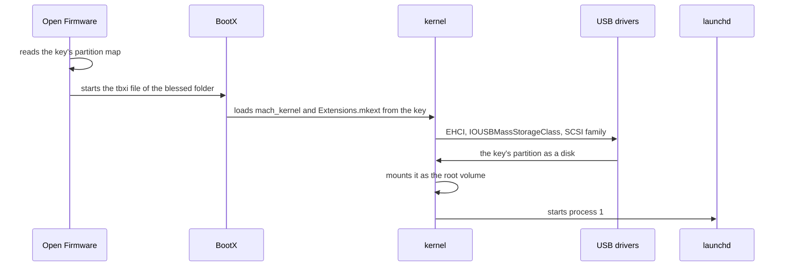

# Step 11: booting from a USB key

> Draft: Step 11 is defined, and no work on it has started. This chapter tells what the step asks for and what is already known, and will be rewritten when the step is reached.

## What you will learn

- Why a boot from a USB key reads the key twice: first through the firmware's own drivers, then through the kernel's.
- What the key must hold for Open Firmware to find BootX on it.
- Which drivers must be in the driver cache for the kernel to find its root volume on USB.
- What Step 9 already showed, and what is still to be found out.

## The goal

README.md sets it as: "A USB key holding the image boots the iMac G5 to the same system, with no internal disk involved."

So far an iMac G5 (`PowerMac12,1`) has started the image only from `Darwin9`, a partition of its internal disk, restored there with `asr` from Leopard on another partition ([How testing is done](../method/testing.md)). A key would carry the whole system on its own, and would not touch the iMac's own disk.

## Background: two readers of one key

A boot from any disk has two halves ([the boot chain](../background/boot-chain.md)). In the first, Open Firmware reads the disk with its own drivers: it finds the partition, reads the volume's blessed folder and starts BootX, which reads the kernel and the driver cache through the same firmware. In the second, the kernel runs its own drivers, finds the root volume and mounts it; the firmware is no longer used.

For the internal disk, both halves are proved: Open Firmware's SATA driver in the first, our AppleK2SATA and IOATABlockStorage in the second ([Step 1, part 2](step-1-drivers-and-bootx.md)). For a USB key, both halves change. Open Firmware must reach the key through its own USB support, and the kernel must reach it through the USB stack of [Step 9](step-9-disks-and-devices.md) before it can mount `/`.

This is the planned path; no part of it has been tried yet.

## What is already known

From Step 9, on the iMac:

- The kernel's half of the USB stack works. A USB key plugged in while Darwin 9 ran came up through the EHCI controller at high speed and was mounted at once.
- That key had a GUID partition map, the kind current Macs use. Open Firmware reads the Apple Partition Map ([the boot chain](../background/boot-chain.md)), and the image that `make-test-image` makes already has one (`hdiutil create -layout SPUD`), with the volume blessed and BootX in its blessed folder ([Making the image](../method/making-the-image.md)).
- `bless --mount <volume> --setOF` sets `boot-device` for a volume on the internal disk, and the iMac restarts into it without the Startup Manager.

From the sources:

- IOUSBMassStorageClass 208.0.1 marks itself `OSBundleRequired` `Local-Root`: it is needed to boot from a local disk.
- `make-test-image` builds the driver cache with `kextcache -l`, which takes the kexts that a boot from a local disk requires, as its manual page says. So the cache is built to the right rule; whether every kext on the USB chain is marked for it is still to be checked.

In QEMU's `mac99`, USB disks work on its EHCI controller, while its OHCI model stops about 90 seconds after boot ([Step 9](step-9-disks-and-devices.md)).

## The plan

The step's questions, in the order they come up:

1. Getting the image onto a key with an Apple Partition Map, and blessed. The image is already such a disk, so it can be written to the key whole, or restored with `asr` onto a key partitioned for it; the choice is not made yet.
2. Finding how the iMac's Open Firmware reaches a USB disk: which device path names the key, whether the Startup Manager lists it, and whether our `bless --setOF` writes a path that works for it.
3. Checking that the driver cache holds every kext from the USB controller to the volume: IOUSBFamily with its EHCI driver, IOUSBMassStorageClass, the SCSI family and its block-device driver, IOStorageFamily. A missing one shows as `Still waiting for root device`, as in Step 1.
4. Booting, and checking that the system is the same as from `Darwin9`: SSH, the clock, fans, sound and the rest of Steps 1 to 9.

Whether QEMU can take part is open too: OpenBIOS would need to boot from USB, and the disk would need QEMU's EHCI controller.

## How it will be proved

The test has to show that nothing on the way came from the internal disk: BootX, the kernel, the driver cache and the root volume all from the key, `mount` showing `/` on the key's device, and the iMac reaching the same system as from `Darwin9`. How the internal disk is kept out of the boot is part of the plan still to be written.

## What is still missing

All of the step.

## Where to look

- README.md: Step 11.
- [scripts/make-test-image](https://github.com/nyg/PowerDarwin/blob/master/scripts/make-test-image): the partition map, the driver cache and `bless`.
- In kext_tools 117.4: `kextcache.8`, for `-l`. In IOUSBMassStorageClass 208.0.1: `OSBundleRequired` in its project file.
- In bless 63.2: `libbless/OpenFirmware/BLGetOpenFirmwareBootDevice.c`, which builds the device path that `--setOF` writes.
- Commit `160662e`, which defined Steps 9 to 11.
