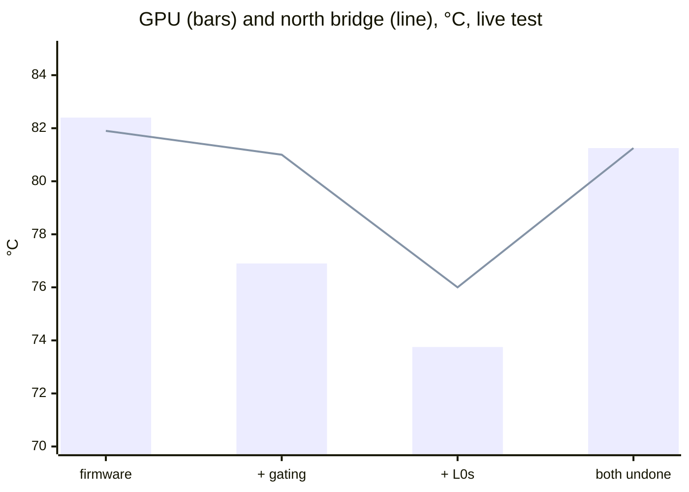

# Step 13: the GPU at idle

## What you will learn

- Why the GPU of an iMac G5 (`PowerMac12,1`) ran warmer under Darwin 9: the firmware leaves most of its clocks running, and no driver of the image stops them.
- What clock gating and the L0s state of a PCI Express link are, and where an ATI RV370 keeps them.
- How OpenRadeonPM sets both, following X.Org's radeon driver, while the firmware's display driver keeps the screen.
- How the gap was measured again, live and against Leopard on the same day, and why it was smaller than Step 7 had found.

## The goal

README.md sets it as: "On the iMac G5, the GPU and the north bridge are as cool at idle as under Leopard."

[Step 7](step-7-fans.md) measured the GPU at 81.6 °C against 72 under Leopard, and the north bridge at 84.2 °C against 79, both 16 minutes after boot. The north bridge's zone starts at 85 °C, so after 30 minutes it lifted the fans a little above their minimum. "As cool" was checked with the same five sensors that OpenSMU reads, at idle, with the screen on, against Leopard on the same day.

## Background: a GPU that no driver manages

### The GPU and its screen

The iMac's GPU is an ATI RV370 with 128 MB of memory, `pci1002,5b62` in the device tree, whose node `ATY,Aphrodite2Parent` sits on the U4's PCI Express port (`pci@0,f0000000`, `u4-pcie`), with all 16 lanes at 2.5 GT/s. On Leopard a closed driver, `ATIRadeon9700`, runs it. The image has no such driver. Its screen comes from the display driver that the GPU's firmware brings along, an NDRV named `ATY,Aphrodite2`, which IONDRVSupport runs ([Step 1, part 2](step-1-drivers-and-bootx.md)): it sets the screen up and lets the kernel draw the console into the GPU's memory, and does nothing else.

Before writing anything, the project looked for Apple's own code, as rule 2 asks. No Darwin release publishes code for an ATI GPU's power. IOGraphics 16 to 42 publish `IOATINDRV`, the ATI part of IONDRVSupport, but it only finds the GPU's memory, its startup mode and its cursor; from IOGraphics 43.2 on, it is left out of the source.

### Clock gating

Each block of a chip, such as the 3D engine or the memory controller, runs from a clock. A clock that keeps ticking costs power even when its block has nothing to do. Clock gating stops a block's clock while the block is idle and starts it again when work arrives, with no change that software can see.

An RV370 does this by itself, block by block, unless a block is forced on. Its clock settings live in its PLL registers, the registers of the circuits that make its clocks, which a driver reaches through two of its memory-mapped registers: it writes a register's index to `CLOCK_CNTL_INDEX` and reads or writes the value through `CLOCK_CNTL_DATA`. At boot the engine runs at 400 MHz and the memory at 300 MHz, the values of the firmware's `ATY,SCLK` and `ATY,MCLK` properties. A test kext, which read these registers and was built on the image with its own compiler, showed what the firmware leaves when the kernel starts:

| PLL register | Index | Firmware's value | What it leaves forced on |
|---|---|---|---|
| `SCLK_CNTL2` | `0x1e` | `0x0008fc00` | the 3D engine's TCL, GA and CBA blocks |
| `SCLK_MORE_CNTL` | `0x35` | `0x0000073f` | the display registers and two memory-controller clients |
| `VCLK_ECP_CNTL` | `0x08` | `0x00000003` | the pixel clock |
| `PIXCLKS_CNTL` | `0x2d` | `0x771ebc80` | some display clocks |
| `MCLK_MISC` | `0x1f` | `0x00003000` | the clocks of the memory controller and of its I/O, which never stop |
| `MCLK_CNTL` | `0x12` | `0x001f1212` | the memory clocks `YCLKA`, `YCLKB` and the memory controller |

`SCLK_CNTL`, which covers the other engine blocks, forces none of them: those already stop when idle.

X.Org's radeon driver, xf86-video-ati, sets these registers in `LegacySetClockGating`, in `src/radeon_pm.c` under the MIT licence. Its branch for the RV350 and later, which includes the RV370, clears the force bits of the 3D blocks, the display registers and the memory controller, lets the pixel and memory clocks stop, and keeps the memory clocks `MCLKA` and `MCLKB` running. X.Org runs it only on Mobility chips, the laptop versions, and only when the user asks for it; Linux's `radeonfb` also switches dynamic clocks on by default only on Mobility chips, and leaves desktop chips as their firmware set them. The iMac's RV370 is a desktop part, so neither would gate it.

### PCI Express link states

A PCI Express link is a set of serial lanes, each a pair of signals, one each way, whose transmitters keep sending even with no data to send. ASPM, Active State Power Management, lets each end of a link put its transmitter into a low-power state when it has nothing to send: L0s, left within a fraction of a microsecond, or the deeper L1. Each end advertises what it supports in its Link Capabilities register, and software turns it on in its Link Control register, at offset `0x10` of its PCI Express capability.

Both ends of the GPU's link, the U4's port and the GPU, advertise L0s and L1. The firmware leaves both off: Link Control `0x0008` on the U4's port and `0x0000` on the GPU. IOPCIFamily 110 reads that setting when it starts, publishes it as `IOPCIExpressASPMDefault` (0 here), and only ever puts it back, never sets more.

## OpenRadeonPM

[replacements/OpenRadeonPM/](https://github.com/nyg/PowerDarwin/blob/master/replacements/OpenRadeonPM/) is a new kext, under the MIT licence ([D117](https://github.com/nyg/PowerDarwin/blob/master/DEVIATIONS.md#d117)). It drives nothing on the screen: it sets the GPU's idle power state once, at boot, and stays loaded with nothing more to do.

### Matching

Its personality matches an `IOPCIDevice` with `IOPCIMatch` `0x5b621002`, in a match category of its own, so it leaves the GPU's nub to any other driver that matches it. In `start` it goes on only on a `PowerMac12,1`, the one machine it was tested on, and only if the boot argument `openradeonpm` is not 0.

### What it sets

`start` maps the GPU's registers, waits until its engine is idle (`RBBM_STATUS` bit 31 clear), then runs the RV350 branch of `LegacySetClockGating`, register by register in X.Org's order, with the same bits. The firmware's display driver also uses `CLOCK_CNTL_INDEX`, so the sequence runs with interrupts off and puts the index back when it ends. After it, the six registers above read:

| PLL register | Firmware's value | OpenRadeonPM's value |
|---|---|---|
| `SCLK_CNTL2` | `0x0008fc00` | `0x00081c00` |
| `SCLK_MORE_CNTL` | `0x0000073f` | `0x0000003f` |
| `VCLK_ECP_CNTL` | `0x00000003` | `0x000000c3` |
| `PIXCLKS_CNTL` | `0x771ebc80` | `0x771ffec0` |
| `MCLK_MISC` | `0x00003000` | `0x0000f000` |
| `MCLK_CNTL` | `0x001f1212` | `0x00031212` |

It then sets L0s in Link Control on both ends of the link, the U4's port first, if both advertise it. The engine and memory clocks keep their speeds, and L1 stays off.

It publishes `DynamicClocks` and `LinkL0s` in the IORegistry and logs one line:

```text
OpenRadeonPM: dynamic clocks on, PCIe L0s on
```

`openradeonpm=1` keeps the clock gating and leaves L0s off; `openradeonpm=0` leaves the GPU as the firmware set it.

The order of the steps and the bits come from xf86-video-ati 6.14.6's `radeon_pm.c`, and the registers' offsets and bits from its `radeon_reg.h`; both notices are in [replacements/OpenRadeonPM/LICENSE](https://github.com/nyg/PowerDarwin/blob/master/replacements/OpenRadeonPM/LICENSE). The rest, about 270 lines of C++ and C with its Makefile and `Info.plist`, is new code. darwinbuild builds it from a Makefile like OpenSMU's, with IOPCIFamily's and xnu's headers ([manifest/plists/9A581.plist](https://github.com/nyg/PowerDarwin/blob/master/manifest/plists/9A581.plist)), as the last step of [manifest/build-order](https://github.com/nyg/PowerDarwin/blob/master/manifest/build-order), and `make-test-image` puts it in the image's `Extensions` with the other kexts of `kext_projects`.

## How it was proved

All the tests ran on the iMac in one afternoon, with the screen on, nothing else running, and the five sensors read every 30 seconds: through `ioreg -c OpenSMU` on the image, and through the platform plug-in's `IOHWSensors` on Leopard. On the image, the fans ran at their minimum speeds throughout. The room's temperature was not measured.

### Live, on a running image

An image without OpenRadeonPM, booted at 13:05, idled for 77 minutes and settled at 30 minutes: the GPU at 82.4 °C, the north bridge at 81.9, the CPU at 50.1, the disk at 43.0 and the optical drive at 42.5. Two test kexts then made the changes by hand, one after the other, each putting the firmware's values back when unloaded:



| Live test | GPU | North bridge | Disk | CPU |
|---|---|---|---|---|
| firmware's settings, 30 to 77 minutes | 82.4 °C | 81.9 °C | 43.0 °C | 50.1 °C |
| clock gating, after 23 minutes | 76.9 °C | 81.0 °C | 42.5 °C | 49.7 °C |
| clock gating and L0s, after 20 more | 73.75 °C | 76.0 °C | 41.5 °C | 49.1 °C |
| both undone, after 15 minutes | 81.25 °C | 81.25 °C | 42.5 °C | 49.4 °C |

The clock gating cooled the GPU by 5.5 °C, most of it in the first five minutes; L0s cooled the north bridge by 5 °C and the GPU by 3 more. Undone, both temperatures climbed back to within about 1 °C of where they started, so the drops came from the settings, not from the room. SSH answered throughout and the display wrangler stayed at its usable state; nobody looked at the screen during the test.

### Against Leopard

Leopard then started on the same iMac, logged in to its desktop, with its display sleep and screen saver off for the test, and idled for 40 minutes. It settled at 30 minutes:

| Steady, at idle | Leopard | Darwin 9, firmware's settings | Darwin 9, clock gating | Darwin 9, gating and L0s |
|---|---|---|---|---|
| GPU | 79.5 °C | 82.4 °C | 76.9 °C | 73.75 °C |
| North bridge | 83.7 °C | 81.9 °C | 81.0 °C | 76.0 °C |
| CPU | 55.5 °C | 50.1 °C | 49.7 °C | 49.1 °C |
| Disk | 43.0 °C | 43.0 °C | 42.5 °C | 41.5 °C |
| Optical drive | 43.0 °C | 42.5 °C | 42.5 °C | 42.0 °C |

In steady state, the image without OpenRadeonPM was 2.9 °C warmer than Leopard on the GPU and 1.8 °C cooler on the north bridge: not the 5 to 10 °C that Step 7 had found 16 minutes after boot, at other times of day. Leopard's CPU ran 5.4 °C warmer, with its window server and desktop running, and its platform plug-in asked for fans 68 to 111 rpm above their minimum, by its processor-power rule ([Step 7](step-7-fans.md)). Clock gating alone puts the image below Leopard on both chips; with L0s, the GPU is 5.75 °C and the north bridge 7.7 °C cooler than under Leopard, well below the north bridge's 85 °C zone.

### With OpenRadeonPM from boot

The image with OpenRadeonPM held 28,298 files, two more than without it, with the same 23 not from the builds. It was restored onto the iMac's `Darwin9` partition and booted at 16:15, about an hour after the live test ended and straight after Leopard's run. OpenRadeonPM logged its line 6 seconds after the kernel started, and the registers then held the values of the table above, with L0s set on both ends. The image idled for 4 hours 20 minutes:

| With OpenRadeonPM | GPU | North bridge | CPU | Disk | Optical drive |
|---|---|---|---|---|---|
| 30 to 40 minutes after boot | 73.4 to 73.9 °C | 75.9 to 76.1 °C | 48.8 to 49.1 °C | 41.5 to 42.0 °C | 41.5 to 42.0 °C |
| 4 hours after boot | 72.9 °C | 75.4 °C | 48.4 °C | 41.0 °C | 41.0 °C |

At the same time after boot as Leopard's run, the GPU was 5.8 °C and the north bridge 7.7 °C cooler than under Leopard. The fans stayed at their minimum speeds throughout. `system.log` held only the two lines that [Step 8](step-8-clean-boot.md) accepts and the Ethernet driver's `UniNEnet::restartReceiver` lines that the image logs without OpenRadeonPM too, and the display wrangler stayed at its usable state. `reboot` restarted the iMac into the image, whose kernel started 37 seconds later, and OpenRadeonPM set the same state again 3 seconds after that. Not tested: `shutdown -h now` with OpenRadeonPM, and the screen by eye, as nobody was at the iMac during these runs.

The image tested had OpenRadeonPM's first build, which also cleared bit 24 of `SCLK_CNTL`, the RE block's force bit, which X.Org's branch leaves alone. The firmware leaves that bit clear, so both builds write the same values on the iMac; the build in the repo differs from the tested one by that mask alone, two more instructions, as a comparison of their disassembly shows.

### In QEMU

QEMU's `mac99` has no ATI GPU: its screen is `.Display_Video_QemuVGA`, a framebuffer that IONDRVSupport also drives. The same image, booted there to multi-user, catalogued 105 personalities, OpenRadeonPM's among them, one more than without it, and `kextstat` listed no OpenRadeonPM.

## What is still missing

- L1, the deeper link state, is not set: L0s already took the north bridge below Leopard, and L1 is untested on this link.
- OpenRadeonPM does not compare the link's exit latencies with what the GPU accepts: the GPU accepts 128 ns for L0s, and the U4's port advertises 128 to 256 ns.
- Power-off with OpenRadeonPM, and the screen by eye, were not tested.
- The engine and memory clocks keep the firmware's 400 and 300 MHz. X.Org and Linux can lower them at idle, which would need a test of its own.
- The primary DAC, the converter behind the external video port, stays powered with nothing plugged in.
- OpenRadeonPM knows one GPU on one machine. The 20-inch iMac G5 and other Macs with an ATI GPU are untested and left alone.
- Sleep is not supported by the image, so OpenRadeonPM has no sleep or wake handling; a GPU reset would undo its settings.
- The image still has no driver for the GPU itself: no acceleration, no brightness control, and the screen stays on.

## Where to look

- [replacements/OpenRadeonPM/](https://github.com/nyg/PowerDarwin/blob/master/replacements/OpenRadeonPM/), and [D117](https://github.com/nyg/PowerDarwin/blob/master/DEVIATIONS.md#d117), its row.
- X.Org's [xf86-video-ati 6.14.6](https://gitlab.freedesktop.org/xorg/driver/xf86-video-ati/-/tree/xf86-video-ati-6.14.6/src): `radeon_pm.c` (`LegacySetClockGating`), `radeon_reg.h`, and `radeon_chipinfo_gen.h`, which lists `0x5B62` in the RV380 family.
- Linux's [`drivers/video/fbdev/aty/radeon_pm.c`](https://github.com/torvalds/linux/blob/master/drivers/video/fbdev/aty/radeon_pm.c) and [`radeon_base.c`](https://github.com/torvalds/linux/blob/master/drivers/video/fbdev/aty/radeon_base.c), read for facts only: dynamic clocks by default on Mobility chips only.
- In IOPCIFamily-110: `IOPCIBridge.cpp`, where `IOPCIExpressASPMDefault` is read and `setDeviceASPMBits` only puts it back. In IOGraphics-42: `IONDRVSupport/IONDRVFramebuffer.cpp`, the last release that publishes `IOATINDRV`.
- [Step 7](step-7-fans.md), the first measurements, and [OpenSMU](../synthesis/opensmu.md), the sensors.
- [hardware/powermac12-1.md](https://github.com/nyg/PowerDarwin/blob/master/hardware/powermac12-1.md): the GPU's row.
