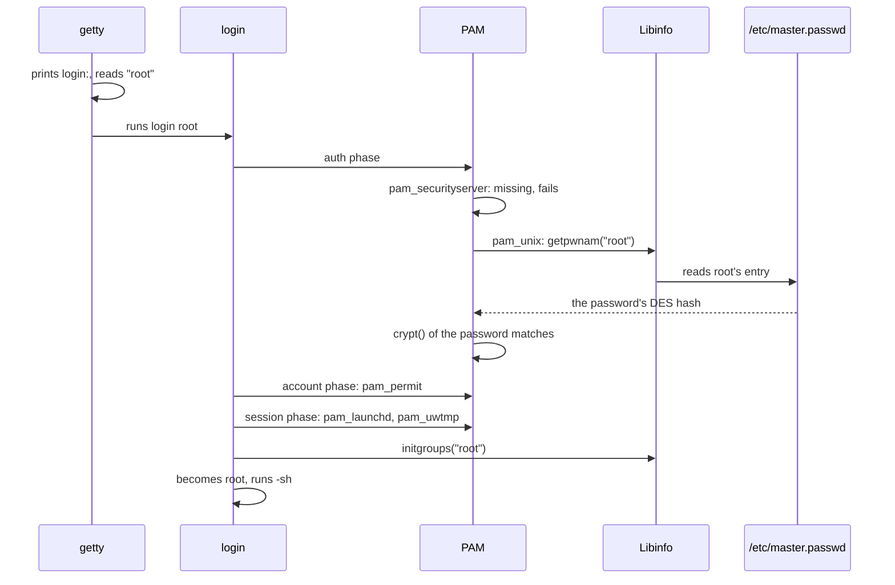

# Step 2: launchd's multi-user startup and a console login

## What you will learn

- What launchd does at a multi-user boot, and how a LaunchDaemon plist describes a job.
- How a console login works on Darwin: getty, login, PAM and its modules, Libinfo and `/etc/master.passwd`.
- Why the image has no `passwd` command, and how the test password gets onto it instead.
- How OpenDirectory, Leopard's new directory interface, pulls closed code into anything that uses it.
- A bug in Libinfo that crashed `id -G`, and why `reboot` first hung, then stopped at `MACH Reboot`.

## The goal

README.md sets Step 2 as: "The same image, booted without `-s`, runs launchd's multi-user startup to a `login:` prompt on the console, where root logs in, in QEMU `mac99` and on an iMac G5."

Without `-s`, launchd does not stop at a shell: it checks and mounts the disk, then starts the system's daemons, one of which offers a login. Leopard's own login screen is loginwindow, a closed graphical program, so the image needs the older Unix way: a text `login:` prompt on the console.

## Background: from launchd to a shell

### launchd's multi-user startup

launchd is process 1 of Mac OS X since 10.4. It replaces `init`, `rc` and `inetd`: every daemon on the system is a job that launchd starts, watches and restarts. At boot, launchd runs `launchctl bootstrap -S System`, and launchctl does what `/etc/rc` did on older systems. In launchd 258.25's `launchctl.c`, it:

1. sets the host name to `localhost` and brings up the loopback interface;
2. checks the root volume with `fsck -p` if it is mounted read-only, then remounts it read-write with `mount -uw /`;
3. runs the few `rc` scripts that still exist, such as `/etc/security/rc.audit`;
4. loads every job in `/System/Library/LaunchDaemons`, `/Library/LaunchDaemons` and `/etc/mach_init.d`.

Each job is a property list. system_cmds' `com.apple.getty.plist` is the whole of one:

```xml
<key>Label</key>
<string>com.apple.getty</string>
<key>ProgramArguments</key>
<array>
        <string>/usr/libexec/getty</string>
        <string>std.9600</string>
        <string>console</string>
</array>
<key>SessionCreate</key>
<true/>
<key>KeepAlive</key>
<true/>
```

`KeepAlive` makes launchd start getty again whenever it exits, so a new `login:` appears after each logout. `SessionCreate` asks launchd to give the job a new security session through Security.framework, which matters in [Step 6](step-6-securityd.md). Apple installs this job only on embedded systems; make-test-image installs it on the image from system_cmds' source.

### A console login

getty opens the console, prints a banner and `login:`, reads a name, and runs `login` with it. login asks for the password and hands both to PAM, the pluggable authentication modules: a library that reads a policy file per service, here `/etc/pam.d/login`, and calls the modules it lists in four phases. Apple's file for `login` reads:

```text
auth       required       pam_nologin.so
auth       sufficient     pam_securityserver.so
auth       sufficient     pam_unix.so
auth       required       pam_deny.so
account    required       pam_permit.so
password   required       pam_deny.so
session    required       pam_launchd.so
session    required       pam_uwtmp.so
```

`sufficient` means that if the module succeeds, the phase succeeds; if it fails, PAM goes on to the next line. pam_unix checks the password the classic way: it asks Libinfo for the user's record with `getpwnam`, and compares the stored hash with `crypt()` of what was typed. Libinfo, part of libSystem, normally asks DirectoryService for records; when DirectoryService is not running, as in this step, it reads `/etc/master.passwd` and `/etc/group` itself.



pam_uwtmp records the login, so that `who` lists it. pam_launchd moves the login into the security session that launchd made for getty; until Security was built, it could not.

## What was built

Five projects make the login, all on 20 November 2026:

- `files`: the volume's folder hierarchy, the `/etc`, `/tmp` and `/var` links, and the files of `/etc`, among them `ttys`, `gettytab`, `master.passwd` and `group`. Until now the image had no accounts at all, which is why part 1's prompt read `I have no name!`.
- `pam`: Linux-PAM as Apple ships it, `libpam` and its helper libraries, six modules and the `pam.d` files.
- `pam_modules`: Apple's own modules, `pam_unix`, `pam_uwtmp`, `pam_afpmount`, `pam_launchd` and `pam_sacl`.
- `system_cmds`: `getty`, `login`, `reboot`, `halt`, `shutdown`, `sysctl`, `dmesg`, `dynamic_pager` and the rest.
- `text_cmds`: `cat`, `ed`, `head`, `tail`, `sed`, `sort`, `wc` and 28 others.

make-test-image copies their Roots into the image and installs the getty job.

### No `passwd`, and the test password

Leopard keeps its accounts in DirectoryService's local directory, and changes passwords through OpenDirectory, which this step could not build (below). So the image has neither `passwd` nor DirectoryService, and root's entry in the `files` project's `master.passwd` has `*` for a password: no password matches it.

[make-test-image](https://github.com/nyg/PowerDarwin/blob/master/scripts/make-test-image) therefore writes one in. A test password is hashed once, outside the repo, with `openssl passwd -crypt -stdin`, which makes a traditional DES `crypt()` hash, and the hash is kept in a file in the build folder on the build machine. When that file exists, make-test-image replaces root's `*` in the image's `/etc/master.passwd` with the hash. The password itself is in no file of the repo, and without the hash file root cannot log in. From [Step 3](step-3-network-and-ssh.md) on, the same hash also goes into DirectoryService's record for root.

## What broke and how it was fixed

### How OpenDirectory pulls in closed code (D42, D44)

Two of the five projects failed on the same missing header. pam_modules, compiling `pam_securityserver`:

```text
OpenDirectory.h:27:51: error: CFOpenDirectory/CFOpenDirectoryConsts.h: No such file or directory
```

and system_cmds, compiling `passwd`'s `od_passwd.c`:

```text
od_passwd.c:127: error: 'ODSessionRef' undeclared
```

OpenDirectory is the interface to directory services that Leopard introduced: accounts, groups and their passwords, wherever they are stored. Its framework has an outer Objective-C part and, inside it, a C part, CFOpenDirectory, on which `passwd`, `chpass` and `pam_securityserver` all build. CFOpenDirectory's source is published, so the first idea was to build it and put it into the build environment. It failed at once:

```text
CFOpenDirectory.c:39:43: error: CoreFoundation/CFBridgingPriv.h: No such file or directory
```

`CFBridgingPriv.h` is a private header of Apple's closed CoreFoundation, about passing objects between CoreFoundation and Objective-C. The open CF-Lite does not have it, so CFOpenDirectory cannot be built, and darwinbuild's archived binary Roots of CFOpenDirectory and OpenDirectory hold only the outer framework. One closed header thus closes off everything that uses OpenDirectory.

The fixes leave those parts out, and make up for them where they can:

- [D42](https://github.com/nyg/PowerDarwin/blob/master/DEVIATIONS.md#d42): pam_modules no longer builds `pam_securityserver`. Apple's `pam.d/login` lists it as `sufficient` before `pam_unix`, so when it is missing PAM goes on to pam_unix, which checks the password in `/etc/master.passwd`. Linux-PAM keeps a module it cannot load as a "faulty module" whose calls fail, so the phase still works.
- [D44](https://github.com/nyg/PowerDarwin/blob/master/DEVIATIONS.md#d44): system_cmds no longer builds `passwd` and `chpass`; make-test-image sets root's password instead, as above.

The same header comes back twice in [Step 3](step-3-network-and-ssh.md): bootp's DHCP server, `bootpd`, is left out for it ([D66](https://github.com/nyg/PowerDarwin/blob/master/DEVIATIONS.md#d66)), and the missing `pam_securityserver` makes SSH logins look like expired accounts ([D80](https://github.com/nyg/PowerDarwin/blob/master/DEVIATIONS.md#d80)).

### A pointer passed where its target was meant (D46)

Once root could log in, `id -G` and `groups`, which list the user's groups, both died:

```text
Bus error
```

Both call Libinfo's `getgrouplist_2`, which returns a newly allocated list of group IDs through a pointer to the caller's pointer. With DirectoryService running, it asks DirectoryService. Without it, it takes another path, in `lookup.subproj/lu_group.c` of Libinfo 278.0.3:

```c
*gid_list = (gid_t *)calloc(gid_count, sizeof(gid_t));
if (*gid_list == NULL) return -1;

status = _old_getgrouplist(name, basegid, (int *)gid_list, (int *)&gid_count);
```

It allocates the list and stores its address in `*gid_list`, then passes `gid_list`, the address of the caller's own pointer, instead of `*gid_list`, the list it has just allocated. `_old_getgrouplist` writes the group IDs there: the first, root's group 0, over the caller's pointer, and the rest over whatever follows it in the caller's memory. The caller then reads its list through a pointer that is now 0. Darwin keeps the first page of every program's memory inaccessible, so that read is a protection fault, which it reports as a bus error.

On Leopard, DirectoryService always runs, so this path is not taken there. `getgrouplist`, which `login` uses through `initgroups`, has no such bug, so login itself worked. Libinfo 330, in Mac OS X 10.6, replaced this code, so there was no fix to backport. [D46](https://github.com/nyg/PowerDarwin/blob/master/DEVIATIONS.md#d46)'s [patch](https://github.com/nyg/PowerDarwin/blob/master/patches/Libinfo-278.0.3/0001-getgrouplist-2-without-directoryservice.patch) adds one character, `(int *)*gid_list`. Libsystem was built again with the new Libinfo; its `ppc` code differed from the previous build only in that call, and `id -G` and `groups` listed root's 11 groups.

### Every other deviation of this step

- [D41](https://github.com/nyg/PowerDarwin/blob/master/DEVIATIONS.md#d41): pam_modules is built without `pam_serialnumber`, which reads the machine's serial number through the closed AppleSystemInfo framework, and which only Mac OS X Server's PAM files use.
- [D43](https://github.com/nyg/PowerDarwin/blob/master/DEVIATIONS.md#d43): system_cmds is built without `arch`, which is written in Objective-C on the closed Foundation.
- [D45](https://github.com/nyg/PowerDarwin/blob/master/DEVIATIONS.md#d45): the first login stopped in the session phase, at `login: PAM Error (line 400): Cannot make/remove an entry for the specified session`, because pam_launchd could not join a security session without Security and securityd. A patch, since removed, made the module `optional` in `pam.d/login`; [Step 6](step-6-securityd.md) built securityd and dropped the deviation.

## Why `reboot` hung, then stopped

### kextd and DiskArbitration

kextd, the kext daemon, keeps the driver caches up to date and loads drivers when user programs ask. It links DiskArbitration.framework, to learn when volumes appear and disappear, and DiskArbitration was not built yet. So at every launch kextd died at once:

```text
dyld: Library not loaded: /System/Library/Frameworks/DiskArbitration.framework/Versions/A/DiskArbitration
```

That broke `halt` and `reboot`. Before anything else, they call `reserve_reboot()`, which asks kextd, through its Mach service, to hold off driver-cache updates while the system goes down. launchd keeps a job's Mach service open even while the job keeps dying, so the request found the service and waited forever for an answer that no kextd would give, before a single disk was synced. Ctrl-C returned to the shell.

`reboot -l` skips that request. It printed `syncing disks... Killing all processes`, then `done` and `MACH Reboot`, and the processor stayed there, in the kernel's `halt_all_cpus`. xnu restarts or powers off a PowerPC Mac only through a hook that the closed ApplePMU and AppleSMU drivers fill; [Step 5](step-5-clock-and-power.md) tells that story and its fix.

### With DiskArbitration

DiskArbitration was built in [Step 3](step-3-security-and-daemons.md), with Security, configd and notifyd. With it, kextd started and stayed up, `launchctl list` showed it as process 10, and plain `reboot` got its lock and handed the shutdown to launchd. On an iMac G5 (`PowerMac12,1`), in the fourth boot test on it, `reboot` then printed `syncing disks... Killing all processes`, `continuing`, `done` and `MACH Reboot`, and the USB driver went on repeating, until the iMac was switched off by hand:

```text
USBF: 328.700 OHCI driver: OHCIRootHubPortPower bit not sticking (0). Retrying.
```

With no driver to power off the machine, the kernel's threads keep running, and the root hub's ports had lost their power.

## How it was proved

In QEMU's `mac99`, the first multi-user boot test was booted with `-v` only. launchd ran `launchctl bootstrap -S System`, which checked the root volume with `fsck -p`, mounted it read-write and loaded the LaunchDaemons, and getty printed `Darwin/BSD (localhost) (console)` and `login:`. After D45, root logged in: with DirectoryService not running, Libinfo read `/etc/master.passwd`, pam_unix checked the password, and pam_uwtmp recorded the login, which `who` listed. After D46, `id -G` and `groups` listed root's 11 groups. Of the image's 7,624 files, all came from our builds except four: the generated `com.apple.Boot.plist` and `Extensions.mkext`, the edited `master.passwd`, and `com.apple.getty.plist`, copied from system_cmds' source. Step 2 was reached in QEMU.

On the iMac, the third boot test on it restored the same image onto `Darwin9` and started it from Open Firmware with `setenv boot-args -v` and `boot sata/k2-sata@0/@0:4,\\:tbxi`. After the 30-second wait for the clock that [Step 5](step-5-clock-and-power.md) removes, it printed `Darwin/BSD (localhost) (console)` and `login:`, and root logged in to `-sh` in `/var/root`. Step 2 was reached in QEMU and on the iMac G5.

## What is still missing

- There is still no way to change a password on the running system: no `passwd`, no `chpass`, no `pam_securityserver`, all for want of CFOpenDirectory.
- The login has no security session of its own until [Step 6](step-6-securityd.md) ([D45](https://github.com/nyg/PowerDarwin/blob/master/DEVIATIONS.md#d45)).
- `reboot` and `halt` end at `MACH Reboot` and `CPU halted` until [Step 5](step-5-clock-and-power.md) on the iMac, and still do in QEMU.
- Logins work only on the console. The network, DirectoryService and SSH come in [Step 3](step-3-network-and-ssh.md).

## Where to look

- DEVIATIONS.md, [D41](https://github.com/nyg/PowerDarwin/blob/master/DEVIATIONS.md#d41) to [D46](https://github.com/nyg/PowerDarwin/blob/master/DEVIATIONS.md#d46).
- [patches/pam_modules-36.2/](https://github.com/nyg/PowerDarwin/blob/master/patches/pam_modules-36.2/), [patches/system_cmds-433.8/](https://github.com/nyg/PowerDarwin/blob/master/patches/system_cmds-433.8/), [patches/Libinfo-278.0.3/](https://github.com/nyg/PowerDarwin/blob/master/patches/Libinfo-278.0.3/).
- [scripts/make-test-image](https://github.com/nyg/PowerDarwin/blob/master/scripts/make-test-image): the getty job and the test password's hash.
- In launchd-258.25: `launchd/src/launchctl.c` (`system_specific_bootstrap`, `do_potential_fsck`). In system_cmds-433.8: `getty.tproj/com.apple.getty.plist`, `login.tproj/login.c`, `reboot.tproj/reboot.c` (`reserve_reboot`). In pam-32.1: `pam.d/login`, `pam/libpam/pam_handlers.c`. In Libinfo-278.0.3: `lookup.subproj/lu_group.c`.
- Commit `c77540a`, which reached Step 2 and built Security, configd, notifyd and DiskArbitration.
