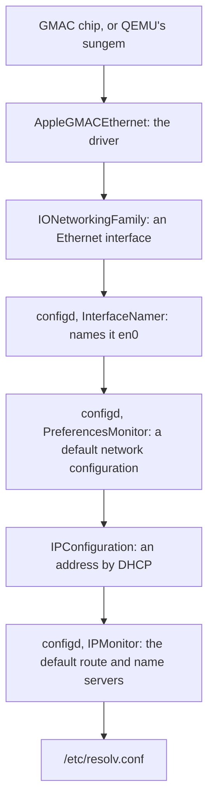
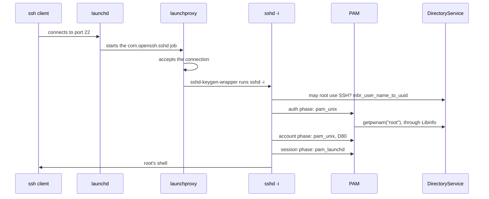

# Step 3, part 2: Ethernet, DHCP, DirectoryService and SSH

## What you will learn

- How an Ethernet port becomes `en0` with an address: the driver, IONetworkingFamily, configd's plug-ins and DHCP.
- Why DirectoryService, Leopard's directory of accounts, pulls in Kerberos, Cyrus SASL, OpenLDAP and the password server, and what its local directory holds.
- How an SSH login runs through launchd, launchproxy, sshd, PAM and DirectoryService.
- Why libraries had to be built for four architectures where the build list gave two.
- How a file watcher was moved off a closed CoreFoundation type onto a thread, and why a working login was first refused as an expired account.

## The goal

README.md sets Step 3 as: "On the iMac G5, the image brings up its Ethernet port and accepts SSH logins."

[Part 1](step-3-security-and-daemons.md) built Security, the missing pieces of CF, configd, notifyd and DiskArbitration. This part adds what sits on top: the Ethernet driver, the DHCP client and the network tools, DirectoryService with the libraries it needs, and OpenSSH. It then proves the step, first in QEMU's `mac99`, then on an iMac G5 (`PowerMac12,1`).

## Background: from a cable to a login

### An interface and its address

The iMac's Ethernet port is Apple's GMAC controller, and QEMU's `sungem` device, which [boot-qemu](https://github.com/nyg/PowerDarwin/blob/master/scripts/boot-qemu) gives the guest, is a model of it. Its driver is AppleGMACEthernet, a plug-in of IONetworkingFamily, the family that turns any network driver into an interface the kernel's BSD layer can use. Several programs then take turns:



InterfaceNamer gives each interface its BSD name, `en0` for the first Ethernet port, once IOKit has gone quiet, that is, once no driver is still starting; it waits at most 60 seconds. With no saved network preferences, PreferencesMonitor writes a default configuration, in which Ethernet uses DHCP. IPConfiguration, from the bootp project and loaded into configd like a plug-in, asks the network's DHCP server for an address, a router and name servers, and puts the answer in the dynamic store. IPMonitor sees it there, sets the default route and writes the name servers to `/etc/resolv.conf`.

### DirectoryService

On Leopard, accounts and groups do not live in `/etc/master.passwd`. They live in directories served by DirectoryService: the local directory on the machine, and network directories such as LDAP servers or Active Directory. The local directory is a folder of property lists, one per record, under `/var/db/dslocal/nodes/Default`; root's is `users/root.plist`. When DirectoryService runs, Libinfo asks it for every user and group, so `getpwnam` in a login now reads root's record from there ([Step 2](step-2-console-login.md) shows the path without it).

DirectoryService's daemon is built with all its plug-ins, and they bring in a whole stack of other projects: OpenLDAP's LDAP.framework for its LDAP plug-in, Cyrus SASL, whose headers it includes, the password server's own framework, SQLite for the local directory's plug-in, and, under LDAP and SASL, Kerberos. Kerberos is a network login protocol built on tickets; Cyrus SASL is a library through which a protocol such as LDAP chooses a login method; LDAP is the protocol of network directories; the password server is Mac OS X Server's store of passwords. So the projects that a single local login needs are many more than it uses.

### An SSH login

sshd does not run until someone connects. launchd listens on port 22 itself, as `ssh.plist`'s `Sockets` key asks, and on each connection starts the job. The job is marked `inetdCompatibility`, so launchd starts launchproxy, which accepts the connection, puts it on the new process's standard input and output, and runs the job's program: `sshd-keygen-wrapper`, which makes the host keys if there are none, then runs `sshd -i`.



Before PAM, Apple's sshd checks whether the user may use SSH at all, a service access list kept by DirectoryService, which it reaches through `mbr_user_name_to_uuid`. PAM's `sshd` policy then checks the password, the account and the session, as for the console.

## What was built

On 21 November 2026, after part 1:

- IONetworkingFamily 47.3 and AppleGMACEthernet 159.3.1: each exports and imports the same symbols as Apple's 10.5.8 kext.
- network_cmds (`ifconfig`, `ping`, `netstat`, `route` and 20 more, each importing exactly what Apple's does), OpenSSL 0.9.7, ipsec's `libipsec`, libresolv and tcp_wrappers.
- bootp 170.1: `IPConfiguration.bundle`, `ipconfig` and the BSDP client, which looks for NetBoot servers, without the DHCP server.
- The directory stack: Kerberos, tcl, SQLite, Cyrus SASL from passwordserver_sasl and passwordserver_saslkerberos, PasswordServer.framework from DSPasswordServerFramework, LDAP.framework from LDAPFramework, then DirectoryService and its daemon. `/usr/sbin/DirectoryService` imports 857 of the 864 symbols of Leopard's, also 514.25, and none other.
- OpenSSH 95.1.5, which is OpenSSH 5.1p1: its tools import and export exactly Apple's symbols; its `sshd_config` sets the same options as Leopard's, which is 10.5.0's file, left in place by later updates, and differs from ours only in comments.

make-test-image copies their Roots into the image, writes the test password's hash into root's record in the local directory as well as into `master.passwd`, and sets `Disabled` to false in `ssh.plist`, as turning on Remote Login does on Leopard.

## What broke and how it was fixed

### Four architectures where the build list gave two (D74)

A fat binary holds the same program built for several processors ([darwinbuild](../method/darwinbuild.md)). darwinbuild builds for `ppc` and `i386` unless the build list says otherwise, but Apple built many of Leopard's libraries for four: `ppc`, `ppc64`, `i386` and `x86_64`. A four-way project can link only libraries that have all four slices, and the linker checks each architecture apart. The directory stack ran into this from several sides at once:

```text
configure: error: "LDAP libraries missing - skipping LDAP database module"
Undefined symbols: "_gss_wrap"
unbind.c:192: error: 'struct ldapoptions' has no member named 'ldo_sasl_secprops'
SASLCode.h:68:23: error: sasl/sasl.h: No such file or directory
```

The first came from Kerberos built for four architectures: its LDAP database module needs LDAP.framework, and the archived LDAPFramework Root was `ppc` and `i386` only. The second came from passwordserver_saslkerberos, Cyrus SASL's Kerberos plug-in, linking our Kerberos on `ppc64`, which our first, two-way Kerberos lacked. The third and fourth came from LDAPFramework and DSPasswordServerFramework, which found no Cyrus SASL headers: they are in passwordserver_saslkerberos' Root, and neither listed it.

So the three projects depend on each other in a ring: Kerberos on LDAP, LDAP on SASL's headers, SASL's Kerberos plug-in on Kerberos. Apple's 10.5.8 LDAP.framework and Kerberos.framework both carry `ppc64`. [D74](https://github.com/nyg/PowerDarwin/blob/master/DEVIATIONS.md#d74) builds LDAPFramework and Kerberos for all four architectures in the build list, and adds passwordserver_saslkerberos to the dependencies of LDAPFramework and DSPasswordServerFramework. Built in that order, LDAP.framework came out four-way, then Kerberos in 26 minutes, then the SASL plug-in and PasswordServer.framework. [D65](https://github.com/nyg/PowerDarwin/blob/master/DEVIATIONS.md#d65) is the same lesson in libSystem: libresolv, four-way, could not find `_DNSServiceProcessResult` on `ppc64` and `x86_64`, so mDNSResponder's `libdns_sd.a` was built for four and Libsystem built again.

### CFFileDescriptor replaced by a thread (D79)

DirectoryService's daemon failed on its BSD plug-in:

```text
FlatFileNode.h:103: error: 'CFFileDescriptorRef' has not been declared
```

That plug-in serves the classic files of `/etc`, such as `/etc/hosts`, `/etc/group` and `/etc/services`, as directory records, and caches them. To notice when one changes, it watches them with a kqueue, the BSD kernel's event queue. Apple's code hands the kqueue to CoreFoundation as a `CFFileDescriptor`, a run-loop source that calls a function whenever the descriptor is readable, and adds it to the daemon's main run loop. `CFFileDescriptor` is in Leopard's closed CoreFoundation only: CF-Lite has never had it, nor has swift-corelibs-foundation, so there is nothing to backport or borrow.

The kqueue itself is plain BSD, so [D79](https://github.com/nyg/PowerDarwin/blob/master/DEVIATIONS.md#d79)'s [patch](https://github.com/nyg/PowerDarwin/blob/master/patches/DirectoryService-514.25/0005-flat-files-watched-without-cffiledescriptor.patch) drops the run loop and waits on it directly. Where the node used to create the `CFFileDescriptor`, it now starts a detached thread:

```c
pthread_create( &watchThread, &attributes, FileChangeThread, (void *) (intptr_t) fKqueue );
```

and the callback becomes `FileChangeThread`, which loops forever on `kevent()` and, for each changed file, does what the callback did: it empties the cache of that file's record type, and for users and groups the membership cache too. The daemon then imports four fewer `CFFileDescriptor` calls than Apple's, and `kCFAllocatorSystemDefault`, which only those used. The other two of the seven missing imports, `CFNotificationCenterGetDistributedCenter` and `CFNotificationCenterPostNotificationWithOptions`, are the calls of `XSEventPortCreate` and `XSEventPortPostEvent`, from the closed `libXSEventPort.a` that [D77](https://github.com/nyg/PowerDarwin/blob/master/DEVIATIONS.md#d77) takes out of the link.

### An account that looked expired (D80)

The second network boot test in QEMU had DirectoryService. sshd now passed the service access check and PAM accepted the password; then the login was refused:

```text
PAM: User account has expired for root from 10.0.2.2
Access denied for user root by PAM account configuration
```

Root's account has no expiry date. The cause is in Apple's `pam.d/sshd`, whose account phase is a single line:

```text
account    required       pam_securityserver.so
```

and `pam_securityserver` is the module that pam_modules' first build leaves out, as CFOpenDirectory comes later in the build order ([D42](https://github.com/nyg/PowerDarwin/blob/master/DEVIATIONS.md#d42)). Linux-PAM keeps a module it cannot load as a "faulty module" with no function, and its dispatcher returns `PAM_MODULE_UNKNOWN` for it; in the auth phase that did not matter, as the line was `sufficient` and pam_unix followed. Here the line is `required`, and alone. OpenSSH's PAM code then turns any failed account check into `PAM_ACCT_EXPIRED`, in `auth-pam.c`:

```c
if (!do_pam_account()) {
	sshpam_err = PAM_ACCT_EXPIRED;
```

and `pam_strerror` spells that "User account has expired". The console was not affected, because Apple's `pam.d/login` uses `pam_permit` for its account phase.

[D80](https://github.com/nyg/PowerDarwin/blob/master/DEVIATIONS.md#d80) made the account phase `pam_unix`, which checks the account's and the password's expiry dates, until `pam_securityserver` was built after OpenDirectory ([Step 2](step-2-console-login.md)). The row is now `dropped`: the phase is Apple's again, and `pam_securityserver` checks password-server policies, disabled accounts and the login shell. In QEMU, on 28 November 2026, with root's shell set to `/usr/bin/false` by `chsh`, sshd refused root after its password, with `PAM: User account has expired for root`, while the console, whose account phase is `pam_permit`, took the password and the shell ended at once; with `/bin/sh` back, both logged in, before and after a restart. On the iMac G5, root's SSH logins passed the same account phase, before and after a restart.

### Every other deviation of this part

- [D63](https://github.com/nyg/PowerDarwin/blob/master/DEVIATIONS.md#d63): network_cmds' `ping6` links `libipsec`, so ipsec, built for that library alone, becomes a dependency.
- [D64](https://github.com/nyg/PowerDarwin/blob/master/DEVIATIONS.md#d64): a script step of Kerberos is written in Python, so the build machine's Python goes into the build environment, as a build tool only.
- [D66](https://github.com/nyg/PowerDarwin/blob/master/DEVIATIONS.md#d66): bootp was built without `bootpd`, the DHCP and NetBoot server, which needs CFOpenDirectory, until OpenDirectory was built ([Step 2](step-2-console-login.md)); bootp is now built after it, with `bootpd`. In QEMU, `bootpd -d -D` with a `/etc/bootpd.plist` naming one subnet listened on UDP port 67 and logged `server starting`; launchd's job for it, `bootps.plist`, stays `Disabled`, as Apple installs it.
- [D67](https://github.com/nyg/PowerDarwin/blob/master/DEVIATIONS.md#d67): Kerberos includes the umbrella headers of the closed CoreServices and ApplicationServices for a few types; small stand-in headers that include CoreFoundation and CarbonCore's headers take their place, as headers only.
- [D68](https://github.com/nyg/PowerDarwin/blob/master/DEVIATIONS.md#d68): Kerberos is built without its login dialog agent and ticket viewer, both Cocoa applications.
- [D69](https://github.com/nyg/PowerDarwin/blob/master/DEVIATIONS.md#d69): bootp is built with `RC_RELEASE = Darwin`, which its own script reads to leave out the closed Apple80211 framework; the DHCP client does not read the Wi-Fi network's name.
- [D70](https://github.com/nyg/PowerDarwin/blob/master/DEVIATIONS.md#d70): Kerberos links with Apple's internal order file, which is not published; an empty one keeps the linker's default order of functions.
- [D71](https://github.com/nyg/PowerDarwin/blob/master/DEVIATIONS.md#d71): SQLite's install expects its Tcl binding, so tcl, built without Tk, becomes its dependency.
- [D72](https://github.com/nyg/PowerDarwin/blob/master/DEVIATIONS.md#d72): Cyrus SASL is built without its MySQL plug-in, which Apple installs disabled.
- [D73](https://github.com/nyg/PowerDarwin/blob/master/DEVIATIONS.md#d73): PasswordServer.framework uses CarbonCore's byte-order macros, so four CarbonHeaders 18.1 headers go into the build environment.
- [D75](https://github.com/nyg/PowerDarwin/blob/master/DEVIATIONS.md#d75): DirectoryService's two DTrace lock probes become empty macros, as Libc's in [Step 1](step-1-kernel-and-userland.md).
- [D76](https://github.com/nyg/PowerDarwin/blob/master/DEVIATIONS.md#d76): DirectoryService's framework is built without the Objective-C helper library for plug-ins written on the closed Foundation.
- [D77](https://github.com/nyg/PowerDarwin/blob/master/DEVIATIONS.md#d77): the daemon is built without XSEventPort, a closed Mac OS X Server library, using the switch its source already has.
- [D78](https://github.com/nyg/PowerDarwin/blob/master/DEVIATIONS.md#d78): darwinbuild's copy of Xcode misplaced `APPLE_INTERNAL_DEVELOPER_DIR`, where the daemon looks for SASL's headers; the build list now sets it.
- [D96](https://github.com/nyg/PowerDarwin/blob/master/DEVIATIONS.md#d96): the daemon includes or links CF, ICU, IOKit, Security, SQLite and Cyrus SASL, none of which the build list names, so their projects become its dependencies.

## How it was proved

### In QEMU

The first network boot test added the network drivers and the Roots from network_cmds to OpenSSH. AppleGMACEthernet matched QEMU's card and printed its Ethernet address, QEMU's default one. InterfaceNamer named it `en0` only once its 60-second wait for IOKit to go quiet ended: some service stayed busy, which [Step 8](step-8-clean-boot.md) traces to the processor's driver. IPConfiguration then got `10.0.2.15` from QEMU's DHCP server, configd wrote `nameserver 10.0.2.3` to `/etc/resolv.conf`, `ping` reached the gateway, and `ifconfig` reported `100baseTX <full-duplex>`. `launchctl load -w /System/Library/LaunchDaemons/ssh.plist` made launchd listen on port 22, and a current OpenSSH client got OpenSSH 5.1's banner. Logins failed for want of DirectoryService: sshd's unprivileged child stopped at `setgid _sshd 75: No such file or directory`, since inside its chroot it could not read `/etc/master.passwd`.

The second network boot test added the directory stack. launchd started DirectoryService on demand, root logged in on the console through it, and `id` listed root's groups from the local directory. After D80, about three minutes after power-on, a current OpenSSH client on the host logged in as root through QEMU's port forward, without anyone touching the guest's console, and ran `uname -a` (`Darwin Kernel Version 9.8.0 … root:xnu-1228.15.4.obj/RELEASE_PPC`), `id`, `ifconfig en0` and `cat /etc/resolv.conf`. Of the image's 9,946 files, all came from our builds except six: the four of Step 2, `root.plist` and `ssh.plist`. Step 3 was reached in QEMU.

### On the iMac

The fifth boot test on the iMac G5 restored the same image onto `Darwin9`, started it with `-v`, and plugged its Ethernet port into a network with a DHCP server. Our IONetworkingFamily 1.6.1 and AppleGMACEthernet 1.5.9f1 loaded, and `en0` came up at `1000baseT <full-duplex,flow-control>`. IPConfiguration got an address from the router by DHCP, and configd made the router the name server, as `scutil --dns` showed.

From another Mac on the network, a current OpenSSH client logged in as root, without anyone touching the iMac's console, and ran `uname -a`, `netstat -rn`, whose default route went through the router, and `ping` to the router, in 0.3 ms, and to `www.apple.com`, whose name resolved through it. `launchctl list` showed configd, notifyd, kextd, diskarbitrationd, DirectoryService, getty and `com.openssh.sshd` running. Step 3 was reached in QEMU and on the iMac.

## What is still missing

- The clock read 31 December 1969, since nothing sets it without AppleSMU; ntpd comes in [Step 4](step-4-everyday-commands.md), the hardware clock in [Step 5](step-5-clock-and-power.md).
- SSH logins get no security session of their own until [Step 6](step-6-securityd.md), where launchproxy's `SessionCreate()` starts to succeed.
- The 60-second wait before `en0` is named remains until [Step 8](step-8-clean-boot.md) on the iMac, and in QEMU until an open driver for its PMU exists ([What's next](whats-next.md)).
- The DHCP client has no Wi-Fi support ([D69](https://github.com/nyg/PowerDarwin/blob/master/DEVIATIONS.md#d69)).
- `grep`, `ps`, `less` and `vi` are not built yet: [Step 4](step-4-everyday-commands.md) adds them.

## Where to look

- DEVIATIONS.md, [D63](https://github.com/nyg/PowerDarwin/blob/master/DEVIATIONS.md#d63) to [D80](https://github.com/nyg/PowerDarwin/blob/master/DEVIATIONS.md#d80), and [D96](https://github.com/nyg/PowerDarwin/blob/master/DEVIATIONS.md#d96).
- [patches/DirectoryService-514.25/](https://github.com/nyg/PowerDarwin/blob/master/patches/DirectoryService-514.25/), [patches/pam-32.1/](https://github.com/nyg/PowerDarwin/blob/master/patches/pam-32.1/), [patches/Kerberos-75.10.11/](https://github.com/nyg/PowerDarwin/blob/master/patches/Kerberos-75.10.11/), [patches/bootp-170.1/](https://github.com/nyg/PowerDarwin/blob/master/patches/bootp-170.1/), [patches/passwordserver_sasl-118.1/](https://github.com/nyg/PowerDarwin/blob/master/patches/passwordserver_sasl-118.1/).
- [env/CoreServices/](https://github.com/nyg/PowerDarwin/blob/master/env/CoreServices/), [env/ApplicationServices/](https://github.com/nyg/PowerDarwin/blob/master/env/ApplicationServices/), [manifest/plists/9A581.plist](https://github.com/nyg/PowerDarwin/blob/master/manifest/plists/9A581.plist).
- [scripts/boot-qemu](https://github.com/nyg/PowerDarwin/blob/master/scripts/boot-qemu) (the `sungem` card and the forwarded SSH port) and [scripts/make-test-image](https://github.com/nyg/PowerDarwin/blob/master/scripts/make-test-image) (`root.plist` and `ssh.plist`).
- In OpenSSH-95.1.5: `launchd-ssh.plist`, `sshd-keygen-wrapper` and `openssh/auth-pam.c`. In launchd-258.25: `launchd/src/launchproxy.c`. In pam-32.1: `pam.d/sshd` and `pam/libpam/pam_dispatch.c`. In DirectoryService-514.25: `PlugIns/BSD/FlatFileNode.cpp`.
- Commits `39e66a1`, which reached Step 3 in QEMU, and `5e2f80a`, which recorded it on the iMac.
