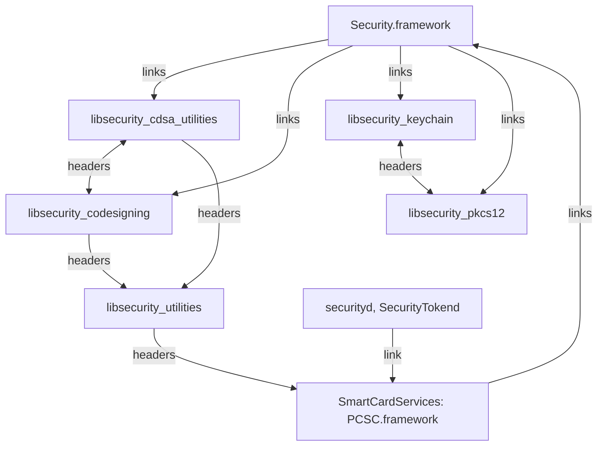
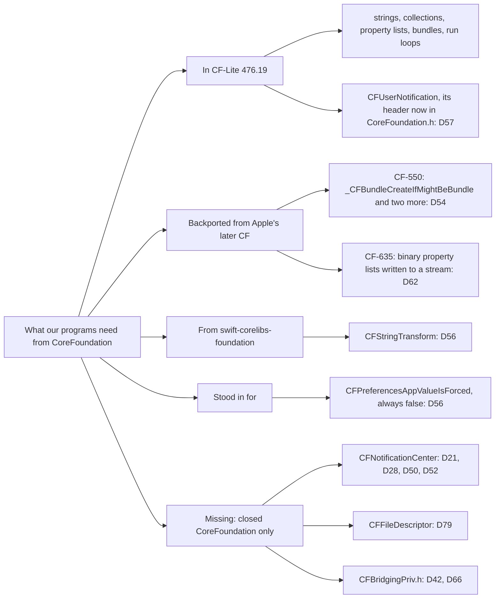

# Step 3, part 1: Security, configd, notifyd and DiskArbitration

## What you will learn

- What Security.framework is, why so much of Darwin links it, and how 28 of its 32 parts were built in spite of headers that depend on each other in circles.
- Where the open CF-Lite falls short of Leopard's CoreFoundation, and how each missing function was backported, borrowed or stood in for.
- How a parser that needs Java 6 at build time was made on another Mac, since neither the build environment nor Leopard's PowerPC Java can run it.
- What configd, its plug-ins and the System Configuration dynamic store do, and what notifyd and DiskArbitration add.
- How a stream that silently stayed empty kept configd from starting.

## The goal

README.md sets Step 3 as: "On the iMac G5, the image brings up its Ethernet port and accepts SSH logins."

Neither half of that is a single program. The network is configured by configd and its plug-ins, through SystemConfiguration.framework, which uses Security.framework and CoreFoundation; DiskArbitration, which kextd needs, uses them too. This part builds that foundation: Security, the missing pieces of CF, configd, notifyd and DiskArbitration. Part 2 adds the Ethernet driver, DHCP, DirectoryService and SSH, and proves the step.

## Background: the daemons under the network

### Security.framework

Security.framework is Mac OS X's library for cryptography, certificates, keychains, code signing and authorisation. It follows CDSA, the Common Data Security Architecture: a core, CSSM, to which plug-in modules attach, such as a cryptographic service provider (CSP) that does the arithmetic, data stores for keychains, and modules for certificates and trust. Apple publishes it as 32 separate projects, mostly named `libsecurity_…`, most making a static library, and a `Security` project that links those into the framework.

### configd and the dynamic store

configd, the System Configuration daemon, holds the machine's current network state in the dynamic store: a table of keys such as `State:/Network/Global/IPv4`, each holding a property list. Its plug-ins, loaded at start, fill the store: InterfaceNamer names network interfaces, KernelEventMonitor follows the kernel's events, PreferencesMonitor copies the saved network preferences in, IPMonitor picks the primary interface and writes the name servers. Programs read the store and ask to be told when keys change; `scutil` is its command-line client. In configd 212.2, the plug-ins' bundles hold only their `Info.plist`, and their code is linked into configd itself.

### notifyd and DiskArbitration

notifyd is the server behind `notify(3)`: programs post named notifications, such as `com.apple.system.timezone`, and others watch for them, cheaply. diskarbitrationd watches IOKit for disks as they appear, mounts their volumes, and tells interested programs, such as kextd, about each one. It registers with configd and notifyd when it starts.

## What was built

All on 20 November 2026, in this order:

1. 28 of Security's 32 parts and the framework, after the headers of all 32.
2. CF again, four times, each time with one more piece ([D54](https://github.com/nyg/PowerDarwin/blob/master/DEVIATIONS.md#d54), [D56](https://github.com/nyg/PowerDarwin/blob/master/DEVIATIONS.md#d56), [D57](https://github.com/nyg/PowerDarwin/blob/master/DEVIATIONS.md#d57), [D62](https://github.com/nyg/PowerDarwin/blob/master/DEVIATIONS.md#d62)).
3. SystemConfiguration.framework, from configd 212.2: for all four architectures, its `ppc` slice exporting the same 667 symbols as Apple's 10.5.8 binary.
4. DiskArbitration 183: the framework, exporting the same 132 symbols as Apple's on `ppc`, and `diskarbitrationd`, `disktool` and `autodiskmount`.
5. notify 16: `notifyd`, which imports the same symbols as Apple's 10.5.8 binary, `notifyutil`, and a launchd job identical to Apple's.
6. IOSerialFamily, whose headers SystemConfiguration includes, and configd's plug-ins and programs: seven plug-in bundles, and `configd`, `scutil` and `scselect`, which import the same 467, 400 and 41 symbols as Apple's 10.5.8 binaries.

### Security and its 32 parts

darwinbuild's build list gives most Security projects no dependencies at all, though each includes the headers of others, and some in circles: libsecurity_cdsa_utilities and libsecurity_codesigning include each other's headers, and so do libsecurity_keychain and libsecurity_pkcs12. darwinbuild puts into the BuildRoot only the Roots of the projects a project lists, so an unlisted header is simply missing; and in a circle, neither project can be built first. Headers break the circle: `darwinbuild -headers` installs a project's headers without compiling it.



Only 5 of the 32 parts are drawn. An arrow marked `headers` means "includes the headers of"; `links` means "is linked with".

[D48](https://github.com/nyg/PowerDarwin/blob/master/DEVIATIONS.md#d48) completes the build list in [manifest/plists/9A581.plist](https://github.com/nyg/PowerDarwin/blob/master/manifest/plists/9A581.plist): each project gets a header dependency on every project whose headers it includes, found by its `#include <security_*/…>`, `<securityd_client/…>` and `<PCSC/…>` lines, and Security gets build dependencies on the parts it links. Then every project's headers were built first, with `darwinbuild -headers`, so that darwinbuild installs ours and not Apple's 9A581 ones, and the libraries were built after. The same row builds Security for all four architectures of its parts, where the build list left it at darwinbuild's `ppc i386`.

The picture has one more circle, which this part could not break. libsecurity_utilities includes the smart-card headers of PCSC.framework, which SmartCardServices installs ([D47](https://github.com/nyg/PowerDarwin/blob/master/DEVIATIONS.md#d47)); headers were enough for it. But SmartCardServices links Security, and securityd and SecurityTokend link PCSC.framework, so both failed with `ld: framework not found PCSC` and waited for [Step 6](step-6-securityd.md).

Four parts were left unbuilt, none of them inside Security.framework itself: libsecurity_dotmacdl and security_dotmac_tp, plug-in bundles that need the closed CFNetwork; libsecurity_ldap_dl, another plug-in, which stopped on a type error against DirectoryService's headers; and libsecurity_filevault, part of SecurityFoundation, which needs the closed DiskImages framework. The framework, built for `ppc`, `ppc64`, `i386` and `x86_64`, exports on each the same 734 functions as Apple's 10.5.8 binary on `ppc`.

## What broke and how it was fixed

### A parser made on another machine (D49)

Code signing, new in Leopard, checks a program's signature against a requirement written in a small language, such as `anchor apple and identifier com.apple.foo`. libsecurity_codesigning parses that language with a parser generated by ANTLR 2, a parser generator written in Java, from its grammar file `requirements.grammar`. Its build runs ANTLR as a script step, and failed:

```text
Script-C2D383B70A23A8C4005C63A2.sh: line 6: java: command not found
```

Neither ANTLR nor Java is among 9L30's published sources, and Leopard's own Java links the closed Foundation, so neither can run in the build environment. Security also links its parser bundle, `csparser.bundle`, with ANTLR's C++ runtime, `-lantlr2c++`, which nothing in the build environment provides.

Apple's later Security-55471, from OS X 10.9, ships ANTLR 2.7.7, which is public domain, in `libsecurity_codesigning/antlr2`: `antlr.jar` and the C++ runtime's source. [D49](https://github.com/nyg/PowerDarwin/blob/master/DEVIATIONS.md#d49) uses it in three pieces, in [env/antlr2/](https://github.com/nyg/PowerDarwin/blob/master/env/antlr2/) and [env/java](https://github.com/nyg/PowerDarwin/blob/master/env/java):

1. `env/antlr2/generate` runs on a current Mac with Java 6 or later. The jar's classes are in Java 6's format, class version 50, which Leopard's PowerPC Java 1.5 refuses. It unpacks ANTLR from Security-55471 and the grammar from libsecurity_codesigning 36924, the version 9L30 lists, runs `antlr.Tool` on the grammar, and puts the generated parser into a folder named after the grammar's checksum, as `cksum` prints it, with the runtime's headers and sources beside it.
2. `env/antlr2/build` runs inside the build environment and compiles the runtime, without the Windows-only `dll.cpp`, as Apple's own project leaves it out, into `/usr/local/lib/libantlr2c++.a` for `ppc` and `ppc64`, the architectures of [D115](https://github.com/nyg/PowerDarwin/blob/master/DEVIATIONS.md#d115).
3. `env/java` goes into the build environment as `/usr/bin/java`. It is not Java: it reads the arguments the build passes, finds the grammar among them, computes its `cksum`, and copies the parser made beforehand for that grammar into the `-o` folder.

So the build's own command line, `java -cp /usr/local/bin/antlr.jar antlr.Tool -o … requirements.grammar`, gets the parser ANTLR made from that very file. A different grammar finds no folder, and the stand-in fails with `java: no ANTLR output made beforehand for …` instead of handing over a stale parser. libsecurity_codesigning then got as far as CF:

```text
lib/bundlediskrep.cpp:40: error: '_CFBundleCreateIfMightBeBundle' was not declared in this scope
```

which is the next story's subject.

### Where CF-Lite falls short

CF, the CF-Lite project, is the open part of CoreFoundation. Leopard's own CoreFoundation is built from more source than Apple published, and programs built against it use functions that CF-Lite lacks. Each gap met in this book was filled in one of four ways, or not at all:



Rule 2 prefers Apple's own later code to a new patch ([The rules](../method/rules.md)). [D54](https://github.com/nyg/PowerDarwin/blob/master/DEVIATIONS.md#d54) backports from CF-550 the three symbols libsecurity_codesigning needs, `_kCFBundleResourceSpecificationKey`, `_CFBundleCreateIfMightBeBundle` and `_CFBundleCreateWithExecutableURLIfMightBeBundle`, which Apple's 10.5.8 CoreFoundation exports and CF-476.19's source lacks; they are adapted to 476, without CF-550's check for bundles built for the iPhone.

### CFStringTransform from Apple's later open CF (D56)

SystemConfiguration then failed to link:

```text
Undefined symbols: "_CFPreferencesAppValueIsForced", "_CFStringTransform"
```

`CFStringTransform` runs ICU's transliterator on a string: it can turn Greek into Latin letters, strip accents, or apply any chain of ICU transforms. SystemConfiguration uses it in `_SC_dos_copy_string`, which turns a name into plain ASCII for an old DOS code page, with this chain, in `SCDPrivate.c` of configd 212.2:

```c
transform = CFStringCreateWithFormat(NULL, NULL,
				     CFSTR("[^%@]; Publishing-Any; Any-Latin; NFKD; [:^ASCII:] Remove"),
				     set);
```

CF-476.19 does not have it. Apple's swift-corelibs-foundation, the open Foundation for Swift, includes a CoreFoundation, under the Apache 2.0 licence with a runtime library exception, and its `CFStringTransform.c` is Apple's own implementation. [D56](https://github.com/nyg/PowerDarwin/blob/master/DEVIATIONS.md#d56)'s [patch](https://github.com/nyg/PowerDarwin/blob/master/patches/CF-476.19/0003-string-transform-and-forced-preferences.patch) adds that file to CF-476.19 with its licence notice, with the function and its 16 `kCFStringTransform…` constants. It changes only what 476 lacks: it includes CF-476's headers and ICU's `<unicode/utrans.h>`, uses CF-476's spin lock, and reads characters with `CFStringGetCharacters`, since 476 has no `CFStringGetCharactersFromInlineBuffer`.

`CFPreferencesAppValueIsForced` is different. It reports whether a preference was imposed by an administrator through managed preferences, a closed part of Mac OS X that the image does not have. So the patch declares it as Apple's header does and makes it return false: no value is forced, which is true on the image. With D56, SystemConfiguration linked, and exports what Apple's does.

### A stream that silently stayed empty (D62)

With SystemConfiguration, DiskArbitration and notifyd built, the third multi-user boot test added configd and its plug-ins. configd started, loaded its seven plug-ins, then logged:

```text
_SCSerialize() failed
SCDynamicStoreSetNotificationKeys() failed: Failed!
```

and launchd restarted it every 10 seconds. `_SCSerialize` is how configd turns a property list into bytes to send to a client. In `SCDPrivate.c`:

```c
stream = CFWriteStreamCreateWithAllocatedBuffers(NULL, NULL);
CFWriteStreamOpen(stream);
CFPropertyListWriteToStream(obj, stream, kCFPropertyListBinaryFormat_v1_0, NULL);
CFWriteStreamClose(stream);
myXml = CFWriteStreamCopyProperty(stream, kCFStreamPropertyDataWritten);
```

It writes the property list, in Apple's binary format, to a stream into memory, then takes back the bytes written. CF-476.19's binary writer, in `CFBinaryPList.c`, writes to a memory buffer or to a stream; its stream branch is one line:

```c
CFAssert(false, __kCFLogAssertion, "Streams are not supported on this platform");
```

A release build compiles assertions out. So the call did nothing, reported the bytes as written, and returned; the stream stayed empty, `CFWriteStreamCopyProperty` found no data, and every serialisation failed. Apple's 10.5.8 binary has the branch: its CoreFoundation is not CF-Lite. CF-635 published it. [D62](https://github.com/nyg/PowerDarwin/blob/master/DEVIATIONS.md#d62)'s [patch](https://github.com/nyg/PowerDarwin/blob/master/patches/CF-476.19/0005-backport-binary-plist-stream-writing.patch) backports it, a loop of `CFWriteStreamWrite` calls that records an error if the stream is full or fails, with CF-476's error strings. With that CF, configd stayed up after `updateConfiguration(): no preferences.`

### Every other deviation of this part

- [D47](https://github.com/nyg/PowerDarwin/blob/master/DEVIATIONS.md#d47): libsecurity_utilities gets SmartCardServices as a header dependency, for PCSC's headers.
- [D48](https://github.com/nyg/PowerDarwin/blob/master/DEVIATIONS.md#d48): every Security part gets the dependencies it really has, as above; configd and DiskArbitration get CF, IOKitUser and Security.
- [D50](https://github.com/nyg/PowerDarwin/blob/master/DEVIATIONS.md#d50): libsecurity_authorization drops an unused Carbon include and compiles its `CFNotificationCenter` calls only with Apple's closed CF; a session no longer passes keyboard input changes on to SecurityAgent.
- [D51](https://github.com/nyg/PowerDarwin/blob/master/DEVIATIONS.md#d51): Security and its CSP are built in Apple's own `Darwin` configuration, without the unpublished CryptKit and comcryption, so the CSP has no FEE (CryptKit's elliptic-curve cryptography) or ASC (Apple Secure Compression) algorithms.
- [D52](https://github.com/nyg/PowerDarwin/blob/master/DEVIATIONS.md#d52): libsecurity_keychain drops an include of `CFNotificationCenter.h` from which it uses nothing.
- [D53](https://github.com/nyg/PowerDarwin/blob/master/DEVIATIONS.md#d53): DirectoryServiceMIG copies its MIG headers from the per-architecture folder the build machine's Xcode writes; backported from DirectoryService-621.
- [D55](https://github.com/nyg/PowerDarwin/blob/master/DEVIATIONS.md#d55): the build-time program that makes Security's error-message strings uses CoreFoundation instead of the closed Foundation; the strings have Apple's text, in big-endian UTF-16.
- [D57](https://github.com/nyg/PowerDarwin/blob/master/DEVIATIONS.md#d57): CF's `CoreFoundation.h` includes `CFUserNotification.h`, as Apple's does, for diskarbitrationd.
- [D58](https://github.com/nyg/PowerDarwin/blob/master/DEVIATIONS.md#d58): configd_plugins 91 was never published; the plug-ins are built from configd-212.2's `Plugins/`, whose bundles carry version 1.9.2, like Apple's 10.5.8 ones.
- [D59](https://github.com/nyg/PowerDarwin/blob/master/DEVIATIONS.md#d59): IPMonitor includes a header of constants from samba, which samba installs only in its full build, so it is copied into the build environment.
- [D60](https://github.com/nyg/PowerDarwin/blob/master/DEVIATIONS.md#d60): IOSerialFamily's headers are copied from its source, since its header build installs none, and IOSerialFamily becomes a dependency of configd.
- [D61](https://github.com/nyg/PowerDarwin/blob/master/DEVIATIONS.md#d61): configd's programs are built without SCMonitor, a plug-in for the closed UserEventAgent.

## How it was proved

The second multi-user boot test in QEMU's `mac99` added CF, Security, configd's framework and DiskArbitration to the image. kextd now started and stayed up, printing `0 cached, 74 uncached personalities to catalog` and `writing kernel link data to /var/run/mach.sym`, and `launchctl list` showed it as process 10. diskarbitrationd started on demand and exited with status 70, `EX_SOFTWARE`: configd and notifyd, with which it registers, were not there yet. Plain `reboot` reached `MACH Reboot`, as [Step 2](step-2-console-login.md) describes. The fourth boot test on an iMac G5 (`PowerMac12,1`) showed the same on real hardware.

The third multi-user boot test added notifyd and configd with its plug-ins. With CF's fifth build, configd failed as above; with the sixth, which carries D62, it stayed up. `launchctl list` showed notifyd, kextd, diskarbitrationd and configd running; `scutil --dns` got its answer from configd, `notifyutil -g com.apple.system.timezone` from notifyd, and diskarbitrationd no longer exited. On `reboot`, configd logged each plug-in's shutdown and `server shutdown complete`. Of the image's 7,854 files, all came from our builds except the four of Step 2.

Nothing here is visible to a user yet: no network interface is configured, because there is no network driver. That, and the step's proof on the iMac, are [part 2](step-3-network-and-ssh.md).

## What is still missing

- securityd, SecurityTokend and SmartCardServices wait for [Step 6](step-6-securityd.md), so there are no security sessions, and launchctl is still built without Security ([D26](https://github.com/nyg/PowerDarwin/blob/master/DEVIATIONS.md#d26)).
- The Apple CSP lacks FEE and ASC, and four Security plug-ins, for .Mac, LDAP and FileVault, are not built.
- Anything that needs `CFNotificationCenter`, distributed notifications between processes, is cut out or left unbuilt, wherever it appears.
- `CFPreferencesAppValueIsForced` always says no, so managed preferences, closed anyway, have no effect.

## Where to look

- DEVIATIONS.md, [D47](https://github.com/nyg/PowerDarwin/blob/master/DEVIATIONS.md#d47) to [D62](https://github.com/nyg/PowerDarwin/blob/master/DEVIATIONS.md#d62).
- [env/antlr2/](https://github.com/nyg/PowerDarwin/blob/master/env/antlr2/) and [env/java](https://github.com/nyg/PowerDarwin/blob/master/env/java), D49's parser.
- [patches/CF-476.19/](https://github.com/nyg/PowerDarwin/blob/master/patches/CF-476.19/), [patches/Security-36371/](https://github.com/nyg/PowerDarwin/blob/master/patches/Security-36371/), [patches/libsecurity_authorization-32564/](https://github.com/nyg/PowerDarwin/blob/master/patches/libsecurity_authorization-32564/), [patches/libsecurity_keychain-36620/](https://github.com/nyg/PowerDarwin/blob/master/patches/libsecurity_keychain-36620/), [patches/configd-212.2/](https://github.com/nyg/PowerDarwin/blob/master/patches/configd-212.2/), [patches/DirectoryService-514.25/](https://github.com/nyg/PowerDarwin/blob/master/patches/DirectoryService-514.25/).
- [manifest/plists/9A581.plist](https://github.com/nyg/PowerDarwin/blob/master/manifest/plists/9A581.plist), with D48's dependencies.
- In configd-212.2: `SystemConfiguration.fproj/SCDPrivate.c` (`_SCSerialize`, `_SC_dos_copy_string`). In CF-476.19: `CFBinaryPList.c`. In Security-55471: `libsecurity_codesigning/antlr2`.
- [RESOURCES.md](https://github.com/nyg/PowerDarwin/blob/master/RESOURCES.md), for swift-corelibs-foundation.
- Commit `c77540a`, which built Security, configd, notifyd and DiskArbitration.
