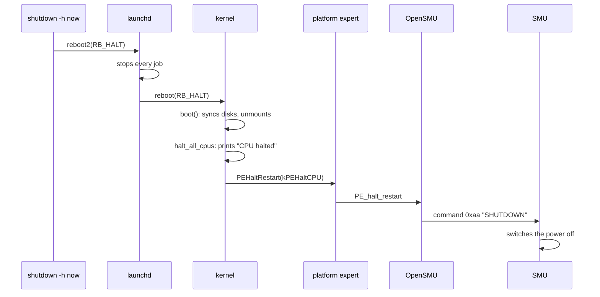

# Step 5: the clock, restart and power-off

## What you will learn

- Why a computer keeps time while it is switched off, and how Darwin's kernel reads that time on a PowerPC Mac.
- Why software cannot switch a computer off by itself, and whom the kernel asks instead.
- What happened on an iMac G5 (`PowerMac12,1`) while no driver answered: a 30-second wait at boot, a clock set to 1970, and a machine that would not switch off.
- How OpenSMU, the project's own driver, talks to the iMac's system management unit to read and set the clock, restart and power off.
- How the step was proved, with Leopard reading back the time that Darwin 9 had written.

## The goal

README.md sets it as: "`reboot` restarts the machine, `shutdown -h now` switches it off, and the clock is read from the hardware at boot."

By Step 4 the image did everything else a small Unix system does, but it could do none of these three things, on the iMac or in QEMU. They have one cause: the chip that does all three has no open driver.

## Background: clocks, power and the SMU

### Keeping time with the power off

A running kernel keeps time with the processor's own timers, which count while the machine runs and stop when it stops. To know the date at boot, a computer has a second clock, the real-time clock, which keeps counting on a battery or on the standby power that a plugged-in machine always has. The kernel reads the real-time clock once at boot, and writes to it when the time is set, by `date` or by NTP, so that the next boot starts from the right time.

### Switching off

A program cannot cut its own power: the moment it did, it would stop. A computer therefore has a small part that stays powered while the machine is "off", watches the power button, and switches the power supply on and off. To restart or power off, the kernel finishes its work, then asks that part to switch the power off, or off and on again.

### The SMU

On the iMac, both jobs belong to the SMU, the system management unit: a small processor on the logic board, with its own firmware, that keeps the real-time clock, switches the power, and also reads temperature sensors and drives the fans ([Step 7](step-7-fans.md)). Many earlier PowerPC Macs, and QEMU's `mac99`, have a PMU instead, an older chip for the same jobs; [PowerPC Macs](../background/powerpc-macs.md) says which Mac has which.

The kernel talks to the SMU through a driver, as it does to any device ([Hardware and boot basics](../background/hardware-basics.md)). Leopard's driver for it, AppleSMU, is closed: Leopard ships it as a binary, and Apple never published its source. The project's rule 5 keeps every Apple binary off the image, so until this step the image had no driver for the SMU at all.

## Before: a kernel with no one to ask

### Two empty hooks

xnu does not know how a given Mac reads its clock or switches off. It leaves both to the platform expert, the part of the kernel that knows the machine's model, and the platform expert in turn leaves them to whichever driver handles the clock and power chip. The link is two function pointers in the kernel, `PE_read_write_time_of_day` and `PE_halt_restart`, which start empty; the driver fills them in when it starts. On Leopard, AppleSMU fills them. On the image, nothing did.

### The clock

At boot, the kernel asks ApplePlatformExpert, its platform expert for Apple's PowerPC Macs, for the time. ApplePlatformExpert first waits for an IOKit resource named `IORTC`, a name that the clock's driver publishes once it is ready, and gives up after 30 seconds (its comment says 15, its code says 30). Only then does it call `PE_read_write_time_of_day`.

Without a driver, the first boot of the iMac waited those 30 seconds and logged:

```text
ApplePlatformExpert::getGMTTimeOfDay can not provide time of day RTC did not show up
```

It then returns 0, which the kernel takes as zero seconds since the Unix epoch: the clock started at 1 January 1970. In Step 4, ntpd corrected it about four and a half minutes after boot with `ntpd[23]: time reset +1795261981.720796 s`, a jump of nearly 57 years, and the clock forgot it again at the next boot, since nothing could write it to the hardware.

### Restart and power-off

`reboot` and `shutdown -h now` both end in the kernel. Both hand the shutdown to launchd through `reboot2()`; launchd stops every job and makes the `reboot` system call. In the kernel, `boot()` syncs the disks, unmounts the file systems and calls Mach's `host_reboot`, which ends in `halt_all_cpus`, in `osfmk/ppc/model_dep.c` of xnu-1228.15.4:

```c
void
halt_all_cpus(boolean_t	reboot)
{
	if(reboot)
	{
		printf("MACH Reboot\n");
		PEHaltRestart(kPERestartCPU);
	}
	else
	{
		printf("CPU halted\n");
		PEHaltRestart(kPEHaltCPU);
	} 
	while(1);
}
```

`PEHaltRestart` calls `PE_halt_restart` if a driver has set it. If not, it returns at once, and the kernel loops forever in `while(1);`, with the machine still switched on. That is what the iMac did: `reboot` printed `syncing disks... Killing all processes`, then `continuing`, `done` and `MACH Reboot`, and `halt` stopped at `CPU halted`. The USB driver, still running, then repeated `USBF: 328.700 OHCI driver: OHCIRootHubPortPower bit not sticking (0). Retrying.` until the iMac was switched off by hand.



Before this step, the arrow from the platform expert to OpenSMU did not exist, and the story stopped at `CPU halted`.

## OpenSMU: an open driver for the SMU

Since AppleSMU has no source, the project wrote its own driver, OpenSMU, a new kext in [replacements/OpenSMU/](https://github.com/nyg/PowerDarwin/blob/master/replacements/OpenSMU/) under the MIT licence, recorded as [D81](https://github.com/nyg/PowerDarwin/blob/master/DEVIATIONS.md#d81). For Step 5 it does three things, in [OpenSMU.cpp](https://github.com/nyg/PowerDarwin/blob/master/replacements/OpenSMU/OpenSMU.cpp): it sends commands to the SMU, fills in the kernel's two hooks, and publishes `IORTC`.

The SMU's commands are not documented by Apple. They are known from NetBSD's driver for the same chip, [`smu.c`](https://github.com/NetBSD/src/blob/trunk/sys/arch/macppc/dev/smu.c), under the BSD licence; OpenSMU speaks the same protocol, and no code comes from it.

### Finding the SMU

IOKit builds its tree of devices from the device tree that Open Firmware hands the kernel, and the SMU appears there as a node named `smu`. OpenSMU's [Info.plist](https://github.com/nyg/PowerDarwin/blob/master/replacements/OpenSMU/Info.plist) asks IOKit to start it on that node (`IONameMatch` `smu`), as AppleSMU's does. Its `OSBundleRequired` is `Root`, so the driver is in the driver cache and starts at boot, before the kernel first asks for the time.

### Talking to the SMU

The SMU does not have registers that the kernel writes a command into. Instead, the kernel leaves the command in memory, tells the SMU where it is, and rings a bell; the SMU reads the command from memory by itself, a form of DMA, writes its reply over it, and signals that it is done. OpenSMU keeps one page of memory for its commands, laid out like this:

| Byte | Sent | Reply |
|---|---|---|
| 0 | the command, such as `0x8e` for the clock | the command with every bit inverted, `0x71` for `0x8e` |
| 1 | the length of the data that follows | the length of the reply's data |
| 2 on | the data | the reply's data |

The device tree tells a driver how to tell the SMU where the page is and how to ring: the `smu` node names three platform functions, operations that other drivers perform on hardware they own. `platform-doorbell-buff` hands the SMU the page's address, and our AppleK2, the driver of the I/O controller, performs it; `platform-doorbell-req` rings the doorbell, a GPIO line to the SMU, which our AppleGPIO performs; `platform-doorbell-ack` says whether the reply is there. Each function's full name ends with the node's phandle, Open Firmware's number for the node, such as `platform-doorbell-buff-` followed by eight hex digits. The driver that performs a function publishes that name as an IOKit resource, so OpenSMU waits for each of the three, up to 30 seconds, and keeps the driver that published it.

Sending a command, in `OpenSMU::sendCommand`, then takes these steps:

1. Write the command, its length and its data into the page.
2. Flush the page from the processor's cache. The processor keeps recent writes in its cache, and the SMU reads memory, not the cache, so without the flush it could read an old command.
3. Call `platform-doorbell-buff` with the page's physical address, the address in the memory chips that a device sees. It goes to the SMU as a 32-bit number, so at start OpenSMU checks that the page lies below 4 GB.
4. Call `platform-doorbell-req` to ring.
5. Call `platform-doorbell-ack` every 100 microseconds until it says the reply is there, for at most 2 seconds. This is polling: the driver asks again and again instead of waiting for an interrupt.
6. Flush the page from the cache again, so that the processor reads the SMU's reply and not its own stale copy.
7. Check that byte 0 holds the command with its bits inverted, and that the reply is as long as expected; then copy the reply out.

A lock keeps two commands from using the page at once. When OpenSMU starts, it logs the page's address, such as `OpenSMU: command buffer at 0x0627f000`.

### Reading and setting the clock

The clock is command `0x8e`. With `0x81` as its data it returns the date; with `0x80` followed by a date it sets the clock. The SMU keeps the date as seven bytes in BCD, binary-coded decimal, where each decimal digit takes four bits, so that 59 is stored as the byte `0x59`. For Saturday 21 November 2026 at 12:00:00, the day Step 5 was reached, the bytes are:

| Seconds | Minutes | Hours | Day of week | Day | Month | Year |
|---|---|---|---|---|---|---|
| `0x00` | `0x00` | `0x12` | `0x06` | `0x21` | `0x11` | `0x26` |

The year is two digits from 2000, and the day of the week counts from Sunday as 0.

ApplePlatformExpert does not want those seven bytes. It wants the time as one number of seconds since 1 January 1904, the epoch of the classic Mac OS, in local time, as Macs have kept their hardware clock since before Mac OS X. It then subtracts the time-zone offset, which it reads from XPRAM, a small area of NVRAM kept from the classic Mac OS, and the 2,082,844,800 seconds from 1904 to 1970, to get Unix time. So `readWriteTimeOfDay`, the function OpenSMU puts in `PE_read_write_time_of_day`, converts between the two forms: the date to a count of days since 1904, then to seconds, and back. The day count uses the public-domain [date algorithms](https://howardhinnant.github.io/date_algorithms.html) of Howard Hinnant.

One oddity: the kernel passes that number as a signed 32-bit `long`, which can count up to about 68 years, so seconds since 1904 have not fitted in it since 1972. It works anyway, because ApplePlatformExpert only adds and subtracts offsets, and those wrap around in the same way as they overflow; OpenSMU treats the number as unsigned.

Because the hardware clock holds local time with Leopard's own offset from XPRAM, Darwin 9 and Leopard read the same clock in the same way: what one writes, the other reads back.

### Restart and power-off

The power is command `0xaa`, with the text `RESTART` or `SHUTDOWN` as its data. `haltRestart`, the function OpenSMU puts in `PE_halt_restart`, sends `SHUTDOWN` when the kernel asks to halt (`kPEHaltCPU`) and `RESTART` when it asks to restart (`kPERestartCPU`).

### Publishing `IORTC`

Once the hooks are set, OpenSMU publishes `IORTC`, and ApplePlatformExpert's wait ends at once. It also publishes a second resource, `IOPMU`, which the iMac's processor driver waits for; that came later, in [Step 8](step-8-clean-boot.md).

### Building it

OpenSMU is built like Apple's kexts, by darwinbuild, from a [Makefile](https://github.com/nyg/PowerDarwin/blob/master/replacements/OpenSMU/Makefile) with the flags Xcode gives Apple's kexts. An entry in [manifest/plists/9A581.plist](https://github.com/nyg/PowerDarwin/blob/master/manifest/plists/9A581.plist) gives it xnu's headers and `libkmod.a` as dependencies, and `scripts/stage-sources` stages its source from `replacements/` instead of from Apple. It builds in 1 to 6 seconds. Before it went on the image, Leopard's `kextload -n`, which links a kext against the running kernel without loading it, linked it against Leopard's 10.5.8 kernel, the same xnu version as ours: every kernel symbol it calls exists.

## How it was proved

QEMU's `mac99` has no SMU, so OpenSMU has nothing to start on there, and the step was tested on the iMac only, in the seventh boot test on the iMac G5.

1. The image, now with `OpenSMU.kext`, was restored onto the iMac's `Darwin9` partition and chosen in the Startup Manager. OpenSMU loaded (`OpenSMU: command buffer at 0x0627f000`), and the kernel no longer waited 30 seconds for the clock.
2. Two minutes after boot, before ntpd had set anything, `date` was 1 second off another Mac's clock: the time came from the hardware.
3. `ntpdate -u -b time.euro.apple.com` stepped the clock by 1.9 seconds, and the kernel wrote the new time to the SMU through OpenSMU.
4. `reboot` restarted the iMac, which started Leopard, its default system, 35 seconds later. Leopard's own `ntpdate` failed at boot (`no servers can be used`), so its clock came only from the hardware, read by Apple's AppleSMU from what OpenSMU had written: it matched the other Mac's to the second.
5. Started again from the Startup Manager, Darwin 9 read the clock 1 second off again.
6. `shutdown -h now` switched the iMac off, as seen at the machine, and it stopped answering ping 33 seconds later.

The image held 12,165 files, all from the project's builds except the eight that `make-test-image` writes or edits, as in Step 4. Step 5 was reached on the iMac.

## What is still missing

- OpenSMU replaces only what the image needs from AppleSMU. It does not put the machine to sleep or wake it, and does not publish the nubs that AppleSMU gives other drivers for the fans, the sensors and the SMU's own I²C buses. The fans came in [Step 7](step-7-fans.md).
- Macs with a PMU, QEMU's `mac99` among them, had no driver for it, since Apple's ApplePMU is closed too. In QEMU, the clock started at 1970, `reboot` stopped at `MACH Reboot`, and the processor driver waited for ApplePMU, as [Step 8](step-8-clean-boot.md) explains, until OpenPMU, the PMU's counterpart of OpenSMU, came in [Step 11](step-11-pmu.md).

## Where to look

- [replacements/OpenSMU/](https://github.com/nyg/PowerDarwin/blob/master/replacements/OpenSMU/): [OpenSMU.cpp](https://github.com/nyg/PowerDarwin/blob/master/replacements/OpenSMU/OpenSMU.cpp) (commands, clock, power), [Info.plist](https://github.com/nyg/PowerDarwin/blob/master/replacements/OpenSMU/Info.plist), [Makefile](https://github.com/nyg/PowerDarwin/blob/master/replacements/OpenSMU/Makefile), [LICENSE](https://github.com/nyg/PowerDarwin/blob/master/replacements/OpenSMU/LICENSE).
- [D81](https://github.com/nyg/PowerDarwin/blob/master/DEVIATIONS.md#d81), OpenSMU's row in DEVIATIONS.md.
- [RESOURCES.md](https://github.com/nyg/PowerDarwin/blob/master/RESOURCES.md): NetBSD's `smu.c`, Linux's `smu.c`, and Howard Hinnant's date algorithms.
- In xnu-1228.15.4: `iokit/Drivers/platform/drvApplePlatformExpert/ApplePlatformExpert.cpp` (the clock and the wait for `IORTC`), `iokit/Kernel/IOPlatformExpert.cpp` (`PE_halt_restart`), `osfmk/ppc/model_dep.c` (`halt_all_cpus`), `bsd/kern/kern_shutdown.c` (`boot()`).
- In system_cmds-433.8: `shutdown.tproj/shutdown.c` and `reboot.tproj/reboot.c`.
- Commit `46f349e`, which reached the step.
- [OpenSMU](../synthesis/opensmu.md), for the whole driver, fans included.
