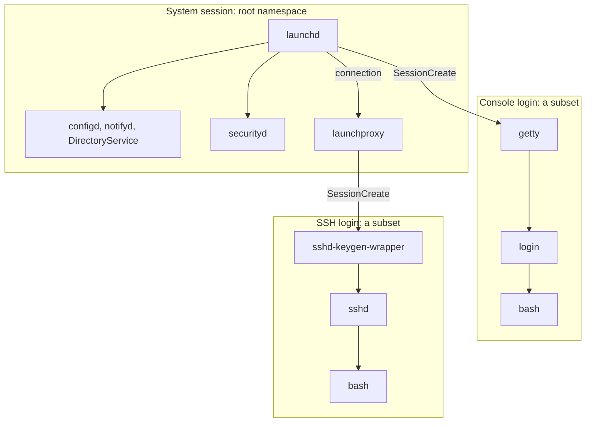
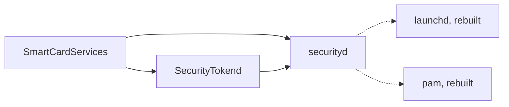

# Step 6: securityd and security sessions

## What you will learn

- How a process on Darwin finds a daemon by name, and how launchd gives each login a namespace of its own.
- What a security session is, and what securityd keeps in one.
- How `SessionCreate`, launchproxy and `pam_launchd` give each SSH and console login its own session.
- How building securityd, with SecurityTokend and SmartCardServices, let the project drop two deviations, D26 and D45.
- Why the smart-card reader drivers that SmartCardServices' source carries stay off the image.

## The goal

README.md sets it as: "securityd runs: SSH and console logins get their own security session, and launchctl and login use Security as Apple built them."

Security, the framework of Apple's security calls, was built in [Step 3](step-3-security-and-daemons.md), but securityd, the daemon it talks to, was not. Two workarounds stood in the way of using Security as Apple built it: `launchctl` was built without it ([D26](https://github.com/nyg/PowerDarwin/blob/master/DEVIATIONS.md#d26)), and the console login made `pam_launchd` optional ([D45](https://github.com/nyg/PowerDarwin/blob/master/DEVIATIONS.md#d45)). Logins on an iMac G5 (`PowerMac12,1`) worked, but each SSH connection logged:

```text
launchproxy[86]: /usr/libexec/sshd-keygen-wrapper: SessionCreate() failed: 226
```

Step 6 builds securityd and removes both workarounds.

## Background: names, namespaces and sessions

### Finding a daemon by name

On Darwin, programs talk to daemons by Mach messages, sent to ports ([What Darwin is](../background/what-darwin-is.md)). A client finds a daemon's port by name: it asks the bootstrap server, which on Darwin 9 is launchd, to look up a name such as `com.apple.SecurityServer`, through the bootstrap port that every process inherits from its parent. launchd also holds the names of jobs that have not started yet, and starts a job when a client first uses its name. securityd's job, `com.apple.SecurityServer` (the file `com.apple.securityd.plist`), names that service and also asks launchd to start it at boot.

### Namespaces

The names a process can look up form its bootstrap namespace. launchd's root namespace, which it calls the System session, holds the names of the system's daemons. A process can ask for a subset: a child namespace that sees every name of its parent, while names registered in the subset are seen only by the processes in it. Children inherit their parent's namespace, so a whole login, from its shell to every program started from it, shares one.

launchd gives each namespace a type, from launchd-258.25's `vproc_priv.h`: `System`, `Background`, `LoginWindow`, `Aqua` and `StandardIO`. A login at a terminal or over SSH is a `StandardIO` session.

### Security sessions

securityd, the Security Server, holds the state that Security's calls share between processes: keychains and whether they are unlocked, authorisation rights once granted, and smart-card tokens. It keeps that state per security session, and it ties each security session to a bootstrap namespace: one `RootSession` for launchd's root namespace, and a `DynamicSession` for each subset that asks for one (securityd-36489, `src/session.h`). So what one login unlocks stays in that login.

### `SessionCreate`

A process gets both at once from Security's `SessionCreate()`. In libsecurity_authorization-32564, `lib/Authorization.cpp`, it does three things:

```cpp
    Bootstrap bootstrap;
    if (!(flags & sessionKeepCurrentBootstrap)) {
		TaskPort self;
		bootstrap = bootstrap.subset(TaskPort());
		self.bootstrap(bootstrap);
		::bootstrap_port = bootstrap;		// update libc global
    }
    
    // now call the SecurityServer and tell it to initialize the (new) session
    server().setupSession(flags, attributes);
```

It makes a subset and moves the process into it, asks securityd to set up a security session for that subset, and finally puts the session's number in the environment variable `SECURITYSESSIONID`.

Three programs call it at login:

- launchd, for a job whose file sets the `SessionCreate` key, in the child it forks before it starts the job (launchd-258.25, `launchd_core_logic.c`). system_cmds' `com.apple.getty`, the job that runs `getty` on the console, sets it.
- launchproxy, for each connection to a job that launchd runs in the way of inetd, one program per connection. OpenSSH's `com.openssh.sshd` is such a job, with `inetdCompatibility` and `SessionCreate`, so launchproxy calls `SessionCreate` in the child it forks for each SSH connection, before it starts `sshd-keygen-wrapper` and through it `sshd`.
- launchctl, when it sets up a `Background` session.

### `pam_launchd`

The last step of a login is PAM's session phase ([Step 2](step-2-console-login.md)). Its `pam_launchd` module tells launchd that the login's namespace is now a user's session. For root, it asks launchd to make the namespace a `StandardIO` session (`_vprocmgr_move_subset_to_user` in launchd-258.25's `libvproc.c`; for any other user it hands the namespace to that user's own launchd). launchd does this for a fresh subset. It refuses for its root namespace, which is already the System session, and the module then fails.



Each login's subset has its own security session in securityd, beside the root session of the System session. Before this step, the two login boxes worked differently, as the next section tells.

## Before: two workarounds and a failing call

### launchctl without Security (D26)

launchctl, launchd's command-line tool, links Security for one call: `SessionCreate`, made when it sets up a `Background` session. In [Step 1](step-1-kernel-and-userland.md), long before Security was built, a volume holding only our builds had no Security.framework, and launchctl could not start. [D26](https://github.com/nyg/PowerDarwin/blob/master/DEVIATIONS.md#d26) built it with `HAVE_SECURITY=0` and without linking the framework. `launchd` and `launchproxy` were left as Apple built them.

### The console login (D45)

In [Step 2](step-2-console-login.md), Security.framework was not on the image either, so launchd could not call `SessionCreate` for getty, and getty and login stayed in launchd's System session. At the end of the login, `pam_launchd` asked launchd to make that namespace a `StandardIO` session, launchd refused, and login exited with:

```text
login: PAM Error (line 400): Cannot make/remove an entry for the specified session
```

That message is PAM's text for `PAM_SESSION_ERR`. [D45](https://github.com/nyg/PowerDarwin/blob/master/DEVIATIONS.md#d45) made `pam_launchd` `optional` instead of `required` in `pam.d/login`, and the login shell stayed in the System session. Both D26 and D45 were marked to be dropped once Security and securityd were built.

### SSH logins

launchproxy, unchanged, called `SessionCreate` for each SSH connection. The function made its subset, then looked up securityd's name, `com.apple.SecurityServer`, and launchd had no such service, as the image had no securityd. Security turns that failed lookup into the error `0xE2`, 226 in decimal, `CSSM_ERRCODE_SERVICE_NOT_AVAILABLE` (libsecurity_cdsa_utilities-33506, `lib/cssmerrors.cpp`; libsecurity_cssm-32993, `lib/cssmapple.h`): hence the `SessionCreate() failed: 226` of every connection. Since the subset was made before that call failed, `pam_launchd`, which `pam.d/sshd` lists as `required`, still found a fresh namespace, and SSH logins worked from [Step 3](step-3-network-and-ssh.md) on, without a security session.

## What was built

securityd watches for smart cards, so it links the projects that read them. Five projects were built in this order:



- SmartCardServices 34733 is PC/SC, the standard interface to smart-card readers: `PCSC.framework`, the `pcscd` daemon, `pcsctool`, `pcsctest`, four card plug-ins and `pkcs11.bundle`. Its headers were built first, with `darwinbuild -headers`, for the projects after it.
- SecurityTokend 32363 is the library of tokend, the daemons that present a smart card to securityd as a keychain.
- securityd 36489 is the daemon itself.
- launchd 258.25 was rebuilt without D26, still with `-target=embedded` ([D21](https://github.com/nyg/PowerDarwin/blob/master/DEVIATIONS.md#d21)), so that `launchctl` and `launchproxy` link Security.
- pam 32.1 was rebuilt without D45, so that `pam.d/login` lists `pam_launchd` as `required`, as Apple ships it.

The dotted arrows into launchd and pam are not build dependencies: those rebuilds only make sense once securityd runs.

## What broke, and how it was fixed

### Missing dependencies (D48)

The build list gives most of Security's projects too few dependencies, and [D48](https://github.com/nyg/PowerDarwin/blob/master/DEVIATIONS.md#d48) already gave Security's 32 parts theirs in [Step 3](step-3-security-and-daemons.md). Without the frameworks they link, SecurityTokend and securityd stop at `ld: framework not found PCSC`. D48 grew to give SecurityTokend build dependencies on CF, Security and SmartCardServices, and securityd on CF, IOKitUser, Security and SmartCardServices, in [manifest/plists/9A581.plist](https://github.com/nyg/PowerDarwin/blob/master/manifest/plists/9A581.plist). SecurityTokend then built in 1 minute 57 seconds.

### A tool Xcode's copy lacked (D82)

securityd compiled and linked for 10 minutes 39 seconds, then failed:

```text
/bin/sh: line 1: /XCD/loper/usr/bin/nmedit: No such file or directory
```

securityd's Xcode target has an exports file, `src/securityd.exp`, which lists the only symbols the finished program should keep visible. Xcode's older targets, built by Jam, the build tool Xcode used before its own, enforce that list after linking by running `nmedit`, a cctools tool that edits a binary's symbol table.

darwinbuild puts its own copy of Xcode 3.1.4 in the build environment, with `/Developer` rewritten to `/XCD/loper` ([D25](https://github.com/nyg/PowerDarwin/blob/master/DEVIATIONS.md#d25)), and links `strip`, `libtool`, `mig` and other tools from there to the build environment's `/usr/bin`. It does not link `nmedit`.

The fix is in the build environment, rule 2's first choice ([The rules](../method/rules.md)): [D82](https://github.com/nyg/PowerDarwin/blob/master/DEVIATIONS.md#d82), a step of [scripts/prepare-buildroot](https://github.com/nyg/PowerDarwin/blob/master/scripts/prepare-buildroot), links `/XCD/loper/usr/bin/nmedit` to `/usr/bin/nmedit`, which the build list's cctools 667.3 Root installs. securityd then built in 10 minutes 37 seconds, and its `ppc` slice imports the same 354 symbols as Leopard's `securityd`.

### Prebuilt drivers in a source (rule 5)

SmartCardServices' install phase does not only install what it builds. It also copies binaries that its source tarball carries ready-made: three kexts (`CM4040.kext`, `CRYPTOCardPCCard.kext` and `SCR24X_Apple_Driver.kext`), four reader bundles in `/usr/libexec/SmartCardServices/drivers/`, and `pkcs11.shlb`. They are vendors' drivers for particular card readers, and no source for them is published.

Rule 5 had said only that the image holds no Apple binary. Commit `4ac9c86` widened it to what it says now: "The image holds only what is built from open source or written by this repo's scripts: no Apple binary, and no prebuilt binary that a source carries." `make-test-image` removes the three kexts, the reader bundles and `pkcs11.shlb` from the image.

### Dropping D26 and D45

With securityd built, both workarounds were removed: their patches were deleted, and their rows in DEVIATIONS.md were marked `dropped`, keeping their IDs, which commits and this book still name.

`launchctl` now links Security as Apple built it. The console login now runs as Apple designed it:

1. launchd starts getty from `com.apple.getty`, whose `SessionCreate` key makes it load Security and call `SessionCreate()` in the child it forks. getty starts in a fresh subset, with its own security session in securityd.
2. getty runs `login`, which checks the password through PAM.
3. `pam_launchd`, `required` again, makes the subset a `StandardIO` session, and the shell starts in it.

## How it was proved

In QEMU's `mac99`, in the fifth multi-user boot test, [scripts/make-test-image](https://github.com/nyg/PowerDarwin/blob/master/scripts/make-test-image) copied the Roots of launchd, SmartCardServices, SecurityTokend and securityd into the image and removed the prebuilt reader drivers. launchd started securityd from its job `com.apple.SecurityServer` at boot, and it stayed up. Root logged in over SSH, and no `SessionCreate() failed` was logged. On the console, root logged in with `pam_launchd` `required` (`ROOT LOGIN (root) ON console`), where before D45 login had stopped with `Cannot make/remove an entry for the specified session`. The image held 12,213 files, all from the project's builds except the eight that `make-test-image` writes or edits.

On the iMac, in the eighth boot test on the iMac G5, the same image was restored onto the `Darwin9` partition and chosen in the Startup Manager:

1. launchd started securityd at boot (`com.apple.SecurityServer[26]: Entering service`), and it stayed up.
2. Root logged in over SSH from another Mac several times, and `/var/log/system.log` no longer got a `SessionCreate() failed: 226` line for each connection.
3. On the console, root logged in with `pam_launchd` `required` (`USER_PROCESS: 81 console`, `ROOT LOGIN (root) ON console`).

Step 6 was reached on the iMac. Two lines remained at each login, both from parts the image lacks:

- `PAM unable to _pam_dlopen(/usr/lib/pam/pam_securityserver.so)`: `pam.d/login` and `pam.d/sshd` still list `pam_securityserver`, which needs OpenDirectory and so Apple's closed CoreFoundation, and is not built ([D42](https://github.com/nyg/PowerDarwin/blob/master/DEVIATIONS.md#d42)). [Step 8](step-8-clean-boot.md) removes it from the PAM files.
- On the console, `bootstrap_look_up(com.apple.ReportCrash) failure: Unknown service name (1102)`: no job holds the name of ReportCrash, Apple's crash reporter, which is closed.

## What is still missing

- `pam_securityserver`, and with it the account checks it makes for sshd: password-server policies, disabled accounts and the login shell ([D80](https://github.com/nyg/PowerDarwin/blob/master/DEVIATIONS.md#d80)).
- No smart-card reader works: the only drivers SmartCardServices brings are the vendors' prebuilt ones, which stay off the image.
- ReportCrash, which is closed.

## Where to look

- [D26](https://github.com/nyg/PowerDarwin/blob/master/DEVIATIONS.md#d26) and [D45](https://github.com/nyg/PowerDarwin/blob/master/DEVIATIONS.md#d45), dropped in this step; [D48](https://github.com/nyg/PowerDarwin/blob/master/DEVIATIONS.md#d48), widened; [D82](https://github.com/nyg/PowerDarwin/blob/master/DEVIATIONS.md#d82), new; [D21](https://github.com/nyg/PowerDarwin/blob/master/DEVIATIONS.md#d21), for launchd's build, and [D42](https://github.com/nyg/PowerDarwin/blob/master/DEVIATIONS.md#d42), for the `pam_securityserver` still missing.
- [scripts/prepare-buildroot](https://github.com/nyg/PowerDarwin/blob/master/scripts/prepare-buildroot) (`step_D82`), [scripts/make-test-image](https://github.com/nyg/PowerDarwin/blob/master/scripts/make-test-image) (the reader drivers), [manifest/plists/9A581.plist](https://github.com/nyg/PowerDarwin/blob/master/manifest/plists/9A581.plist) (SecurityTokend and securityd).
- In libsecurity_authorization-32564: `lib/Authorization.cpp` (`SessionCreate`). In libsecurityd-36292: `lib/ssclient.cpp` (`findSecurityd`). In libsecurity_cdsa_utilities-33506: `lib/cssmerrors.cpp` (`CssmError::cssmError`). In libsecurity_cssm-32993: `lib/cssmapple.h` (`CSSM_ERRCODE_SERVICE_NOT_AVAILABLE`). In securityd-36489: `src/session.h` and `src/session.cpp` (root and dynamic sessions), `etc/com.apple.securityd.plist` (the job). In launchd-258.25: `launchd/src/launchd.c` and `launchd_core_logic.c` (the `SessionCreate` key), `launchproxy.c`, `launchctl.c`, `libvproc.c` (`_vprocmgr_move_subset_to_user`), `vproc_priv.h` (session types). In pam_modules-36.2: `pam_launchd/pam_launchd.c`. In system_cmds-433.8: `getty.tproj/com.apple.getty.plist`. In OpenSSH-95.1.5: `launchd-ssh.plist`. In SmartCardServices-34733: `installPhase/`.
- Commits `daa71f9`, which defined the step, `a4d892a`, which reached it, and `4ac9c86`, which widened rule 5.
