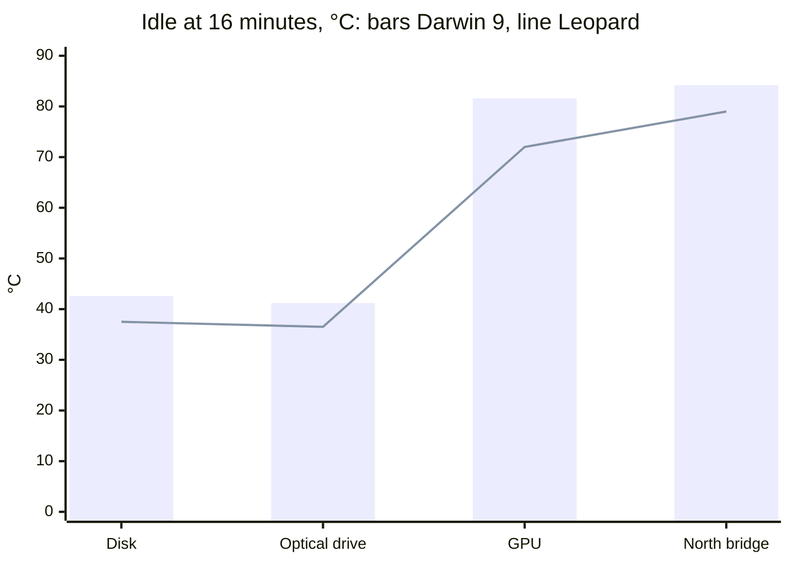

# Step 7: fan control

## What you will learn

- Why an iMac G5 (`PowerMac12,1`) was loud under Darwin 9: when no driver sets the fans, the SMU's own firmware runs them.
- What Leopard uses instead, and the source Apple published for the same fans before Leopard.
- How OpenSMU reads five temperature sensors, one through the SMU and four over I²C, and sets three fans from them in zones.
- How Darwin 9 compared with Leopard at idle and under load, and why the GPU and north bridge ran warmer, until [Step 13](step-13-gpu-idle-heat.md).
- How a calibration that was not where Leopard shows it, and readings half a degree too fine, were found and fixed.

## The goal

README.md sets it as: "OpenSMU drives the fans from the SMU's temperature sensors, and the machine is as quiet at idle as under Leopard."

"As quiet" was checked in two ways: by ear at the machine, and by the fans' speeds against Leopard's, read on the same iMac on the same day.

## Background: heat, sensors and fans

### Thermal control

The iMac holds its processor, graphics chip, disk and optical drive behind the screen, in one case, with three fans. The device tree names them by where they sit: `CPU Fan`, `HDD Fan` and `ODD Fan`, the last for the optical disc drive. A fan that turns faster cools better and is louder, so thermal control reads the temperatures and runs each fan as slowly as they allow.

### The SMU's own control

The fans belong to the SMU, the system management unit that [Step 5](step-5-clock-and-power.md) introduced: the small processor on the logic board that also keeps the clock and switches the power. A driver tells the SMU how fast to turn each fan. When no driver does, the SMU's firmware runs them by its own rules, which are loud. Under Darwin 9, until this step, that is what the iMac did.

### What Leopard does

On Leopard, AppleSMU talks to the SMU, and a platform plug-in, `PowerMac12_1_PlatformPlugin` with `SMU_Neo2_PlatformPlugin` in `IOPlatformPluginFamily`, decides the fans' speeds. It reads the disk, optical drive, GPU and north bridge through `IOI2CLM7x` and `IOI2CMaxim6690`, Apple's open drivers for those chips in AppleHWSensor. AppleSMU and Leopard's plug-ins, version 3.4.0, are closed. The `PlatformPlugin-README` in Leopard's AppleMacRISC4PE says that the plug-ins moved out of that project in November 2005, to a project of their own, which is not among Apple's published sources.

The versions before that are published. AppleMacRISC4PE 180.0.34, 185.0.0 and 186.3.1, older than Leopard's first version, 202.0.9, hold this iMac's plug-in, `PowerMac12_1PlatformPlugin`, and its thermal profile, `PowerMac12_1_ThermalProfile` 1.8.6f1, under the APSL. Linux's driver for this model, `windfarm_pm121.c`, says it uses the values of those files. The profile tells the plug-in, for each of two models, the 17-inch and the 20-inch iMac G5, which sensor drives which fan, and how:

- Each fan follows a control loop that speeds the fan up while its sensor is above a target temperature, and slows it down below. The targets are 55 °C for the disk, 50 °C for the optical drive, 85 °C for the north bridge, and for the GPU 90 °C on the 17-inch model and 80 °C on the 20-inch. The CPU's loop aims at the processor's highest allowed temperature, `cpu-tmax`, less a margin, `input-target-delta`, both from the SMU's own data: Leopard's IORegistry shows 85 °C and 5 °C on the iMac, so its target is 80 °C.
- On the 17-inch model, the disk and the GPU drive the HDD fan, the optical drive and the north bridge the ODD fan, and the CPU the CPU fan. The CPU fan's target also never falls more than 500 rpm below the ODD fan's, a rule the profile calls a rubber band. The 20-inch model pairs the GPU with the CPU fan and the north bridge with the HDD fan, and keeps the ODD fan no more than 500 rpm below the HDD fan in the same way.
- Every fan's lowest speed rises with the power the processor draws: on the 17-inch model, by about 30, 24 and 39 rpm for each watt above 10 W, for the ODD, HDD and CPU fans.

OpenSMU takes no code from these files. Its zones, below, are simpler than Apple's loops, and are built around the profile's numbers.

### Five sensors

- The CPU diode, a diode on the processor chip whose voltage changes with its temperature. The SMU's ADC, its analog-to-digital converter, turns the voltage into a number, and a slope and an offset that the SMU keeps in its own data turn the number into degrees.
- The disk and the optical drive, each measured by an LM75, a small temperature-sensor chip.
- The GPU and the north bridge, the U4, each measured by a MAX6690, a chip of the same kind.

The four chips sit on an I²C bus of the U4. I²C is a slow bus of two wires, a clock and a data line, on which a controller reads and writes small chips by their address ([Hardware and boot basics](../background/hardware-basics.md)). Our IOI2CFamily drives the U4's I²C controller, through its `IOI2CControllerPPC`.

The device tree describes all five, as nodes of type `temp-sensor` with a `location` such as `CPU T-Diode` or `HD Temp`, and the three fans, under the `smu` node, with each fan's register in the SMU and its minimum and maximum speed.

## OpenSMU's fan loop

OpenSMU is the project's driver for the SMU ([D81](https://github.com/nyg/PowerDarwin/blob/master/DEVIATIONS.md#d81)). Step 5 gave it the clock, restart and power-off. Step 7 adds [FanControl.cpp](https://github.com/nyg/PowerDarwin/blob/master/replacements/OpenSMU/FanControl.cpp), started at the end of OpenSMU's `start`. This chapter tells the loop at the level the step needs; [OpenSMU](../synthesis/opensmu.md) gives the commands, the register formats and the arithmetic.

### Starting

`startFanControl` first reads the thermal model from the SMU, the number that tells the 17-inch model from the 20-inch, and checks that the machine is a `PowerMac12,1` of thermal model 2, the 17-inch, the only one whose zones it knows. It then reads the CPU diode's calibration from the SMU, finds the fans in the device tree and checks that every fan the zones and the rubber band name is there. If any of this fails, it logs why and leaves the fans to the SMU's firmware, and the machine stays loud. Otherwise it logs the thermal model, how many fans and zones it found, with the diode's slope and offset, and starts a kernel thread.

### Every 2 seconds

The thread runs the same pass every 2 seconds:

1. Find each zone's sensor in the device tree, if it has not been found yet. The I²C sensors appear only once IOI2CFamily has started, so this can take a few passes.
2. Read each sensor: the CPU diode through the SMU's ADC (command `0xd8`), the four chips over I²C through IOI2CFamily, with the registers and scaling of `IOI2CLM7x` and `IOI2CMaxim6690`, Apple's open drivers for those chips in AppleHWSensor.
3. Work out each fan's speed from the zones and the rubber band below.
4. Set each fan's speed through the SMU (command `0x4a`), and read its speed back.
5. Publish the readings in the IORegistry as `Sensors`, `Fans` and `Failsafe`.

### Zones

A zone ties one sensor to one fan, with two temperatures. Below the lower one, the zone asks for its fan's minimum speed; above the upper one, its maximum; in between, a speed in proportion. A fan in several zones runs at the highest speed any of them asks for. Zones work this way in NetBSD's drivers for the same Macs, `smu.c` and `fancontrol.c`, under the BSD licence; no code comes from them. In the version Step 7 tested, a zone could drive several fans, and OpenSMU's pairs were those of the profile's 17-inch model, except that the optical drive's and the north bridge's zones drove the CPU fan too, where the profile has only the rubber band. The zones' temperatures are OpenSMU's own, as no Apple source gives any: three lie 5 °C either side of the profile's target, the north bridge's starts at it, and the CPU's ends at it:

| Sensor | Fans in Step 7 | Fans now | Zone | Apple's target |
|---|---|---|---|---|
| CPU diode (`CPU T-Diode`) | CPU | CPU | 65 to 80 °C | 80 °C |
| Disk (`HD Temp`) | HDD | HDD | 50 to 60 °C | 55 °C |
| GPU (`GPU Temp`) | HDD | HDD | 85 to 95 °C | 90 °C |
| Optical drive (`ODD Temp`) | ODD, CPU | ODD | 45 to 55 °C | 50 °C |
| North bridge (`NB Temp`) | ODD, CPU | ODD | 85 to 95 °C | 85 °C |

After the tests below, OpenSMU came closer to the profile. The optical drive and the north bridge now drive only the ODD fan, and the CPU fan's target is never set more than 500 rpm below the ODD fan's, as the rubber band does. OpenSMU also reads the byte that tells the two models apart, as Apple's plug-in does: byte 4 of the SMU's SDB partition `0x25`, 2 for the 17-inch and 3 for the 20-inch. It drives the fans only on model 2, and leaves them to the SMU on the other.

### The fail-safe

Fans that turn too slowly can harm the machine, so OpenSMU errs towards noise. If a sensor is still not found 60 seconds after start, if it cannot be read, or if it reads 5 °C above its zone's upper temperature, every fan runs at full speed, and `Failsafe` turns true, until the fault clears.

### Reading it

To read those properties on the image, the project built IOKitTools 76, in 10 seconds, for `ioreg` and two smaller tools. `ioreg -c OpenSMU` prints the driver's entry, with every sensor's temperature and every fan's target and current speed.

## What broke, and how it was fixed

The fan loop took five builds of OpenSMU and three boots of the iMac. Every change went into D81, the step's only deviation, whose row grew a fan part.

### Building it

- OpenSMU includes `IOI2CDefs.h` for its I²C commands. IOI2CFamily installs that header only in its private `IOI2C.framework`, so OpenSMU gained a build dependency on IOI2CFamily in [manifest/plists/9A581.plist](https://github.com/nyg/PowerDarwin/blob/master/manifest/plists/9A581.plist), and its [Makefile](https://github.com/nyg/PowerDarwin/blob/master/replacements/OpenSMU/Makefile) an include path.
- The first build linked, but Leopard's `kextload -n`, which links a kext against the running kernel without loading it, refused it: `kld(): Undefined symbols: _strlcpy`. The 10.5.8 kernel declares `strlcpy` in its headers but does not export it to kexts. The fans' locations are now copied with `bcopy`.
- The SMU numbers its fans by register, and the loop handles four. A fan whose register is past the fourth is now skipped.

### The calibration that was not there

In the ninth boot test on the iMac G5, OpenSMU loaded and logged:

```text
OpenSMU: no CPU diode calibration, the SMU keeps the fans
```

The SMU keeps its own data in numbered blocks that NetBSD calls SDB partitions, and the CPU diode's slope and offset are in partition `0x18`. On Leopard, the IORegistry shows that partition as a property of the `smu` node, `sdb-partition-18`, and the first version of the loop read it from there. But the property is not Open Firmware's: Apple's AppleSMU copies the SDB partitions into the node when it starts. Without AppleSMU, the node has none, and the fans stayed with the SMU's firmware.

So OpenSMU now asks the SMU itself, as NetBSD's `smu.c` does: command `0x3e` returns where partition `0x18` is, and command `0xee` reads its bytes. In the tenth boot test on the iMac G5, OpenSMU logged three fans, five zones and the diode's slope and offset, the same values AppleSMU puts in Leopard's registry. Within seconds came:

```text
OpenSMU: found the 5 zone sensors, the fans follow them
```

### Half a degree too fine

The same test read the disk at 42.6 °C and the optical drive at 41.2 °C. An LM75 cannot give those numbers: it measures in steps of 0.5 °C. Its temperature register is 16 bits wide, of which only the top 9 hold the temperature; the chip leaves the low 7 bits undefined. OpenSMU had used all 16, so whatever the chip left in the low bits could put a reading up to 0.5 °C off.

AppleHWSensor's `IOI2CLM7x` masks the register with `0xFF80`, keeping the top 9 bits. Commit `d6316f8` does the same, in one line of `readSensor`:

```cpp
      sensor->temperature = (SInt16)(((data[0] << 8) | data[1]) & 0xff80) * 256;
```

One instruction of the built kext differs from the build before, and `kextload -n` links it. In the eleventh boot test on the iMac G5, 30 readings every 30 seconds, from 2 to 17 minutes after boot, gave the disk 40.5 to 43.5 °C and the optical drive 41.0 to 42.5 °C, always in steps of 0.5 °C.

## How it was proved

QEMU's `mac99` has no SMU and no fans to drive, so Step 7 was tested on the iMac only, in the tenth and eleventh boot tests on the iMac G5. The image held 12,220 files, all from the project's builds except the eight that `make-test-image` writes or edits.

### Against Leopard, at idle

Leopard was measured on the same day, idle 16 minutes after boot, with the air coming into the iMac at 25 °C, from its platform plug-in's entries in the IORegistry. Darwin 9 was read through `ioreg` at the same time after boot. The disk and optical drive readings of Darwin 9 come from the tenth test, before the LM75 fix, and so may be up to 0.5 °C off.



| At idle, 16 minutes after boot | Leopard | Darwin 9 |
|---|---|---|
| CPU | 51 to 57 °C | 54 °C |
| Disk | 37.5 °C | 42.6 °C |
| Optical drive | 36.5 °C | 41.2 °C |
| GPU | 72 °C | 81.6 °C |
| North bridge | 79 °C | 84.2 °C |
| CPU fan | 1201 rpm, target about 1310 | 1200 rpm |
| HDD fan | 1202 rpm, target about 1265 | 1200 rpm |
| ODD fan | 1000 rpm, target about 1080 | 1000 rpm |

Leopard's speeds are what its plug-in reports; Darwin 9's are read back from the SMU, within 5 rpm of what OpenSMU set.

Every Darwin 9 temperature but the CPU's is higher. On Leopard, the GPU has its closed driver, `ATIRadeon9700`; on the image no driver managed it, and it ran warmer, 81.6 °C against 72, and warmed its neighbours, the north bridge among them. [Step 13](step-13-gpu-idle-heat.md) later measured both systems again in one afternoon, once their temperatures had settled: the image's GPU was 2.9 °C warmer than Leopard's and its north bridge 1.8 °C cooler, and with OpenRadeonPM both run cooler than under Leopard. The north bridge's zone starts at 85 °C, so after 30 minutes, holding at 85.1 to 85.4 °C, it lifted the two fans it then drove just above their minimum: the ODD fan to 1050 to 1160 rpm and the CPU fan to 1240 to 1330 rpm, within about 50 rpm of Leopard's idle targets. Heard at the machine, the iMac was quiet, where the SMU's own control had been loud.

### Under load

Two `yes > /dev/null`, which keep the iMac's one processor busy, ran for 6 minutes on Darwin 9, and the same load ran on Leopard:

| Under two `yes` | Leopard | Darwin 9 |
|---|---|---|
| CPU | 66.6 °C | 68.7 °C, from 54 |
| CPU fan | target 1871 rpm | 2040 rpm, from 1330 |
| HDD fan | target 1613 rpm | not recorded |
| ODD fan | target 1516 rpm | 1000 rpm |

On Darwin 9, the CPU's zone sped up the CPU fan, which also cooled the north bridge to 83.4 °C, below its zone, so the ODD fan returned to its minimum. When the load stopped, the CPU fell to 57 °C and the CPU fan returned to 1200 rpm. No sensor read failed and no fan ran at full speed. Step 7 was reached on the iMac.

### The version after the tests

The version with the rubber band and the model check was booted in the Step 10 boot test on the iMac G5. In both boots, OpenSMU logged thermal model 2, three fans and five zones, then `found the 5 zone sensors, the fans follow them`, and never fell back to full speed or to the SMU. About 10 and 12 minutes after boot, every sensor read below its zone, the north bridge at 82.8 °C, and the three fans ran at their minimum, read back within 2 rpm. Two `yes` for 2 minutes took the CPU to 60.7 °C, below the 65 °C where its zone starts, so the CPU fan stayed at 1200 rpm.

## What is still missing

- The rubber band has not yet had to act: in that test the ODD fan's target never rose more than 500 rpm above the CPU fan's.
- The fan loop knows one machine, the 17-inch iMac G5. On the 20-inch, whose profile pairs the GPU and the north bridge with other fans and aims the GPU at 80 °C, and on any other model, OpenSMU leaves the fans to the SMU; each needs its own zones, from its own thermal profile.
- The GPU and north bridge ran warmer than under Leopard, as no driver of ours managed the GPU. OpenRadeonPM sets the GPU's idle power state since [Step 13](step-13-gpu-idle-heat.md).
- Under load, Leopard's plug-in raised all three fans' targets. Worked out from each fan's minimum and the profile's slopes, the three targets give the same processor power: the power rule, not a temperature, held them up. OpenSMU has no such rule, as it would need the processor's current and voltage, and under the same load it left its ODD fan at the minimum.
- OpenSMU publishes no `AppleSMUDevice` nubs for the fans, the sensors or the SMU's own I²C buses, so no other driver can use them.

## Where to look

- [replacements/OpenSMU/FanControl.cpp](https://github.com/nyg/PowerDarwin/blob/master/replacements/OpenSMU/FanControl.cpp) (the zones, the rubber band and the loop), [OpenSMU.h](https://github.com/nyg/PowerDarwin/blob/master/replacements/OpenSMU/OpenSMU.h), [OpenSMU.cpp](https://github.com/nyg/PowerDarwin/blob/master/replacements/OpenSMU/OpenSMU.cpp) (where the loop starts), [Makefile](https://github.com/nyg/PowerDarwin/blob/master/replacements/OpenSMU/Makefile).
- [D81](https://github.com/nyg/PowerDarwin/blob/master/DEVIATIONS.md#d81), OpenSMU's row, its fan part.
- [hardware/powermac12-1.md](https://github.com/nyg/PowerDarwin/blob/master/hardware/powermac12-1.md): the platform plug-in's row.
- [RESOURCES.md](https://github.com/nyg/PowerDarwin/blob/master/RESOURCES.md): NetBSD's `smu.c` and `fancontrol.c`.
- In AppleMacRISC4PE-186.3.1: [IOPlatformPlugins/PowerMac12_1PlatformPlugin/](https://github.com/apple-oss-distributions/AppleMacRISC4PE/tree/AppleMacRISC4PE-186.3.1/IOPlatformPlugins/PowerMac12_1PlatformPlugin), [ThermalProfiles/](https://github.com/apple-oss-distributions/AppleMacRISC4PE/tree/AppleMacRISC4PE-186.3.1/ThermalProfiles), and the profile's values in the `Info.plist` of `PowerMac12_1_ThermalProfile` inside `AppleMacRISC4PE.pbproj/project.pbxproj`. In AppleMacRISC4PE-204.0.9: `IOPlatformPlugins/PlatformPlugin-README`.
- Linux's [`drivers/macintosh/windfarm_pm121.c`](https://github.com/torvalds/linux/blob/master/drivers/macintosh/windfarm_pm121.c), the same control for Linux.
- In AppleHWSensor-190: `IOI2CLM7x.cpp` (the `0xFF80` mask) and `IOI2CMaxim6690.cpp`.
- Commits `3fe1c44`, which reached the step, and `d6316f8`, the LM75 fix.
- [OpenSMU](../synthesis/opensmu.md), for the SMU's commands, the sensors' formats, the calibration and the state of the loop.
