# Step 8: a clean boot

## What you will learn

- What a clean boot means here: a log in which every line left comes from Apple's own files, from a closed part the image lacks, or from a stand-in for one.
- Why IOKit never went quiet, and how that held the network back for 60 seconds, on an iMac G5 (`PowerMac12,1`) and still in QEMU's `mac99`.
- Why `ntpdate` failed at boot, how a fix from a later Apple release made it wait, and how a silent success was proved.
- What the time zone, BootCache, `hfs.util`, `rc.common` and a version file each needed.
- How every line left in `/var/log/system.log` was traced to its source.

## The goal

README.md sets it as: "The image boots cleanly: the network comes up without a 60-second wait, `ntpdate` sets the clock at boot, the local time zone applies, BootCache runs, and `/var/log/system.log` shows no errors."

"No errors" needs a definition, since some of the lines a boot logs come from Apple's own files and would appear on Leopard too, and some from closed parts that the image will never have. Here a boot is clean when every line left in `system.log` comes from Apple's own files, from a closed part the image lacks, or from the stand-in the project uses for a closed or unpublished part (the sandbox stub, Panther's IOATABlockStorage), and from nothing else the project built or wrote. The chapter's last sections list those lines.

## The 60-second wait

### What was seen

From the first network test of [Step 3](step-3-network-and-ssh.md), in QEMU, and on the iMac as well, the Ethernet port got its name, `en0`, only a minute after boot. configd logged:

```text
InterfaceNamer: timed out waiting for IOKit to quiesce
```

and kextd, the daemon that loads kexts, logged `IOKitWaitQuiet() timed out waiting to write kernel symbols`. Everything that needed the network waited for that minute, `ntpdate` among them.

### Background: IOKit going quiet

At boot, IOKit builds its tree of devices from the device tree, and matches drivers to each node, or nub ([the boot chain](../background/boot-chain.md)). While IOKit matches drivers to a nub, and while the `start` function of the driver it chose runs, the nub is busy, and so is every entry above it, up to the root of the IORegistry. When nothing is busy any more, IOKit is quiet: every device present has found its driver. `IOKitWaitQuiet` waits for that moment.

InterfaceNamer, the configd plug-in that gives network interfaces their names, waits for IOKit to go quiet before it names them, for at most 60 seconds (`WAIT_QUIET_TIMEOUT_DEFAULT` in configd-212.2, `Plugins/InterfaceNamer/ifnamer.c`). When that time runs out it logs the line above, lists the services still busy, and goes on. So something stayed busy for good.

### Finding the busy service

In the sixth multi-user boot test in QEMU, the list at the end of the wait named one service:

```text
PowerMac3,1/MacRISC2PE/PowerPC,G4@0 [1]
```

It is the nub of the processor. The iMac's `Darwin9` partition, from the eleventh boot test on the iMac G5, held the same in its log: `PowerMac12,1/MacRISC4PE/PowerPC,G5@0 [1]`.

### The processor driver's wait

The processor's driver comes with the platform driver, AppleMacRISC4PE on the iMac. Near the end of `MacRISC4CPU::start`, in AppleMacRISC4PE-204.0.9's `MacRISC4CPU.cpp`:

```cpp
    // Finds PMU so in quiesce we can put the machine to sleep.
    // I can not put these calls there because quiesce runs in interrupt
    // context and waitForService may block.
	if (!pmu) {

		service = waitForService(resourceMatching("IOPMU"));
		if (service) 
			if (!(pmu = OSDynamicCast (IOService, service->getProperty("IOPMU")))) return false;
	}
```

`waitForService` without a time-out waits until something publishes the IOKit resource `IOPMU`, the name by which the driver of a Mac's power controller announces itself. On Leopard, AppleSMU publishes it. On the image, nothing did, so `start` never returned, the processor's nub stayed busy, and IOKit never went quiet. The processor itself ran on: the wait only kept the driver's `start` from returning.

The fix is two lines in [OpenSMU.cpp](https://github.com/nyg/PowerDarwin/blob/master/replacements/OpenSMU/OpenSMU.cpp), now part of [D81](https://github.com/nyg/PowerDarwin/blob/master/DEVIATIONS.md#d81): OpenSMU publishes `IOPMU`, as it publishes `IORTC` ([Step 5](step-5-clock-and-power.md)). MacRISC4CPU then keeps OpenSMU as its "PMU", but it and AppleU3, the platform driver's class for the north bridge, call it only to put the machine to sleep (`sleepNow`) or to change the processor's speed (`setSpeedNow`). This image does neither, so OpenSMU handles none of those calls.

### QEMU keeps the wait

QEMU's machine is a MacRISC2 Mac with a PMU, and its processor driver, in AppleMacRISC2PE-187.0.5's `MacRISC2CPU.cpp`, waits differently:

```cpp
    pmu = waitForService(serviceMatching("ApplePMU"));
```

This waits for a driver of the class `ApplePMU`, Apple's closed driver, not for a resource that another driver could publish. Without an open PMU driver of that name, QEMU keeps the 60-second wait.

### Before and after

```mermaid
gantt
    title The iMac's boot, from the kernel's first message
    dateFormat X
    axisFormat %M:%S
    section Before (11th test)
    configd waits for IOKit :0, 60s
    kextd times out :milestone, 51, 0s
    en0 named :milestone, 60, 0s
    section After (12th test)
    en0 named and configured :milestone, 2, 0s
    Gigabit link up :milestone, 5, 0s
    Host name from DHCP :milestone, 11, 0s
    kextd writes kernel symbols :milestone, 12, 0s
    section After (14th test)
    DNS ready, ntpdate runs :milestone, 9, 0s
```



In the twelfth boot test on the iMac G5, with OpenSMU publishing `IOPMU`, `ioreg` showed no busy service 42 seconds after boot. configd named and configured `en0` 2 seconds after the kernel's first message, the gigabit link was up 5 seconds after it, and configd set the host name from DHCP at 11 seconds. kextd wrote the kernel's symbols, which it needs to link kexts, at 12 seconds without a time-out, where in the eleventh test it had timed out and written it at 51 seconds.

## The clock at boot

### Why `ntpdate` failed

[Step 4](step-4-everyday-commands.md) had already seen `ntpdate` fail at boot. With the network up in seconds, it still did, in the twelfth and thirteenth tests:

```text
ntpdate[34]: can't find host time.euro.apple.com
```

ntp-37.3's `ntpd-wrapper`, the script launchd runs for ntpd, waits for the network in one line before it sets the clock:

```sh
ipconfig waitall
ntpdate -bvs
```

`ipconfig waitall` waits only for the interfaces that IPConfiguration, the configd plug-in that configures addresses, found configured when it started. On the first boot after a restore, the image has no network preferences yet, so IPConfiguration finds no configured interface and `ipconfig waitall` returns at once. On the second boot, `en0` was attached a moment after IPConfiguration started: `ntpdate` ran in the second `en0` was attached, 4 seconds before its link was up. Leopard's own `ntpdate` fails at boot in the same way, as [Step 5](step-5-clock-and-power.md) saw.

### A fix from Mac OS X 10.6 (D83)

Apple fixed this in ntp-45.1, the version of Mac OS X 10.6, whose `ntpd-wrapper` also waits for DNS. Rule 2 ([The rules](../method/rules.md)) prefers such a backport to a new patch, so [D83](https://github.com/nyg/PowerDarwin/blob/master/DEVIATIONS.md#d83), [0001-ntpd-wrapper-wait-for-dns.patch](https://github.com/nyg/PowerDarwin/blob/master/patches/ntp-37.3/0001-ntpd-wrapper-wait-for-dns.patch), takes that wait into ntp-37.3:

```sh
DEADLINE=$((SECONDS+TIMEOUT))
for (( CURTIMEOUT=TIMEOUT; SECONDS < DEADLINE; CURTIMEOUT=DEADLINE-SECONDS )); do
    if scutil -w ${KEY} -t ${CURTIMEOUT}; then
	if [[ -f ${DNS} ]]; then 
	    break;
	fi			# else retry false alarms
    else
	logger -p daemon.err "$0: scutil key ${KEY} not present after ${TIMEOUT} seconds"
	break;
    fi
done
```

For up to 30 seconds it waits for the key `State:/Network/Global/DNS` in configd's store and for the file `/var/run/resolv.conf`, which together mean that names can be looked up. ntp-45.1 also replaces `ntpdate` with `sntp`; that part is not taken. The time-out message goes through `logger`, which remote_cmds installs and the image lacks, so a time-out would go unlogged.

### Proving a silent success

In the fourteenth to sixteenth boot tests on the iMac G5, DNS was ready 9 seconds after the kernel's first message, `ntpd-wrapper` then ran `ntpdate`, and neither `ntpdate` nor ntpd logged an error. Nor did `ntpdate` log success. Its `step time server` message is at the level `LOG_INFO`, to which Apple's `NLS_EAP.patch` in ntp-37.3 lowers it, and `/etc/syslog.conf` keeps only `notice` and above. Run by hand, `ntpdate -u -bvs time.euro.apple.com` returned 0 and logged nothing either.

So the proof is indirect. The kernel starts its clock on a whole second from the SMU (`kern.boottime` has `usec = 0`), so without `ntpdate` the clock would start up to a second off. ntpd then logged no `time reset`, and its first sample was 0.040 ms off the server: something had set the clock to well under a millisecond before ntpd started, and only `ntpdate` runs in between. On the next two boots ntpd's first sample was −0.408 and 0.027 ms off.

## The time zone

The kernel keeps time in UTC, and programs show local time through `/etc/localtime`, a link to a compiled time zone in `/usr/share/zoneinfo`. `zic`, from system_cmds, compiles those files from the tz database, which TimeZoneData 19 installs as two tarballs, `tzcode2009i` and `tzdata2009j`, in `/usr/local/share/tz`. TimeZoneData was built in this step, in 33 seconds; its tarballs are the same files as in Apple's 9L30 Root, so `zic` now compiles from our copy.

system_cmds' `zic.tproj/Makefile` links `/etc/localtime` to `US/Pacific`. [scripts/make-test-image](https://github.com/nyg/PowerDarwin/blob/master/scripts/make-test-image) replaces the link with the one the build machine's Leopard has, or with UTC if the image lacks that zone, and `date` then gives local time.

## BootCache

A boot reads many small pieces of the disk, spread all over it. BootCache records which blocks a boot reads, in a playlist, `/var/db/BootCache.playlist`. At the next boot it reads those blocks ahead, in large reads in disk order, into memory, so that the boot's own reads find them there. It is a kext, `BootCache.kext`, and a tool, `BootCacheControl`, which launchctl itself runs three times during startup, with `start`, `tag` and `stop`, as on Leopard (launchd-258.25, `launchctl.c`, `do_BootCache_magic`). The playlist is written when launchctl stops it, 60 seconds after boot.

BootCache 43.12 built in 20 seconds. `BootCache.kext` and `BootCacheControl` have the same sizes as in Apple's 9J61 Root, and their `ppc` code is the same as that of Leopard's copies. Over the first boots after a restore, it behaves as on any new system:

| Boot | What BootCache did |
|---|---|
| First | No playlist yet: `could not open /var/db/BootCache.playlist: No such file or directory` and `could not unlink playlist /var/db/BootCache.playlist: Unknown error: -1`; it records the boot and writes the playlist. |
| Second | It plays the first boot's playlist back, then stops with the kernel's `BootCache: hit rate below threshold (195 hits on 501 lookups)` and goes on recording. Its playlist comes from the first boot, which also built dyld's shared cache and kextd's personality cache. |
| Third | 421 reads ahead; 97.7 % of the looked-up extents (runs of contiguous blocks) and 95.3 % of the requested blocks found in its cache. Root was logged in over SSH 18 seconds after boot. |

These are the fourteenth to sixteenth boot tests on the iMac G5; the thirteenth, the second boot of an earlier restore, stopped in the same way at 182 hits on 501 lookups.

## Volumes: `hfs.util`

DiskArbitration, the daemon that watches disks and mounts them, learns an HFS+ volume's name and UUID by running `hfs.util`, a helper in `/System/Library/Filesystems/hfs.fs`. Without it, DiskArbitration had no UUID for the root volume, and kextd, which watches volumes to keep their caches of kexts up to date, logged at every `reboot`:

```text
error reconsidering volume /
```

hfs 165.1 built in 8 seconds. Its `hfs.util` has the same size as in Apple's 9G55 Root, and its `ppc` code is the same as Leopard's. With it, the line went away.

## Files that startup expects

Two of a boot's errors came from files that launchd's startup reads and the image did not have.

- launchctl reads `/System/Library/CoreServices/SystemVersion.plist` to set the kernel's `kern.osversion`, and without it logged `Bug: launchctl.c:3061 (23887):9: (versdict = _CFCopySystemVersionDictionary())`. The image had none, so `make-test-image` writes one, naming the product `Darwin`, version `9.8`, build `9L30`. `sysctl kern.osversion` now gives `9L30`.
- launchctl runs system_cmds' `/etc/security/rc.audit` at boot, which first reads `/etc/rc.common`, which reads `/etc/hostconfig`. Both come from launchd's source, where SystemStarter's target installs them, and [D21](https://github.com/nyg/PowerDarwin/blob/master/DEVIATIONS.md#d21) builds launchd without SystemStarter, which needs Apple's closed CoreFoundation. So the boot logged `/etc/security/rc.audit: line 7: /etc/rc.common: No such file or directory`, with launchctl's `Bug: launchctl.c:1474`. `make-test-image` now copies both files from launchd's source, and D21's row says so.

## What was removed because it cannot work

- DirectoryService's installer job. DirectoryServiceDaemon's Root, like Apple's 9J61 one, installs `com.apple.DirectoryServicesInstallDaemon.plist`, a job with the same label as DirectoryService's own, which Leopard's installed system lacks. launchd refused the second with `com.apple.DirectoryServices: Already loaded`. `make-test-image` removes the installer job.
- IOATAPIProtocolTransport, the driver that reaches the optical drive. It needs IOSCSIArchitectureModelFamily, whose Leopard version was never published, so the kernel logged `extension "com.apple.iokit.IOSCSIArchitectureModelFamily" cannot be found` and `Couldn't alloc class "IOATAPIProtocolTransport"`. It was left out of the image, until [Step 9](step-9-disks-and-devices.md) brought it back with Panther's family.
- `pam_securityserver`, in every login. [D42](https://github.com/nyg/PowerDarwin/blob/master/DEVIATIONS.md#d42) does not build that module, as it needs OpenDirectory and so Apple's closed CoreFoundation, but Apple's PAM files still list it, and each login logged `PAM unable to _pam_dlopen(/usr/lib/pam/pam_securityserver.so)`, then `PAM adding faulty module: /usr/lib/pam/pam_securityserver.so`. [D84](https://github.com/nyg/PowerDarwin/blob/master/DEVIATIONS.md#d84), [0003-auth-without-pam-securityserver.patch](https://github.com/nyg/PowerDarwin/blob/master/patches/pam-32.1/0003-auth-without-pam-securityserver.patch), removes its `auth sufficient` line from `pam.d/login`, `pam.d/sshd` and `pam.d/su`. `pam_unix`, the next `sufficient` module, checks the password as before. It is `deferred`: it would go if the module could be built.

## What is left in the log

After the sixteenth test, the third boot of that image, `/var/log/system.log` held, besides informational lines, only these:

| Line | Source |
|---|---|
| launchd: `Unknown key: SHAuthorizationRight`, for `org.ntp.ntpd` and `com.openssh.sshd` | Apple's job files, which name a key launchd does not know; Leopard logs it too |
| launchd: `Falling back to default Mach exception handler. Could not find: com.apple.ReportCrash.DirectoryService` | ReportCrash, Apple's crash reporter, closed and not on the image |
| configd: `allow_crash_reports bootstrap_look_up() failed: Unknown service name` | the same |
| kernel: `Extension "com.apple.driver.AppleMacRISC4PE" has immediate dependencies on both com.apple.kernel and com.apple.kpi components; use only one style.` | Apple's `Info.plist` for AppleMacRISC4PE, which Leopard's copy shares |
| kernel: `Extension "com.apple.iokit.IOATABlockStorage" has no explicit kernel dependency; using version 6.0.` | Panther's IOATABlockStorage, built because Leopard's was never published ([D40](https://github.com/nyg/PowerDarwin/blob/master/DEVIATIONS.md#d40)) |
| `update: sandbox_init: sandbox is not available in this Darwin build` | our stub for Leopard's closed sandbox library ([D13](https://github.com/nyg/PowerDarwin/blob/master/DEVIATIONS.md#d13)) |

The first boot after a restore adds BootCacheControl's two lines about the missing playlist and launchd's `(com.apple.aslmanager): Throttling respawn`, which Leopard also logs; the second adds BootCache's `hit rate below threshold`.

### How each line was traced

Each line names the program that wrote it, and the project's sources say where and why:

- launchd writes `Unknown key:` for any key of a job file it has no rule for (launchd-258.25, `launchd_core_logic.c`). `SHAuthorizationRight` is in ntp-37.3's `org.ntp.ntpd.plist` and in OpenSSH-95.1.5's `launchd-ssh.plist`, as Apple ships them, and Leopard's log has the same line.
- The two ReportCrash lines are lookups of a Mach service that no job on the image provides, since ReportCrash is closed.
- `com.apple.kpi` libraries are the kernel's stable programming interfaces, and `com.apple.kernel` and its components, such as `com.apple.kernel.libkern`, the older dependency on the whole kernel; the loader wants one style or the other, and only warns when a kext mixes them. The kernel's line about them comes from xnu-1228.15.4's `libsa/kext.cpp`, and AppleMacRISC4PE-204.0.9's `Info.plist` lists `com.apple.kernel.libkern` beside three `com.apple.kpi` libraries, as Leopard's copy does.
- IOATABlockStorage 130.3.1 declares no kernel dependency, and Leopard's loader takes that as `com.apple.kernel` 6.0, as D40 records.
- The sandbox line is the message of our own stub, in [replacements/sandbox/sandbox.c](https://github.com/nyg/PowerDarwin/blob/master/replacements/sandbox/sandbox.c), which makes `sandbox_init` fail so that no program believes it is sandboxed.

## How it was proved

In QEMU, the sixth multi-user boot test booted the new image: launchctl's two `Bug:` lines, the `rc.common` and `Already loaded` messages and the IOATAPIProtocolTransport lines were gone, `date` gave local time, `sysctl kern.osversion` gave `9L30`, and BootCache recorded the boot and wrote its playlist. The 60-second wait remained, for the closed `ApplePMU`.

On the iMac, the twelfth to sixteenth boot tests on the iMac G5 proved each part, from the `Darwin9` partition chosen in the Startup Manager:

1. Twelfth test, OpenSMU publishing `IOPMU`: nothing busy, `en0` named 2 seconds after the kernel's first message, the gigabit link up at 5 seconds, and no `error reconsidering volume /` at `reboot`.
2. Thirteenth test, the same partition booted again: BootCache played its playlist back; `ntpdate` still failed, which led to D83.
3. Fourteenth to sixteenth tests, three boots of an image with pam root~5 (D84) and ntp root~2 (D83), the numbers darwinbuild gives a project's successive builds: `ntpdate` set the clock at every boot, no login logged a PAM line, BootCache reached 95.3 % on the third boot, and `system.log` held only the lines of the table above.

The image held 12,232 files, all from the project's builds except eleven that `make-test-image` writes or edits: the eight of Step 7, `rc.common`, `hostconfig` and `SystemVersion.plist`; it also writes the `/etc/localtime` link. Step 8 was reached on the iMac.

## What is still missing

- In QEMU, the 60-second wait remains until an open driver for the PMU exists; [What's next](whats-next.md) lists one.
- ReportCrash, which is closed.
- `logger`, from remote_cmds, which is not built, so D83's time-out message would go unseen.
- IOATAPIProtocolTransport and the optical drive, which came back in [Step 9](step-9-disks-and-devices.md).

## Where to look

- [D81](https://github.com/nyg/PowerDarwin/blob/master/DEVIATIONS.md#d81) (the `IOPMU` part), [D83](https://github.com/nyg/PowerDarwin/blob/master/DEVIATIONS.md#d83) and [D84](https://github.com/nyg/PowerDarwin/blob/master/DEVIATIONS.md#d84), new in this step; [D21](https://github.com/nyg/PowerDarwin/blob/master/DEVIATIONS.md#d21), widened to `rc.common` and `hostconfig`; [D13](https://github.com/nyg/PowerDarwin/blob/master/DEVIATIONS.md#d13), [D40](https://github.com/nyg/PowerDarwin/blob/master/DEVIATIONS.md#d40) and [D42](https://github.com/nyg/PowerDarwin/blob/master/DEVIATIONS.md#d42), behind lines that remain or went.
- [replacements/OpenSMU/OpenSMU.cpp](https://github.com/nyg/PowerDarwin/blob/master/replacements/OpenSMU/OpenSMU.cpp) (`IOPMU`), [patches/ntp-37.3/0001-ntpd-wrapper-wait-for-dns.patch](https://github.com/nyg/PowerDarwin/blob/master/patches/ntp-37.3/0001-ntpd-wrapper-wait-for-dns.patch), [patches/pam-32.1/0003-auth-without-pam-securityserver.patch](https://github.com/nyg/PowerDarwin/blob/master/patches/pam-32.1/0003-auth-without-pam-securityserver.patch), [scripts/make-test-image](https://github.com/nyg/PowerDarwin/blob/master/scripts/make-test-image) (`SystemVersion.plist`, `rc.common`, `hostconfig`, `/etc/localtime`, the installer job, IOATAPIProtocolTransport).
- README.md, "Steps": Step 8's goal.
- In AppleMacRISC4PE-204.0.9: `MacRISC4CPU.cpp`. In AppleMacRISC2PE-187.0.5: `MacRISC2CPU.cpp`. In configd-212.2: `Plugins/InterfaceNamer/ifnamer.c`. In ntp-37.3: `ntpd-wrapper` and `patches/NLS_EAP.patch`. In system_cmds-433.8: `zic.tproj/Makefile` and `auditd.tproj/rc.audit`. In launchd-258.25: `launchd/src/launchctl.c`, `rc.common` and `hostconfig`. In kext_tools-117.4: `watchvol.c`. In xnu-1228.15.4: `libsa/kext.cpp`.
- Commit `fd34289`, which reached the step.
