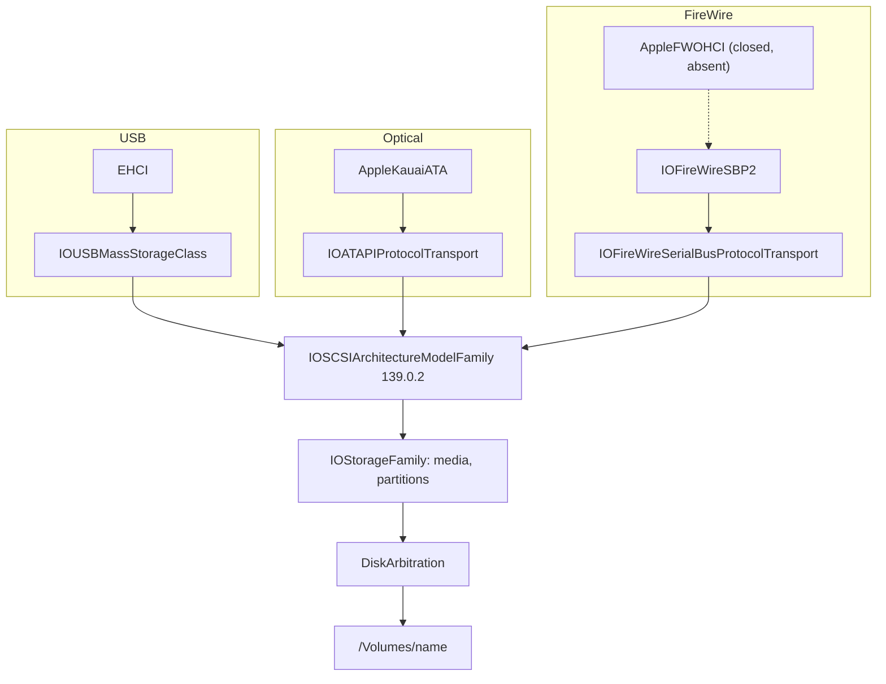
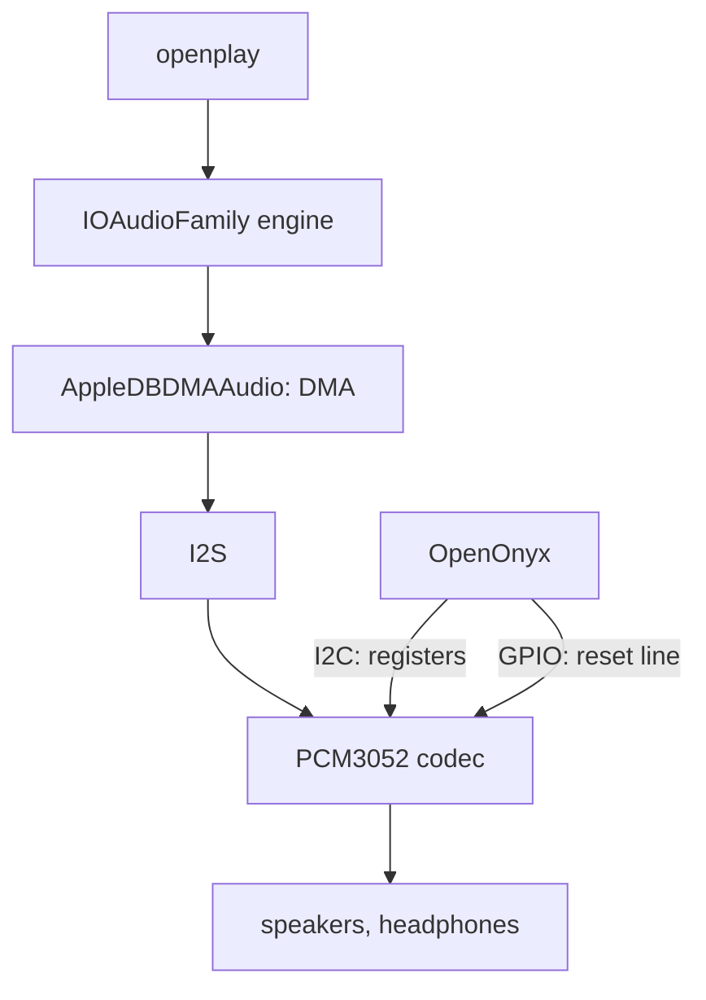

# Step 9: disks and devices

## What you will learn

- How a disk travels from its controller to a folder in `/Volumes`: the driver stack, the SCSI family in its middle, and DiskArbitration at its end.
- Why Panther's SCSI family can stand in for Leopard's unpublished one, and how that was checked.
- Why DiskArbitration mounts nothing removable on a system without loginwindow, and the setting that changes it.
- How the sound of an iMac G5 (`PowerMac12,1`) came up without Apple's codec driver or CoreAudio, why it stayed silent for five boot tests, and why its microphone's levels did not move at first.
- Why FireWire disks and UDF were left out of the step, and how CDs and DVDs were tested on the iMac through a USB drive.

## The goal

README.md sets it as: "DiskArbitration mounts the internal partitions, USB disks and CDs as they appear (CDs tested on the iMac through a USB drive), `bless` makes a partition the startup disk, and the built-in audio plays sound."

By Step 8 the image booted cleanly from its own partition, and saw nothing else. The iMac's other volumes stayed unmounted, a USB key did nothing, and there was no CD drive and no sound.

## Background: from a controller to `/Volumes`

### SCSI everywhere

A hard disk on the iMac's SATA bus is driven by ATA commands ([Step 1, part 2](step-1-drivers-and-bootx.md)). Almost every other storage device speaks SCSI, a command set older than any of these buses: CD and DVD drives over ATA (ATAPI), USB disks and keys, FireWire disks. Each bus has a transport driver that carries SCSI commands over it: IOATAPIProtocolTransport for ATAPI, IOUSBMassStorageClass for USB, IOFireWireSerialBusProtocolTransport for FireWire's SBP-2 protocol.

Above the transports sits one family, IOSCSIArchitectureModelFamily. It turns a device that answers SCSI commands into a disk (`IOSCSIBlockCommandsDevice`) or an optical drive (`IOSCSIMultimediaCommandsDevice`). IOStorageFamily then presents what the device holds as media and partitions, such as `disk1s2`, as it does for the SATA disk. This is a driver stack, as [Hardware and boot basics](../background/hardware-basics.md) explains.

### DiskArbitration

DiskArbitration ([Step 3, part 1](step-3-security-and-daemons.md)) watches for new media. For each one it runs the file-system bundles in `/System/Library/Filesystems`, such as `hfs.fs` or `msdos.fs`, each of which says whether it recognises the volume and gives its name; then it mounts the volume at `/Volumes/<name>`. Before this step the image had `hfs.fs` ([Step 8](step-8-clean-boot.md)), and none for CDs or FAT disks.

## What was built

### Panther's SCSI family

Leopard's IOSCSIArchitectureModelFamily 200.3.6 was never published, so Step 1 left the family out, and with it every CD and USB disk: `extension "com.apple.iokit.IOSCSIArchitectureModelFamily" cannot be found`. [Step 8](step-8-clean-boot.md) even removed IOATAPIProtocolTransport, which could not load. The last published version is Panther's 139.0.2, and the project builds it in Leopard's place ([D85](https://github.com/nyg/PowerDarwin/blob/master/DEVIATIONS.md#d85)), as it does Panther's IOATABlockStorage ([D40](https://github.com/nyg/PowerDarwin/blob/master/DEVIATIONS.md#d40)).

The risk is that the transports were written for Leopard's family. A transport is a C++ subclass of the family's classes, and calls their virtual functions through a table of pointers, the vtable, at fixed slots. If Leopard's family had added a virtual function or changed an object's size, a transport built for it would call the wrong slot in Panther's. So the two sets of headers were compared: the SDK's copy of 200.3.6's ([D36](https://github.com/nyg/PowerDarwin/blob/master/DEVIATIONS.md#d36)) and 139.0.2's own. `SCSITask.h` is the same, and the two classes that transports subclass differ only in members of `ExpansionData`, a separate structure reached through a pointer, an enum value and a property key. No virtual function and no reserved slot changes, so layouts and vtables match.

Then the other side: does each transport find in 139.0.2 every symbol it imports? [scripts/check-family-imports](https://github.com/nyg/PowerDarwin/blob/master/scripts/check-family-imports) reads the family's source for its definitions and lists the imports that none matches. Leopard's IOATAPIProtocolTransport and IOUSBMassStorageClass import nothing Panther's lacks. IOFireWireSerialBusProtocolTransport imports `IOSCSIProtocolServices::stop`, which 139.0.2 declares and never defines; it is an inherited vtable entry, which the kernel's linker fills from the superclass, as it does for 139.0.2's own vtable.

Panther's kexts are version 1.3.9. IOUSBMassStorageClass 208.0.1 asks for 2.0.7 and is refused, so [D86](https://github.com/nyg/PowerDarwin/blob/master/DEVIATIONS.md#d86) lowers that to 1.0.0, as Apple's own 2.0.1 asked. Built, it imports every symbol Leopard's 2.0.8 does but `_kOSBooleanTrue`.

### File systems and the console user

`isoutil` gives DiskArbitration `cd9660.fs` for data CDs, `cddafs` mounts audio CDs, and `msdosfs` brings FAT, with its kext, `mount_msdos`, `fsck_msdos` and `newfs_msdos`. The last needed one dependency that Apple's build list omits ([D92](https://github.com/nyg/PowerDarwin/blob/master/DEVIATIONS.md#d92)): `ld: library not found for -ldisk`.

DiskArbitration also waits for a console user before it mounts a removable or external disk, and only loginwindow, Leopard's closed graphical login, registers one. A getty or SSH login registers none, so a USB key would never be mounted. Apple's servers lift that wait with `AutomountDisksWithoutUserLogin` in `/Library/Preferences/SystemConfiguration/autodiskmount.plist`, and `make-test-image` now writes the same ([Making the image](../method/making-the-image.md)).

UDF, the file system of DVDs and Blu-ray discs, has no source in any Darwin release: none of darwinbuild's build lists, from Darwin 7 to Darwin 12, names a UDF project, and Apple's GitHub holds none. Leopard's `udf.kext` 2.0.2, its `udf.fs` bundle, `mount_udf` and `newfs_udf` are closed, so the image has no UDF, and the step leaves it out. Many discs are bridge discs, with an ISO 9660 volume beside the UDF one over the same files, and `cd9660.fs` mounts that. A disc with only a UDF volume is one that no bundle recognises, and DiskArbitration-183 ejects such an optical disc when no console user is logged in (`diskarbitrationd/DAStage.c`). An open UDF could be ported from FreeBSD ([What's next](whats-next.md)).

### bless

`bless` makes a volume the startup disk by setting Open Firmware's `boot-device` ([the boot chain](../background/boot-chain.md)). Its link named two closed frameworks it never calls, `ld: framework not found ApplicationServices`, which [D91](https://github.com/nyg/PowerDarwin/blob/master/DEVIATIONS.md#d91) removes; its source also carries 68k boot blocks as a prebuilt binary, which rule 5 keeps off the image.

### FireWire

IOFireWireFamily, IOFireWireSBP2 and IOFireWireSerialBusProtocolTransport all built. The iMac's FireWire controller, though, needs `AppleFWOHCI`, a plug-in of IOFireWireFamily that neither its source nor any later release holds: it is closed, and without it no FireWire device appears. So FireWire disks are left out of this step. [Step 12](step-12-firewire.md) writes an open driver for the controller, OpenFWOHCI, and found that IOFireWireFamily as built here did not load either: its published source leaves one class empty, which Step 12 also writes.

## Sound

### The pieces

The iMac's sound runs from memory to the speakers through four parts. A DMA engine reads samples from memory; I²S, a serial bus for audio, carries them to the codec, a PCM3052 chip whose DAC turns them into a voltage; the codec's settings, such as volume and mute, are written over I²C ([Step 7](step-7-fans.md)). Darwin's drivers follow the same split: IOAudioFamily, the family; AppleOnboardAudio, the driver of Apple's built-in sound, with AppleDBDMAAudio as its engine and one plug-in per codec; and AppleI2S. On Leopard, programs reach the engine through CoreAudio, which is closed.

### Closed and missing parts

- IOAudioFamily made one call into the closed `OSvKernDSPLib`, `vDSP_vadd`, to add two buffers of samples; [D87](https://github.com/nyg/PowerDarwin/blob/master/DEVIATIONS.md#d87) replaces it with a loop. It exports the same 739 functions as Leopard's.
- AppleOnboardAudio uses a codec name and a count that no source defines (`PlatformInterfaceI2C.h:48: error: 'kCodec_NumberOfTypes' was not declared in this scope`, [D90](https://github.com/nyg/PowerDarwin/blob/master/DEVIATIONS.md#d90)), calls a function no source defines ([D93](https://github.com/nyg/PowerDarwin/blob/master/DEVIATIONS.md#d93)), and needed its dependencies and CoreAudio's SDK headers to build ([D88](https://github.com/nyg/PowerDarwin/blob/master/DEVIATIONS.md#d88), [D89](https://github.com/nyg/PowerDarwin/blob/master/DEVIATIONS.md#d89)). Its DSP sources, the code that processes the samples on the processor before the DMA engine reads them, are empty.
- `AppleOnyxAudio`, the plug-in for the iMac's codec, is published as a 15-line stub. The project wrote its own, OpenOnyx ([D94](https://github.com/nyg/PowerDarwin/blob/master/DEVIATIONS.md#d94)), under the MIT licence, with the list of registers and their first values copied from FreeBSD's `onyx.c` under its BSD licence.
- Nothing on the image plays sound without CoreAudio, so the project also wrote `openplay` ([D95](https://github.com/nyg/PowerDarwin/blob/master/DEVIATIONS.md#d95)), which does what CoreAudio's lowest layer does: it registers a buffer with the engine through IOAudioFamily's published interface and writes a tone or a WAV file into it a little ahead of the hardware.

### Five silent boots

The eighteenth boot test on the iMac G5 stopped at `Sound assertion "1" failed in "AppleOnboardAudio/PlatformInterfaceI2C_PlatformFunction.cpp" at line 193`. AppleOnboardAudio had waited 10 seconds for the codec's I²C driver, IOI2CFamily's `IOI2CDevice`, which never started. Its personality, the `Info.plist` entry that tells IOKit which device a driver takes, is in `AppleIOI2CAudioCodec.kext`, a kext with no code by design, which `make-test-image` had removed with the stub plug-ins. Kept, it let OpenOnyx log `OpenOnyx: PCM3052 codec set up`, and the registry matched Leopard's: the output selector at `'ispk'`, the internal speakers, moving to `'line'` when headphones went in and back within 5 seconds when they came out.

Then `openplay` played a tone on Leopard and nothing on Darwin 9. OpenOnyx now released the codec's reset line, which AppleOnboardAudio holds at start-up and leaves to the plug-in: still silent. The twenty-second test compared AppleOnboardAudio's state with Leopard's while `openplay` played. I²S, the reset line, the amplifier mutes and the DMA (16 loops of the buffer in 6 seconds on both) were the same; but the codec's register 68 read `0x03`, the DAC muted. AppleOnboardAudio mutes the digital output whenever no S/PDIF cable is in, and OpenOnyx had applied that mute to the DAC. With the mute kept to the digital stream, register 68 read `0x00`, and the tone and a speech file were heard on the speakers and the headphone socket.

### The microphone

The microphone's levels did not move on Darwin 9. AppleOnboardAudio had selected the internal microphone, `'imic'`, but the codec's register 72 read `0x07`. TI's data sheet for the PCM3052A gives that register two fields: bit 5, AML, picks the analog input, 0 for the line input and 1 for the microphone; bits 0 to 4, `PG[4:0]`, hold the input's gain as the gain in dB plus 8, from 4 (−4 dB) to 28 (+20 dB), every other code being a digital mute. OpenOnyx had never written AML, so the codec listened to the empty line input, and it coded the gain in four bits, from 0 to 15, of which 0 to 3 are a mute. Now it sets AML for `'imic'` and clears it for `'line'`, and gives AppleOnboardAudio the gain's range as 4 to 28 ([D94](https://github.com/nyg/PowerDarwin/blob/master/DEVIATIONS.md#d94)).

Nothing on the image could record without CoreAudio either, so `openplay` gained a record mode ([D95](https://github.com/nyg/PowerDarwin/blob/master/DEVIATIONS.md#d95)): `openplay -r file.wav` registers a buffer with the engine's input stream, starts the engine, and copies what the hardware wrote into it, a chunk at a time, through IOAudioFamily's `performClientInput`, to a 16-bit WAV file, printing the peak level every half second.

## How it was proved

In QEMU, the seventh multi-user boot test mounted an ISO 9660 CD at `/Volumes/D9ISO`, read-only, and HFS+ and FAT32 USB disks, the second plugged in through QEMU's monitor while the guest ran; both read back the files written on them, and `disktool -e disk3` unmounted and ejected the FAT32 one. QEMU's OHCI model stopped 90 seconds after boot (`Watchdog detected dead controller`), so the disks went on its EHCI controller, as on the iMac.

A later boot test in QEMU inserted two discs made with `hdiutil makehybrid` through QEMU's monitor. The one with only a UDF volume (`-udf`) was ejected within 10 seconds of going in. The bridge disc (`-udf -iso`) was mounted through `cd9660.fs`, and its two files read back with the MD5 they were written with.

On the iMac, the seventeenth boot test, with an `/etc/fstab` added for that test only to keep them read-only, mounted `Tiger` and `Leopard` at boot, and a USB key as soon as it was plugged in, with `nodev, nosuid, noowners` as Leopard does, reading 128 MB from it in 13.7 seconds. `bless --mount / --setOF` set `boot-device` to `sata/k2-sata@0/@0:4,\\:tbxi`, and `reboot` started Darwin 9 without the Startup Manager; `bless --mount /Volumes/Leopard --setOF` and `reboot` went back. The optical drive was found. The eighteenth to twenty-third tests brought the sound, as above. The last image held 12,340 files, all from the project's builds except the 12 that `make-test-image` writes.

The iMac's own optical drive did not see a DVD even under Leopard, and ejected it after half a minute, so a later boot test on the iMac read CDs and DVDs through a USB DVD writer, each first under Leopard for reference. Darwin 9 mounted each one read-only, the DVD-RW at boot and the others as they went in: a CD-R through `cd9660.fs`, the HFS+ partition of a Mac OS X 10.4 install DVD, and a DVD-RW with UDF and ISO 9660 volumes through `cd9660.fs`, where Leopard had used its UDF. The CD-R's 40 files, five files of 583 MB from the install DVD, and 39 of the DVD-RW's 40 files read back with Leopard's MD5, and so did the raw sectors: the CD-R's whole track, the first 256 MB of the install DVD and the first 181 MB of the DVD-RW. The 40th file is `syslinux/boot.cat`, the disc's El Torito boot catalog, to which its UDF side gives no data and its ISO 9660 side the 2,048 bytes of the catalog's sector. `disktool -e` ejected each disc. The image held 28,316 files, all from the project's builds except the 23 that `make-test-image` writes.

The same boot test checked the microphone. Register 72 read `0x27` with `'imic'` selected: AML set, and the gain at OpenOnyx's default, code 7, −1 dB. `openplay -r` recorded 15 seconds of silence and then speech: 661,500 frames, none late, at an RMS level of −57 to −67 dBFS for the first 5 seconds and −38 to −42 dBFS from 5.5 seconds on. `openplay` played it back through the speakers, and the speech was heard. With the gain at its maximum (`-g 100`), register 72 read `0x3c`, code 28: the silence rose to −48 dBFS and the speech peaked at −2.0 dBFS, with no sample clipped. The microphone is mono, its two channels equal in every frame. The line input was not tested.

Step 9 was reached on the iMac for the internal volumes, USB disks, CDs and DVDs through a USB drive, `bless`, and sound in and out.

## What is still missing

- The iMac's own optical drive, which did not see a DVD even under Leopard, and audio CDs: none was at hand, so `cddafs` is untested.
- The line input, which no test has used.
- AppleOnboardAudio's DSP, whose sources are empty.
- UDF: Leopard's is closed and no release published one, so a disc with only a UDF volume is ejected; a bridge disc mounts through its ISO 9660 volume.

## Where to look

- [D85](https://github.com/nyg/PowerDarwin/blob/master/DEVIATIONS.md#d85) to [D95](https://github.com/nyg/PowerDarwin/blob/master/DEVIATIONS.md#d95), and [D36](https://github.com/nyg/PowerDarwin/blob/master/DEVIATIONS.md#d36) for the SDK's SCSI headers.
- Patches: [IOUSBMassStorageClass-208.0.1](https://github.com/nyg/PowerDarwin/blob/master/patches/IOUSBMassStorageClass-208.0.1/), [IOAudioFamily-169.4.5](https://github.com/nyg/PowerDarwin/blob/master/patches/IOAudioFamily-169.4.5/), [AppleOnboardAudio-258.3.1](https://github.com/nyg/PowerDarwin/blob/master/patches/AppleOnboardAudio-258.3.1/), [bless-63.2](https://github.com/nyg/PowerDarwin/blob/master/patches/bless-63.2/).
- Replacements: [replacements/OpenOnyx/](https://github.com/nyg/PowerDarwin/blob/master/replacements/OpenOnyx/), [replacements/OpenPlay/](https://github.com/nyg/PowerDarwin/blob/master/replacements/OpenPlay/).
- Scripts: [make-test-image](https://github.com/nyg/PowerDarwin/blob/master/scripts/make-test-image) (`autodiskmount.plist`, the kexts kept and removed), [boot-qemu](https://github.com/nyg/PowerDarwin/blob/master/scripts/boot-qemu) (the USB disk), [check-family-imports](https://github.com/nyg/PowerDarwin/blob/master/scripts/check-family-imports).
- [hardware/powermac12-1.md](https://github.com/nyg/PowerDarwin/blob/master/hardware/powermac12-1.md): `AppleFWOHCI`, `OSvKernDSPLib` and `AppleOnyxAudio` among the closed drivers.
- Commits `160662e`, which defined the step, `15152ff`, which left FireWire disks out of its goal, `da709b8`, which reached it for the internal volumes, USB disks and `bless`, and `9885fd1`, which brought the sound.
