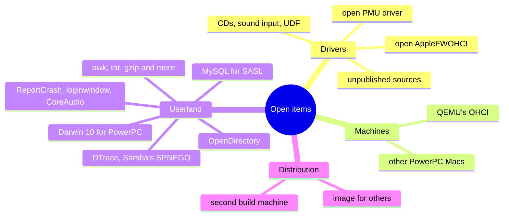

# What's next

## What you will learn

- What the project leaves open once Step 14 is reached, in four areas: drivers, machines, userland and distribution.
- What each open item would take, from what the repo already records.
- Which closed parts stand behind most of them.

Steps 1 to 10 and 13 are reached on the iMac G5 (`PowerMac12,1`), with Step 9's CDs tested in QEMU only, and Steps 11, 12 and 14 are defined ([Step 9](step-9-disks-and-devices.md), [Step 10](step-10-working-unix.md), [Step 13](step-13-gpu-idle-heat.md), [Step 14](step-14-usb-boot.md)). This chapter lists what would remain after them. Two of its driver items are now steps in README.md, the open PMU driver Step 11 and FireWire Step 12, and each leaves this chapter when its step is reached, as the GPU's item did with Step 13. Every other item is an idea, not a commitment. The chapter changes whenever README.md gains a step.

## Drivers

### An open driver for the PMU

QEMU's `mac99`, and many PowerPC Macs before the later G5s, keep their clock and switch their power through a PMU, whose driver, ApplePMU, is closed ([PowerPC Macs](../background/powerpc-macs.md)). Without it, QEMU's clock starts at 1970, `reboot` stops at `MACH Reboot`, and configd waits 60 seconds before it names `en0`. That wait has a twist ([Step 8](step-8-clean-boot.md)): AppleMacRISC2PE's processor driver waits with `waitForService(serviceMatching("ApplePMU"))`, for a driver of that class, not for a resource. IOKit matches a class or any subclass of it, so only a driver whose class is named `ApplePMU`, or derives from one so named, ends the wait.

It would take a kext like OpenSMU ([Step 5](step-5-clock-and-power.md)): the PMU's clock, restart and power-off commands, known from NetBSD's `pmu.c` under the BSD licence, the kernel's two hooks filled in, `IORTC` published, and the class name above. Anyone could test it in QEMU, and QEMU would then cover Steps 5 and 8 too.

### FireWire

FireWire disks need `AppleFWOHCI`, the driver of the iMac's FireWire controller, which is closed ([Step 9](step-9-disks-and-devices.md)). An open one would subclass IOFireWireFamily's `IOFireWireLink`, whose 33 pure virtual functions, which a subclass must write, cover bus resets, packets to and from the bus, the access that SBP-2 disks have to memory, and isochronous transfers, the steady streams of audio and video devices. FreeBSD's `fwohci.c`, under the BSD licence, drives the same kind of controller and would be the reference, as NetBSD's `smu.c` was for OpenSMU. Testing it needs a FireWire disk.

### What Step 9 leaves

A CD test on the iMac; sound input, whose levels did not move; and AppleOnboardAudio's DSP, whose sources are empty. 9L30's build list has no UDF project, so a DVD with only a UDF volume has no file system to mount it.

### Unpublished sources

Panther's IOATABlockStorage 130.3.1 and IOSCSIArchitectureModelFamily 139.0.2 stand in for Leopard's 200.1.8 and 200.3.6, which Apple never published ([D40](https://github.com/nyg/PowerDarwin/blob/master/DEVIATIONS.md#d40), [D85](https://github.com/nyg/PowerDarwin/blob/master/DEVIATIONS.md#d85)). If either source ever appears, the project would build it, drop the stand-in and the deviations around it, and compare the result with Leopard's binary. AppleMacRISC4PE builds with 66 register values that no published header defines ([D39](https://github.com/nyg/PowerDarwin/blob/master/DEVIATIONS.md#d39)), and the published source leaves parts of five of its functions out; only a model-name line in panic logs applies to the iMac, so what the others lack can matter only on other Macs.

## Machines

### Other PowerPC Macs

The image is built for PowerPC Macs, not for one model, but only the iMac has run it. Another Mac needs four things:

- its platform driver, AppleMacRISC2PE or AppleMacRISC4PE, both built here;
- a driver for its power controller: OpenSMU for an SMU, or the open PMU driver above;
- on an SMU Mac, its own fans, sensors and temperatures in OpenSMU, which today knows only the 17-inch iMac G5's, thermal model 2 ([OpenSMU](../synthesis/opensmu.md));
- drivers for its own chips, such as its Ethernet, disk controller and sound codec, each open, closed, or to be written, as [hardware/powermac12-1.md](https://github.com/nyg/PowerDarwin/blob/master/hardware/powermac12-1.md) maps them for the iMac.

For temperatures, Tiger's AppleMacRISC4PE 186.3.1 publishes, under the APSL, thermal profiles for `PowerMac8,1`, `PowerMac9,1`, `PowerMac11,2`, `PowerMac12,1` and the PowerBook G4, and platform plug-ins for `PowerMac7,2`, `PowerMac11,2`, `PowerMac12,1`, `RackMac3,1` and the PowerBook G4; whether OpenSMU's zones can be built from them is not checked. They also open a path to Apple's own fan control: if OpenSMU published the SMU's SDB partitions as `sdb-partition-*` properties and `AppleSMUDevice` nubs for the fans and sensors, as AppleSMU does, Tiger's IOPlatformPluginFamily and its `SMU_Neo2` and `PowerMac12_1` plug-ins could be built for Leopard and run in place of OpenSMU's zones. Not tried.

### QEMU

QEMU's OHCI USB model stops about 90 seconds after boot under our drivers, so USB disks there go on its EHCI controller ([Step 9](step-9-disks-and-devices.md)). Finding which guest access stops it, and reporting it to QEMU, would let USB disks use QEMU's default controller.

## Userland

### OpenDirectory

Several pieces wait for OpenDirectory, Leopard's interface to directory services: `passwd` ([D44](https://github.com/nyg/PowerDarwin/blob/master/DEVIATIONS.md#d44)), `pam_securityserver` ([D42](https://github.com/nyg/PowerDarwin/blob/master/DEVIATIONS.md#d42), [D80](https://github.com/nyg/PowerDarwin/blob/master/DEVIATIONS.md#d80), [D84](https://github.com/nyg/PowerDarwin/blob/master/DEVIATIONS.md#d84)) and `bootpd`, the DHCP server ([D66](https://github.com/nyg/PowerDarwin/blob/master/DEVIATIONS.md#d66)). Its C part includes a private header of Apple's CoreFoundation that CF-Lite lacks, and its Objective-C part needs the closed Foundation. It would take the missing declarations from a later open CoreFoundation, as other gaps in CF-Lite were filled ([D56](https://github.com/nyg/PowerDarwin/blob/master/DEVIATIONS.md#d56)), and a way around the Objective-C part for the pieces that use it.

### What Step 10 leaves

[Step 10](step-10-working-unix.md) made the image a working Unix system, and left these open:

- Everyday tools that no step has built: `awk`, `tar`, `gzip`, `file`, `lsof`, `top` and `curl`. Each is a project of the 9L30 build list (awk 11, gnutar 442.0.1, gnuzip 25, file 23, lsof 33, top 39 and curl 42), so each is one more build, with whatever its entry in the build list lacks.
- DTrace. The probes of Perl and Python compile to nothing through a stand-in `dtrace` in the build environment ([D97](https://github.com/nyg/PowerDarwin/blob/master/DEVIATIONS.md#d97)), and Ruby's through a patched header ([D103](https://github.com/nyg/PowerDarwin/blob/master/DEVIATIONS.md#d103)), as Libc's and DirectoryService's do ([D12](https://github.com/nyg/PowerDarwin/blob/master/DEVIATIONS.md#d12), [D75](https://github.com/nyg/PowerDarwin/blob/master/DEVIATIONS.md#d75)). dtrace-48.1 is published, but its library needs the closed Foundation and Symbolication even when built from it, in `libdtrace/dt_ld.m` and `dt_pid_apple.m`; tracing on the image would take a library without them.
- Python's 36 Carbon modules, its Build Applet and its Python Launcher, which need the closed Carbon and ApplicationServices ([D102](https://github.com/nyg/PowerDarwin/blob/master/DEVIATIONS.md#d102)), and `_tkinter`, since Tk needs the closed Aqua frameworks ([D71](https://github.com/nyg/PowerDarwin/blob/master/DEVIATIONS.md#d71)).
- `.dSYM` bundles: the image's `dsymutil` is a script that does nothing, since Apple's is closed ([D112](https://github.com/nyg/PowerDarwin/blob/master/DEVIATIONS.md#d112)).
- In Samba: SPNEGO, which `smb.conf` turns off because Samba 3.0.25b's `spnego_parse_auth` rejects the `mechListMIC` field that the current Mac's client sends ([D113](https://github.com/nyg/PowerDarwin/blob/master/DEVIATIONS.md#d113)); the byte-range locks of the `darwin_streams` module, which need the closed `ByteRangeLocking.framework` ([D108](https://github.com/nyg/PowerDarwin/blob/master/DEVIATIONS.md#d108)); and file sharing switched on from a preference pane: on Leopard the closed Sharing pane writes the file that `synchronize-preferences` reads, and that tool no longer posts its change notices ([D109](https://github.com/nyg/PowerDarwin/blob/master/DEVIATIONS.md#d109), D113), so the image's `smb.conf` and `smbd.plist` are written by `make-test-image` instead. Samba 3.0.25b speaks SMB1 only.
- CarbonHeaders at Leopard's version: the image has 18.1's, of Mac OS X 10.6 ([D111](https://github.com/nyg/PowerDarwin/blob/master/DEVIATIONS.md#d111)), and would take 9L30's if its source appeared.
- A test in QEMU, where Step 10 was not tried.

None of Step 10's rows is `deferred`: what it turned off waits for closed code, not for an open project.

### Other closed parts

- ReportCrash, the crash reporter, whose absence launchd and configd still log ([Step 8](step-8-clean-boot.md)).
- loginwindow, which registers the console user; `autodiskmount.plist` works around its absence for disks ([Step 9](step-9-disks-and-devices.md)).
- CoreAudio: `openplay` plays a sound, and no more; a sound server for other programs would be new code ([D95](https://github.com/nyg/PowerDarwin/blob/master/DEVIATIONS.md#d95)).

[What stays closed](../synthesis/what-stays-closed.md) lists them all.

### Deferred features

A `deferred` deviation turns a feature off until the open project it needs is built. [D72](https://github.com/nyg/PowerDarwin/blob/master/DEVIATIONS.md#d72) leaves out Cyrus SASL's MySQL plug-in, which needs MySQL's client library; the 9L30 build list has MySQL 45, so building it would bring the plug-in back.

### Darwin 10 for PowerPC

Mac OS X 10.6 dropped PowerPC, though Darwin 10's kernel source still has it. Others have started on it: macos-powerpc's darwinbuild has a `Darwin10` branch that adds PowerPC to the `10A432` build list, and a group built `10A432`'s kernel, `xnu-1456.1.26`, for PowerPC from source ([the history](../background/history.md)). This project could serve as a base: its method and rules, its deviations as a list of what to expect, its open drivers, and Panther's stand-ins. It would take a Darwin 10 build list with PowerPC, a toolchain for it, and every deviation checked again.

## Distribution

### An image others can boot

Today the image is made for tests: `make-test-image` writes the hash of a test password into it, and `passwd`, the usual way to change a password, is not built ([D44](https://github.com/nyg/PowerDarwin/blob/master/DEVIATIONS.md#d44)). An image for others would need a first-boot way to set the password, and one download, a disk image to restore with `asr` or, after Step 14, to write to a USB key.

Rule 5 already holds for such an image: every file is built from source or written by the scripts, and the check of each file's MD5 proves it ([Making the image](../method/making-the-image.md)). The licences ask for more. Most of Darwin is under the APSL 2.0, and bash, gcc and Samba under the GPL; both ask that binaries come with their sources and changes. The repo holds the patches and scripts, and `manifest/` pins each source by its hash, so publishing them beside the image would be most of it.

### A second build machine

Every image so far was built on one build machine, which runs Sorbet Leopard, a community update of Leopard 10.5.8. A rebuild from scratch on another, with an unmodified Leopard 10.5.8, would show that the scripts repeat the build, and would settle the comparisons with Leopard's binaries, which are provisional until then ([How testing is done](../method/testing.md)).

## A map of the open items

Some items help others: the PMU driver would serve both QEMU and the older Macs, and OpenDirectory would bring back `passwd`, with which an image for others could set its password.

## Where to look

- README.md: "Status", which ends with what does not work yet and the tools still missing.
- DEVIATIONS.md: the `deferred` rows [D66](https://github.com/nyg/PowerDarwin/blob/master/DEVIATIONS.md#d66), [D72](https://github.com/nyg/PowerDarwin/blob/master/DEVIATIONS.md#d72), [D80](https://github.com/nyg/PowerDarwin/blob/master/DEVIATIONS.md#d80) and [D84](https://github.com/nyg/PowerDarwin/blob/master/DEVIATIONS.md#d84), the `closed-*` rows, among them [D40](https://github.com/nyg/PowerDarwin/blob/master/DEVIATIONS.md#d40), [D81](https://github.com/nyg/PowerDarwin/blob/master/DEVIATIONS.md#d81), [D85](https://github.com/nyg/PowerDarwin/blob/master/DEVIATIONS.md#d85), [D94](https://github.com/nyg/PowerDarwin/blob/master/DEVIATIONS.md#d94) and [D95](https://github.com/nyg/PowerDarwin/blob/master/DEVIATIONS.md#d95), Step 10's [D102](https://github.com/nyg/PowerDarwin/blob/master/DEVIATIONS.md#d102), [D103](https://github.com/nyg/PowerDarwin/blob/master/DEVIATIONS.md#d103), [D108](https://github.com/nyg/PowerDarwin/blob/master/DEVIATIONS.md#d108), [D109](https://github.com/nyg/PowerDarwin/blob/master/DEVIATIONS.md#d109), [D111](https://github.com/nyg/PowerDarwin/blob/master/DEVIATIONS.md#d111), [D112](https://github.com/nyg/PowerDarwin/blob/master/DEVIATIONS.md#d112) and [D113](https://github.com/nyg/PowerDarwin/blob/master/DEVIATIONS.md#d113), and [D39](https://github.com/nyg/PowerDarwin/blob/master/DEVIATIONS.md#d39), a `bug` row, for AppleMacRISC4PE's register values.
- [hardware/powermac12-1.md](https://github.com/nyg/PowerDarwin/blob/master/hardware/powermac12-1.md): the closed drivers of the iMac G5.
- [RESOURCES.md](https://github.com/nyg/PowerDarwin/blob/master/RESOURCES.md): NetBSD's `pmu.c`, FreeBSD's `fwohci.c`, macos-powerpc's darwinbuild, the Snow Leopard kernel for PowerPC.
- In AppleMacRISC2PE-187.0.5: `MacRISC2CPU.cpp`, the wait for `ApplePMU`.
- In IOFireWireFamily-349.4.0: `IOFireWireFamily.kmodproj/IOFireWireLink.h`.
- In AppleMacRISC4PE-186.3.1: `IOPlatformPlugins/` and `ThermalProfiles/`, for Tiger's plug-ins and profiles.
- [scripts/make-test-image](https://github.com/nyg/PowerDarwin/blob/master/scripts/make-test-image): the test password.
- [What stays closed, and why](../synthesis/what-stays-closed.md).
