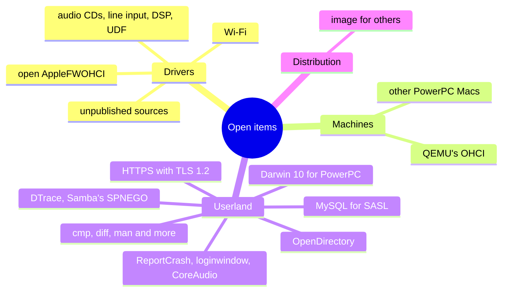

# What's next

## What you will learn

- What the project leaves open once Step 14 is reached, in four areas: drivers, machines, userland and distribution.
- What each open item would take, from what the repo already records.
- Which closed parts stand behind most of them.

Steps 1 to 10 and 13 are reached on the iMac G5 (`PowerMac12,1`), with Step 9's CDs tested through a USB drive, Step 11 is reached in QEMU's `mac99`, and Steps 12 and 14 are defined ([Step 9](step-9-disks-and-devices.md), [Step 10](step-10-working-unix.md), [Step 11](step-11-pmu.md), [Step 13](step-13-gpu-idle-heat.md), [Step 14](step-14-usb-boot.md)). This chapter lists what would remain after them. One of its driver items is now a step in README.md, FireWire Step 12, and it leaves this chapter when its step is reached, as the PMU's item did with Step 11 and the GPU's with Step 13. Every other item is an idea, not a commitment. The chapter changes whenever README.md gains a step.

## Drivers

### FireWire

FireWire disks needed `AppleFWOHCI`, the driver of the iMac's FireWire controller, which is closed ([Step 9](step-9-disks-and-devices.md)). [Step 12](step-12-firewire.md) wrote OpenFWOHCI in its place, a subclass of IOFireWireFamily's `IOFireWireLink`, and the class that IOFireWireFamily's published source leaves out; with no device attached, the bus comes up on the iMac. What is left is a test with a FireWire disk that holds nothing of value: its config ROM, an SBP-2 login, mounting it read-only and then read-write, unplugging it, and a restart with it attached. Isochronous transfers, the steady streams of audio and video devices, are not written.

### What Step 9 leaves

Audio CDs, which no test has read, and the iMac's own optical drive, which did not see a DVD even under Leopard; the line input, which no test has used; and AppleOnboardAudio's DSP, whose sources are empty. Leopard's UDF is closed and no Darwin release published one, so a disc with only a UDF volume is ejected, and a bridge disc mounts through its ISO 9660 volume ([Step 9](step-9-disks-and-devices.md)). An open UDF could be a port of FreeBSD's `sys/fs/udf`, under a BSD licence: about 3,500 lines that read UDF's physical and sparable partitions, but neither the virtual allocation table of discs written in increments nor the metadata partition of UDF 2.50 and later, which Blu-ray discs use. Like msdosfs 136.6, it would need a kext, a `udf.fs` bundle with its probe, and `mount_udf`.

### Unpublished sources

Panther's IOATABlockStorage 130.3.1 and IOSCSIArchitectureModelFamily 139.0.2 stand in for Leopard's 200.1.8 and 200.3.6, which Apple never published ([D40](https://github.com/nyg/PowerDarwin/blob/master/DEVIATIONS.md#d40), [D85](https://github.com/nyg/PowerDarwin/blob/master/DEVIATIONS.md#d85)). If either source ever appears, the project would build it, drop the stand-in and the deviations around it, and compare the result with Leopard's binary. AppleMacRISC4PE builds with 66 register values that no published header defines ([D39](https://github.com/nyg/PowerDarwin/blob/master/DEVIATIONS.md#d39)), and the published source leaves parts of five of its functions out; only a model-name line in panic logs applies to the iMac, so what the others lack can matter only on other Macs.

### Wi-Fi

The image has no Wi-Fi: Leopard's 802.11 family, its AirPort drivers, its framework and its daemons are closed, and Apple published only eap8021x, the 802.1X client, and the family's headers. The iMac's AirPort Extreme is a Broadcom BCM4318, which open drivers in Linux (b43) and the BSDs (bwn, bwi) support. A driver of the project's own, with a station's 802.11 stack and WPA2, would fit the image's network path as a second Ethernet interface, but the chip needs firmware loaded at every power-up, and the only open one, OpenFWWF, is from outside Apple's release and untried on the iMac's core revision. [Wi-Fi: what it would take](../synthesis/wifi.md) compares four routes against the rules, says what was checked and how, and lists the decisions and the stages.

## Machines

### Other PowerPC Macs

The image is built for PowerPC Macs, not for one model, but only the iMac has run it. Another Mac needs four things:

- its platform driver, AppleMacRISC2PE or AppleMacRISC4PE, both built here;
- a driver for its power controller: OpenSMU for an SMU, or OpenPMU for a PMU, which only QEMU has run so far ([Step 11](step-11-pmu.md));
- on an SMU Mac, its own fans, sensors and temperatures in OpenSMU, which today knows only the 17-inch iMac G5's, thermal model 2 ([OpenSMU](../synthesis/opensmu.md));
- drivers for its own chips, such as its Ethernet, disk controller and sound codec, each open, closed, or to be written, as [hardware/powermac12-1.md](https://github.com/nyg/PowerDarwin/blob/master/hardware/powermac12-1.md) maps them for the iMac.

For temperatures, Tiger's AppleMacRISC4PE 186.3.1 publishes, under the APSL, thermal profiles for `PowerMac8,1`, `PowerMac9,1`, `PowerMac11,2`, `PowerMac12,1` and the PowerBook G4, and platform plug-ins for `PowerMac7,2`, `PowerMac11,2`, `PowerMac12,1`, `RackMac3,1` and the PowerBook G4; whether OpenSMU's zones can be built from them is not checked. They also open a path to Apple's own fan control: if OpenSMU published the SMU's SDB partitions as `sdb-partition-*` properties and `AppleSMUDevice` nubs for the fans and sensors, as AppleSMU does, Tiger's IOPlatformPluginFamily and its `SMU_Neo2` and `PowerMac12_1` plug-ins could be built for Leopard and run in place of OpenSMU's zones. Not tried.

### QEMU

QEMU's OHCI USB model stops about 90 seconds after boot under our drivers, so USB disks there go on its EHCI controller ([Step 9](step-9-disks-and-devices.md)). Finding which guest access stops it, and reporting it to QEMU, would let USB disks use QEMU's default controller.

## Userland

### OpenDirectory

Several pieces wait for OpenDirectory, Leopard's interface to directory services: `passwd` ([D44](https://github.com/nyg/PowerDarwin/blob/master/DEVIATIONS.md#d44)), `pam_securityserver` ([D42](https://github.com/nyg/PowerDarwin/blob/master/DEVIATIONS.md#d42), [D80](https://github.com/nyg/PowerDarwin/blob/master/DEVIATIONS.md#d80), [D84](https://github.com/nyg/PowerDarwin/blob/master/DEVIATIONS.md#d84)) and `bootpd`, the DHCP server ([D66](https://github.com/nyg/PowerDarwin/blob/master/DEVIATIONS.md#d66)). Its C part includes a private header of Apple's CoreFoundation that CF-Lite lacks, and its Objective-C part needs the closed Foundation. It would take the missing declarations from a later open CoreFoundation, as other gaps in CF-Lite were filled ([D56](https://github.com/nyg/PowerDarwin/blob/master/DEVIATIONS.md#d56)), and a way around the Objective-C part for the pieces that use it.

### What Step 10 leaves

[Step 10](step-10-working-unix.md) made the image a working Unix system, and left these open:

- More everyday commands that no step has built, each a project of the 9L30 build list: `cmp` and `diff` (gnudiff 14), `patch` (patch_cmds 11), `man` (man 12, with groff 31), `crontab` (cron 30), `nc` (netcat 7), `dig` and `host` (bind9 26.1.5), `telnet` and `logger` (remote_cmds 13.0.2), `rsync` (rsync 35.2), `zip` (zip 9), `screen` (screen 12) and `nano` (nano 4); and `bzip2`, whose 16.5 is built for the build environment only ([D19](https://github.com/nyg/PowerDarwin/blob/master/DEVIATIONS.md#d19)). `awk`, `tar`, `gzip`, `file`, `lsof`, `top` and `curl` were built after the step ([D122](https://github.com/nyg/PowerDarwin/blob/master/DEVIATIONS.md#d122)).
- HTTPS to current sites. The image's `curl`, on OpenSSL 0.9.7l as Leopard's is, speaks TLS 1.0 at most and checks no certificate signed with SHA-256, so current sites refuse it, as they refuse Leopard's; they need TLS 1.2, which no project of the 9L30 build list has.
- DTrace. The probes of Perl and Python compile to nothing through a stand-in `dtrace` in the build environment ([D97](https://github.com/nyg/PowerDarwin/blob/master/DEVIATIONS.md#d97)), and Ruby's through a patched header ([D103](https://github.com/nyg/PowerDarwin/blob/master/DEVIATIONS.md#d103)), as Libc's and DirectoryService's do ([D12](https://github.com/nyg/PowerDarwin/blob/master/DEVIATIONS.md#d12), [D75](https://github.com/nyg/PowerDarwin/blob/master/DEVIATIONS.md#d75)). dtrace-48.1 is published, but its library needs the closed Foundation and Symbolication even when built from it, in `libdtrace/dt_ld.m` and `dt_pid_apple.m`; tracing on the image would take a library without them.
- Python's 36 Carbon modules, its Build Applet and its Python Launcher, which need the closed Carbon and ApplicationServices ([D102](https://github.com/nyg/PowerDarwin/blob/master/DEVIATIONS.md#d102)), and `_tkinter`, since Tk needs the closed Aqua frameworks ([D71](https://github.com/nyg/PowerDarwin/blob/master/DEVIATIONS.md#d71)).
- `.dSYM` bundles: the image's `dsymutil` is a script that does nothing, since Apple's is closed ([D112](https://github.com/nyg/PowerDarwin/blob/master/DEVIATIONS.md#d112)).
- In Samba: SPNEGO, which `smb.conf` turns off because Samba 3.0.25b's `spnego_parse_auth` rejects the `mechListMIC` field that the current Mac's client sends ([D113](https://github.com/nyg/PowerDarwin/blob/master/DEVIATIONS.md#d113)); the byte-range locks of the `darwin_streams` module, which need the closed `ByteRangeLocking.framework` ([D108](https://github.com/nyg/PowerDarwin/blob/master/DEVIATIONS.md#d108)); and file sharing switched on from a preference pane: on Leopard the closed Sharing pane writes the file that `synchronize-preferences` reads, and that tool no longer posts its change notices ([D109](https://github.com/nyg/PowerDarwin/blob/master/DEVIATIONS.md#d109), D113), so the image's `smb.conf` and `smbd.plist` are written by `make-test-image` instead. Samba 3.0.25b speaks SMB1 only.
- CarbonHeaders at Leopard's version: the image has 18.1's, of Mac OS X 10.6 ([D111](https://github.com/nyg/PowerDarwin/blob/master/DEVIATIONS.md#d111)), and would take 9L30's if its source appeared.
- A test in QEMU of the compiler, the languages and Samba: only the everyday tools built after the step were tried there.

None of Step 10's rows is `deferred`: what it turned off waits for closed code, not for an open project.

### Other closed parts

- ReportCrash, the crash reporter, whose absence launchd and configd still log ([Step 8](step-8-clean-boot.md)).
- loginwindow, which registers the console user; `autodiskmount.plist` works around its absence for disks ([Step 9](step-9-disks-and-devices.md)).
- CoreAudio: `openplay` plays or records a sound, and no more; a sound server for other programs would be new code ([D95](https://github.com/nyg/PowerDarwin/blob/master/DEVIATIONS.md#d95)).

[What stays closed](../synthesis/what-stays-closed.md) lists them all.

### Deferred features

A `deferred` deviation turns a feature off until the open project it needs is built. [D72](https://github.com/nyg/PowerDarwin/blob/master/DEVIATIONS.md#d72) leaves out Cyrus SASL's MySQL plug-in, which needs MySQL's client library; the 9L30 build list has MySQL 45, so building it would bring the plug-in back.

### Darwin 10 for PowerPC

Mac OS X 10.6 dropped PowerPC, though Darwin 10's kernel source still has it. Others have started on it: macos-powerpc's darwinbuild has a `Darwin10` branch that adds PowerPC to the `10A432` build list, and a group built `10A432`'s kernel, `xnu-1456.1.26`, for PowerPC from source ([the history](../background/history.md)). This project could serve as a base: its method and rules, its deviations as a list of what to expect, its open drivers, and Panther's stand-ins. It would take a Darwin 10 build list with PowerPC, a toolchain for it, and every deviation checked again.

## Distribution

### An image others can boot

The image is now made the way a release would publish it: `make-test-image --release=<name>` leaves root without a password, uses UTC and `time.apple.com` instead of the build machine's time zone and NTP server, and puts the licence texts and the notices of every project built into `/usr/share/doc/PowerDarwin`. At its first boot, the console asks for root's password, and the image makes its SSH host keys before it turns SSH on, which stands in for `passwd` there ([D124](https://github.com/nyg/PowerDarwin/blob/master/DEVIATIONS.md#d124)). Every project is built in UTC, under the host name `powerdarwin.invalid` and the login name `root`, so that the programs that record who built them and where name no machine or user ([D125](https://github.com/nyg/PowerDarwin/blob/master/DEVIATIONS.md#d125)). `make-release` checks such an image for passwords, keys and anything of the build machine, and writes the release's files: one raw image, for QEMU and for `install-image`, the source of every binary on it, and checksums; `publish-release` uploads them ([Making the image](../method/making-the-image.md#releases)).

What remains after the first release: Step 14, after which the same raw image can be written to a USB key; a way to change root's password after the first boot, which `passwd` gives on Leopard and which needs OpenDirectory (above); and a lawyer's reading of what the licences ask, which the project's own reading leaves open on a few points.

## A map of the open items

Some items help others: OpenDirectory would bring back `passwd`, with which root's password could be changed after the first boot.

## Where to look

- README.md: "Status", which ends with what does not work yet, what `curl` reaches over HTTPS, and the commands still missing.
- DEVIATIONS.md: the `deferred` rows [D66](https://github.com/nyg/PowerDarwin/blob/master/DEVIATIONS.md#d66), [D72](https://github.com/nyg/PowerDarwin/blob/master/DEVIATIONS.md#d72), [D80](https://github.com/nyg/PowerDarwin/blob/master/DEVIATIONS.md#d80) and [D84](https://github.com/nyg/PowerDarwin/blob/master/DEVIATIONS.md#d84), the `closed-*` rows, among them [D40](https://github.com/nyg/PowerDarwin/blob/master/DEVIATIONS.md#d40), [D81](https://github.com/nyg/PowerDarwin/blob/master/DEVIATIONS.md#d81), [D85](https://github.com/nyg/PowerDarwin/blob/master/DEVIATIONS.md#d85), [D94](https://github.com/nyg/PowerDarwin/blob/master/DEVIATIONS.md#d94) and [D95](https://github.com/nyg/PowerDarwin/blob/master/DEVIATIONS.md#d95), Step 10's [D102](https://github.com/nyg/PowerDarwin/blob/master/DEVIATIONS.md#d102), [D103](https://github.com/nyg/PowerDarwin/blob/master/DEVIATIONS.md#d103), [D108](https://github.com/nyg/PowerDarwin/blob/master/DEVIATIONS.md#d108), [D109](https://github.com/nyg/PowerDarwin/blob/master/DEVIATIONS.md#d109), [D111](https://github.com/nyg/PowerDarwin/blob/master/DEVIATIONS.md#d111), [D112](https://github.com/nyg/PowerDarwin/blob/master/DEVIATIONS.md#d112) and [D113](https://github.com/nyg/PowerDarwin/blob/master/DEVIATIONS.md#d113), and [D39](https://github.com/nyg/PowerDarwin/blob/master/DEVIATIONS.md#d39), a `bug` row, for AppleMacRISC4PE's register values.
- [hardware/powermac12-1.md](https://github.com/nyg/PowerDarwin/blob/master/hardware/powermac12-1.md): the closed drivers of the iMac G5.
- [RESOURCES.md](https://github.com/nyg/PowerDarwin/blob/master/RESOURCES.md): FreeBSD's `fwohci.c`, macos-powerpc's darwinbuild, the Snow Leopard kernel for PowerPC.
- In IOFireWireFamily-349.4.0: `IOFireWireFamily.kmodproj/IOFireWireLink.h`.
- In AppleMacRISC4PE-186.3.1: `IOPlatformPlugins/` and `ThermalProfiles/`, for Tiger's plug-ins and profiles.
- [Wi-Fi: what it would take](../synthesis/wifi.md): the iMac's AirPort Extreme, the open drivers and firmware for it, and the decisions they need.
- [scripts/make-test-image](https://github.com/nyg/PowerDarwin/blob/master/scripts/make-test-image), [overlay/usr/libexec/first-boot](https://github.com/nyg/PowerDarwin/blob/master/overlay/usr/libexec/first-boot), [scripts/make-release](https://github.com/nyg/PowerDarwin/blob/master/scripts/make-release) and [scripts/publish-release](https://github.com/nyg/PowerDarwin/blob/master/scripts/publish-release): the test password, the first boot and the release.
- [What stays closed, and why](../synthesis/what-stays-closed.md).
