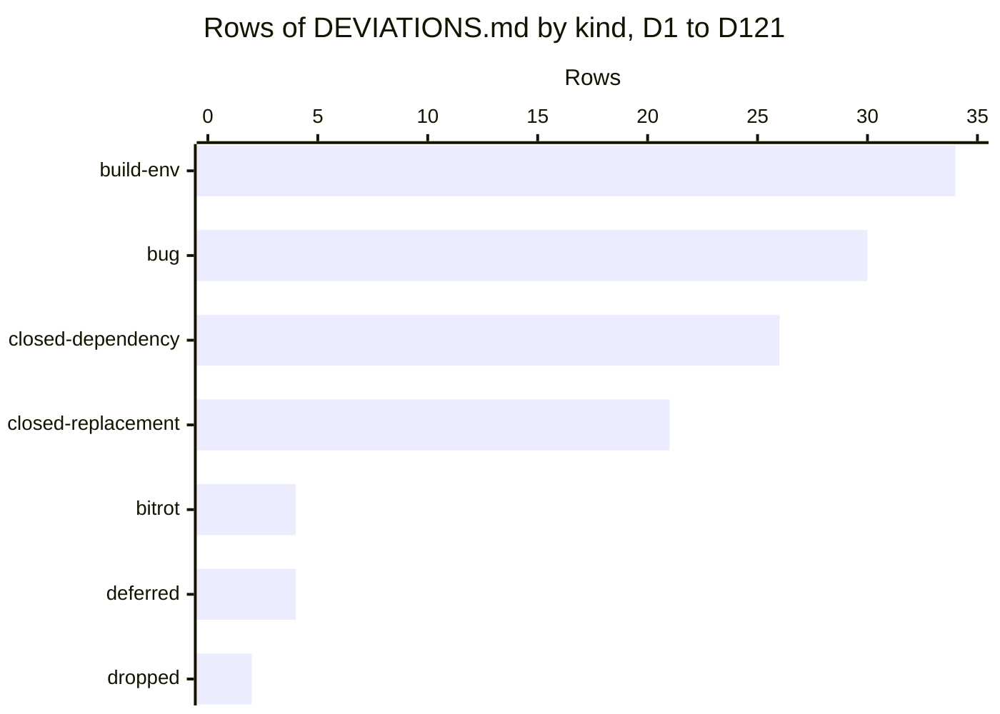
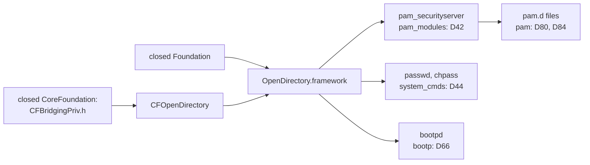

# Kinds of deviation, with worked examples

## What you will learn

- How the 121 rows of DEVIATIONS.md divide among its seven kinds, and why a kind describes the fix rather than the fault.
- The causes behind the rows: a build list that misses projects, the gap between CF-Lite and Apple's CoreFoundation, closed Foundation and dtrace, code that Apple's source export removed, Apple's own Xcode against the public one, sources never published, and a few more.
- One worked example for each cause, and where the step chapters tell the others.
- How one closed framework, OpenDirectory, reaches four projects.
- What carries over to anyone who builds another Darwin, or Darwin for another Mac.

## A row for every change

Rule 3 asks for one row in [DEVIATIONS.md](https://github.com/nyg/PowerDarwin/blob/master/DEVIATIONS.md) for every patch, every workaround in the build environment and every replacement ([The rules](../method/rules.md)). Each row gives the project, the kind of change, what was changed, the error it fixes, quoted exactly, and the later Apple release with the same fix, if any. There are 121 rows, D1 to D121: 113 by the end of Step 10, three more while the build was replayed from an empty folder and its image installed, D114 to D116 ([darwinbuild and the build machine](../method/darwinbuild.md#the-build-order)), four in Steps 11 to 13, D117 to D120, and D121, which put `sw_vers` on the image. Every step chapter tells the rows of its step; this chapter looks at all of them at once, to find what made them necessary.

### The seven kinds

[The rules](../method/rules.md) defines the kinds, with two examples each. In short:

- `build-env`: the build environment changes, and no source does.
- `bitrot`: something that worked when Apple built Leopard no longer does, such as a dead web site or a tool that changed.
- `bug`: a fault in what Apple published, its source or its build list.
- `closed-replacement`: something new stands in for a closed Apple binary.
- `closed-dependency`: a feature is turned off for good, because it needs closed Apple code.
- `deferred`: a feature is turned off until the open project it needs is built.
- `dropped`: a row no longer applied, kept for its ID.



A quarter of the rows are `bug`, but few of them fix Apple's code. Of the 30, 16 change only the build list, 4 put back what the source export removed, 3 fill gaps in CF-Lite, and 2 follow the public tools, Xcode's layout and darwinxref's order of flags; only 5 fix a fault in the code itself. The largest kind, `build-env`, changes no source at all. Most of the work of building Darwin 9 is not fixing Apple's code but supplying what the build around that code needs.

### Kind and cause

A row's kind says what sort of change was made. It does not say why the change was needed, and the same cause can lead to rows of several kinds. When Xcode 3.1.4 wrote its MIG output into a folder per architecture, where IOKitUser's script looked for it in one folder, the fix was filed as `bitrot` ([D23](https://github.com/nyg/PowerDarwin/blob/master/DEVIATIONS.md#d23)); when DirectoryService's script failed the same way, as `bug` ([D53](https://github.com/nyg/PowerDarwin/blob/master/DEVIATIONS.md#d53)). A missing dependency becomes `build-env` when a Root is put into the build environment by hand ([D4](https://github.com/nyg/PowerDarwin/blob/master/DEVIATIONS.md#d4)), and `bug` when the build list itself gets the dependency ([D29](https://github.com/nyg/PowerDarwin/blob/master/DEVIATIONS.md#d29)).

So the rest of this chapter sorts the rows a second way, by cause. Every row has one cause, the one its error points at first, or, for rows added before any build failed, such as D88 and D89, the gap it fills; D100 and D115, choices, have a cause of their own:

| Cause | `build-env` | `bitrot` | `bug` | `closed-replacement` | `closed-dependency` | `deferred` | `dropped` |
|---|---|---|---|---|---|---|---|
| The build list's gaps | D4, D5, D9, D14, D18, D19, D59, D60, D64, D98, D104, D110 | | D29, D31, D38, D47, D48, D63, D65, D71, D74, D88, D92, D96, D101, D106, D114 | | | | |
| CF-Lite against Apple's CoreFoundation | D11 | | D54, D57, D62 | D16, D56, D79 | D21, D28, D50, D52, D109 | | |
| Closed Foundation and dtrace | D24, D49, D97 | | | | D12, D34, D43, D55, D68, D75, D76, D77, D103 | | |
| What the source export removed | | | D35, D39, D90, D93 | D120 | D22, D32 | | |
| Apple's Xcode against the public one | D7, D70, D82, D99 | D23, D25, D78 | D53, D105 | | | | |
| Leopard's versions never published | D10, D30, D36, D73 | | D58 | D37, D40, D85, D86, D111, D121 | | | |
| Closed parts the system needs | | | | D8, D13, D15, D67, D81, D94, D95, D112, D117, D118, D119 | | | |
| Other closed frameworks and libraries | D51, D69, D89, D107 | | | | D27, D41, D61, D87, D91, D102, D108, D113 | | |
| OpenDirectory | | | | | D42, D44 | D66, D80, D84 | |
| The archive: tarballs, lists, Roots | D1, D3, D6, D20 | D2 | | | | | |
| Faults in Apple's code | | | D17, D33, D46, D83, D116 | | | | |
| Waiting for an open project | | | | | | D72 | D26, D45 |
| A choice: PowerPC only | D100, D115 | | | | | | |

[Indexes and timeline](../reference/indexes.md) lists every row with its step and chapter.

## The build list's gaps

### What happens

darwinbuild builds each project in a BuildRoot that holds only what the project's entry in the build list names: its build, header and library dependencies ([darwinbuild and the build machine](../method/darwinbuild.md)). An entry that leaves out a project still builds on a machine where that project's files are already installed. A clean BuildRoot shows every such gap, as a missing header, library or tool. These 27 rows, the largest group, come from there: [D4](https://github.com/nyg/PowerDarwin/blob/master/DEVIATIONS.md#d4), [D5](https://github.com/nyg/PowerDarwin/blob/master/DEVIATIONS.md#d5), [D9](https://github.com/nyg/PowerDarwin/blob/master/DEVIATIONS.md#d9), [D14](https://github.com/nyg/PowerDarwin/blob/master/DEVIATIONS.md#d14), [D18](https://github.com/nyg/PowerDarwin/blob/master/DEVIATIONS.md#d18), [D19](https://github.com/nyg/PowerDarwin/blob/master/DEVIATIONS.md#d19), [D29](https://github.com/nyg/PowerDarwin/blob/master/DEVIATIONS.md#d29), [D31](https://github.com/nyg/PowerDarwin/blob/master/DEVIATIONS.md#d31), [D38](https://github.com/nyg/PowerDarwin/blob/master/DEVIATIONS.md#d38), [D47](https://github.com/nyg/PowerDarwin/blob/master/DEVIATIONS.md#d47), [D48](https://github.com/nyg/PowerDarwin/blob/master/DEVIATIONS.md#d48), [D59](https://github.com/nyg/PowerDarwin/blob/master/DEVIATIONS.md#d59), [D60](https://github.com/nyg/PowerDarwin/blob/master/DEVIATIONS.md#d60), [D63](https://github.com/nyg/PowerDarwin/blob/master/DEVIATIONS.md#d63), [D64](https://github.com/nyg/PowerDarwin/blob/master/DEVIATIONS.md#d64), [D65](https://github.com/nyg/PowerDarwin/blob/master/DEVIATIONS.md#d65), [D71](https://github.com/nyg/PowerDarwin/blob/master/DEVIATIONS.md#d71), [D74](https://github.com/nyg/PowerDarwin/blob/master/DEVIATIONS.md#d74), [D88](https://github.com/nyg/PowerDarwin/blob/master/DEVIATIONS.md#d88), [D92](https://github.com/nyg/PowerDarwin/blob/master/DEVIATIONS.md#d92), [D96](https://github.com/nyg/PowerDarwin/blob/master/DEVIATIONS.md#d96), [D98](https://github.com/nyg/PowerDarwin/blob/master/DEVIATIONS.md#d98), [D101](https://github.com/nyg/PowerDarwin/blob/master/DEVIATIONS.md#d101), [D104](https://github.com/nyg/PowerDarwin/blob/master/DEVIATIONS.md#d104), [D106](https://github.com/nyg/PowerDarwin/blob/master/DEVIATIONS.md#d106), [D110](https://github.com/nyg/PowerDarwin/blob/master/DEVIATIONS.md#d110) and [D114](https://github.com/nyg/PowerDarwin/blob/master/DEVIATIONS.md#d114).

They take a few forms:

- A project that is not listed at all: OpenSSL for file_cmds' digests (D4), bzip2 for ncurses' install (D19), IOI2CFamily for AppleGPIO's private headers (D29), SQLite, ICU and four more for DirectoryService's daemon (D96), CF and Security for Samba (D106), AppleDisplays and CF for IOKitUser (D114). Python and Ruby have no dependencies at all in the build list (D101).
- A project listed for its headers whose headers come only with its full install: PowerManagement for IOHIDFamily (D31), AppleI2C for IOGraphics (D38), IOSerialFamily for itself and configd (D60).
- A static library linked but not listed, such as Libsystem's parts (D14) or diskdev_cmds' `libdisk.a` for msdosfs (D92).
- A build tool that no project provides: Ruby for Xcode's `copyplist` (D24, under Foundation below), Python for a script of Kerberos (D64), `ofileListTool` and `fastcp` from project_makefiles (D9), `sw_vers` for Perl (D98).
- Projects that include each other's headers in cycles, some of Security's parts among them (D48), and three that depend on each other in a ring (D74).
- Architectures: a project built for `ppc i386` only, darwinbuild's default, where Apple's binary has four ([D65](https://github.com/nyg/PowerDarwin/blob/master/DEVIATIONS.md#d65), D74, SystemStubs in D110).
- Flags: the build list's `-no-cpp-precomp`, which Apple's own build of Ruby did not use, and which the diff Apple's build applies to Ruby's recorded flags does not expect (D104).

### Worked example: a header that comes only with the install (D31)

IOHIDFamily's UPS driver includes `IOKit/ps/IOUPSPlugIn.h`, a header of PowerManagement, and the build list does name PowerManagement as a header dependency. darwinbuild then installs PowerManagement's headers Root, the result of its `installhdrs` step ([darwinbuild and the build machine](../method/darwinbuild.md)). But PowerManagement's `installhdrs` installs nothing: the header is copied only by its full install. So the build failed with:

```text
IOHIDUPSClass.h:28:34: error: IOKit/ps/IOUPSPlugIn.h: No such file or directory
```

The fix changes no source. `manifest/plists/9A581.plist`, the project's copy of the build list that every later list inherits from, makes PowerManagement a build dependency, so darwinbuild installs its full Root, and the list is reloaded with `darwinxref loadIndex`. AppleI2C's header for IOGraphics failed in the same way, and got the same fix ([D38](https://github.com/nyg/PowerDarwin/blob/master/DEVIATIONS.md#d38)).

### Worked example: four architectures (D65)

Not every gap stops the project that has it. libSystem takes its 63 `DNSService` functions from mDNSResponder's static library, and the build list leaves mDNSResponder at darwinbuild's `ppc i386`, so libSystem built and booted with those functions in two of its four slices. The gap showed up in another project, libresolv, whose ppc64 and x86_64 links failed with `Undefined symbols: "_DNSServiceProcessResult"`. D65 builds mDNSResponder for all four architectures, then libSystem again, whose exports then matched Apple's on all four, but for two version strings ([How testing is done](../method/testing.md) shows how exports are compared).

### The lesson

Treat a darwinbuild build list as a first draft. Fix it as data, in the build list, where darwinbuild can install the right Root, rather than by copying files by hand; and compare each built binary's architectures and exports with Apple's, since some gaps break nothing until later.

## CF-Lite against Apple's CoreFoundation

### What happens

CoreFoundation is Apple's C library of strings, collections, property lists and run loops. Apple publishes part of it as CF, called CF-Lite, and keeps the rest in its closed CoreFoundation, which every other Leopard project was built against ([What Darwin is](../background/what-darwin-is.md)). Every place where Apple's source calls something CF-Lite lacks shows up as an error. Twelve rows come from this gap: [D11](https://github.com/nyg/PowerDarwin/blob/master/DEVIATIONS.md#d11), [D16](https://github.com/nyg/PowerDarwin/blob/master/DEVIATIONS.md#d16), [D21](https://github.com/nyg/PowerDarwin/blob/master/DEVIATIONS.md#d21), [D28](https://github.com/nyg/PowerDarwin/blob/master/DEVIATIONS.md#d28), [D50](https://github.com/nyg/PowerDarwin/blob/master/DEVIATIONS.md#d50), [D52](https://github.com/nyg/PowerDarwin/blob/master/DEVIATIONS.md#d52), [D54](https://github.com/nyg/PowerDarwin/blob/master/DEVIATIONS.md#d54), [D56](https://github.com/nyg/PowerDarwin/blob/master/DEVIATIONS.md#d56), [D57](https://github.com/nyg/PowerDarwin/blob/master/DEVIATIONS.md#d57), [D62](https://github.com/nyg/PowerDarwin/blob/master/DEVIATIONS.md#d62), [D79](https://github.com/nyg/PowerDarwin/blob/master/DEVIATIONS.md#d79) and [D109](https://github.com/nyg/PowerDarwin/blob/master/DEVIATIONS.md#d109). [Step 3, part 1](../steps/step-3-security-and-daemons.md) draws most of them as a map.

What is missing falls into three groups, each with its own fix:

- Things Apple's header does and CF's does not: including CarbonCore's `MacTypes.h` (D16), and `CFUserNotification.h` from the umbrella header (D57). The fix copies Apple's own header lines.
- Functions Apple's binary exports and CF's source lacks. Where a later Apple release has them, they are backported: two bundle functions and a key from CF-550 (D54), stream writing of binary property lists from CF-635 (D62), and `CFStringTransform` from swift-corelibs-foundation, Apple's later open CoreFoundation (D56).
- Things no open source has: `CFNotificationCenter`, the notifications between processes, and `CFFileDescriptor`. Their callers are turned off (D21, D28, D50, D52; Samba's preference sync, D109) or rewritten without them (D79).

### Worked example: compiling out what the header lacks (D28)

kextd watches AppleRAID sets through `CFNotificationCenter`, and with CF-Lite failed with `watchvol.h:39: error: syntax error before 'center'`. The patch could have deleted the RAID code, and kextd would then have lost it even when built against Apple's CoreFoundation. Instead it compiles the observer only when `__COREFOUNDATION_CFNOTIFICATIONCENTER__` is defined, the guard of `CFNotificationCenter.h`, which only Apple's closed header sets. With Apple's CoreFoundation the code is the same as Apple's; with CF-Lite it drops out, and kextd no longer updates the boot partitions of an AppleRAID set. libsecurity_authorization's session notifications use the same test ([D50](https://github.com/nyg/PowerDarwin/blob/master/DEVIATIONS.md#d50)).

### The lesson

When a CoreFoundation symbol is missing, look in this order: Apple's own header (an include or a type), Apple's later CF releases and swift-corelibs-foundation (a backport), and only then a patch that turns the caller off, keyed on the closed header's guard so that the change disappears with Apple's header. And test behaviour, not only links: D62's missing stream branch built and linked, then left every binary property list written to a stream empty, which configd met as `_SCSerialize() failed` ([Step 3, part 1](../steps/step-3-security-and-daemons.md) tells it).

## Closed Foundation and dtrace

### What happens

Foundation, the Objective-C library under Cocoa, is closed, and so is Symbolication, a private framework that dtrace's library needs. Neither is linked into much of Darwin, but both are used at build time: dtrace's tools run on Foundation, the final link of libSystem loads `libdtrace.dylib`, Leopard's Java links Foundation, and a few build helpers are written in Objective-C. Twelve rows: [D12](https://github.com/nyg/PowerDarwin/blob/master/DEVIATIONS.md#d12), [D24](https://github.com/nyg/PowerDarwin/blob/master/DEVIATIONS.md#d24), [D34](https://github.com/nyg/PowerDarwin/blob/master/DEVIATIONS.md#d34), [D43](https://github.com/nyg/PowerDarwin/blob/master/DEVIATIONS.md#d43), [D49](https://github.com/nyg/PowerDarwin/blob/master/DEVIATIONS.md#d49), [D55](https://github.com/nyg/PowerDarwin/blob/master/DEVIATIONS.md#d55), [D68](https://github.com/nyg/PowerDarwin/blob/master/DEVIATIONS.md#d68), [D75](https://github.com/nyg/PowerDarwin/blob/master/DEVIATIONS.md#d75), [D76](https://github.com/nyg/PowerDarwin/blob/master/DEVIATIONS.md#d76), [D77](https://github.com/nyg/PowerDarwin/blob/master/DEVIATIONS.md#d77), [D97](https://github.com/nyg/PowerDarwin/blob/master/DEVIATIONS.md#d97) and [D103](https://github.com/nyg/PowerDarwin/blob/master/DEVIATIONS.md#d103).

- dtrace probes: Libc's 18 lock probes (D12) and DirectoryService's two (D75) are turned off; `dtrace -h`, which makes their header, fails with `dyld: Library not loaded: …/Foundation.framework/Versions/C/Foundation`. Ruby's own build failed at `ld: couldn't dlopen() /usr/lib/libdtrace.dylib` in Step 1, so the build machine's Ruby runs Xcode's `copyplist` (D24). In Step 10 a stand-in `dtrace` in the build environment, which only writes headers whose probes do nothing, let Perl and Python build with no change to their sources (D97), and a patch gave Ruby, whose header ships already generated, the same empty probes (D103); Ruby then built.
- Programs and parts written on Foundation or Cocoa are left out: `arch` (D43), USB Prober (D34), Kerberos' login agent and ticket viewer (D68), DirectoryService's Objective-C plug-in library (D76); DirectoryService's daemon also loses a Foundation link from which it imports nothing, with the closed XSEventPort (D77).
- A build tool on Java: ANTLR, which makes the parser of code signing's requirement language, is run on another Mac, and the build environment gets a `java` that hands back its output (D49, told in [Step 3, part 1](../steps/step-3-security-and-daemons.md)).

### Worked example: a build helper rewritten on CoreFoundation (D55)

Security's build writes and runs a small program, `generateErrStrings.mm`, that turns its error messages into `SecErrorMessages.strings`. It is Objective-C on Foundation, and failed with `generateErrStrings.mm:5:35: error: Foundation/Foundation.h: No such file or directory`. Turning it off would have left Security without its error strings. So the patch changes the generated program instead: it reads the text, makes Apple's two replacements and writes UTF-16 with a byte-order mark through CoreFoundation's `CFStringFindAndReplace` and `CFStringCreateExternalRepresentation`. The files have the same text as Apple's; only their UTF-16 byte order differs, the build machine's, big-endian, where Apple's, built on Intel, are little-endian.

### The lesson

Closed code reaches a build through the tools it runs, not only the libraries it links. Before a long build, list what each project runs: dtrace, Java, Ruby, Python, Objective-C helpers. Where a program only runs at build time, rewriting it on an open library, or running it elsewhere and keeping its output, saves the feature.

## What the source export removed

### What happens

Apple's published sources are an export of its internal ones. The export removes blocks marked `#ifndef __OPEN_SOURCE__`, and sometimes leaves behind code that uses what it removed. Some sources come out as stubs or empty files. Seven rows: [D22](https://github.com/nyg/PowerDarwin/blob/master/DEVIATIONS.md#d22), [D32](https://github.com/nyg/PowerDarwin/blob/master/DEVIATIONS.md#d32), [D35](https://github.com/nyg/PowerDarwin/blob/master/DEVIATIONS.md#d35), [D39](https://github.com/nyg/PowerDarwin/blob/master/DEVIATIONS.md#d39), [D90](https://github.com/nyg/PowerDarwin/blob/master/DEVIATIONS.md#d90), [D93](https://github.com/nyg/PowerDarwin/blob/master/DEVIATIONS.md#d93) and [D120](https://github.com/nyg/PowerDarwin/blob/master/DEVIATIONS.md#d120).

- A declaration: `fLockGroup` in IOUSBFamily's `IOUSBWorkLoop.h` sits inside `#ifndef __OPEN_SOURCE__`, as Leopard's `Kernel.framework`, the headers that kexts compile against, shows (D35, told in [Step 1, part 2](../steps/step-1-drivers-and-bootx.md)).
- Values: 66 register offsets, masks and version tests of the U3 and U4 north bridges, which AppleMacRISC4PE's code uses and no header defines (D39, the same chapter).
- Names: AppleOnboardAudio uses `kCodec_PCM3052` and `kCodec_NumberOfTypes` and defines neither, in every release on Apple's GitHub (D90).
- A function: `convertNanosToPercent`, declared and called, defined nowhere (D93).
- Empty files: IOKitUser was published with 24 empty files, its HID event system among them, and MIG rejects the empty interface file (D22), so IOHIDFamily's `hidd`, which runs that system, is left out (D32). AppleOnyxAudio comes as a 15-line stub, for which OpenOnyx stands in ([D94](https://github.com/nyg/PowerDarwin/blob/master/DEVIATIONS.md#d94)), and AppleDBDMAAudio's DSP as empty sources, so the DSP does not run ([Step 9](../steps/step-9-disks-and-devices.md)). IOFireWireFamily publishes `IOFWSimplePhysicalAddressSpace`'s source file with only a copyright line from 344.4.0 on, and 338.4.0 has it inside `#ifndef _OPEN_SOURCE_`, so the family built without the class; D120 writes it from its published header and its subclass's source ([Step 12](../steps/step-12-firewire.md)).

### Worked example: a function no published source defines (D93)

AppleDBDMAAudio, the sound engine of an iMac G5 (`PowerMac12,1`), reports its share of processor time through `convertNanosToPercent`, which `AppleDBDMAFloatLib.h` declares and `AppleDBDMAAudio.cpp` calls. No published source defines it, so our kext imported `_convertNanosToPercent` and could not load. Its meaning is plain from its name and its callers: the percentage of one 64-bit count of nanoseconds in another. The patch writes it in the float library's `AppleDBDMAClip.c`. Apple's AppleDBDMAAudio imports no helper routine, so the new function converts the 64-bit counts to `double` in two 32-bit halves, without the libgcc helpers that a kext cannot reach.

### The lesson

Search a source for `__OPEN_SOURCE__` before building it, and compare its headers with the copies in Leopard's `Kernel.framework` and the SDK, which keep what the export removed. Check the result by comparing the compiled code with Apple's.

## Apple's Xcode against the public one

### What happens

Apple built 9L30 with its own tools. The build machine has the public Xcode 3.1.4, and darwinbuild runs a copy of it inside the BuildRoot, with `/System` and `/Developer` rewritten as `/XCD/SY` and `/XCD/loper` so that the copy uses its own frameworks ([darwinbuild and the build machine](../method/darwinbuild.md)). Both differences break builds. Nine rows: [D7](https://github.com/nyg/PowerDarwin/blob/master/DEVIATIONS.md#d7), [D23](https://github.com/nyg/PowerDarwin/blob/master/DEVIATIONS.md#d23), [D25](https://github.com/nyg/PowerDarwin/blob/master/DEVIATIONS.md#d25), [D53](https://github.com/nyg/PowerDarwin/blob/master/DEVIATIONS.md#d53), [D70](https://github.com/nyg/PowerDarwin/blob/master/DEVIATIONS.md#d70), [D78](https://github.com/nyg/PowerDarwin/blob/master/DEVIATIONS.md#d78), [D82](https://github.com/nyg/PowerDarwin/blob/master/DEVIATIONS.md#d82), [D99](https://github.com/nyg/PowerDarwin/blob/master/DEVIATIONS.md#d99) and [D105](https://github.com/nyg/PowerDarwin/blob/master/DEVIATIONS.md#d105); the last two come from darwinbuild's own tools rather than Xcode's.

- Xcode 3.1.4 writes MIG output into one `DerivedSources/<arch>` folder per architecture, where Apple's scripts look in `DerivedSources/` (D23, D53). Both fixes are backports: IOKitUser 502 and DirectoryService 621, of Mac OS X 10.6, look in the per-architecture folder first.
- darwinbuild's rewrite changes two of Xcode's default settings: `SYSTEM_LIBRARY_DIR` becomes `/XCD/SY/Library` (D25), and `APPLE_INTERNAL_DEVELOPER_DIR` becomes `/AppleInternal/XCD/loper` (D78). Both are set back in the build list.
- The copy lacks a tool: darwinbuild links `strip`, `libtool`, `mig` and others of its Xcode to the build environment's `/usr/bin`, but not `nmedit` (D82).
- Xcode's `dsymutil` crashes inside the build environment, though it works on the build machine itself (D7, told in [Step 1, part 1](../steps/step-1-kernel-and-userland.md)).
- Apple's internal files: Kerberos links with an order file from `/AppleInternal/OrderFiles`, which is not published; an empty one keeps the linker's default order (D70).
- darwinbuild's own tools: its shell-script stand-in for Apple's closed `ditto` does not create the destination folder when given several sources, as Apple's does (D99), and darwinxref puts the flags of `RC_CFLAGS` in another order than Apple's build did, so that Apple's diff of Ruby's recorded flags no longer applies (D105).

### Worked example: frameworks installed in the wrong place (D25)

An IOKitUser build looked right until its Root was read: it held `XCD/SY/Library/Frameworks/IOKit.framework`, whose install name, the path that programs linked against it record, was `/XCD/SY/Library/Frameworks/IOKit.framework/Versions/A/IOKit`. Every program linked against it would have looked for IOKit in a folder that exists only in the BuildRoot. darwinbuild's rewrite of `/System` to `/XCD/SY` inside its copy of Xcode had also turned Xcode's default `SYSTEM_LIBRARY_DIR` into `/XCD/SY/Library`. The fix is one setting, `SYSTEM_LIBRARY_DIR = /System/Library`, in `manifest/plists/9A581.plist`, which darwinbuild passes to every `xcodebuild`. macos-powerpc's darwinbuild for Darwin 10 rewrites the paths in the same way, so a Darwin 10 build would meet the same fault.

### The lesson

The build tools are part of the input. Read each Root after its first build, its paths and install names as well as its files, since a wrong path builds without an error. When a script step fails on a path, look first for a later release of the same project, whose script may already handle the new layout.

## Sources never published

### Leopard's versions in older form

Some projects that Leopard ships were never published at Leopard's version, or at all. Eleven rows: [D10](https://github.com/nyg/PowerDarwin/blob/master/DEVIATIONS.md#d10), [D30](https://github.com/nyg/PowerDarwin/blob/master/DEVIATIONS.md#d30), [D36](https://github.com/nyg/PowerDarwin/blob/master/DEVIATIONS.md#d36), [D37](https://github.com/nyg/PowerDarwin/blob/master/DEVIATIONS.md#d37), [D40](https://github.com/nyg/PowerDarwin/blob/master/DEVIATIONS.md#d40), [D58](https://github.com/nyg/PowerDarwin/blob/master/DEVIATIONS.md#d58), [D73](https://github.com/nyg/PowerDarwin/blob/master/DEVIATIONS.md#d73), [D85](https://github.com/nyg/PowerDarwin/blob/master/DEVIATIONS.md#d85), [D86](https://github.com/nyg/PowerDarwin/blob/master/DEVIATIONS.md#d86), [D111](https://github.com/nyg/PowerDarwin/blob/master/DEVIATIONS.md#d111) and [D121](https://github.com/nyg/PowerDarwin/blob/master/DEVIATIONS.md#d121).

- CarbonHeaders, whose 9L30 version has no source, comes as the 9G55 Root's headers for building only, with CarbonHeaders 18.1's where they are missing (D10, D30, D73); for the image's own compiler, `make-test-image` installs 18.1's headers, of Mac OS X 10.6 (D111).
- The SCSI family and the ATA disk driver, IOSCSIArchitectureModelFamily 200.3.6 and IOATABlockStorage 200.1.8, were never published. Their public headers come from the SDK for building (D36), one private header from Panther's published family (D37), and Panther's 139.0.2 and 130.3.1, Apple's last published versions, are built in Leopard's place (D40, D85).
- configd_plugins 91 was never published, but configd-212.2 carries the same plug-ins, so they are built from there (D58).
- Leopard's `sw_vers` comes from a closed project, but Apple published an open one in Darwin 8's DarwinTools 1, which is built in its place, its `sw_vers` alone (D121).

### Worked example: a version number in an Info.plist (D86)

With Panther's SCSI family in place, Leopard's IOUSBMassStorageClass, the USB disk driver, built from its own published source, still would not load: its Info.plist requires IOSCSIArchitectureModelFamily 2.0.7, and Panther's family is 1.3.9. The question was whether the requirement was real. IOUSBMassStorageClass's source uses nothing that the 200.3.6 headers add, and once built it imports the symbols Apple's 2.0.8 imports, less `_kOSBooleanTrue`, and none that Panther's family lacks. Apple's own IOUSBMassStorageClass 2.0.1, in 9D34, asked for 1.0.0. So the patch lowers the number to 1.0.0 and changes nothing else. [Step 9](../steps/step-9-disks-and-devices.md) tells how D85 checked that Panther's classes have Leopard's layout, the deeper question behind it.

### Closed parts the system needs

Where no version was ever published, the project writes its own. Eleven rows are new code: [D8](https://github.com/nyg/PowerDarwin/blob/master/DEVIATIONS.md#d8), [D13](https://github.com/nyg/PowerDarwin/blob/master/DEVIATIONS.md#d13) and [D15](https://github.com/nyg/PowerDarwin/blob/master/DEVIATIONS.md#d15), stubs of the closed quarantine and sandbox libraries, so that copyfile builds and libSystem exports Apple's symbols; [D67](https://github.com/nyg/PowerDarwin/blob/master/DEVIATIONS.md#d67), two umbrella headers for building Kerberos; and six replacements under the MIT licence, OpenSMU for AppleSMU ([D81](https://github.com/nyg/PowerDarwin/blob/master/DEVIATIONS.md#d81), [OpenSMU](opensmu.md)), OpenPMU for ApplePMU ([D118](https://github.com/nyg/PowerDarwin/blob/master/DEVIATIONS.md#d118)), OpenRadeonPM for the GPU's idle power settings of the closed ATIRadeon9700 ([D117](https://github.com/nyg/PowerDarwin/blob/master/DEVIATIONS.md#d117)), OpenFWOHCI for AppleFWOHCI, the link driver of the FireWire controller ([D119](https://github.com/nyg/PowerDarwin/blob/master/DEVIATIONS.md#d119)), OpenOnyx for the codec plug-in published only as a stub ([D94](https://github.com/nyg/PowerDarwin/blob/master/DEVIATIONS.md#d94)), and `openplay` for playing sound without CoreAudio ([D95](https://github.com/nyg/PowerDarwin/blob/master/DEVIATIONS.md#d95)); and the image's `dsymutil`, a script that exits 0 in place of Xcode's closed tool, which gcc runs after a one-step `-g` build ([D112](https://github.com/nyg/PowerDarwin/blob/master/DEVIATIONS.md#d112)). OpenSMU, OpenPMU, OpenOnyx and OpenFWOHCI learned their hardware from BSD drivers, NetBSD's `smu.c` and `pmu.c` and FreeBSD's `onyx.c` and `fwohci.c`, with Linux's `smu.c`, `windfarm_pm121.c` and `firewire-ohci` read for facts, and `openplay` from IOAudioFamily's published interface; none took code, but for the table of the codec's registers and their first values, which OpenOnyx copies from `onyx.c` with its BSD notice.

### The lesson

Before writing new code, look for an older published version, then check that it fits: the symbols each client imports, the class layouts and vtables it relies on, and the versions its Info.plist asks for. Headers from the SDK may build a project but never reach the image. When new code is needed, BSD drivers for the same Macs are the best reference, read for facts and not copied.

## Other closed frameworks and libraries

Twelve rows turn off or work around other closed parts: [D27](https://github.com/nyg/PowerDarwin/blob/master/DEVIATIONS.md#d27) and [D91](https://github.com/nyg/PowerDarwin/blob/master/DEVIATIONS.md#d91) (ApplicationServices, MediaKit), [D41](https://github.com/nyg/PowerDarwin/blob/master/DEVIATIONS.md#d41) (AppleSystemInfo), [D51](https://github.com/nyg/PowerDarwin/blob/master/DEVIATIONS.md#d51) (CryptKit and comcryption), [D61](https://github.com/nyg/PowerDarwin/blob/master/DEVIATIONS.md#d61) (ApplicationServices and UserEventAgent), [D69](https://github.com/nyg/PowerDarwin/blob/master/DEVIATIONS.md#d69) (Apple80211), [D87](https://github.com/nyg/PowerDarwin/blob/master/DEVIATIONS.md#d87) (`OSvKernDSPLib`), [D89](https://github.com/nyg/PowerDarwin/blob/master/DEVIATIONS.md#d89) (CoreAudio's headers, for building only), [D102](https://github.com/nyg/PowerDarwin/blob/master/DEVIATIONS.md#d102) (Carbon and ApplicationServices, for Python's Mac modules), [D107](https://github.com/nyg/PowerDarwin/blob/master/DEVIATIONS.md#d107) and [D108](https://github.com/nyg/PowerDarwin/blob/master/DEVIATIONS.md#d108) (`ByteRangeLocking.framework`, for Samba) and [D113](https://github.com/nyg/PowerDarwin/blob/master/DEVIATIONS.md#d113) (the Sharing preference pane). Two patterns save most of the features:

- A link that nothing uses. kextcache links ApplicationServices, and failed with `ld: framework not found ApplicationServices`; but kextcache links without undefined symbols when the framework is left out, so it uses none of it, and D27 removes the link, with no feature lost. bless links ApplicationServices and MediaKit the same way (D91).
- Apple's own switch for Darwin. Security and its CSP, the module that holds its cryptographic algorithms, have a `Darwin` build configuration, a set of Xcode settings chosen with `xcodebuild -configuration`, that builds them without CryptKit and comcryption (D51), and bootp checks `RC_RELEASE = Darwin` to leave out the Wi-Fi framework (D69), as Samba's Makefile does before it links `ByteRangeLocking.framework` (D107). Python's own `--disable-toolbox-glue` drops its Carbon modules in the same way (D102). Apple and the upstream projects put these switches in their sources; the build list only has to ask for them.

The lesson: before patching a closed dependency away, check whether the code uses it at all, and whether Apple already provided a way to build without it.

## OpenDirectory, one framework in four projects

OpenDirectory is Leopard's interface to directory services: accounts, groups and passwords. Its C part, CFOpenDirectory, includes `CoreFoundation/CFBridgingPriv.h`, a private header of Apple's closed CoreFoundation, so it cannot be built on CF-Lite, and its Objective-C part needs Foundation. darwinbuild's 9A581 Roots of both hold only the outer framework. Four projects use it, in five rows:



- [D42](https://github.com/nyg/PowerDarwin/blob/master/DEVIATIONS.md#d42) builds pam_modules without `pam_securityserver`.
- [D44](https://github.com/nyg/PowerDarwin/blob/master/DEVIATIONS.md#d44) builds system_cmds without `passwd` and `chpass`, so `make-test-image` writes root's password hash itself.
- [D66](https://github.com/nyg/PowerDarwin/blob/master/DEVIATIONS.md#d66) builds bootp without `bootpd`, the DHCP and NetBoot server; the DHCP client is built.
- [D80](https://github.com/nyg/PowerDarwin/blob/master/DEVIATIONS.md#d80) and [D84](https://github.com/nyg/PowerDarwin/blob/master/DEVIATIONS.md#d84) follow from D42 in pam's files: sshd's account phase uses `pam_unix`, and logins no longer try the missing module, which logged `PAM adding faulty module: /usr/lib/pam/pam_securityserver.so` at each login.

Two of the five are `closed-dependency` and three `deferred`, though all five come from the same closed header and framework: a row's kind records how it was filed, not its cause. One private header of CoreFoundation and the closed Foundation thus cost two account tools, a PAM module and a DHCP server. [What's next](../steps/whats-next.md) says what an open path would take. The lesson: follow a closed framework to every project that includes it before turning features off one by one; a single gap may explain several rows.

## Smaller causes

### The archive

Five rows come from the passage of time between Leopard and now. The build lists' web site is gone, so they are copied by hand ([D2](https://github.com/nyg/PowerDarwin/blob/master/DEVIATIONS.md#d2)); some Roots survive only at an earlier build ([D3](https://github.com/nyg/PowerDarwin/blob/master/DEVIATIONS.md#d3)); GitHub's tarballs name their top folder differently from what darwinbuild expects ([D1](https://github.com/nyg/PowerDarwin/blob/master/DEVIATIONS.md#d1)) and give every file the same time ([D20](https://github.com/nyg/PowerDarwin/blob/master/DEVIATIONS.md#d20)); and system_cmds' archived Root has an `arch` that breaks `mig` until system_cmds is built ([D6](https://github.com/nyg/PowerDarwin/blob/master/DEVIATIONS.md#d6)). D20 is the subtlest: bash's patched grammar was no newer than the parser generated from it, so `make` compiled the old parser, and our `/bin/sh` read `#` inside quotes inside backquotes as a comment ([Step 1, part 1](../steps/step-1-kernel-and-userland.md)). A published tarball keeps a file's content, not its history.

### Faults in Apple's code

Five rows fix a fault in the code itself, rather than in what surrounds it: libgcc compiles `crt2.o` without a deployment target, the oldest Mac OS X version a binary is built for, which Leopard's headers need ([D17](https://github.com/nyg/PowerDarwin/blob/master/DEVIATIONS.md#d17)), three IOUSBFamily headers never close their include guards ([D33](https://github.com/nyg/PowerDarwin/blob/master/DEVIATIONS.md#d33)), Libinfo's `getgrouplist_2` passes the address of a pointer where it means the buffer ([D46](https://github.com/nyg/PowerDarwin/blob/master/DEVIATIONS.md#d46)), `ntpd-wrapper` runs `ntpdate` before the network can look up names ([D83](https://github.com/nyg/PowerDarwin/blob/master/DEVIATIONS.md#d83)), and IOGraphics 305.14's display wrangler, with no window server, idles to a state in which the console drops every key ([D116](https://github.com/nyg/PowerDarwin/blob/master/DEVIATIONS.md#d116)). Three have a later Apple fix, which rule 2 prefers: IOUSBFamily 378.4.3 closes the guards, ntp-45.1, of Mac OS X 10.6, waits for DNS, and IOGraphics 330, of the same release, starts the wrangler's idle timer only once a window server opens the screen. For the other two the patch is new and as small as possible: D46 changes one argument.

### Waiting for an open project

A change made only until another project is built is `deferred`, and becomes `dropped` once that project is. launchctl was built without Security ([D26](https://github.com/nyg/PowerDarwin/blob/master/DEVIATIONS.md#d26)), and the console login's `pam_launchd` was optional ([D45](https://github.com/nyg/PowerDarwin/blob/master/DEVIATIONS.md#d45)), until securityd was built in Step 6; both rows are now `dropped` ([Step 6](../steps/step-6-securityd.md)). Cyrus SASL's MySQL plug-in still waits for MySQL ([D72](https://github.com/nyg/PowerDarwin/blob/master/DEVIATIONS.md#d72)).

### A choice

Two rows fix nothing: [D100](https://github.com/nyg/PowerDarwin/blob/master/DEVIATIONS.md#d100) builds gcc and gcc_42 for PowerPC only, without the Intel cross compilers that the build list's `ppc i386` would add, since the project targets PowerPC, and [D115](https://github.com/nyg/PowerDarwin/blob/master/DEVIATIONS.md#d115) builds every project so, keeping `ppc64` wherever Leopard has it. Their error column says "none: a choice".

## Step 9's rows

The rows of Step 9, D85 to D96, brought no new cause:

| Row | Project | Cause |
|---|---|---|
| D85, D86 | IOSCSIArchitectureModelFamily, IOUSBMassStorageClass | Leopard's versions never published |
| D87 | IOAudioFamily | another closed library, `OSvKernDSPLib` |
| D88, D92, D96 | AppleOnboardAudio, msdosfs, DirectoryServiceDaemon | the build list's gaps |
| D89 | AppleOnboardAudio | another closed framework, CoreAudio's headers |
| D90, D93 | AppleOnboardAudio | what the source export removed |
| D91 | bless | another closed framework, a link nothing uses |
| D94, D95 | OpenOnyx, OpenPlay | closed parts the system needs |

D96 belongs to Step 3 in time: it records, after the fact, six build dependencies that DirectoryService's daemon was given then.

## Step 10's rows

The rows of Step 10, D97 to D113, brought one new cause, a choice, and otherwise fell into the old ones:

| Row | Project | Cause |
|---|---|---|
| D97, D103 | perl, python, ruby | closed Foundation and dtrace |
| D98, D101, D104, D106, D110 | perl, python, ruby, samba, SystemStubs | the build list's gaps |
| D99, D105 | all, ruby | Apple's Xcode against the public one, here darwinbuild's `ditto` and its order of flags |
| D100 | gcc, gcc_42 | a choice: PowerPC only |
| D102, D107, D108, D113 | python, samba | other closed frameworks and parts: Carbon, `ByteRangeLocking.framework`, the Sharing pane |
| D109 | samba | CF-Lite against Apple's CoreFoundation |
| D111 | CarbonHeaders | Leopard's versions never published |
| D112 | gcc | closed parts the system needs |

## The rows after Step 10

The rows after Step 10, D114 to D116 from the replay of the build from an empty folder and the install of its image, D117 to D120 from Steps 11 to 13, and D121 for `sw_vers`, brought no new cause:

| Row | Project | Cause |
|---|---|---|
| D114 | IOKitUser | the build list's gaps |
| D115 | all | a choice: PowerPC only |
| D116 | IOGraphics | a fault in Apple's code |
| D117, D118, D119 | OpenRadeonPM, OpenPMU, OpenFWOHCI | closed parts the system needs |
| D120 | IOFireWireFamily | what the source export removed |
| D121 | DarwinTools | Leopard's versions never published |

## What carries over

Anyone who builds another Darwin, or Darwin 9 for another Mac, will meet most of these causes again, since they come from how Apple published its sources and not from one machine. In order of how many rows they cost here:

1. Complete the build list first, as data, and compare every binary's architectures and exports with Apple's.
2. Map what Apple's closed CoreFoundation, Foundation and dtrace give that the open parts lack, and look for Apple's later open code before writing any.
3. For a part never published, try Apple's last published version and check its interfaces; write new code only where none exists, from BSD drivers' facts.
4. Look for Apple's own `Darwin` switches, and for links nothing uses, before patching a closed dependency away.
5. Read each Root after its first build: its paths and install names, not only its files.
6. Search sources for what the export removed, and check the result against Apple's binaries.
7. Record every change with its exact error, so that the next builder can search for it.

Another Mac adds rows of its own only where its hardware differs: its platform driver, its power controller (OpenSMU or OpenPMU), its sensors and fans, its codec and its network chip ([What's next](../steps/whats-next.md)).

## Where to look

- [DEVIATIONS.md](https://github.com/nyg/PowerDarwin/blob/master/DEVIATIONS.md), in full, and the list of kinds after its table.
- [patches/](https://github.com/nyg/PowerDarwin/tree/master/patches), [env/](https://github.com/nyg/PowerDarwin/tree/master/env) and [replacements/](https://github.com/nyg/PowerDarwin/tree/master/replacements), the files the rows name.
- [manifest/plists/9A581.plist](https://github.com/nyg/PowerDarwin/blob/master/manifest/plists/9A581.plist), where the build list's gaps are filled.
- [scripts/prepare-buildroot](https://github.com/nyg/PowerDarwin/blob/master/scripts/prepare-buildroot), one step per `build-env` row that puts files into the build environment.
- [The rules](../method/rules.md), for the kinds and the order of fixes, and [Indexes and timeline](../reference/indexes.md), for every row with its step.
- The step chapters, for the full stories: D7, D12, D13 and D20 in [Step 1, part 1](../steps/step-1-kernel-and-userland.md); D35, D39 and D40 in [Step 1, part 2](../steps/step-1-drivers-and-bootx.md); D49, D56 and D62 in [Step 3, part 1](../steps/step-3-security-and-daemons.md); D26, D45 and D48 in [Step 6](../steps/step-6-securityd.md); D83 in [Step 8](../steps/step-8-clean-boot.md); D85, D94 and D95 in [Step 9](../steps/step-9-disks-and-devices.md); D97, D102, D103 and D113 in [Step 10](../steps/step-10-working-unix.md); D116 in [Step 2](../steps/step-2-console-login.md); D118 in [Step 11](../steps/step-11-pmu.md); D119 and D120 in [Step 12](../steps/step-12-firewire.md); D117 in [Step 13](../steps/step-13-gpu-idle-heat.md).
