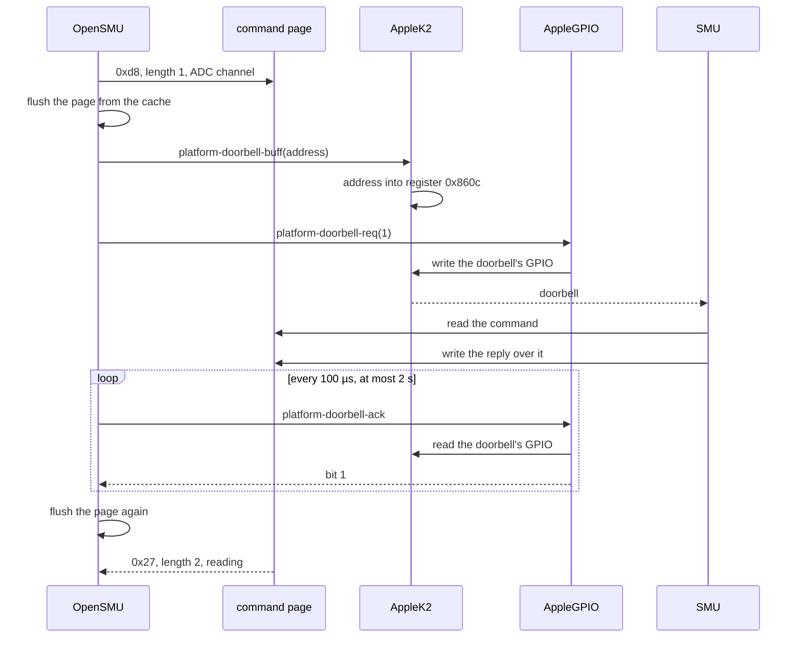
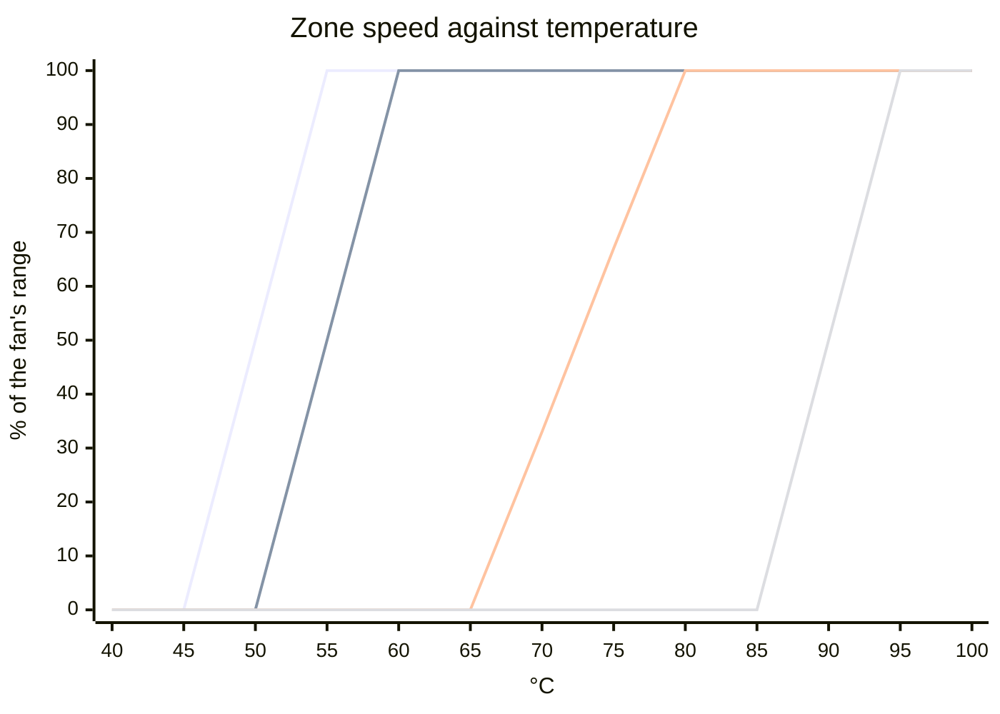
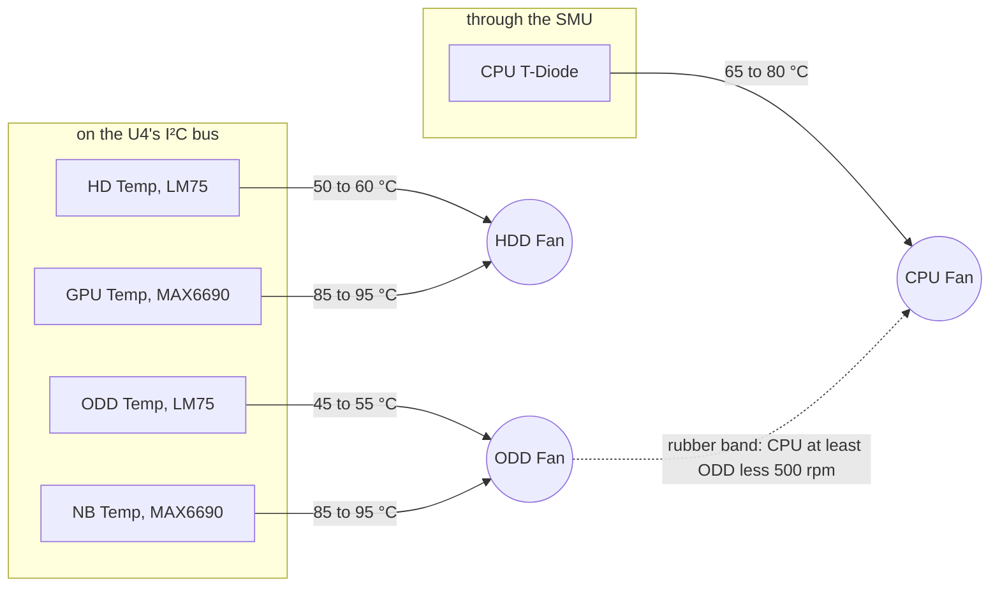
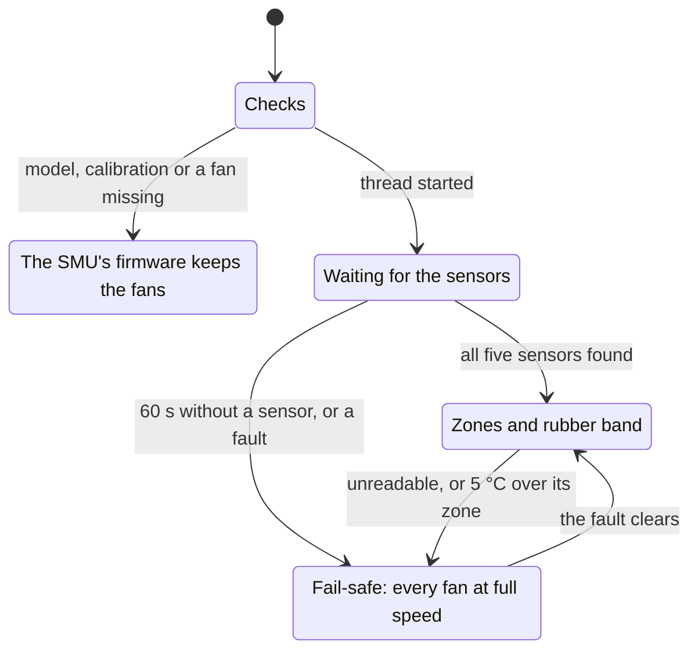

# OpenSMU

## What you will learn

- What the SMU is, what Apple's closed AppleSMU does for Leopard, and which of its jobs OpenSMU, the project's own driver, takes over.
- How a driver finds the SMU in the device tree, and how three platform functions, performed by two other drivers, carry every command to it.
- Which commands OpenSMU sends, and the arithmetic that turns the SMU's clock into the kernel's time.
- How the fan thread reads five sensors of three kinds, turns them into fan speeds through zones and a rubber band, and runs every fan at full speed when anything is wrong.
- How a kext is packaged and built, where each piece of knowledge came from and under which licence, and what OpenSMU leaves undone.

## Why a new driver

### The SMU

The iMac G5 (`PowerMac12,1`) has an SMU, a system management unit: a small processor on the logic board, with firmware of its own, that keeps running while the machine is switched off. It keeps the real-time clock, switches the power, reads temperature sensors and sets the speed of the three fans ([PowerPC Macs](../background/powerpc-macs.md)). The kernel reaches it through a driver, as it reaches any device. QEMU's `mac99` and many G4 Macs have a PMU instead, an older chip for the same jobs, with another protocol.

### What AppleSMU does on Leopard

Leopard's driver for the SMU is AppleSMU 1.2.1d1. It is closed: Leopard ships the binary, and no release of Apple's open source holds its code. On Leopard it does five things:

- It reads and sets the clock, and restarts and powers off the Mac, through two function pointers of the kernel, `PE_read_write_time_of_day` and `PE_halt_restart`.
- It publishes two IOKit resources, `IORTC` and `IOPMU`, for which other drivers wait.
- It copies the SMU's SDB partitions, numbered blocks of the SMU's own data, into the device tree's `smu` node, as properties such as `sdb-partition-18`.
- It publishes `AppleSMUDevice` nubs for the fans, for the sensors the SMU reads, and for the SMU's own I²C buses.
- It puts the machine to sleep and wakes it.

The fans are not AppleSMU's alone: on Leopard a platform plug-in, closed as well, decides each fan's speed from a thermal profile, through AppleSMU's nubs and partitions ([Step 7](../steps/step-7-fans.md)).

Rule 5 keeps every Apple binary off the image ([The rules](../method/rules.md)). Without AppleSMU the iMac still boots, but its clock starts at 1970, it cannot restart or switch itself off ([Step 5](../steps/step-5-clock-and-power.md)), the SMU's firmware runs the fans by its own loud rules ([Step 7](../steps/step-7-fans.md)), and IOKit never goes quiet ([Step 8](../steps/step-8-clean-boot.md)).

### What OpenSMU is

OpenSMU is a new kext, under the MIT licence, in [replacements/OpenSMU/](https://github.com/nyg/PowerDarwin/blob/master/replacements/OpenSMU/), recorded in DEVIATIONS.md as [D81](https://github.com/nyg/PowerDarwin/blob/master/DEVIATIONS.md#d81), a `closed-replacement`. It grew in four steps: the clock, restart and power-off for Step 5 (commit `46f349e`), the fans for Step 7 (`3fe1c44`, then `d6316f8` for the LM75 readings), the `IOPMU` resource for Step 8 (`fd34289`), and, after Step 7's tests, Apple's pairs of sensor and fan, the rubber band and the thermal-model check, not yet boot-tested ([below](#what-the-tests-showed-and-what-is-still-to-test)).

| File | What it holds |
|---|---|
| [OpenSMU.cpp](https://github.com/nyg/PowerDarwin/blob/master/replacements/OpenSMU/OpenSMU.cpp) | `start`, the command path to the SMU, the clock, restart and power-off, the two resources |
| [FanControl.cpp](https://github.com/nyg/PowerDarwin/blob/master/replacements/OpenSMU/FanControl.cpp) | the fan thread: sensors, fans, zones, rubber band, fail-safe and registry properties |
| [OpenSMU.h](https://github.com/nyg/PowerDarwin/blob/master/replacements/OpenSMU/OpenSMU.h) | the class and the structures the two files share |
| [Info.plist](https://github.com/nyg/PowerDarwin/blob/master/replacements/OpenSMU/Info.plist), [OpenSMU_info.c](https://github.com/nyg/PowerDarwin/blob/master/replacements/OpenSMU/OpenSMU_info.c), [Makefile](https://github.com/nyg/PowerDarwin/blob/master/replacements/OpenSMU/Makefile), [LICENSE](https://github.com/nyg/PowerDarwin/blob/master/replacements/OpenSMU/LICENSE) | the packaging, the build and the licence |

Of AppleSMU's five jobs, OpenSMU does the first two, and runs the fans in place of both AppleSMU and the platform plug-ins. It copies no partition into the device tree, publishes no nub, and never sleeps.

## Finding the SMU

### The `smu` node

Open Firmware describes the machine to the kernel as a device tree, and IOKit makes a nub, an entry in its registry, for each node ([The boot chain](../background/boot-chain.md)). The SMU is a node named `smu`. OpenSMU's Info.plist holds one personality, the description of what a driver matches: it asks IOKit to start the class `OpenSMU` on a nub of the class `IOPlatformDevice` whose name is `smu` (`IONameMatch`), as AppleSMU's personality does.

The node also tells a driver how to talk to the SMU. It carries three properties named after platform functions, `platform-doorbell-buff`, `platform-doorbell-req` and `platform-doorbell-ack`. Each holds a phandle, Open Firmware's number for a node: the node whose driver performs that function. On the iMac, as Leopard's IORegistry shows, `-buff` names the K2, the I/O controller, and `-req` and `-ack` name `smu-doorbell`, one of the K2's GPIO lines, its general-purpose inputs and outputs.

### Platform functions

A platform function is a small operation on hardware that one driver owns and another needs: set a GPIO line, write a register, read a chip over I²C. Apple's device trees for PowerPC Macs describe each one as data, on the node of the hardware it touches, in a property whose name starts with `platform-do-`. The data is a short program: the phandle of the node it serves, flags that say when it runs (at start, at stop, at sleep, at wake, on demand) and whether it can raise an interrupt, then one or more commands from a fixed list. That list is in `IOPlatformFunction.h`, which AppleKeyLargo and AppleGPIO each carry. On the iMac each doorbell function is one command:

| Property | On the node of | Performed by | Command | Effect |
|---|---|---|---|---|
| `platform-do-doorbell-buff` | the K2 | AppleK2 | `0x1d`, write a 32-bit register, with a shift and a mask | writes the value it is given into the K2's register at offset `0x860c` |
| `platform-do-doorbell-req` | `smu-doorbell` | AppleGPIO | `0x1`, write a GPIO | writes bit 0 of the doorbell line's register |
| `platform-do-doorbell-ack` | `smu-doorbell` | AppleGPIO | `0x2`, read a GPIO, with a mask, a shift and an XOR | returns bit 1 of the same register |

AppleGPIO does not touch the K2's registers itself. It hands each read or write to MacIOGPIO, the driver of the K2's block of GPIO lines, from the same AppleGPIO project, which asks AppleK2 to do it. The ack function's flags also allow an interrupt, and AppleGPIO publishes `register-doorbell-ack-…` and `enable-doorbell-ack-…` functions for it, so a driver could be called back when the SMU answers. OpenSMU does not use them: it polls, asking again and again until the answer is there.

### Resources and `callPlatformFunction`

A driver finds the one that performs a function through IOKit resources. A resource is a name that a driver publishes on IOKit's `IOResources` entry, with an object as its value, so that others can wait for it. AppleK2 and AppleGPIO each publish one for every function they perform, named after the function and the phandle of the node it serves, such as `platform-doorbell-buff-` and eight hex digits, with themselves as the value ([Step 5](../steps/step-5-clock-and-power.md)).

OpenSMU's `findFunction` builds each of the three names from the `smu` node's `AAPL,phandle` property, the phandle as IOKit keeps it, and waits up to 30 seconds for each with `waitForService(resourceMatching(name))`. If one is missing, OpenSMU logs `OpenSMU: <name> did not show up` and does not start.

From then on, OpenSMU calls each function with `callPlatformFunction`, IOKit's call by which one driver asks another to perform a named function, with up to four arguments: the command's physical address for `-buff`, the value 1 for `-req`, and for `-ack` a pointer to the word that receives the answer.

## One command

### The command page

The kernel leaves each command in a page of memory, tells the SMU where it is and rings the doorbell; the SMU reads the command, a form of DMA ([Hardware and boot basics](../background/hardware-basics.md)), and writes its reply over it, with the command's bits inverted in byte 0. [Step 5](../steps/step-5-clock-and-power.md) gives the page's layout. OpenSMU allocates the page, 4 KB on a page boundary, with `IOMallocAligned`, asks the kernel's map of its own memory, with `pmap_find_phys`, for the physical address that the SMU must be given, and refuses to start if that address lies above 4 GB, past the doorbell register's 32 bits.

### Reading the CPU diode, step by step



`OpenSMU::sendCommand` does the same for every command, under a lock, since the kernel's clock and power calls and the fan thread can all send one, and with the two cache flushes that [Step 5](../steps/step-5-clock-and-power.md) explains, made with `flush_dcache`: the command's bytes before it rings, the header and the longest reply, 255 bytes, after. It then checks the reply. No answer in 2 seconds gives `kIOReturnTimeout`; a byte 0 that is not the command inverted, `0x27` for `0xd8`, gives `kIOReturnIOError`; a reply shorter than expected, `kIOReturnUnderrun`. Each failure is logged as `OpenSMU: command 0x.. failed with 0x........, buffer holds 0x.. 0x..`, with the first two bytes the SMU left.

## The commands

Apple never documented the SMU's commands. They are known from NetBSD's driver for the same chip, [`smu.c`](https://github.com/NetBSD/src/blob/trunk/sys/arch/macppc/dev/smu.c), under the BSD licence, and OpenSMU speaks the same protocol without its code. These are the ones OpenSMU sends:

| Command | Data sent | Reply | Used for |
|---|---|---|---|
| `0x8e` | `0x81` | 7 bytes, the date in BCD | reading the clock |
| `0x8e` | `0x80`, then the date as 7 bytes in BCD | nothing | setting the clock |
| `0xaa` | `RESTART` or `SHUTDOWN`, with its final zero byte | nothing | restarting, powering off |
| `0xd8` | an ADC channel | 2 bytes, the ADC's reading | the CPU diode |
| `0x4a` | `0x30`, the fan's register, the speed in 2 bytes | nothing | setting a fan's speed |
| `0x4a` | `0x31`, the fan's register | 2 bytes, the speed | reading a fan's speed |
| `0x4a` | `0x00`, a mask of fans, then 2 bytes per fan, 14 bytes in all | nothing | setting a fan's speed, older form |
| `0x4a` | `0x01` | 1 byte, then 2 bytes per fan | reading the fans' speeds, older form |
| `0x3e` | `0x01`, a partition's ID | 2 bytes, the partition's address | finding an SDB partition |
| `0xee` | `0x02`, 4, 0, 0, the address in 2 bytes, a length | the partition's bytes, its ID first | reading an SDB partition |

Speeds are in rpm, high byte first, as PowerPC stores numbers ([Hardware and boot basics](../background/hardware-basics.md)). The older fan commands are those NetBSD's driver falls back to. OpenSMU tries `0x30` first; if the SMU refuses it and takes the older form, OpenSMU uses the older form from then on and logs `OpenSMU: the SMU takes the old fan commands`.

OpenSMU reads two SDB partitions. Partition `0x18` holds the CPU diode's calibration, its slope in bytes 4 and 5 and its offset, a signed number, in bytes 6 and 7. Partition `0x25` holds, in byte 4, the thermal model, which tells the two iMac G5 models apart: 2 for the 17-inch, 3 for the 20-inch, both `PowerMac12,1`. In both, byte 0 is the partition's own ID, which OpenSMU checks. Apple's plug-in reads more of them: `0x12` for the processor's highest allowed temperature, `0x17` for the CPU fan loop's settings, `0x21` for the constants that turn the processor's current and voltage into watts.

## The clock

The SMU keeps the date as seven bytes in BCD, binary-coded decimal, with a two-digit year from 2000, and ApplePlatformExpert, the kernel's platform expert for Apple's PowerPC Macs, wants one number, the seconds since 1 January 1904 in local time ([Step 5](../steps/step-5-clock-and-power.md) gives both formats).

### Days since 1904

So OpenSMU's `readWriteTimeOfDay`, the function it puts in `PE_read_write_time_of_day`, turns a date into a count of days, and back. It uses the public-domain [date algorithms](https://howardhinnant.github.io/date_algorithms.html) of Howard Hinnant, which count days with integer arithmetic only, without a table of month lengths:

1. Start the year on 1 March. January and February count as the last two months of the year before. The leap day then falls on the last day of a year, and every month before it has a fixed length.
2. Split the years into eras of 400 years. The Gregorian calendar repeats every 400 years, so every era has 146,097 days: 400 × 365, and 97 leap days.
3. In its era, a year's first day lies 365 days per year after the era's start, plus one day every 4 years, less one every 100.
4. In its year, a day lies `(153 × m + 2) / 5 + day − 1` days after 1 March, where `m` counts the months from March as 0, in integer division. The formula gives the pattern of month lengths from March on, 31, 30, 31, 30, 31.
5. The sum counts days from 1 March of year 0. Taking away 719,468 makes it days from 1 January 1970, and adding 24,107, the days from 1904 to 1970, days from 1 January 1904.

For Saturday 21 November 2026, the day Step 5 was reached: November is month 8 counted from March, so the day lies `(153 × 8 + 2) / 5 + 21 − 1`, or 265 days, into the year; 2026 is year 26 of the era that starts in 2000, era 5, so the day is 26 × 365 + 6 + 265, or 9,761 days, into the era. Then 5 × 146,097 + 9,761 − 719,468 + 24,107 gives 44,885 days since 1904. The way back runs the same steps in reverse, in `dateFromDaysSince1904`. The day of the week, which the SMU wants when the clock is set, is `(days + 5) mod 7`, counted from Sunday as 0, since 1 January 1904 was a Friday: here 6, a Saturday.

### A number too large for its type

At 12:00:00 that day, the clock reads 44,885 × 86,400 + 43,200, or 3,878,107,200 seconds since 1904. The kernel passes the number as a `long`, which on 32-bit PowerPC is signed and holds at most 2,147,483,647, about 68 years: seconds since 1904 have not fitted in it since 1972. The number wraps around to −416,860,096. It works all the same, because ApplePlatformExpert only adds and subtracts offsets, and they wrap around the same way: −416,860,096 less 2,082,844,800, the seconds from 1904 to 1970, wraps back to 1,795,262,400, which is the Unix time of that moment if the time-zone offset is zero. OpenSMU treats the number as unsigned. On reading, it also checks that the month lies between 1 and 12 and the day between 1 and 31, and otherwise reports a failure to the kernel rather than a date made from garbage. With a two-digit year from 2000, its clock covers the years 2000 to 2099.

## `IORTC` and `IOPMU`

Once the command page and the three functions are ready, `start` fills in the kernel's two hooks with `readWriteTimeOfDay` and `haltRestart`, which sends `SHUTDOWN` or `RESTART` ([Step 5](../steps/step-5-clock-and-power.md)). It then publishes two resources, each with OpenSMU as its value, calls `registerService` so that other drivers can match it, and starts the fans.

- `IORTC` ends ApplePlatformExpert's wait of up to 30 seconds for the clock ([Step 5](../steps/step-5-clock-and-power.md)).
- `IOPMU` is the name under which a Mac's power controller announces itself. AppleMacRISC4PE's `MacRISC4CPU::start` waits for it with no time-out before it returns, and AppleU3, the platform driver's class for the north bridge, waits for it in its sleep path. Both keep the value as their "PMU", and call it only to put the machine to sleep (`sleepNow`) or to change the processor's speed (`setSpeedNow`). The image does neither, and OpenSMU handles neither call.

Until OpenSMU published `IOPMU`, IOKit never went quiet on the iMac; in QEMU, whose processor driver waits for a driver of the class `ApplePMU`, it still does not ([Step 8](../steps/step-8-clean-boot.md)).

## The fans

### What starts the thread

`startFanControl` runs at the end of `start` and checks five things in turn. If any is missing, it leaves the fans to the SMU's firmware, loud but safe, and for all but the last logs why. The clock and the power work either way.

1. The model and the thermal model. It reads byte 4 of SDB partition `0x25` and looks in its table for the root node's `model` with that thermal model. The table has one row, `PowerMac12,1` with thermal model 2; else it logs `OpenSMU: no fan zones for this model and thermal model <n>, the SMU keeps the fans`.
2. The calibration, from SDB partition `0x18`; else `OpenSMU: no CPU diode calibration, the SMU keeps the fans`.
3. The fans. Under the `smu` node, a node named `fans` (or `rpm-fans`) holds one child per fan, of type `fan-rpm-control`, with a `location`, here `CPU Fan`, `HDD Fan` and `ODD Fan`, the last for the optical disc drive, a `reg`, the fan's register in the SMU, and its lowest and highest speeds, `min-value` and `max-value`. OpenSMU keeps at most four, whose register is below 4.
4. Every fan that a zone names is among them, else `OpenSMU: no <fan> in the device tree, the SMU keeps the fans`, and both fans of the rubber band, else `OpenSMU: no <fan> or <fan> in the device tree, the SMU keeps the fans`.
5. A kernel thread, made with `IOCreateThread`; this last failure is not logged.

It then logs `OpenSMU: thermal model 2, 3 fans, 5 zones, CPU diode slope 0x… offset …`, with the calibration's two numbers.

### The sensors in the device tree

The sensors are nodes of type `temp-sensor`, each with a `location` and a `reg`, whose parent says how to reach them:

- under a node whose `compatible` is `smu-sensors`, the SMU reads the sensor itself, and `reg` is its ADC channel;
- under a node whose `compatible` is `lm75` or `max6690`, the sensor is in that chip, the chip's own `reg` holds its I²C address, and for a MAX6690 the sensor's `reg` says which of its two channels.

| Location | Sensor | Reached through | Steps of |
|---|---|---|---|
| `CPU T-Diode` | a diode on the processor chip, read by the SMU's ADC | SMU command `0xd8` | as the calibration gives |
| `HD Temp` | LM75 beside the disk | the U4's I²C bus | 0.5 °C |
| `ODD Temp` | LM75 beside the optical drive | the U4's I²C bus | 0.5 °C |
| `GPU Temp` | MAX6690, remote channel | the U4's I²C bus | 0.125 °C |
| `NB Temp` | MAX6690, remote channel | the U4's I²C bus | 0.125 °C |

`bindSensor` walks the whole device tree for each zone's location and takes the first node that fits. A chip's node becomes a nub that can be called only once IOI2CFamily has started and published its bus, which can come after OpenSMU starts, so the thread, not `startFanControl`, binds the sensors, pass after pass.

### Reading over I²C

The four chips sit on the U4's I²C bus, which our IOI2CFamily drives ([Step 7](../steps/step-7-fans.md)). OpenSMU fills in an `IOI2CCommand`, IOI2CFamily's description of one transfer: a read, the chip's address, the sub-address of the register to read, the byte count, combined mode (the register's number is written, then the bytes read, in one transfer), and two retries. It then calls the platform function `IOI2CReadI2CBus` on the chip's nub, passing the command and the default client key, with which IOI2CFamily takes and releases the bus around the transfer. A nub that does not handle a platform function passes it to its provider, so the call goes up to IOI2CFamily's bus, which adds its bus number, and to the controller, which runs the transfer. The names come from `IOI2CDefs.h`, a header that IOI2CFamily installs only in its private `IOI2C.framework`.

### Temperatures as integers

Every temperature in OpenSMU is in 16.16 fixed point: an integer whose upper 16 bits hold whole degrees and lower 16 bits fractions of a degree, so that 65,536 is 1 °C, and a negative temperature is negative. Apple's drivers report temperatures the same way: Leopard's IORegistry gives the processor's highest allowed temperature, 85 °C, as 5,570,560. OpenSMU is compiled with `-msoft-float`, as Xcode compiles most of Apple's kexts, and uses no floating point; fixed point lets integers carry fractions.

The three kinds of sensor each have their own format. `readSensor` turns each into 16.16:

```cpp
   case kSensorADC:
      sensor->temperature = (SInt32)(((UInt64)((data[0] << 8) | data[1]) * fDiodeSlope) >> 3) * 2
         + fDiodeOffset * 1024;
      return true;
   case kSensorLM75:
      sensor->temperature = (SInt16)(((data[0] << 8) | data[1]) & 0xff80) * 256;
      return true;
   case kSensorMAX6690:
      sensor->temperature = (SInt8)data[0] * 65536 + ((data[1] & 0xe0) << 8);
      return true;
```

- The CPU diode. The SMU's ADC turns its voltage into a 16-bit number ([Step 7](../steps/step-7-fans.md)), which the slope from partition `0x18` scales and the offset, times 1,024, shifts into 16.16.
- The LM75. Its temperature register, register 0, is 16 bits wide, read high byte first, and OpenSMU keeps its top 9 bits, the temperature in half degrees, with the mask `0xFF80` ([Step 7](../steps/step-7-fans.md) tells why). Read as a signed number of 1/256 degrees, the high byte holds whole degrees and the top bit of the low byte the half, so multiplying by 256 makes 16.16: `0x2B80` is 43.5 °C.
- The MAX6690. It has two channels: a local one, the chip's own temperature, and a remote one, a diode in another chip, here the GPU or the north bridge. Each channel has a main register, a signed byte of whole degrees (`0x00` local, `0x01` remote), and an extended register whose top 3 bits are eighths of a degree (`0x11` local, `0x10` remote). OpenSMU reads both, as AppleHWSensor's `IOI2CMaxim6690` does: a main register of `0x54` with an extended register of `0x20` is 84.125 °C.

The device tree's `GPU Temp` and `NB Temp` are the MAX6690s' remote channels, and their local channels are `GPU Ambient` and `NB Ambient`. Apple's thermal profile names the sensors of its GPU and north bridge loops `GPU_AMBIENT` and `NB_AMBIENT`, but by `sensor-id` its loops use the remote channels, the same two that OpenSMU reads.

### Apple's control, for comparison

Leopard's plug-in, and Tiger's published source for it in AppleMacRISC4PE 186.3.1, run one loop per sensor towards a target temperature, with a rubber band and a floor from the processor's power ([Step 7](../steps/step-7-fans.md)). Each is a PID loop: it sets its output from the error, how far the reading is from the target (proportional), the error added up over time (integral, which Apple calls reset), and how fast the error changes (derivative, zero in these loops), and so finds by itself the speed that holds its sensor at the target. In front of each fan, a virtual control takes the highest speed its loops ask for, then applies the two floors.

### OpenSMU's zones

OpenSMU keeps Apple's pairs of sensor and fan, the rubber band, and the rule that the highest request wins, and replaces each PID loop with a zone, which asks for a fan's lowest speed below one temperature of its sensor, its highest above another, and a speed in proportion between, as in NetBSD's [`fancontrol.c`](https://github.com/NetBSD/src/blob/trunk/sys/arch/macppc/dev/fancontrol.c) ([Step 7](../steps/step-7-fans.md)). The temperatures are OpenSMU's own, placed around Apple's targets:

| Zone's sensor | Fan | Zone | Apple's target | Full speed from |
|---|---|---|---|---|
| `CPU T-Diode` | CPU | 65 to 80 °C | 80 °C | 85 °C |
| `HD Temp` | HDD | 50 to 60 °C | 55 °C | 65 °C |
| `GPU Temp` | HDD | 85 to 95 °C | 90 °C | 100 °C |
| `ODD Temp` | ODD | 45 to 55 °C | 50 °C | 60 °C |
| `NB Temp` | ODD | 85 to 95 °C | 85 °C | 100 °C |

The last column is the fail-safe's threshold, 5 °C above the zone's top ([The loop and its states](#the-loop-and-its-states)).

The chart shows each zone's speed as a share of its fan's range, from its lowest speed, 0 %, to its highest, 100 %. From left to right, the lines are the optical drive's zone, the disk's, the CPU's, and the GPU's and north bridge's, which share one line.



`zoneRPM` works in 1/256 of a degree, the 16.16 temperature divided by 256: it takes the temperature less the zone's lower bound, and, if that is between zero and the zone's width, the fan's lowest speed plus its range times that share of the width. With the north bridge at 87.5 °C, a quarter of the way into its zone, the ODD fan is asked for its lowest speed plus a quarter of its range.

A zone does not hold a temperature at a target, as a PID loop does. It gives one speed for each temperature, and the temperature settles where that speed carries away the heat. On the iMac the north bridge settled at idle just inside its zone, with the two fans it then drove just above their lowest speeds ([Step 7](../steps/step-7-fans.md)).

### Each fan's target

Each pass starts every fan at its lowest speed. Each zone then asks for its speed, and a fan keeps the highest it is asked for: the HDD fan follows the hotter of the disk's and the GPU's zones, the ODD fan the optical drive's and the north bridge's. Last, the rubber band raises the CPU fan, if needed, to the ODD fan's target less 500 rpm, but never above the CPU fan's highest speed. The ODD fan's lowest speed is 1,000 rpm and the CPU fan's 1,200 ([Step 7](../steps/step-7-fans.md)), so the rubber band does nothing until the ODD fan passes 1,700 rpm: only then does 500 rpm below it exceed the CPU fan's own floor.



### The loop and its states

The thread runs one pass every 2 seconds:

1. Bind each zone's sensor that is not found yet.
2. Read every sensor that is found, and note the first fault: a sensor still missing after 30 passes, 60 seconds; a sensor that cannot be read; or a reading 5 °C or more above its zone's upper temperature.
3. If some sensor is still missing and there is no fault, publish the readings and wait for the next pass, without touching the fans: the SMU's firmware still runs them.
4. Otherwise work out the targets: on a fault, every fan at its highest speed; else the zones and the rubber band, as above.
5. Log a change of state: `OpenSMU: found the 5 zone sensors, the fans follow them` the first time all are found, `OpenSMU: fans at full speed: <sensor> <fault>` on a fault, such as `not found`, `unreadable` or `over its limit`, and `OpenSMU: fans back under zone control` when it clears.
6. Set each fan's speed, with `0x4a`, and read back its current speed.
7. Publish the readings in the IORegistry, and sleep for 2 seconds with `IOSleep`.



One bad sensor sends every fan to full speed, not only the fan of its zone ([Step 7](../steps/step-7-fans.md) gives the reason). Apple's loops have a fail-safe state of their own; OpenSMU's rule is its own.

### What it publishes

After each pass, OpenSMU sets three properties on its own registry entry, which `ioreg -c OpenSMU` prints, with `ioreg` from IOKitTools 76:

- `Sensors`, an array with one dictionary per sensor read in the pass, holding its `location` and its `current-value` in 16.16;
- `Fans`, an array with one dictionary per fan, holding its `location`, its `target-value` and its `current-value`, both in rpm;
- `Failsafe`, true while every fan runs at full speed.

### What the tests showed, and what is still to test

Step 7's tests, the tenth and eleventh boot tests on the iMac G5, were of the version before this one, whose optical drive and north bridge zones also drove the CPU fan, without the rubber band or the thermal-model check; it held the fans within about 50 rpm of Leopard's idle targets ([Step 7](../steps/step-7-fans.md) gives the numbers).

The version this chapter describes, with Apple's pairs, the rubber band and the thermal-model check, was booted twice in the Step 10 boot test on the iMac G5. Both times OpenSMU logged thermal model 2, three fans and five zones, then `found the 5 zone sensors, the fans follow them`, and never fell back to full speed or to the SMU's firmware. About 10 and 12 minutes after boot, `ioreg` showed `Failsafe` false and every sensor below its zone: the CPU at 55.3 and 56.0 °C, the disk at 43.5, the GPU at 83.1, the optical drive at 41.5 and 42.0, and the north bridge at 82.8. The three fans ran at their lowest speeds, ODD 1,000, HDD 1,200 and CPU 1,200 rpm, read back within 2 rpm: the CPU fan no longer follows the north bridge. Two `yes > /dev/null` for 2 minutes took the CPU to 60.7 °C, still below the 65 °C where its zone starts, so the CPU fan stayed at 1,200 rpm.

Two parts had nothing to do in that test. The rubber band did not act, since the ODD fan's target never rose more than 500 rpm above the CPU fan's, and the CPU's zone did not start; it did in Step 7's tests, with the same bounds, when two `yes` took the processor to 68.7 °C.

## Packaging a kext

### The bundle

A kext is a bundle, a folder that the system treats as one thing: `OpenSMU.kext/Contents/Info.plist`, which says what the kext is and what it matches, and `OpenSMU.kext/Contents/MacOS/OpenSMU`, its code. The Info.plist's main keys:

| Key | Value | Meaning |
|---|---|---|
| `CFBundleIdentifier` | `io.github.nyg.driver.OpenSMU` | the kext's unique name, after the project's GitHub account |
| `CFBundleVersion` | `1.0` | its version, which another kext could require |
| `CFBundleExecutable` | `OpenSMU` | its code, in `Contents/MacOS` |
| `IOKitPersonalities` | one personality, `OpenSMU` | `IOClass` `OpenSMU`, `IOProviderClass` `IOPlatformDevice`, `IONameMatch` `smu` |
| `OSBundleLibraries` | `com.apple.kernel.6.0`, 7.9.9 | what its code links against |
| `OSBundleRequired` | `Root` | needed at boot, so it goes into the driver cache |

`com.apple.kernel.6.0` lets a kext link against every symbol the kernel exports. OpenSMU needs more than IOKit's classes: it calls `pmap_find_phys` and `flush_dcache` and reads `kernel_pmap`, from the kernel's memory code, and sets `PE_halt_restart` and `PE_read_write_time_of_day`.

### The kmod information

Every kext carries a `kmod_info` structure, with its name and version, which the kernel's loader reads. [OpenSMU_info.c](https://github.com/nyg/PowerDarwin/blob/master/replacements/OpenSMU/OpenSMU_info.c) makes it with `KMOD_EXPLICIT_DECL`, naming `_start` and `_stop`, which `libkmod.a` and `libkmodc++.a`, from xnu, supply. A C++ driver has no `main` of its own, so the file sets `_realmain` and `_antimain`, the hooks for one, to zero.

### The Makefile

darwinbuild builds a project by running `make install` in its source, with `SRCROOT`, `OBJROOT`, `SYMROOT` and `DSTROOT` naming the source, the scratch folders and the Root to install into ([darwinbuild and the build machine](../method/darwinbuild.md)). OpenSMU's Makefile compiles with `gcc-4.0` and `g++-4.0`, the release's compilers under rule 4, and the flags Xcode gives Apple's kexts, among them:

- `-arch ppc`, written in the Makefile, which matches the build list's `RC_ARCHS = ppc`;
- `-nostdinc` with the headers of `Kernel.framework`, since kernel code cannot use the user programs' C library, and IOI2CFamily's `PrivateHeaders` folder for `IOI2CDefs.h`;
- `-fno-rtti -fno-exceptions -fapple-kext`, the restricted C++ of IOKit, without run-time type information or exceptions;
- `-msoft-float`, `-static` and `-mlong-branch`: no floating point, no shared library, and calls that can reach any address, since the loader puts a kext wherever the kernel has room;
- `-DKERNEL -DKERNEL_PRIVATE -DDRIVER_PRIVATE`, which open the kernel headers' parts meant for drivers, and `-Wall -Werror`, so that a warning stops the build.

It links the objects with `-r`, into one relocatable object that the kernel's loader links when it loads the kext, with `-lkmodc++ -lkmod`, and strips the debugging symbols with `strip -S`. Its `installhdrs` target is empty, as OpenSMU installs no header.

### In the build list

Its entry in [manifest/plists/9A581.plist](https://github.com/nyg/PowerDarwin/blob/master/manifest/plists/9A581.plist) gives version 1.0, xnu for its headers and `libkmod.a`, IOI2CFamily for `IOI2CDefs.h`, the tools a Makefile needs, and `RC_ARCHS = ppc`. `scripts/stage-sources <host> OpenSMU=1.0` copies its source from `replacements/` as it would unpack one of Apple's tarballs, and it builds in 1 to 6 seconds.

### Checking it against Leopard's kernel

Leopard's `kextload -n` linked each build against Leopard's kernel, the same xnu 1228.15.4 as ours, without loading it ([How testing is done](../method/testing.md)), and caught one import that the kernel does not export, `strlcpy` ([Step 7](../steps/step-7-fans.md)). The lesson carries over to any kext written for this kernel: its headers declare more than it exports.

## Licences, and where the knowledge came from

OpenSMU's code is the project's, under the MIT licence in its own [LICENSE](https://github.com/nyg/PowerDarwin/blob/master/replacements/OpenSMU/LICENSE). What it knows about the hardware came from others, each under its own licence, and only facts and values were taken:

| Source | Licence | What OpenSMU takes from it |
|---|---|---|
| NetBSD's `smu.c` | BSD | the SMU's protocol: the command page, the commands, the clock's format, the SDB partitions, the CPU diode's calibration; no code |
| NetBSD's `fancontrol.c` | BSD | zones as the way to run the fans; no code |
| Linux's `smu.c` and `windfarm_pm121.c` | GPL-2.0-only | read for facts only; no code |
| AppleMacRISC4PE 186.3.1, `PowerMac12_1PlatformPlugin` and `PowerMac12_1_ThermalProfile` 1.8.6f1 | APSL | which sensor drives which fan, the targets around which the zones sit, the rubber band, the thermal-model byte; no code |
| AppleHWSensor 190, `IOI2CLM7x` and `IOI2CMaxim6690` | APSL | the chips' registers and scaling, such as the mask `0xFF80`; no code |
| IOI2CFamily 111.0.2 | APSL | its header `IOI2CDefs.h` at build time, and its platform function at run time |
| Howard Hinnant's date algorithms | public domain | the day counts |
| The iMac's device tree, and Leopard's IORegistry | | node and property names, the platform functions, and values to compare with |

Tiger's thermal profile is published source, so the fan values come from a published source. Leopard's closed profile, version 3.4.0d0, holds the same values: its `IOPlatformThermalProfile` dictionary is identical to 186.3.1's.

## What OpenSMU does not do

- No PID loops: zones with bounds of its own, around Apple's targets.
- No floor from the processor's power, which held Leopard's fans up under load ([Step 7](../steps/step-7-fans.md)). It would need the processor's current and voltage through the SMU's ADC, and the constants in SDB partition `0x21`.
- No CPU loop of Apple's kind, whose gains and target come from the SMU and whose integral term works on the processor's power.
- One machine only: the 17-inch iMac G5, thermal model 2. On the 20-inch, whose profile pairs other fans, and on every other model, the fans stay with the SMU's firmware ([Step 7](../steps/step-7-fans.md)).
- No `AppleSMUDevice` nubs and no `sdb-partition-*` properties in the device tree. Tiger's published plug-ins look for both, from the driver that publishes `IOPMU`, so they cannot run on OpenSMU as it is.
- No sleep, no wake, no change of processor speed, and none of the calls that come through `IOPMU` for them.
- No interrupt from the doorbell: OpenSMU polls.
- Nothing for the PMU, which QEMU and many G4 Macs have ([What's next](../steps/whats-next.md)).

## Where to look

- [replacements/OpenSMU/](https://github.com/nyg/PowerDarwin/blob/master/replacements/OpenSMU/): [OpenSMU.cpp](https://github.com/nyg/PowerDarwin/blob/master/replacements/OpenSMU/OpenSMU.cpp), [FanControl.cpp](https://github.com/nyg/PowerDarwin/blob/master/replacements/OpenSMU/FanControl.cpp), [OpenSMU.h](https://github.com/nyg/PowerDarwin/blob/master/replacements/OpenSMU/OpenSMU.h), [Info.plist](https://github.com/nyg/PowerDarwin/blob/master/replacements/OpenSMU/Info.plist), [OpenSMU_info.c](https://github.com/nyg/PowerDarwin/blob/master/replacements/OpenSMU/OpenSMU_info.c), [Makefile](https://github.com/nyg/PowerDarwin/blob/master/replacements/OpenSMU/Makefile), [LICENSE](https://github.com/nyg/PowerDarwin/blob/master/replacements/OpenSMU/LICENSE).
- [D81](https://github.com/nyg/PowerDarwin/blob/master/DEVIATIONS.md#d81), OpenSMU's row in DEVIATIONS.md.
- [manifest/plists/9A581.plist](https://github.com/nyg/PowerDarwin/blob/master/manifest/plists/9A581.plist): OpenSMU's entry.
- [RESOURCES.md](https://github.com/nyg/PowerDarwin/blob/master/RESOURCES.md): NetBSD's `smu.c` and `fancontrol.c`, Linux's drivers, AppleMacRISC4PE 186.3.1, Howard Hinnant's date algorithms.
- In AppleKeyLargo-172.3.1: `IOPlatformFunction.h` (the commands of a platform function) and `AppleK2.cpp`. In AppleGPIO-131.0.0: `AppleGPIO.cpp` and `MacIOGPIO.cpp`.
- In IOI2CFamily-111.0.2: `I2CFamily/IOI2CDefs.h` and `IOI2CBus.cpp`. In AppleHWSensor-190: `IOI2CLM7x.cpp` and `IOI2CMaxim6690.cpp`.
- In AppleMacRISC4PE-204.0.9: `MacRISC4CPU.cpp` and `U3.cpp`, the waits for `IOPMU`. In AppleMacRISC4PE-186.3.1: `IOPlatformPlugins/PowerMac12_1PlatformPlugin/` and the profile in `AppleMacRISC4PE.pbproj/project.pbxproj`.
- Commits `46f349e` (Step 5), `3fe1c44` (Step 7), `d6316f8` (the LM75 mask) and `fd34289` (`IOPMU`).
- [Step 5](../steps/step-5-clock-and-power.md), [Step 7](../steps/step-7-fans.md) and [Step 8](../steps/step-8-clean-boot.md), which tell how each part was proved.
