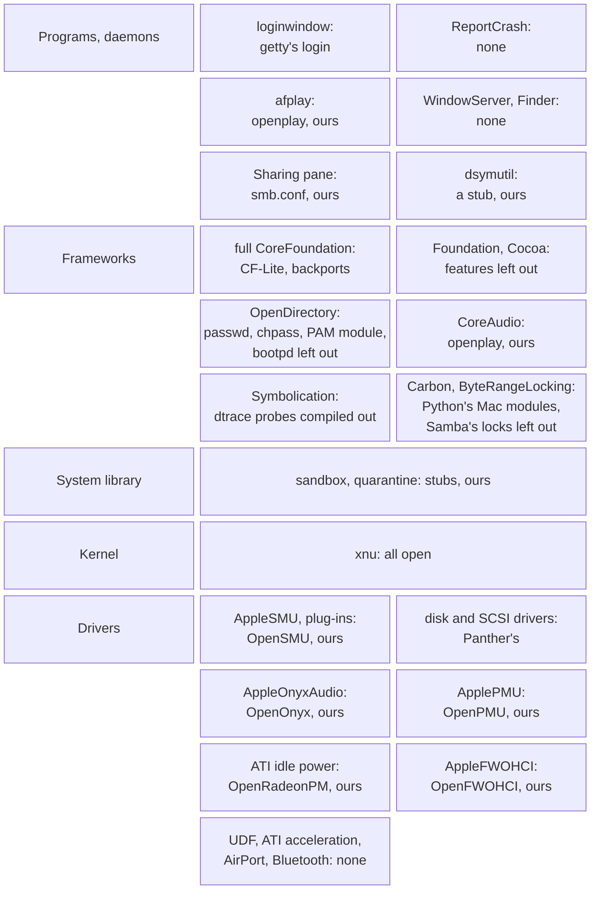

# What stays closed, and why

## What you will learn

- The four ways in which a part of Leopard can be missing from Apple's open source, and why rule 5 keeps all of them off the image.
- Every closed Apple component the project met, layer by layer: what it does on Leopard, what its absence costs on the image, and what stands in for it.
- Which closed tools run the build without reaching the image.
- What the image cannot do because of them, and which of those costs an open part could remove.

## Four ways to be missing

The book calls code "closed" when Apple ships only a binary, "open" when the project builds it from Apple's published source, and "ours" when the project wrote it ([What Darwin is](../background/what-darwin-is.md)). The parts the project could not build from Leopard's sources come in four forms:

- Closed: Apple ships the binary and has never published its source, such as AppleSMU or Foundation.
- Not published at Leopard's version: an open project whose Leopard version never appeared, such as IOATABlockStorage 200.1.8, though Panther's 130.3.1 did.
- Published empty: a source that Apple published as a stub or as empty files, such as AppleOnyxAudio or IOKitUser's HID event system.
- Prebuilt inside a source: a binary that a published source carries but cannot rebuild, such as the smart-card reader drivers in SmartCardServices.

Rule 5 keeps all four off the image: "The image holds only what is built from open source or written by this repo's scripts: no Apple binary, and no prebuilt binary that a source carries." Its reason is the project's goal, a Darwin 9 made from Apple's published sources: with a closed binary on the image, what the sources cannot do would be hidden ([The rules](../method/rules.md)). So each closed part shows up either as something missing or as an open stand-in, and this chapter lists both. It does not guess why Apple kept any part closed; it records what the sources and binaries show.

## The map

The layers of [What Darwin is](../background/what-darwin-is.md), from the programs at the top to the drivers at the bottom, with each closed piece and what takes its place on the image:

## Drivers

[hardware/powermac12-1.md](https://github.com/nyg/PowerDarwin/blob/master/hardware/powermac12-1.md) maps every driver that an iMac G5 (`PowerMac12,1`) loads under Leopard to its project. These are the closed or unpublished ones, with QEMU's ApplePMU:

| Component | What it does on Leopard | Cost on the image | Stand-in |
|---|---|---|---|
| AppleSMU 1.2.1d1 | drives the iMac's SMU: clock, restart and power-off, `IOPMU`, nubs for fans and sensors, sleep | without a stand-in: a clock from 1970 after a 30-second wait, no restart or power-off, loud fans, a 60-second wait for the network | OpenSMU ([D81](https://github.com/nyg/PowerDarwin/blob/master/DEVIATIONS.md#d81)); no sleep, no nubs |
| `IOPlatformPluginFamily` with `PowerMac12_1_PlatformPlugin`, `SMU_Neo2_PlatformPlugin` and `PowerMac12_1_ThermalProfile`, 3.4.0 | runs the fans from a thermal profile | the SMU's firmware runs the fans, loudly | OpenSMU's zones, around the targets of Tiger's published plug-in, AppleMacRISC4PE 186.3.1 ([OpenSMU](opensmu.md)) |
| ApplePMU | the PMU of QEMU's `mac99` and of many G4 Macs: clock, restart, power-off, sleep, ADB, battery and lid | without a stand-in, in QEMU: the clock starts at 1970, `reboot` stops at `MACH Reboot`, and configd waits 60 seconds | OpenPMU ([D118](https://github.com/nyg/PowerDarwin/blob/master/DEVIATIONS.md#d118), [Step 11](../steps/step-11-pmu.md)); no sleep, no PMU interrupts |
| IOATABlockStorage 200.1.8, never published | the driver of ATA and SATA disks | little: Panther's driver class is `IOATABlockStorageDriver`, where Apple's is `AppleATADiskDriver`, and the kernel notes `Extension "com.apple.iokit.IOATABlockStorage" has no explicit kernel dependency; using version 6.0.` | Panther's 130.3.1 ([D40](https://github.com/nyg/PowerDarwin/blob/master/DEVIATIONS.md#d40)) |
| IOSCSIArchitectureModelFamily 200.3.6, with its three plug-ins, never published | turns SCSI devices into disks and optical drives: CDs, DVDs, USB disks | without a stand-in, no CD or USB disk; with Panther's, no Blu-ray | Panther's 139.0.2 ([D85](https://github.com/nyg/PowerDarwin/blob/master/DEVIATIONS.md#d85), [D86](https://github.com/nyg/PowerDarwin/blob/master/DEVIATIONS.md#d86)) |
| `udf.kext` 2.0.2, with `udf.fs`, `mount_udf` and `newfs_udf` | mounts UDF, the file system of DVDs and Blu-ray discs; `newfs_udf` makes UDF volumes | a disc with only a UDF volume is not mounted, and DiskArbitration ejects it; a bridge disc mounts through its ISO 9660 volume | none ([Step 9](../steps/step-9-disks-and-devices.md)) |
| `AppleFWOHCI` | the FireWire controller's driver, a plug-in of IOFireWireFamily that no published source holds | no FireWire device appears | OpenFWOHCI ([D119](https://github.com/nyg/PowerDarwin/blob/master/DEVIATIONS.md#d119)), with no isochronous DMA; no FireWire device tested yet |
| `IOFWSimplePhysicalAddressSpace`, in IOFireWireFamily 344.4.0 and later | the physical address space that SBP-2 keeps its commands in; the published source file holds only a copyright line | IOFireWireFamily does not load | ours, in a patch ([D120](https://github.com/nyg/PowerDarwin/blob/master/DEVIATIONS.md#d120)) |
| `ATIRadeon9700`, and the ATI display drivers in `IONDRVSupport` | the GPU's acceleration and power management | the screen comes from the firmware's display driver; our OpenRadeonPM sets the GPU's clock gating and its link's L0s state, which keeps the GPU and the north bridge cooler at idle than under Leopard ([Step 13](../steps/step-13-gpu-idle-heat.md)) | OpenRadeonPM ([D117](https://github.com/nyg/PowerDarwin/blob/master/DEVIATIONS.md#d117)) |
| `IO80211Family` with `AppleAirPortBrcm4311`; `IOBluetoothFamily` | AirPort and Bluetooth | no Wi-Fi, no Bluetooth: the network is Ethernet | none |
| `IOHDIXController` | the driver of disk images | no disk-image driver | none |
| `ALF`, `AppleXsanFilter`, `TMSafetyNet`, `seatbelt` | the application firewall, Xsan, Time Machine's protection, the sandbox's policy | no firewall, no sandbox | none |
| `OSvKernDSPLib` | vector arithmetic in the kernel, which IOAudioFamily calls once | none | a loop ([D87](https://github.com/nyg/PowerDarwin/blob/master/DEVIATIONS.md#d87)) |
| `AppleOnyxAudio`, published as a stub | AppleOnboardAudio's plug-in for the iMac's PCM3052 codec | without a stand-in, no codec and no sound | OpenOnyx ([D94](https://github.com/nyg/PowerDarwin/blob/master/DEVIATIONS.md#d94)) |
| AppleDBDMAAudio's DSP, published as empty sources | processing of the sound stream | the DSP does not run | none |

[hardware/powermac12-1.md](https://github.com/nyg/PowerDarwin/blob/master/hardware/powermac12-1.md) also lists `AppleOnboardDisplay`, `AppleIRController` and `IOI2CPulsar` as closed. No step has needed them.

## Frameworks and libraries

| Component | What it does on Leopard | Cost on the image | Stand-in |
|---|---|---|---|
| The full CoreFoundation | the whole of CF, of which CF-Lite is the open part | no `CFNotificationCenter` between processes: no SystemStarter ([D21](https://github.com/nyg/PowerDarwin/blob/master/DEVIATIONS.md#d21)), no AppleRAID updates by kextd ([D28](https://github.com/nyg/PowerDarwin/blob/master/DEVIATIONS.md#d28)), no change notices from Samba's preference sync ([D109](https://github.com/nyg/PowerDarwin/blob/master/DEVIATIONS.md#d109)); no private bridging header for CFOpenDirectory; managed preferences always off | CF-Lite with Apple's later fixes ([D54](https://github.com/nyg/PowerDarwin/blob/master/DEVIATIONS.md#d54), [D56](https://github.com/nyg/PowerDarwin/blob/master/DEVIATIONS.md#d56), [D62](https://github.com/nyg/PowerDarwin/blob/master/DEVIATIONS.md#d62)); a thread in place of `CFFileDescriptor` ([D79](https://github.com/nyg/PowerDarwin/blob/master/DEVIATIONS.md#d79)) |
| Foundation, Cocoa | the Objective-C libraries of Mac OS X's programs | `arch`, USB Prober, Kerberos' login agent and ticket viewer and DirectoryService's Objective-C plug-in library are not built | a build helper rewritten on CF ([D55](https://github.com/nyg/PowerDarwin/blob/master/DEVIATIONS.md#d55)) |
| OpenDirectory, with CFOpenDirectory | changes accounts and passwords, checks password policies | no `passwd` or `chpass`, no `pam_securityserver`, no `bootpd` | `pam_unix` checks passwords, and `make-test-image` writes root's hash ([D42](https://github.com/nyg/PowerDarwin/blob/master/DEVIATIONS.md#d42), [D44](https://github.com/nyg/PowerDarwin/blob/master/DEVIATIONS.md#d44), [D66](https://github.com/nyg/PowerDarwin/blob/master/DEVIATIONS.md#d66), [D80](https://github.com/nyg/PowerDarwin/blob/master/DEVIATIONS.md#d80), [D84](https://github.com/nyg/PowerDarwin/blob/master/DEVIATIONS.md#d84)) |
| Symbolication, which `libdtrace.dylib` needs, and dtrace's tools on Foundation | tracing | no tracing: the dtrace probes of Libc, DirectoryService, Perl, Python and Ruby compile to nothing | empty probe macros ([D12](https://github.com/nyg/PowerDarwin/blob/master/DEVIATIONS.md#d12), [D75](https://github.com/nyg/PowerDarwin/blob/master/DEVIATIONS.md#d75), [D103](https://github.com/nyg/PowerDarwin/blob/master/DEVIATIONS.md#d103)), and a `dtrace` in the build environment that writes them ([D97](https://github.com/nyg/PowerDarwin/blob/master/DEVIATIONS.md#d97)) |
| The sandbox library | applies sandbox profiles | no sandbox; `update` logs its `sandbox_init` failure | a stub that always fails ([D13](https://github.com/nyg/PowerDarwin/blob/master/DEVIATIONS.md#d13)) |
| The quarantine library | marks files that came from the network | no quarantine marks, so `tar` marks no file it extracts | stubs ([D8](https://github.com/nyg/PowerDarwin/blob/master/DEVIATIONS.md#d8), [D15](https://github.com/nyg/PowerDarwin/blob/master/DEVIATIONS.md#d15), [D122](https://github.com/nyg/PowerDarwin/blob/master/DEVIATIONS.md#d122)) |
| CoreAudio | the sound interface for programs | no program but ours plays or records sound | `openplay`, through IOAudioFamily's own interface ([D95](https://github.com/nyg/PowerDarwin/blob/master/DEVIATIONS.md#d95)); CoreAudio's SDK headers for building only ([D89](https://github.com/nyg/PowerDarwin/blob/master/DEVIATIONS.md#d89)) |
| IOKitUser's HID event system, published as empty files | carries input events, through `hidd` | no `hidd`; the HID drivers work without it | none ([D22](https://github.com/nyg/PowerDarwin/blob/master/DEVIATIONS.md#d22), [D32](https://github.com/nyg/PowerDarwin/blob/master/DEVIATIONS.md#d32)) |
| CryptKit and comcryption | Security's FEE (elliptic-curve) and ASC (Apple Secure Compression) algorithms | the Apple CSP lacks those two | Apple's own `Darwin` configuration ([D51](https://github.com/nyg/PowerDarwin/blob/master/DEVIATIONS.md#d51)) |
| ApplicationServices, MediaKit, Carbon's HIToolbox, UserEventAgent | graphics, disk partitioning, the graphical toolkit, event agents | SCMonitor, the agent that offers to configure new interfaces, is not built ([D61](https://github.com/nyg/PowerDarwin/blob/master/DEVIATIONS.md#d61)) | links and includes that used nothing are removed ([D27](https://github.com/nyg/PowerDarwin/blob/master/DEVIATIONS.md#d27), [D50](https://github.com/nyg/PowerDarwin/blob/master/DEVIATIONS.md#d50), [D91](https://github.com/nyg/PowerDarwin/blob/master/DEVIATIONS.md#d91)) |
| Carbon and ApplicationServices, for Python | Python's Mac modules, its toolbox glue, and its Build Applet and Python Launcher | the 36 Mac modules of Apple's 99, such as `MacOS`, and the two applications are not built | Python's own `--disable-toolbox-glue` ([D102](https://github.com/nyg/PowerDarwin/blob/master/DEVIATIONS.md#d102)) |
| `ByteRangeLocking.framework`, private | byte-range locks that Samba's `darwin_streams` module takes with `darwin_streams:brlm = yes`, as Apple's `smb.conf` sets | none with the image's `smb.conf`, which leaves it off | Samba's own `RC_RELEASE = Darwin` switch, and a module linked without it ([D107](https://github.com/nyg/PowerDarwin/blob/master/DEVIATIONS.md#d107), [D108](https://github.com/nyg/PowerDarwin/blob/master/DEVIATIONS.md#d108)) |
| CarbonHeaders at Leopard's version, and CoreServices' copy of `MacTypes.h` | headers that many others include, such as `AvailabilityMacros.h` and `TargetConditionals.h` | the image's compiler sees Mac OS X 10.6's versions of them, which differ from Leopard's | the 9G55 Root's for building ([D10](https://github.com/nyg/PowerDarwin/blob/master/DEVIATIONS.md#d10)); CarbonHeaders 18.1 on the image ([D111](https://github.com/nyg/PowerDarwin/blob/master/DEVIATIONS.md#d111)) |
| CoreServices' umbrella header, CFNetwork | Carbon's core services, network access | Security's two plug-ins for .Mac, Apple's online service of the time, are not built | two umbrella headers for building Kerberos ([D67](https://github.com/nyg/PowerDarwin/blob/master/DEVIATIONS.md#d67)) |
| DiskImages | disk images | Security's FileVault part, in SecurityFoundation, is not built | none |
| AppleSystemInfo | reads the serial number | `pam_serialnumber`, used only by Mac OS X Server's PAM files, is not built | none ([D41](https://github.com/nyg/PowerDarwin/blob/master/DEVIATIONS.md#d41)) |
| XSEventPort | carries DirectoryService's events to the adaptive firewall | `dsPostEvent` returns 0 | DirectoryService's own switch ([D77](https://github.com/nyg/PowerDarwin/blob/master/DEVIATIONS.md#d77)) |
| Apple80211 | Wi-Fi | IPConfiguration does not read the Wi-Fi network's name | bootp's own `NO_WIRELESS` build ([D69](https://github.com/nyg/PowerDarwin/blob/master/DEVIATIONS.md#d69)) |

## Programs

| Component | What it does on Leopard | Cost on the image | Stand-in |
|---|---|---|---|
| loginwindow | the graphical login; registers the console user | no graphical login; DiskArbitration waits for a console user before mounting removable disks | getty's `login:` prompt ([Step 2](../steps/step-2-console-login.md)); `AutomountDisksWithoutUserLogin`, as on Apple's servers ([Step 9](../steps/step-9-disks-and-devices.md)) |
| WindowServer, the Finder and the applications | the graphical system | none of it | none |
| The Sharing preference pane | writes the SMB server's preferences file, from which Samba's `synchronize-preferences` turns file sharing on or off | without a stand-in, smbd is unloaded a minute after boot | `make-test-image` removes the preference job, enables `smbd.plist` and writes `smb.conf` ([D113](https://github.com/nyg/PowerDarwin/blob/master/DEVIATIONS.md#d113)) |
| `dsymutil`, Xcode's | collects a program's debugging information into a `.dSYM` bundle; gcc runs it after a one-step `-g` build | no `.dSYM` bundles; a two-step build keeps its debugging information in its object files | a script that exits 0 on the image ([D112](https://github.com/nyg/PowerDarwin/blob/master/DEVIATIONS.md#d112)), a wrapper in the build environment ([D7](https://github.com/nyg/PowerDarwin/blob/master/DEVIATIONS.md#d7)) |
| ReportCrash | writes crash reports | no crash reports; launchd and configd log its absence, and console logins log `bootstrap_look_up(com.apple.ReportCrash) failure: Unknown service name (1102)` | none |

## Binaries inside published sources

Four published sources carry binaries that cannot be rebuilt from them, and rule 5 keeps those off the image too ([The rules](../method/rules.md)): an Apple `libncurses.5.dylib` from 2006 in ncurses' source; SmartCardServices' prebuilt drivers for smart-card readers, three kexts, four bundles and `pkcs11.shlb`, which `make-test-image` leaves out; bless's 68k boot blocks, `/usr/share/misc/bootblockdata`, which it leaves out as well ([D91](https://github.com/nyg/PowerDarwin/blob/master/DEVIATIONS.md#d91)); and Python's `wininst-*.exe`, Windows programs that its `distutils` installs, which it removes too.

## Closed tools that run the build

Rule 5 lets closed tools run the build, as long as nothing of theirs reaches the image, and the MD5 check of every file on the image against the project's builds enforces it ([Making the image](../method/making-the-image.md)):

| Tool | What it does in the build |
|---|---|
| Leopard on the build machine (Sorbet Leopard, a community update of 10.5.8) | runs darwinbuild, `hdiutil` and `kextload -n`, and is the reference against which our binaries are compared |
| Xcode 3.1.4 | `xcodebuild` and its helpers, such as `copyplist`; `dsymutil`, wrapped ([D7](https://github.com/nyg/PowerDarwin/blob/master/DEVIATIONS.md#d7)) |
| darwinbuild's Roots | Apple's binaries of each project, which fill the BuildRoots until our builds replace them ([D3](https://github.com/nyg/PowerDarwin/blob/master/DEVIATIONS.md#d3)); the release's compilers among them (rule 4), until Step 10 built ours |
| Xcode's `MacOSX10.5.sdk` | headers and link stubs of what was never published: the SCSI family's headers ([D36](https://github.com/nyg/PowerDarwin/blob/master/DEVIATIONS.md#d36)), CoreAudio's ([D89](https://github.com/nyg/PowerDarwin/blob/master/DEVIATIONS.md#d89)) |
| The 9G55 CarbonHeaders Root | CarbonCore's headers, for compiling only ([D10](https://github.com/nyg/PowerDarwin/blob/master/DEVIATIONS.md#d10)) |
| The build machine's Ruby 1.8.6 and Python 2.5.1 | Xcode's `copyplist` and a script of Kerberos ([D24](https://github.com/nyg/PowerDarwin/blob/master/DEVIATIONS.md#d24), [D64](https://github.com/nyg/PowerDarwin/blob/master/DEVIATIONS.md#d64)) |
| Java on a current Mac | runs ANTLR 2.7.7, public domain, to make code signing's parser, whose output is source ([D49](https://github.com/nyg/PowerDarwin/blob/master/DEVIATIONS.md#d49)) |

## What it costs, in sum

On the iMac G5, the image is a Unix system with no graphical system: it boots, mounts its disks and USB keys, keeps time, restarts, switches off, runs its fans as quietly as Leopard, plays and records sound through `openplay`, serves SSH logins over Ethernet, compiles programs with the release's own toolchain, runs Perl, Python and Ruby, and shares a folder over SMB1. What the closed parts take away:

- the graphical system and everything built on Foundation and Cocoa;
- Wi-Fi and Bluetooth, and FireWire's audio and video streams;
- sleep, and graphics acceleration;
- discs with only a UDF volume;
- `passwd`, password policies and a DHCP server, through OpenDirectory;
- crash reports, the sandbox and the firewall;
- DTrace, Python's Mac modules, `.dSYM` bundles, and file sharing switched on from a preference pane;
- on a PMU Mac, sleep, the ADB keyboard, the battery and the lid, through ApplePMU.

Some of these could come back as open parts, on the model of OpenSMU, OpenOnyx, OpenPMU, OpenRadeonPM and OpenFWOHCI: OpenDirectory from a later open CoreFoundation, and a UDF file system from FreeBSD's. [What's next](../steps/whats-next.md) says what each would take. The graphical system is not part of Darwin at all ([What Darwin is](../background/what-darwin-is.md)).

## Where to look

- [hardware/powermac12-1.md](https://github.com/nyg/PowerDarwin/blob/master/hardware/powermac12-1.md): every driver of the iMac G5, open and closed.
- [DEVIATIONS.md](https://github.com/nyg/PowerDarwin/blob/master/DEVIATIONS.md): the `closed-replacement` and `closed-dependency` rows, and the `deferred` rows around OpenDirectory.
- [README.md](https://github.com/nyg/PowerDarwin/blob/master/README.md): rule 5, and "Hardware", whose machine pages in `hardware/` list the drivers with no published source.
- [What Darwin is](../background/what-darwin-is.md), for the layers; [The rules](../method/rules.md), for rule 5; [Kinds of deviation](kinds-of-deviation.md), for the causes behind the rows; [What's next](../steps/whats-next.md), for what could be opened.
